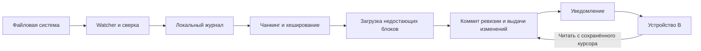
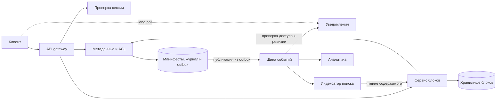

# Вопросы на собеседовании: `Design Dropbox`

`Dropbox` (Google Drive, OneDrive, iCloud Drive) — cloud file sync на 700M+ пользователей, эксабайты данных, миллиарды файлов. Кейс проверяет умение комбинировать chunking, content-addressable storage (CAS), delta sync через rolling hash (rsync), conflict resolution на mobile/desktop, multi-region replication, и собственный block storage уровня S3. Standalone сложный senior-кейс.

## Полезные ссылки

- [Dropbox Tech Blog](https://dropbox.tech/)
- [Magic Pocket — Dropbox exabyte storage (2016)](https://dropbox.tech/infrastructure/magic-pocket-infrastructure)
- [Magic Pocket follow-up (2020+)](https://dropbox.tech/infrastructure/extending-magic-pocket-innovation-with-the-first-petabyte-scale-smr-drive-deployment)
- [The rsync algorithm (Andrew Tridgell, 1996)](https://rsync.samba.org/tech_report/)
- [Content-Addressable Storage (Wikipedia)](https://en.wikipedia.org/wiki/Content-addressable_storage)
- [How Dropbox Sync works (Tech Blog)](https://dropbox.tech/infrastructure/streaming-file-synchronization)
- [System Design Primer](https://github.com/donnemartin/system-design-primer)
- [LSM trees (Cassandra/RocksDB)](https://en.wikipedia.org/wiki/Log-structured_merge-tree)

## Содержание

**Requirements и capacity**
- [Q1. (!) Functional и non-functional requirements?](#q1--functional-и-non-functional-requirements)
- [Q2. (!) Оценка нагрузки и объёмов (700M users, exabyte storage)?](#q2--оценка-нагрузки-и-объёмов-700m-users-exabyte-storage)
- [Q3. SLA и SLO для sync pipeline?](#q3-sla-и-slo-для-sync-pipeline)

**Chunking и storage**
- [Q4. (!) Chunking: фиксированные 4MB vs content-defined (CDC)?](#q4--chunking-фиксированные-4mb-vs-content-defined-cdc)
- [Q5. (!) Как устроено Content-Addressable Storage (CAS): SHA256 → location?](#q5--как-устроено-content-addressable-storage-cas-sha256--location)
- [Q6. Зачем разделять metadata и blob (Postgres + Magic Pocket)?](#q6-зачем-разделять-metadata-и-blob-postgres--magic-pocket)
- [Q7. (!) Magic Pocket — зачем Dropbox своё exabyte-хранилище?](#q7--magic-pocket--зачем-dropbox-своё-exabyte-хранилище)
- [Q8. Сжатие перед upload (LZ4 vs Zstandard)?](#q8-сжатие-перед-upload-lz4-vs-zstandard)

**Sync engine**
- [Q9. (!) Delta sync — как работает алгоритм rsync (rolling + strong hash)?](#q9--delta-sync--как-работает-алгоритм-rsync-rolling--strong-hash)
- [Q10. (!) Архитектура sync engine (watcher → diff → upload → notify)?](#q10--архитектура-sync-engine-watcher--diff--upload--notify)
- [Q11. События файловой системы (inotify / FSEvents / ReadDirectoryChangesW)?](#q11-события-файловой-системы-inotify--fsevents--readdirectorychangesw)
- [Q12. Офлайн-режим и локальный LSM-журнал?](#q12-офлайн-режим-и-локальный-lsm-журнал)
- [Q13. (!) Сервис уведомлений (long-polling vs WebSocket)?](#q13--сервис-уведомлений-long-polling-vs-websocket)
- [Q14. Selective sync и Smart Sync (ленивая загрузка)?](#q14-selective-sync-и-smart-sync-ленивая-загрузка)

**Conflict и versioning**
- [Q15. (!) Разрешение конфликтов при concurrent edits?](#q15--разрешение-конфликтов-при-concurrent-edits)
- [Q16. Версионирование (30-day history, point-in-time restore)?](#q16-версионирование-30-day-history-point-in-time-restore)
- [Q17. Корзина и retention (30-day soft delete)?](#q17-корзина-и-retention-30-day-soft-delete)

**Архитектура**
- [Q18. (!) Архитектура верхнего уровня (block + metadata + notification)?](#q18--архитектура-верхнего-уровня-block--metadata--notification)
- [Q19. (!) Мульти-регион (data residency EU, репликация)?](#q19--мульти-регион-data-residency-eu-репликация)
- [Q20. Аварийное восстановление (cross-region + erasure coding)?](#q20-аварийное-восстановление-cross-region--erasure-coding)

**Features**
- [Q21. Модель шаринга (folders, links, ACL)?](#q21-модель-шаринга-folders-links-acl)
- [Q22. Поиск (Elasticsearch по metadata + извлечение контента, OCR)?](#q22-поиск-elasticsearch-по-metadata--извлечение-контента-ocr)
- [Q23. Загрузка с мобильных (camera roll, battery-aware)?](#q23-загрузка-с-мобильных-camera-roll-battery-aware)

**Безопасность**
- [Q24. (!) Шифрование at rest и in transit?](#q24--шифрование-at-rest-и-in-transit)
- [Q25. Сквозное шифрование (E2EE) — ограничения?](#q25-сквозное-шифрование-e2ee--ограничения)
- [Q26. Защита от злоупотреблений (DMCA, malware scanning)?](#q26-защита-от-злоупотреблений-dmca-malware-scanning)

**Production**
- [Q27. (!) Обязательные метрики мониторинга?](#q27--обязательные-метрики-мониторинга)
- [Q28. Квоты и throttling на пользователя?](#q28-квоты-и-throttling-на-пользователя)
- [Q29. (!) Оптимизация стоимости (Magic Pocket vs S3, dedup)?](#q29--оптимизация-стоимости-magic-pocket-vs-s3-dedup)
- [Q30. (!) Антипаттерны и подводные камни?](#q30--антипаттерны-и-подводные-камни)

## Q1. (!) Functional и non-functional requirements?

Прежде чем рисовать архитектуру, фиксируем границы задачи: что система обязана уметь (функциональные требования) и под какую нагрузку/качество она проектируется (нефункциональные). Без этого дизайн уходит в абстракцию.

**Функциональные:**
- Загрузка / скачивание файлов в пределах лимита продукта, с возобновлением больших загрузок.
- Синхронизация между N устройствами (desktop, mobile, web).
- Шаринг (папки, ссылки с правами read/edit).
- Версионирование + восстановление прежних версий.
- Офлайн-доступ — локальный кэш.
- Selective sync — выбрать, что скачивать.
- Корзина с заданным сроком хранения, например 30 дней в учебном сценарии.
- Поиск по метаданным + содержимому файлов.

**Нефункциональные требования учебного проекта:**
- Нагрузка и объём данных задаются расчётом из Q2.
- Как минимум 99% подходящих пар «ревизия — устройство» подтверждают синхронизацию в течение 5 секунд за окно 30 дней (Q3).
- Для загрузки задаём отдельную цель доступности, например 99,99% подходящих операций в пределах бюджета времени. Для отказов хранилища и региона отдельно задаём цели сохранности данных, RPO и RTO.
- Пропускную способность проверяем для заданного распределения размеров файлов и профиля клиентских сетей.
- Размещение данных по регионам определяем требованиями к резидентности данных и восстановлению после отказа.
- Шифрование при хранении и передаче.

**Что исключаем из scope (типично):**
- Совместное редактирование в реальном времени (Google Docs / Paper — отдельный продукт).
- Транскодирование видео.
- Голосовой чат / мессенджер.

**Дедупликация.** Если экономия трафика или места важна для бюджета, заранее определяем границы дедупликации и протокол загрузки. Повторное использование чанков влияет на формат манифестов и сборку мусора. Экономию оцениваем на характерной выборке файлов, как в Q2 и Q29.

## Q2. (!) Оценка нагрузки и объёмов (700M users, exabyte storage)?

Dropbox сообщил о более чем 700 млн регистраций на 30 сентября 2026 года. Это ориентир масштаба. Для расчёта ниже отдельно задаём число аккаунтов с данными, дневную активность и профиль операций. Все численные параметры нагрузки далее — учебные допущения. [Dropbox, Form 10-Q](https://investors.dropbox.com/node/14466/html)

- **Блоки.** Если 100 млн аккаунтов хранят в среднем по 5 ГБ логических данных, всего получается 500 ПБ. При 60% уникальных байтов после дедупликации и коэффициенте 0,8 после сжатия нужно 240 ПБ под данные до добавления избыточности. С кодом 10+4 это 336 ПБ фрагментов до резерва, метаданных и дополнительных копий для восстановления после потери региона. Измеряйте эти коэффициенты на характерной выборке (Q29).
- **Метаданные.** При 10 млрд текущих файлов и 500 байтах на основную запись получается 5 ТБ основных записей. Список чанков растёт с размером файла. Индексы, манифесты, история ревизий и реплики считаются отдельно. Например, две дополнительные ревизии в среднем на файл с записями по 500 байт добавят 10 ТБ записей ревизий до учёта индексов и манифестов.
- **Полоса.** Если приходит 1 млрд обновлений в сутки и на каждое клиент передаёт в среднем 1 МБ данных, получаем около 11,6 ГБ/с входящего трафика в среднем и около 35 ГБ/с при пике ×3. Для скачиваний возьмём отдельное допущение в 5 ПБ/сутки. Тогда средний трафик доставки составляет около 58 ГБ/с, а чтения из исходного хранилища зависят от доли попаданий в кэш по байтам. Трафик репликации и ремонта входит в отдельный бюджет.
- **Запросы к метаданным.** При 20 млн активных аккаунтов в сутки и 100 логических операциях на аккаунт получаем 2 млрд операций в сутки, около 23 тыс. в секунду в среднем и 116 тыс. в пике ×5. Нагрузка на БД зависит от доли записей, числа запросов на операцию и попаданий в кэш. Ёмкость одного шарда подтверждают тестом на таком составе операций и целевой задержке. Ключ партиционирования выбирают с учётом владения данными и горячих общих папок, которые могут концентрировать нагрузку.

В расчёте используются десятичные единицы. Если меняется сценарий, сначала пересчитывайте параметры с наибольшей неопределённостью: уникальные байты, объём исходящего трафика и перекос нагрузки между шардами.


## Q3. SLA и SLO для sync pipeline?

SLI измеряет наблюдаемый результат, SLO задаёт его целевое значение на выбранном окне, SLA фиксирует обязательства перед клиентом и условия их применения. Пример ниже задаёт внутреннюю цель проектируемого сервиса.

**Учебный SLO синхронизации.** За 30 дней как минимум 99% подходящих пар «ревизия — устройство» должны подтвердить применение небольшой ревизии в течение 5 секунд с момента фиксации на сервере. Условия включения, включая размер файла и доступность устройства, определяем заранее. Просроченная операция без подтверждения расходует бюджет ошибок. Например, из 100 тыс. подходящих пар не более тысячи могут нарушить срок. Время от локального сохранения до фиксации и догоняющую синхронизацию после офлайна наблюдаем отдельными SLI (Q27).

**Доступность и сохранность.** Для загрузки отдельно считаем долю подходящих операций, успешно опубликовавших ревизию в пределах своего бюджета времени. Процентиль запроса к метаданным и глубина очереди помогают найти причину нарушения. Потерю зафиксированных данных отслеживаем отдельно от задержки или недоступности. Для отказа региона задаём допустимую потерю данных (RPO) и время восстановления (RTO) и проверяем их на учениях (Q19–Q20).

**Поведение при отказе.** При потере связи клиент держит локальные операции в журнале и дочитывает удалённые изменения с курсора после восстановления связи (Q12–Q13). При недоступности метаданных клиент оставляет операцию в ожидании подтверждения. При сбое блочного хранилища чтение может продолжиться с доступной копии, если она содержит нужную ревизию. Публикация ожидает выбранного условия сохранности блоков.

Дежурному сигнализируем о быстром расходовании бюджета ошибок на коротком и длинном окнах. Внутренние метрики из Q27 помогают локализовать сбой. [Google SRE — алерты по SLO](https://sre.google/workbook/alerting-on-slos/)


## Q4. (!) Chunking: фиксированные 4MB vs content-defined (CDC)?

Чанки могут иметь фиксированный размер или границы, выбранные по содержимому (content-defined chunking, CDC). Отдельно выбирают размер порции запроса и правила возобновления загрузки.

**Загрузка и повтор.** В Dropbox API для файла в 1 ГБ нужна upload session, поскольку одиночный `/files/upload` ограничен 150 МБ. В учебном протоколе сервер хранит прогресс сессии, поэтому после обрыва клиент может продолжить с подтверждённой позиции. При дедупликации клиент передаёт содержимое отсутствующих чанков, если протокол позволяет безопасно определить, какие блоки можно переиспользовать. Доля изменённых байтов файла сама по себе объём передачи не определяет. [Dropbox API — загрузка больших файлов](https://docs.dropboxapi.com/dropbox-api/docs/performance#large-files)

**Фиксированные чанки.** Режем файл по 4 МиБ с нулевого смещения. Если заменили байт внутри одного чанка без изменения длины файла, достаточно передать этот чанк при наличии остальных. Вставка байта в начало меняет выравнивание всех последующих блоков относительно старых данных. На файле без повторяющихся блоков это может привести к передаче почти всего файла.

**CDC.** При сканировании содержимого алгоритм ищет позицию, где хэш удовлетворяет условию, например выбранные младшие биты равны нулю. Минимальный размер ограничивает частоту разрезов, максимальный принудительно завершает чанк. Для учебного дизайна можно взять целевой размер 4 МиБ и границы 1–16 МиБ. После вставки границы могут снова совпасть на неизменившемся участке, поэтому остальные чанки можно переиспользовать. Алгоритм не гарантирует совпадение на ближайшей границе: результат зависит от содержимого и правил разреза. У FastCDC проверка границ основана на Gear и учитывает нормализацию размеров. [FastCDC — статья авторов](https://www.usenix.org/conference/atc16/technical-sessions/presentation/xia)

Dropbox публично описывает блоки по 4 МиБ для вычисления поля `content_hash`. Это контракт проверки содержимого через API. Размеры частей upload session и политика разбиения в хранилище из этого контракта не следуют. [Dropbox API — Content Hash](https://docs.dropboxapi.com/dropbox-api/docs/technical-reference/content-hash)

**Выбор.** Для файлов, которые часто дописывают в конец или обновляют по прежним смещениям, начните с фиксированных границ. При вставках и удалениях внутри больших файлов сравните CDC с фиксированным разбиением по доле переиспользованных байтов, затратам CPU и размеру манифестов. Если поддерживаете обе стратегии, храните версию схемы разбиения для воспроизводимости.

## Q5. (!) Как устроено Content-Addressable Storage (CAS): SHA256 → location?

CAS адресует блок по содержимому. В учебной схеме SHA-256 даёт 32-байтовый идентификатор, который можно записать 64 шестнадцатеричными символами. Индекс сопоставляет идентификатор с местом хранения.

- **Дедупликация.** Несколько манифестов в одной области дедупликации могут ссылаться на один логический блок. Параллельные загрузки согласовывает условное создание записи или уникальный ключ. Физические реплики и фрагменты для восстановления учитывают отдельно.
- **Целостность.** Сервер вычисляет хэш полученных байтов и сверяет его с заявленным. При чтении или фоновой проверке хэш сравнивают с доверенным идентификатором. Повреждение обнаруживается при проверке.
- **Неизменяемость.** По существующему ключу нельзя перезаписывать содержимое. Изменение файла создаёт новый манифест, который ссылается на новые и переиспользованные блоки.
- **Сборка мусора.** Нулевой refcount делает блок кандидатом на удаление. GC должен учитывать незавершённые загрузки и конкурировать с созданием ссылок по протоколу Q17.

**Ключ содержимого и поколение хранения.** В одной области дедупликации индекс по SHA-256 находит поколение, доступное для новых ссылок. Запись поколения хранит физический ключ объекта, состояние и счётчик ссылок. Манифест ревизии ссылается на конкретное поколение. Если GC перевёл старое поколение в `DELETING`, повторная загрузка тех же байтов получает новый физический ключ. Запоздалый повтор удаления затрагивает только старое поколение (Q17).

**Поток загрузки.**
1. Клиент разбивает файл и вычисляет SHA-256 каждого чанка (Q4).
2. Сервер в рамках авторизованной сессии определяет, какие блоки доступны этому клиенту для переиспользования.
3. Клиент передаёт остальные чанки. Сервер проверяет их размер и хэш перед сохранением.
4. При коммите сервер проверяет доступность блоков и публикует манифест ревизии (Q10).

Если разрешить пропуск передачи по одному известному хэшу, ответ сервера может раскрыть наличие чужих данных, а знание хэша не подтверждает право на них. В учебном дизайне разрешаем пропуск для блоков, к которым клиент уже имеет доступ. Серверная дедупликация после приёма байтов экономит место, а входящий трафик при этом сохраняется.

**Коллизии.** Равенство SHA-256 используют как практическое допущение о равенстве байтов. Для поиска произвольной пары с одинаковым хэшем общий алгоритм использует порядка 2^128 вычислений. При обнаружении несовпадающих байтов под существующим ключом операция должна завершиться ошибкой с сохранением исходного блока. [NIST — стойкость хэш-функций](https://csrc.nist.gov/projects/hash-functions)

## Q6. Зачем разделять metadata и blob (Postgres + Magic Pocket)?

Метаданные и содержимое обслуживают разные операции. Список папки, проверка прав и публикация ревизии работают с небольшими записями и индексами. Загрузка и скачивание передают большие объёмы байтов. Популярные файлы могут быть горячими, поэтому блобам тоже нужны цели по задержке и пропускной способности.

**Учебная архитектура.**
- PostgreSQL хранит записи файлов и ревизий, ACL и манифесты чанков. Ключ шардирования выбираем по границе владения и транзакций. Для общей папки учитываем нагрузку на раздел владельца и стоимость операций между разделами.
- Блочное хранилище держит неизменяемые чанки. Пропускную способность и ёмкость масштабируем отдельно от числа транзакций с метаданными. Горячие данные можно обслуживать через кэш, а для холодных выбирать более дешёвый класс хранения.
- В Q2 оценка основных записей даёт 5 ТБ до индексов, истории и манифестов. Объём блоков считаем отдельно с учётом дедупликации и избыточности. Долю попаданий в кэш проверяем по метрикам реальной нагрузки.

В опубликованной архитектуре Dropbox Magic Pocket обслуживает блочные данные, а отдельный стек метаданных опирается на шардированные MySQL-развёртывания. PostgreSQL в заголовке относится к учебному выбору. Для редко читаемых блоков Dropbox описывает отдельный холодный уровень. [Dropbox — два стека хранения](https://dropbox.tech/infrastructure/disaster-readiness-test-failover-blackhole-sjc) · [Dropbox — холодный уровень Magic Pocket](https://dropbox.tech/infrastructure/how-we-optimized-magic-pocket-for-cold-storage)

**Согласованность между уровнями.** Сначала записываем блоб и получаем подтверждение, затем публикуем ссылку на него в метаданных. При коммите проверяем, что поколение чанка всё ещё доступно для новых ссылок. Если коммит не состоялся, блоб может остаться без ссылок. Его подбирает GC после истечения защиты незавершённой загрузки по протоколу Q17.

## Q7. (!) Magic Pocket — зачем Dropbox своё exabyte-хранилище?

Magic Pocket — собственное эксабайтное хранилище неизменяемых блобов Dropbox. Своя платформа даёт контроль над выбором дисков, размещением фрагментов и фоновым перекодированием. Экономический эффект зависит от загрузки оборудования, расходов на разработку и эксплуатацию, а также требований к восстановлению. Сравнение полной стоимости с S3 разобрано в Q29. [Dropbox Engineering — Magic Pocket](https://dropbox.tech/infrastructure/improving-storage-efficiency-in-magic-pocket-our-immutable-blob-store)

**Опубликованная архитектура.** В описании Dropbox фронтенд находит блок через Block Index. Индекс указывает на логический кластер (`cell`) и bucket. Таблица внутри кластера сопоставляет bucket с томом и устройствами хранения (OSD). Один cell распределён по нескольким стойкам. Master координирует размещение и ремонт, а Volume Manager переносит и перекодирует тома. [Dropbox — Inside the Magic Pocket](https://dropbox.tech/infrastructure/inside-the-magic-pocket)

```text
Block Index → cell и bucket → том → OSD
```

**Учебный расчёт из Q2.** Код Reed–Solomon 10+4 создаёт 10 фрагментов данных и 4 фрагмента избыточности. Для восстановления достаточно любых 10 доступных корректных фрагментов. На их хранение уходит 1,4 объёма исходных данных до учёта метаданных и резервной ёмкости. Три полные копии занимают три объёма. Сопоставимость по сохранности зависит от размещения по независимым доменам отказа, вероятности совместных отказов и времени ремонта. Например, потеря одной стойки делает такой набор невосстановимым, если в ней лежат пять из его фрагментов.

**Цена чтения и ремонта.** При недоступности фрагмента декодирование может потребовать чтений с нескольких устройств и дополнительного сетевого трафика. В опубликованной схеме Magic Pocket для закодированных томов обычное чтение целого блока может обслужить один OSD. Для холодных данных Dropbox отдельно описывает межрегиональную раскладку фрагментов с большей сетевой стоимостью чтения. [Dropbox — чтение и ремонт томов](https://dropbox.tech/infrastructure/inside-the-magic-pocket) · [Dropbox — холодный уровень](https://dropbox.tech/infrastructure/how-we-optimized-magic-pocket-for-cold-storage)

## Q8. Сжатие перед upload (LZ4 vs Zstandard)?

В учебном сервисе сначала выделяем чанки исходного файла и вычисляем ключ каждого чанка по его исходным байтам. Сжатие выбираем отдельно для представления блока при передаче и хранении. Так смена кодека или уровня сжатия сохраняет ключ содержимого. Хранилище записывает кодек, исходную длину и идентификатор словаря, если он нужен для декодирования. При приёме нового блока сервер декодирует данные с ограничением выходного размера и сверяет хеш исходных байтов с заявленным ключом.

**Почему важен порядок.** Если сжать файл целиком до чанкинга, изменения исходных данных могут изменить границы и байты многих блоков сжатого потока. Это уменьшает шанс повторного использования одинаковых участков исходного файла. Независимое сжатие после чанкинга позволяет читать и декодировать блоки по отдельности. При этом один и тот же чанк может иметь несколько корректных сжатых представлений. Например, два клиента отправили одинаковый исходный чанк, один в LZ4, другой в Zstandard. После проверки ключа сервис может оставить уже сохранённое представление и добавить ссылку на него.

**Когда сжимать.** LZ4 стоит измерить, когда важны время обработки и нагрузка на CPU. Zstandard предлагает разные уровни для обмена времени сжатия на размер. Словарь Zstandard может помочь на небольших блоках похожих данных, но его эффект нужно измерять, а нужную версию словаря хранить до удаления всех зависимых блоков. Сравнивайте полное время загрузки, расход CPU, время декодирования и объём переданных данных на своей выборке. Для уже сжатых материалов можно начать с эвристики по формату или пробного сжатия. Если выигрыш меньше установленного порога, передавайте исходные байты. Экономия места появляется, если хранилище сохраняет сжатое представление. [LZ4 — описание и замеры](https://github.com/lz4/lz4) · [Zstandard — уровни и словари](https://github.com/meta/zstd)

**Публичный API Dropbox.** Поле `content_hash` позволяет проверить содержимое файла. Dropbox вычисляет SHA-256 каждого исходного блока размером до 4 МиБ, затем SHA-256 от конкатенации бинарных хешей блоков. Это файловый контрольный хеш. Приведённый выше выбор кодека и формат хранения относятся к учебной архитектуре. [Dropbox API — Content Hash](https://docs.dropboxapi.com/dropbox-api/docs/technical-reference/content-hash)

## Q9. (!) Delta sync — как работает алгоритм rsync (rolling + strong hash)?

В rsync **получатель хранит старую версию**, а **отправитель читает новую**. По подписям блоков старой версии отправитель находит совпадения даже после сдвига данных. По сети идут ссылки на совпавшие блоки и содержимое участков без совпадений. Получатель собирает из них новую версию. [Tridgell и Mackerras — алгоритм rsync](https://rsync.samba.org/tech_report/node2)

1. Получатель делит старый файл на блоки длины `B` с возможным коротким хвостом. Для каждого блока он передаёт быструю и более сильную контрольные суммы. Позиция подписи определяет номер блока.
2. Отправитель сканирует новую версию скользящим окном. Быстрая сумма отбирает кандидатов из таблицы подписей. Для проверки кандидата отправитель вычисляет сильную сумму. Конкретный алгоритм зависит от версии и настроек rsync.
3. При совпадении отправитель передаёт ссылку на блок получателя и продвигается на длину совпавшего блока. Иначе окно сдвигается на байт, а данные вне совпадений накапливаются для отправки. Получатель читает старые блоки по ссылкам и добавляет полученные байты. rsync также проверяет контрольную сумму собранного файла. [Rsync — этапы передачи](https://rsync.samba.org/how-rsync-works.html) · [Rsync — выбор контрольных сумм](https://www.samba.org/ftp/rsync/rsync.1.html)

**Зачем скользящая сумма.** Для окна длины `B` алгоритм поддерживает простую сумму `a` и взвешенную сумму `b`. При выходе байта `x` и входе байта `y` пересчёт занимает постоянное число операций. Ниже обе суммы вычисляются по модулю 65536. [Rsync — rolling checksum](https://rsync.samba.org/tech_report/node3.html)

```text
a_next = a - x + y
b_next = b - B * x + a_next
```

**Пример.** Если добавить префикс к большому файлу, старые блоки могут совпасть целиком по новым смещениям. Тогда передаются префикс и ссылки, а в обратную сторону идут подписи. При правке внутри блока могут понадобиться и неизменившиеся байты этого блока. Если приложение заново сжало большой участок и двоичные совпадения исчезли, передача может приблизиться к размеру новой версии.

**Как это связано с Dropbox-подобным дизайном.** В модели Q4–Q5 клиент формирует манифест чанков новой версии. При CDC границы определяются содержимым, поэтому после локальной вставки часть границ может восстановиться и прежние чанки снова совпадут. CAS позволяет переиспользовать уже сохранённые и доступные для этой операции чанки. Единица повторного использования здесь — чанк по идентификатору содержимого. В rsync ссылка указывает на диапазон конкретного базового файла. CDC и CAS описывают выбор учебного дизайна, а детали внутреннего протокола Dropbox требуют отдельного источника. [FastCDC — работа авторов](https://www.usenix.org/conference/atc16/technical-sessions/presentation/xia)


## Q10. (!) Архитектура sync engine (watcher → diff → upload → notify)?

Sync engine превращает локальную правку в подтверждённую серверную ревизию. Остальные устройства догоняют её со своих курсоров. Ниже схема учебного сервиса.



1. **Обнаружение.** Watcher объединяет близкие по времени сигналы и ставит путь на сверку. После потери событий или перезапуска клиент сверяет дерево с индексом (Q11). Для загрузки он фиксирует стабильный снимок содержимого и записывает в локальный журнал ключ операции и базовую ревизию (Q12).
2. **Подготовка и передача.** Клиент делит снимок на чанки, хеширует исходные байты и строит манифест. Сервер определяет, какие блоки доступны для переиспользования в разрешённой области дедупликации. Клиент параллельно передаёт остальные с ограничением по сети и памяти. После частичного сбоя можно повторить передачу недостающих блоков.
3. **Публикация.** Сервер проверяет базовую ревизию файла и возможность добавить ссылки на выбранные поколения блоков по протоколу Q17. При успехе он в одной транзакции публикует новый манифест и записывает изменение, доступное через курсор. В той же транзакции можно записать задачу на отправку уведомления в outbox. Загруженные блоки сами по себе новую ревизию не публикуют. При конфликте клиент действует по Q15. Если ответ на коммит потерялся, повтор с тем же ключом возвращает уже сохранённый результат. [AWS — Transactional Outbox](https://docs.aws.amazon.com/prescriptive-guidance/latest/cloud-design-patterns/transactional-outbox.html)
4. **Доставка на другое устройство.** После коммита отправитель передаёт сигнал. Сигнал может прийти повторно. Устройство B читает страницы с собственного курсора и фиксирует их обработку по Q12. Содержимое оно загружает сразу или при открытии файла по правилам Q14. После пропущенного сигнала штатная сверка всё равно читает опубликованную ревизию (Q13). Такой разрыв между сигналом и чтением изменений есть и в публичном API Dropbox. [Dropbox API — обнаружение изменений](https://docs.dropboxapi.com/dropbox-api/docs/detecting-changes)

**Как измерять задержку.** Отдельно измеряйте время от локальной записи до коммита ревизии, от коммита до применения метаданных на устройстве B и от применения метаданных до доступности содержимого. Например, при ленивой загрузке имя файла уже видно, а первое открытие ещё ждёт сеть. Сравнивайте p95 для заданных размеров файла и состояния соединения.

## Q11. События файловой системы (inotify / FSEvents / ReadDirectoryChangesW)?

Watcher подсказывает клиенту, какие пути нужно сверить с локальным индексом. В учебном сервисе адаптеры ОС передают движку путь или поддерево, требующее сверки. При потере событий адаптер помечает всю затронутую область.

- **Linux, inotify.** Наблюдение за каталогом охватывает его непосредственных потомков. Для дерева нужны отдельные watches на подкаталоги, включая вновь созданные. Между появлением подкаталога и установкой watch в нём уже могли появиться файлы, поэтому после установки его перечисляют. При `IN_Q_OVERFLOW` нужно сверить область, которую обслуживает переполненная очередь, и восстановить набор watches. Лимиты зависят от настроек системы. [Linux — inotify(7)](https://man7.org/linux/man-pages/man7/inotify.7.html)
- **macOS, FSEvents.** Поток может объединять события. Доступны уведомления по каталогам и режим событий на уровне файлов. При `MustScanSubDirs` рекурсивно сверяют указанное поддерево. При потере событий на стороне ядра или клиента документация требует полной сверки наблюдаемых каталогов. [Apple — FSEvents](https://developer.apple.com/library/archive/documentation/Darwin/Conceptual/FSEvents_ProgGuide/UsingtheFSEventsFramework/UsingtheFSEventsFramework.html)
- **Windows, ReadDirectoryChangesW.** Вызов следит за открытым каталогом, а `bWatchSubtree` включает его поддерево. API поддерживает синхронный и асинхронный режимы. При переполнении буфера результаты отбрасываются. Если вызов завершился успешно с нулём байт, перечислите каталог или поддерево для восстановления состояния. [Microsoft — ReadDirectoryChangesW](https://learn.microsoft.com/en-us/windows/win32/api/winbase/nf-winbase-readdirectorychangesw)

**Что делает движок.** Редактор может сохранить файл через временный путь и замену оригинала. Вместо подсчёта событий клиент после серии сигналов сверяет фактическое состояние пути с индексом. Если события продолжают приходить во время сканирования, клиент сохраняет затронутые пути для следующего прохода. Найденные правки ставятся в локальный журнал по Q12.

**Пример восстановления.** При массовом импорте часть событий потерялась. Клиент помечает наблюдаемое дерево для сверки и сравнивает текущее содержимое с индексом. Так он обнаруживает и файлы, для которых события не дошли. Если внешний диск отключился, клиент помечает корень недоступным и откладывает вывод об удалениях. Когда тот же том возвращается, клиент восстанавливает наблюдение и сверяет дерево.

## Q12. Офлайн-режим и локальный LSM-журнал?

Клиент хранит два вида состояния: журнал локальных правок, которые ещё нужно отправить, и курсор уже применённых серверных изменений. Для журнала подойдёт SQLite или локальная LSM-БД с подходящим режимом надёжной записи. Сам журнал хранит команды и ссылки на содержимое. Файлы или чанки, на которые ссылаются команды, должны пережить перезапуск вместе с журналом.

**Локальная правка.** Клиент сохраняет содержимое и фиксирует в журнале ключ операции, идентификатор файла (временный для нового файла), базовую ревизию и параметры изменения. Удаление и переименование также получают свою запись. Пока сервер не подтвердил результат, содержимое остаётся доступно для повтора. Если версия уже есть на сервере, повтор с тем же ключом возвращает прежний результат по протоколу Q15.

**Что делать после подключения:**

1. Запросить страницу изменений с сохранённого курсора. В одной локальной транзакции обновить индекс серверных метаданных, поставить нужные загрузки в персистентную очередь и сохранить следующий курсор. Если приложение упадёт до коммита, оно снова прочитает страницу. Если упадёт после, очередь загрузок переживёт перезапуск. Операции с файлами вне БД выполняются из очереди с возможностью безопасного повтора. [SQLite — атомарный коммит](https://www.sqlite.org/atomiccommit.html)
2. Сопоставить серверные изменения с локальными командами. Например, офлайн-клиент переименовал файл и затем изменил его. Переименование и правка связаны идентификатором файла и выполняются с учётом зависимости. Сортировка всех команд по типу или времени последней правки может нарушить эту зависимость. Если сервер уже изменил базовую ревизию, окончательное решение о конфликте принимается при публикации на сервере (Q15).
3. При истечении курсора заново перечислить серверное дерево и сверить его с локальным индексом. Сохранить неподтверждённые команды и их содержимое. Полная сверка метаданных позволяет загрузить только нужное содержимое.

**Публичный API Dropbox.** `list_folder` и `list_folder/continue` возвращают курсор и `has_more`. При `has_more=true` нужно дочитать страницы. Последний возвращённый курсор сохраняют и при пустой странице. При ответе `409 reset` перечисление начинают заново. Локальный журнал и порядок коммитов выше относятся к учебному дизайну. [Dropbox API — обнаружение изменений](https://docs.dropboxapi.com/dropbox-api/docs/detecting-changes)

## Q13. (!) Сервис уведомлений (long-polling vs WebSocket)?

Сервис уведомлений помогает устройству B быстро заметить изменение, которое устройство A уже опубликовало. Сигнал запускает чтение журнала изменений с сохранённого курсора устройства B. Если уведомление потерялось, само изменение по-прежнему можно прочитать из журнала, пока курсор действителен.

**Выбор транспорта для учебного сервиса:**

- **Polling** подходит для редких фоновых сверок. При интервале 30 секунд и 1 млн одновременно опрашивающих устройств получится около 33 тыс. запросов в секунду. Для оценки нужны активные устройства, а MAU описывает аудиторию за месяц.
- **Long-polling** удерживает запрос до появления изменения или истечения времени ожидания. Если 1 млн устройств держат по одному запросу и при отсутствии изменений переподключаются каждые 60 секунд, шлюз держит около 1 млн ожидающих запросов и обслуживает около 17 тыс. повторных запросов в секунду. Поток изменений, ошибки и таймауты инфраструктуры влияют на эту оценку.
- **SSE и WebSocket** позволяют передавать несколько сигналов за жизнь соединения. SSE подходит для однонаправленного потока от сервера, WebSocket даёт двусторонний обмен. Выбор зависит от инфраструктуры, нагрузки и требований к обратному каналу. Для обоих измеряют задержку доставки и ёмкость шлюза по активным соединениям.
- **Мобильный push** через APNs или FCM может разбудить клиент для сверки. Если сигнал не дошёл, клиент сверяет изменения при следующем запуске или подключении.

**Разрыв связи и повтор сигнала.** Пусть устройство B сохранило курсор C. После разрыва связи A изменило файл два раза, а B получило один сигнал при переподключении. B читает страницы от C до конца по протоколу Q12. Так оно восстанавливает актуальные метаданные даже при потере, объединении или повторе сигналов. При восстановлении связи запускайте сверку от сохранённой позиции. Если новый сигнал поступил во время чтения страниц, запланируйте ещё одну сверку после текущей. Сигнал может содержать идентификатор пространства синхронизации. Позицию клиента продвигает курсор из успешно обработанной страницы.

**Публичный API Dropbox.** Клиент передаёт сохранённый курсор в `list_folder/longpoll`. При `changes=true` он вызывает `list_folder/continue` и применяет страницы по Q12. При `changes=false` можно снова ждать с тем же курсором. Если пришёл `backoff`, клиент выдерживает указанную паузу до следующего long-poll независимо от значения `changes`. При ошибке `reset` курсор восстанавливают через новое перечисление. Серверный webhook сообщает, у каких аккаунтов могли измениться файлы. Сервер читает изменения с собственного сохранённого курсора. [Dropbox API — обнаружение изменений](https://docs.dropboxapi.com/dropbox-api/docs/detecting-changes) · [Dropbox Python SDK — результат long-poll](https://dropbox-sdk-python.readthedocs.io/en/latest/api/files.html#dropbox.files.ListFolderLongpollResult)

## Q14. Selective sync и Smart Sync (ленивая загрузка)?

В настройках Dropbox **selective sync** определяет, какие папки входят в локальное дерево на этом компьютере. Если снять отметку с папки, её содержимое исчезнет с этого устройства и останется в облаке. Состояние **online-only** (Smart Sync в формулировке вопроса) управляет хранением содержимого внутри синхронизируемого дерева. Запись видна в файловом менеджере, а чтение может потребовать загрузки. Режим **available offline** означает, что после завершения скачивания файл можно открыть без сети. [Dropbox — Selective sync](https://help.dropbox.com/sync/selective-sync-overview) · [Dropbox — Online-only files](https://help.dropbox.com/sync/make-files-online-only)

**Как спроектировать загрузку по требованию:**

1. Синхронизируем метаданные по курсору (Q12). Для файла без локального содержимого создаём placeholder с идентификатором и ревизией. Отображаемый размер и занятое место зависят от платформы.
2. Когда приложению нужны байты, провайдер запрашивает содержимое указанной ревизии. Например, Windows Cloud Files API поддерживает гидратацию диапазона файла. При смене ревизии клиент проверяет, относится ли загрузка к той версии, которую сейчас материализует. Если сети нет и нужных байтов локально нет, чтение завершается ошибкой. Файл нулевой длины был бы другим результатом. [Microsoft — CfHydratePlaceholder](https://learn.microsoft.com/en-us/windows/win32/api/cfapi/nf-cfapi-cfhydrateplaceholder)
3. Чистую локальную копию можно вытеснить, оставив placeholder. Политика учебного сервиса может учитывать свободное место, недавние обращения, закрепление для офлайна и активные чтения. Копию с неподтверждённой правкой сохраняем вместе с записью журнала до разрешения операции. Переход в online-only меняет локальное хранение, поэтому наблюдатель файловой системы должен отличать его от пользовательского удаления.

**Пример.** На ноутбуке папка с архивом исключена через selective sync, а отчёт в рабочей папке виден как online-only. Перед поездкой пользователь делает отчёт доступным офлайн и ждёт завершения загрузки. В дороге он открывает и правит его, а клиент отправляет правку после подключения. Если на сервере уже опубликована другая ревизия, применяется правило конфликта из Q15. [Dropbox — Доступ к файлам офлайн](https://help.dropbox.com/sync/access-files-offline)


## Q15. (!) Разрешение конфликтов при concurrent edits?

**Сценарий:** Анна и Борис открыли `report.docx` на ревизии `r1`. Анна сохранила правки первой, и сервер опубликовал `r2`. Борис загрузил изменения после работы офлайн и указал `r1` как базовую ревизию. Если применить Last-Writer-Wins к целому файлу, версия Бориса заменит правки Анны. В учебном дизайне оставляем `r2` основной версией, а изменения Бориса сохраняем под отдельным идентификатором как конфликтную копию.

**Где проходит граница записи.** Клиент передаёт идентификатор файла, базовую ревизию, ссылку на уже загруженное содержимое и ключ операции. В транзакции сервер блокирует строку метаданных файла и проверяет, совпадает ли базовая ревизия с текущей. При совпадении он создаёт новую ревизию и обновляет указатель. При расхождении создаёт отдельную копию, сохраняя связь с исходным файлом и базовой ревизией. Ссылки на содержимое и результат операции фиксируются в той же транзакции. Простая последовательность «прочитать ревизию → позже записать» допускает, что два запроса прочитают `r1` и оба посчитают себя победителями. [PostgreSQL — блокировки строк](https://www.postgresql.org/docs/current/explicit-locking.html#LOCKING-ROWS)

**Повтор после потери ответа.** Например, сервер сохранил конфликтную копию Бориса, но ответ оборвался. Повтор с тем же ключом должен вернуть идентификатор уже созданной копии. Иначе проверка ревизии снова выявит расхождение и создаст лишнюю копию. Для этого результат ищут до повторной проверки ревизии, а параллельные повторы сериализуют по уникальному ключу в области клиента или аккаунта. Ключ связывают с исходными параметрами запроса. Если тот же ключ приходит с другой базовой ревизией или другим содержимым, сервер отклоняет запрос. Та же схема защищает успешное обновление основной версии: повтор после записи `r2` возвращает `r2`.

**Когда можно сливать изменения.** Если известны общая база и две изменённые версии, редактор с поддержкой формата может выполнить трёхстороннее слияние и вынести неоднозначные части на ручную проверку. Для совместного редактора CRDT описывает операции над структурой документа и правила их объединения. На уровне синхронизации произвольных файлов сохранение конфликтной копии позволяет передать решение пользователю или редактору.

Dropbox документирует появление конфликтных копий, в том числе после офлайн-правок. В публичном API `WriteMode.update(rev)` задаёт ожидаемую ревизию при записи. Транзакция и ключ операции выше относятся к учебному дизайну. [Dropbox Help — конфликтные копии](https://help.dropbox.com/organize/conflicted-copy) · [Dropbox Java SDK — WriteMode](https://dropbox.github.io/dropbox-sdk-java/api-docs/v5.3.0/com/dropbox/core/v2/files/WriteMode.html)

## Q16. Версионирование (30-day history, point-in-time restore)?

История версий хранит прежние состояния файла в пределах политики retention. В учебной схеме окно составляет 30 дней. Dropbox указывает окна 30, 180 и 365 дней в зависимости от тарифа, а также предлагает расширения. Окончательно удалённые файлы через историю версий не восстанавливаются.

**Хранение ревизий.** У файла есть указатель на текущую ревизию. Каждая ревизия содержит метаданные и упорядоченный список ссылок на поколения чанков. Неизменившиеся чанки могут использоваться несколькими ревизиями. Место зависит от объёма уникальных изменений за окно хранения, а также от сжатия, избыточности и размера метаданных. При полном переписывании файла на каждом сохранении экономия от дедупликации может быть небольшой.

```sql
CREATE TABLE file_revisions (
  file_id BIGINT,
  revision_id BIGINT,
  chunk_list JSONB,
  size BIGINT,
  modified_at TIMESTAMPTZ,
  modified_by BIGINT,
  PRIMARY KEY (file_id, revision_id)
);
```

Здесь `chunk_list` иллюстрирует порядок сборки файла. Для подсчёта ссылок нужны согласованные метаданные привязок и поколений из Q17.

**Восстановление одной версии.** Клиент передаёт выбранную историческую ревизию и ожидаемую текущую. Сервер в одной транзакции проверяет доступность исторической версии, закрепляет ссылки на её чанки, создаёт новую ревизию и обновляет текущую. Устройства получают восстановление как очередное изменение. Если другой клиент уже опубликовал более свежую версию, проверка ожидаемой ревизии останавливает запись и UI предлагает пересмотреть операцию. При повторе после потерянного ответа ключ операции позволяет вернуть уже созданную ревизию.

**Восстановление папки на момент времени.** В учебном дизайне по журналу метаданных строим согласованное целевое состояние папки на выбранной позиции журнала. Оно включает состав файлов и пути на тот момент. Затем вычисляем изменения относительно текущего состояния и публикуем их как новые операции. Для больших папок можно применять их возобновляемым заданием по файлам и проверять ожидаемое состояние перед каждым шагом. Такой вариант допускает частично применённое восстановление. Если нужен атомарный результат для всей папки, потребуется отдельный механизм публикации состояния.

Dropbox Rewind отменяет поддерживаемые массовые изменения и добавляет операцию в историю. Он действует в пределах доступного окна и не возвращает окончательно удалённые файлы или прежнее членство в общей папке.

[Dropbox — история версий](https://help.dropbox.com/delete-restore/version-history-overview) · [Dropbox — Rewind](https://help.dropbox.com/delete-restore/rewind)

## Q17. Корзина и retention (30-day soft delete)?

В учебном дизайне мягкое удаление скрывает файл и сохраняет ссылки на его версии на 30 дней. Пока срок не истёк, восстановление возвращает файл в активное состояние. Срок хранения здесь задан условиями задачи.

**Освобождение места проходит в два этапа.**

1. После истечения срока воркер удаляет ссылки просроченной версии и обновляет счётчики в одной транзакции метаданных. Повтор задания пропускает уже удалённые ссылки. Восстановление и очистка согласованы по состоянию версии: очистка повторно проверяет, что версия всё ещё удалена и срок истёк.
2. GC блокирует строку конкретного поколения чанка, повторно проверяет отсутствие ссылок и активных загрузок, затем фиксирует состояние `DELETING`. Создание ссылки проверяет состояние под той же блокировкой. После коммита воркер удаляет объект по уникальному ключу поколения. При сбое он может повторить удаление того же ключа. Если в это время снова загружают те же байты, система записывает их под ключом нового поколения, прежде чем опубликовать ссылку.

**Пример гонки.** У чанка C исчезла последняя ссылка, и GC поставил его в очередь. В это время другая версия файла пытается переиспользовать C. Если она успела зафиксировать ссылку первой, повторная проверка GC увидит её. Если первым зафиксировалось состояние `DELETING`, новая версия не получит ссылку на это поколение. Ключ с поколением не позволит запоздалому повтору удаления затронуть новую копию.

Для выборки файлов с истёкшим сроком можно использовать частичный индекс:

```sql
ALTER TABLE files ADD COLUMN deleted_at TIMESTAMP;
CREATE INDEX idx_deleted ON files (deleted_at) WHERE deleted_at IS NOT NULL;
```

Проверка доступа по ссылке должна учитывать мягкое удаление. Политика окончательной очистки определяет, когда ссылки можно удалить, а удержание данных, например legal hold, продлевает этот срок. Удаление одной версии не освобождает блоки, которые нужны другим версиям.

Для сравнения, restic тоже разделяет удаление снимка и очистку данных. Он блокирует репозиторий на время `prune`. В учебной схеме выше публикация ссылок и GC согласуются на уровне строки чанка. [restic — forget и prune](https://restic.readthedocs.io/en/stable/060_forget.html) · [PostgreSQL 19 — блокировки строк](https://www.postgresql.org/docs/19/explicit-locking.html#LOCKING-ROWS)

## Q18. (!) Архитектура верхнего уровня (block + metadata + notification)?

В Dropbox-подобном сервисе метаданные отвечают за путь, права и ревизию файла. Хранилище блоков выдаёт байты по идентификатору. Уведомление подсказывает, когда снова проверить журнал изменений. Dropbox Engineering описывает разделение журнала версий и неизменяемых блоков Magic Pocket. Схема ниже показывает учебную архитектуру на основе этого разделения. [Dropbox Engineering — журнал и blocklists](https://dropbox.tech/infrastructure/streaming-file-synchronization) · [Dropbox Engineering — Magic Pocket](https://dropbox.tech/infrastructure/inside-the-magic-pocket)



**Чтение файла.** После проверки сессии сервис метаданных проверяет право чтения файла и возвращает манифест конкретной ревизии. Он содержит упорядоченные идентификаторы блоков и их длины. Клиент сверяет манифест с локальным кешем, запрашивает недостающие блоки с ограниченным параллелизмом и собирает их в порядке манифеста. Сервис блоков проверяет право доступа к ревизии и принадлежность запрошенного блока её манифесту. Одного знания хеша для скачивания недостаточно. При повторе запроса клиент использует тот же манифест, пока ревизия доступна. Если её уже очистили по политике хранения, нужно заново разрешить ревизию и начать согласованное чтение по новому манифесту (Q16–Q17).

**Запись и оповещение.** После загрузки недостающих блоков сервис метаданных проверяет базовую ревизию и публикует манифест вместе с журнальной записью и outbox в одной транзакции (Q10). Отдельный отправитель переносит событие из outbox в шину. Индексация, аналитика и уведомления выполняются асинхронно. Уведомление может повториться или потеряться. Устройство восстанавливает изменения из журнала по собственному курсору (Q12–Q13). [AWS — Transactional Outbox](https://docs.aws.amazon.com/prescriptive-guidance/latest/cloud-design-patterns/transactional-outbox.html)

**Пример.** Устройство скачивает ревизию 7 из четырёх блоков. Два блока уже есть в кеше. Пока оно получает остальные, другой клиент публикует ревизию 8. Скачивание заканчивается сборкой ревизии 7, а новая запись журнала запускает отдельную синхронизацию ревизии 8. Если доступ отозван, последующие запросы блоков проверяются повторно. Уже выданные байты остаются у клиента.


## Q19. (!) Мульти-регион (data residency EU, репликация)?

В учебном дизайне у рабочей области есть регион записи метаданных и набор допустимых регионов хранения. Первый определяет, куда отправлять изменения. Второй ограничивает размещение блобов, реплик, резервных копий и кэшей. Размещение ближе к пользователю может уменьшить задержку, а независимый резервный регион нужен для восстановления после регионального сбоя.

**Пример.** Для рабочей области с договорным ограничением «данные остаются в ЕС» выбираем основной и резервный регионы внутри ЕС. Асинхронно переносим метаданные и блобы. Точка восстановления должна включать согласованную версию метаданных и доступное содержимое всех файлов, на которые эта версия ссылается. Одной реплики каталога для этого недостаточно (Q20).

**Шаринг между регионами.** Пользователь может обратиться к ближайшему шлюзу. Шлюз проверяет ACL и направляет чтение в допустимый регион хранения. Если локальное кэширование запрещено политикой размещения, сам факт выдачи доступа его не разрешает. При проектировании отдельно проверяют допустимость удалённого доступа и трансграничной передачи. GDPR предусматривает условия такой передачи, включая решения об адекватности и надлежащие гарантии. Ограничение «только ЕС» в примере задано договором. [GDPR, глава V](https://eur-lex.europa.eu/eli/reg/2016/679/oj/eng)

**Переключение.** Маршрутизация направляет запросы на резерв, когда он способен обслужить выбранную точку восстановления. Для возобновления записи нужно исключить приём коммитов прежним лидером, например через проверяемую при записи эпоху лидерства. До этого можно обслуживать чтения из проверенного снимка, если клиентский контракт допускает устаревшую версию файла и сервис может проверить права на чтение (Q20). Вернувшийся основной узел сначала синхронизируется с новым лидером и возвращается в работу как реплика. [PostgreSQL — переключение на резерв](https://www.postgresql.org/docs/18/warm-standby-failover.html)

## Q20. Аварийное восстановление (cross-region + erasure coding)?

Защиту строят отдельно для отказа диска, стойки и целого региона. Для каждой границы проверяют, какие фрагменты и метаданные переживут отказ и сможет ли резервная инфраструктура обслужить нагрузку.

**Внутри региона.** В учебном примере Reed–Solomon 10+4 восстанавливает данные из любых 10 доступных корректных фрагментов из 14. Номинальный объём фрагментов составляет 1,4 от исходного до учёта прочих расходов. Если в одной стойке разместить пять фрагментов одной группы, её потеря превысит запас кода.

**Между регионами.** В опубликованном описании Magic Pocket Dropbox хранит независимую избыточность тёплого слоя в нескольких регионах. Для холодного слоя Dropbox описывает размещение фрагментов одного блока по регионам. В примере с тремя регионами два хранят по половине блока, третий — их XOR, поэтому любые два региона позволяют восстановить блок. Это иллюстрация схемы, а конкретное размещение и объём восстановления зависят от конфигурации. [Dropbox Engineering — холодное хранение Magic Pocket](https://dropbox.tech/infrastructure/how-we-optimized-magic-pocket-for-cold-storage)

**Что восстановится после сбоя.** В учебном дизайне метаданные и блобы могут реплицироваться с разной задержкой. Допустим, резерв уже видит новую ревизию файла, но одного из её чанков ещё нет. Выбираем последнюю точку восстановления, где каждому манифесту соответствуют доступные чанки. Право на выдачу проверяем отдельно. Если доступ уже отозван в основном регионе, резервный снимок ACL может всё ещё разрешать чтение. В этом дизайне при невозможности подтвердить актуальность прав выдачу файла приостанавливаем до восстановления проверки доступа. Для RPO = 0 при потере одного региона до подтверждения операции проверяем удалённую сохранность и метаданных ревизии, и всех блоков, на которые она ссылается. [Google Research — Zanzibar и согласованность проверок доступа](https://research.google/pubs/zanzibar-googles-consistent-global-authorization-system/)

**RPO и RTO.** RPO задаёт допустимую потерю изменений во времени. При учении сравниваем доступную точку восстановления с последними подтверждёнными изменениями. RTO задаёт допустимое время восстановления сервиса. В замер входят обнаружение сбоя, переключение, восстановление или реконструкция данных и выход на нужную пропускную способность. Отдельно проверяем восстановление из резервной копии при ошибочном удалении или порче, которую могла распространить репликация.

## Q21. Модель шаринга (folders, links, ACL)?

**Приглашение** выдаёт права конкретному пользователю или группе. Например, участник с ролью viewer может читать папку, а editor — менять содержимое. **Ссылка** создаёт отдельное основание для доступа. Ссылка для всех предъявителей и ссылка для приглашённых пользователей требуют разных проверок. Настройки ссылки могут ограничивать аудиторию и операции, а в поддерживаемых тарифах — задавать пароль или срок действия. Поделиться папкой можно через изменение метаданных, сохраняя прежние блоки и манифесты. [Dropbox — ссылки](https://help.dropbox.com/share/create-and-share-link) · [Dropbox — права участников](https://help.dropbox.com/share/set-file-folder-permissions)

**Модель учебного сервиса.** Права на общую папку распространяются на её потомков. Храним прямые назначения и вычисляем унаследованные права по дереву. При переносе файла проверяем права в новом расположении. Ссылку проверяем по её области действия, разрешённой операции, аудитории, сроку и статусу отзыва. Общая политика организации применяется к обоим способам доступа.

```sql
CREATE TABLE folder_acl (
  folder_id BIGINT NOT NULL,
  principal_type TEXT NOT NULL CHECK (principal_type IN ('user', 'group')),
  principal_id BIGINT NOT NULL,
  role TEXT NOT NULL CHECK (role IN ('viewer', 'editor', 'owner')),
  PRIMARY KEY (folder_id, principal_type, principal_id)
);

CREATE TABLE shared_links (
  token_digest BYTEA PRIMARY KEY,
  folder_id BIGINT NOT NULL,
  permission TEXT NOT NULL CHECK (permission IN ('view', 'edit')),
  audience TEXT NOT NULL CHECK (audience IN ('anyone', 'invited')),
  password_hash TEXT,
  expires_at TIMESTAMPTZ,
  revoked_at TIMESTAMPTZ
);
```

При `audience = 'invited'` запрос должен прийти от аутентифицированного пользователя, которому уже разрешена соответствующая операция. При `audience = 'anyone'` действующая ссылка может дать доступ без членства в папке, если это допускает политика организации. В обоих случаях сервис блоков выдаёт только блоки разрешённой ревизии по Q18.

**Отзыв во время скачивания.** После удаления назначения в ACL новый запрос должен проверяться по актуальным правам. Шлюз обращается к актуальному источнику прав или использует кеш с подтверждённой свежестью. Асинхронная инвалидация оставляет окно между подтверждением отзыва и обновлением кеша. Если вместо такой проверки сервис полагается на ранее выпущенный автономный токен, окно доступа зависит от его срока жизни и поддержки отзыва. Уже открытый поток может продолжиться до следующей проверки. Уже скачанные данные могут остаться у пользователя. Удаление участника также оставляет возможным доступ по другой действующей ссылке, если её аудитория это допускает. [Dropbox — удаление участников](https://help.dropbox.com/share/unshare-folder) · [Dropbox — другие основания доступа](https://help.dropbox.com/share/remove-access)

**Пример переключения.** В основном регионе подтвердили отзыв доступа, но в резерве ещё видно старое назначение. Если актуальный источник прав доступен, шлюз отклоняет запрос по отозванному назначению. Если актуальность прав подтвердить невозможно, шлюз приостанавливает выдачу файла до восстановления проверки, даже когда манифест и блоки уже доступны (Q20). [Google Research — согласованность проверок доступа в Zanzibar](https://research.google/pubs/zanzibar-googles-consistent-global-authorization-system/)

**Квота.** Учёт места задаётся политикой продукта отдельно от того, сколько физических копий блоков лежит в хранилище. Dropbox учитывает общую папку в квоте участников с отдельными аккаунтами. Внутри одной команды папка учитывается один раз в общей квоте команды. Индивидуальные лимиты внутри команды и внешние приглашения имеют отдельные правила, которые зависят от владельца папки и конфигурации. [Dropbox — квота общей папки](https://help.dropbox.com/storage-space/shared-folder-count-against-storage) · [Dropbox — командные лимиты](https://help.dropbox.com/storage-space/manage-team-space)


## Q22. Поиск (Elasticsearch по metadata + извлечение контента, OCR)?

Поиск по метаданным находит файлы по имени, пути, типу и времени изменения. Полнотекстовый поиск использует текст документа, а для изображений — результат OCR. Извлечение идёт в фоне, чтобы загрузка файла не ждала обработки PDF или фотографии.

**Пайплайн индексации**

1. Сервис фиксирует ревизию файла и запись outbox в одной транзакции (Q18). Изменения метаданных и удаление тоже обновляют поисковую проекцию.
2. Воркер читает манифест указанной ревизии и собирает содержимое из её блоков. Для PDF и Office можно использовать Apache Tika, для сканов — Tesseract. OCR повышает полноту поиска, но его стоимость и качество зависят от формата, языка и изображения.
3. Поисковый документ получает стабильный ID файла и монотонную версию проекции. Условная запись по версии защищает от повторов и событий, пришедших вне порядка. Удаление оставляет версионную отметку на время возможного переигрывания событий, чтобы опоздавшее извлечение не вернуло файл в выдачу. Доступность записи для поиска зависит также от refresh в Elasticsearch.

**Права доступа и выдача**

- В этом дизайне индекс ищет кандидатов в доступных пользователю пространствах, включая общие папки (Q21). Фильтр по владельцу пропустил бы файлы, которыми с пользователем поделились. Шардирование определяет размещение данных, а право на файл проверяет сервис авторизации.
- Сервис пакетно сверяет текущие права, наличие файла и соответствие ревизии до показа имени, пути и фрагмента текста. Если право отозвано или индекс вернул старую ревизию, кандидат отбрасывается. Если источник прав недоступен, сервис не показывает непроверенные результаты.
- Сервис обрабатывает кандидатов в порядке сортировки до заполнения страницы или исчерпания бюджета. Курсор хранит значения сортировки последнего кандидата, учтённого при сборке страницы. Например, если десятый доступный результат оказался кандидатом № 15 из полученных 20, продолжение начинается после № 15: оставшиеся пять ещё могут попасть на следующую страницу. Если все 20 кандидатов обработаны и выдано только семь результатов, курсор сдвигается до № 20. В Elasticsearch для такого обхода подходят PIT и `search_after` со стабильной сортировкой. PIT фиксирует представление индекса, а каждая страница заново проверяет права. [Elasticsearch — пагинация](https://www.elastic.co/docs/reference/elasticsearch/rest-apis/paginate-search-results)
- Счётчики и фасеты по устаревшей ACL-проекции могут раскрыть существование недоступных файлов даже при правильной фильтрации строк. Считаем итоги по полному набору результатов с проверенными правами. Если такой набор недоступен в бюджете запроса, опускаем общий счётчик и фасеты. Число элементов текущей страницы можно показать отдельно. Elasticsearch применяет `post_filter` к результатам поиска после агрегаций, поэтому этого параметра для защиты счётчиков недостаточно.

**Эксплуатация и приватность**

Измеряем отдельно задержку от фиксации ревизии до её появления в поиске и время ответа запроса. Бюджеты зависят от объёма OCR, очереди и проверки прав. Для извлечённого текста действуют те же ограничения доступа и хранения, что для содержимого файла. Если сервер не располагает ключом расшифровки, серверная полнотекстовая индексация и OCR невозможны (Q25).

Источники: [Elasticsearch — refresh и видимость изменений](https://www.elastic.co/docs/manage-data/data-store/near-real-time-search), [Elasticsearch — запись с внешней версией](https://www.elastic.co/docs/api/doc/elasticsearch/operation/operation-index), [Elasticsearch — фильтры и агрегации](https://www.elastic.co/docs/reference/elasticsearch/rest-apis/filter-search-results).

## Q23. Загрузка с мобильных (camera roll, battery-aware)?

В учебном дизайне автозагрузка фото и видео разделена на обнаружение файлов, подготовку данных и передачу. После получения доступа к медиатеке приложение сохраняет задания в локальной очереди. ОС выбирает, когда запустить фоновую работу, поэтому интерфейс показывает ожидание подходящих условий и прогресс, а время завершения заранее неизвестно.

**Планирование на устройстве**

- **iOS.** Когда приложение получает время на работу, оно подготавливает локальный файл и регистрирует задачу загрузки в фоновой `URLSession`. Передачу выполняет отдельный системный процесс, поэтому приостановка приложения сама по себе её не останавливает. Для фоновой отправки используем файл на диске и восстанавливаем сессию с тем же идентификатором при следующем запуске. Если пользователь принудительно закрыл приложение из переключателя, iOS отменяет фоновые передачи и не запускает приложение автоматически для их продолжения.
- **Android.** Для отложенной работы можно использовать WorkManager с `NetworkType.UNMETERED`, `requiresBatteryNotLow` и, для больших очередей, `requiresCharging`. Если обязательное условие перестало выполняться, WorkManager останавливает воркер. При следующем запуске воркер читает сохранённый прогресс.
- **Политика продукта.** Автозагрузка ждёт нетарифицируемую сеть. Пользователь может разрешить передачу через мобильную сеть. На iOS можно запретить дорогие и ограниченные соединения и отдать выбор момента передачи системе через `isDiscretionary`. На Android `UNMETERED` опирается на оценку тарификации ОС. Эти режимы описывают стоимость сети, а буквальный запрет сотового интерфейса требует отдельной настройки. Порог заряда и обязательная зарядка для больших файлов — параметры продукта.

**Возобновление передачи**

1. Клиент сохраняет идентификатор задания, стабильный снимок передаваемых байтов, идентификатор сессии и ключ публикации из локального журнала (Q10). Большое видео передаётся частями. Временные файлы сохраняются, пока нужны активным задачам или для возобновления, а число одновременно подготовленных частей ограничено доступным местом.
2. После обрыва клиент сверяет прогресс с сервером. Если подтверждены части с первой по восьмую из двенадцати, отправку можно продолжить с девятой. При параллельной передаче сверяем номера и контрольные суммы частей, поскольку восемь принятых частей могут содержать пропуски. В учебном протоколе повтор той же части с теми же байтами в той же сессии даёт тот же результат, а другие байты под тем же номером отклоняются. Это правило сервиса. Например, S3 Multipart Upload при повторной отправке под тем же номером заменяет прежнюю часть. [Amazon S3 — Multipart Upload](https://docs.aws.amazon.com/AmazonS3/latest/userguide/mpuoverview.html)
3. Когда все части проверены, отдельная операция публикует ревизию по правилам Q10 и Q18. Если ответ на публикацию потерялся, клиент повторяет её с тем же ключом и получает сохранённый результат, если коммит уже состоялся. Новую сессию передачи создаём, если публикация ещё не состоялась и старая сессия истекла. Сервер заново проверяет возможность переиспользовать блоки. Дедупликация в CAS экономит место, а трафик экономится, когда сервер подтверждает возможность переиспользования до отправки блока (Q17).

В этом дизайне по умолчанию сохраняем исходное качество. При удалении GPS из EXIF или сжатии меняются байты файла, поэтому преобразование выполняем до расчёта хешей передаваемых блоков.

Источники: [Apple — фоновая URLSession](https://developer.apple.com/documentation/foundation/urlsessionconfiguration/background(withidentifier:)), [Apple — ограничения фоновой передачи](https://developer.apple.com/documentation/foundation/downloading-files-in-the-background), [Apple — политика дорогих сетей](https://developer.apple.com/documentation/foundation/urlsessionconfiguration/allowsexpensivenetworkaccess), [Android — условия запуска WorkManager](https://developer.android.com/develop/background-work/background-tasks/persistent/getting-started/define-work).

## Q24. (!) Шифрование at rest и in transit?

TLS защищает содержимое и целостность трафика между двумя точками завершения соединения. Если TLS заканчивается на балансировщике, соединение от него к сервису защищают отдельно. mTLS добавляет аутентификацию обеих сторон. TLS 1.3 стандартизован в RFC 8446 в 2018 году.

**Шифрование хранилища в учебном дизайне**

```text
KMS/HSM управляет KEK (ключом шифрования ключей)
    ↓ оборачивает
DEK (ключ данных для блока или объекта)
    ↓ шифрует
Блок данных
```

При записи сервис шифрует блок через AES-GCM и сохраняет ciphertext, nonce, тег и обёрнутый DEK. Для одного DEK nonce должен быть уникальным для каждой операции шифрования. При чтении сервис с соответствующими правами разворачивает DEK через KMS и проверяет тег перед использованием данных. Так копия диска или резервной копии без доступа к ключам не даёт прочитать содержимое. Сервис с разрешением на расшифровку по-прежнему может получить открытые данные.

**Ротация и миграция ключей**

- При ротации материала KEK в AWS KMS новые операции шифрования используют актуальный материал, а старый остаётся для расшифровки уже обёрнутых ключей.
- При переходе на другой KEK можно переобернуть DEK, сохранив зашифрованные блоки. Например, миграция завершена только после проверки, что читаются блоки всех сохранённых ревизий, включая доступные для восстановления.
- При замене скомпрометированного DEK потребуется перешифровать данные, которые он защищал. Ротация KEK не устраняет последствия утечки DEK.

Документация Dropbox описывает отдельный режим Advanced Encryption с многоуровневой схемой ключей. Диаграмма выше показывает общий принцип envelope encryption. Стоимость решения оценивают по задержке операций KMS и пропускной способности на реальной нагрузке. Соответствие требованиям проверяют для конкретного процесса и конфигурации.

Источники: [RFC 8446](https://www.rfc-editor.org/info/rfc8446/), [AWS KMS — envelope encryption](https://docs.aws.amazon.com/kms/latest/developerguide/kms-cryptography.html), [AWS KMS — ротация](https://docs.aws.amazon.com/kms/latest/developerguide/rotate-keys.html), [Dropbox Advanced Encryption](https://help.dropbox.com/security/advanced-encryption).

## Q25. Сквозное шифрование (E2EE) — ограничения?

При E2EE содержимое шифруется на устройстве отправителя и расшифровывается на авторизованных устройствах. Сервис хранит ciphertext и может хранить обёрнутые ключи, если у него нет материала для их разворачивания. Какие метаданные видны сервису, определяется форматом и моделью угроз.

| Возможность | Последствия для дизайна |
|---|---|
| Поиск и OCR (Q22) | Сервер не может прочитать исходные файлы для полнотекстовой индексации. Клиент может строить локальный индекс. Поиск по метаданным доступен там, где их видит сервер и разрешает ACL. |
| Превью | Клиент может построить его после расшифровки. При синхронизации миниатюр им нужна своя защита, поскольку они раскрывают часть исходного содержимого. |
| Общий доступ (Q21) | Получателю нужно предоставить возможность расшифровки, например обернуть ключ папки его публичным ключом. Изменение ACL само по себе не стирает ключи и данные, уже полученные устройством. После отзыва выдают новый ключ оставшимся участникам и защищают им новые данные и изменения. Если новая ревизия повторно использует старые зашифрованные блоки, её неизменённые фрагменты остаются под прежними ключами. Если требование состоит в защите всей новой ревизии от обладателя прежних ключей, эти блоки нужно зашифровать заново. Уже скачанный текст или пару из старого ciphertext и ключа ротация не отзывает. |
| Сброс пароля и восстановление | Сброс пароля может вернуть доступ к учётной записи. Для расшифровки нужен отдельный путь, например доверенное устройство или заранее сохранённый ключ восстановления. При утрате всех таких способов ciphertext остаётся недоступным. |
| Дедупликация (Q5, Q17) | При независимом рандомизированном шифровании одинаковые файлы могут иметь разные ciphertext. Глобальная дедупликация по открытому хешу требует отдельной модели угроз, поскольку равенство содержимого становится наблюдаемым. |

Например, сотрудник меняет ноутбук. После входа он ещё должен зарегистрировать устройство и получить ключ папки через предусмотренный командой механизм. Сервер может доставить ему зашифрованный файл до завершения регистрации, но прочитать файл на новом устройстве получится только после получения ключа.

В Dropbox E2EE документировано для зашифрованных командных папок: содержимое защищено, метаданные остаются читаемыми, администратор может создать ключ восстановления. Это полезный пример того, как конкретный продукт задаёт границы поиска и восстановления.

Источники: [Dropbox — зашифрованные командные папки](https://help.dropbox.com/security/encrypted-team-folders), [Dropbox Engineering — ключи команды и ротация](https://dropbox.tech/security/end-to-end-encryption-for-dropbox-teams#team-centric-key-management).

## Q26. Защита от злоупотреблений (DMCA, malware scanning)?

В учебном сервисе жалобы на публикации и автоматическая проверка файлов идут разными путями. Решение о доступе привязано к ссылке, файлу или ревизии. Один физический блок в CAS может обслуживать несколько независимых файлов (Q5).

**Жалобы на опубликованные материалы**

- В процессе DMCA по § 512 в США сервис принимает уведомление, проверяет, позволяет ли оно идентифицировать спорный материал, и при соблюдении условий процедуры оперативно удаляет материал или ограничивает доступ. Пользователя уведомляют и предусматривают обработку встречного уведомления. Совпадение содержимого само по себе не устанавливает нарушение авторского права: использование может быть разрешено, а контекст публикаций различается.
- Например, если жалоба относится к публичной ссылке, решение может закрыть эту ссылку. Сервис проверяет решение при выдаче доступа (Q21). Удаление общего блока на уровне CAS повредило бы и другие ссылки на данные. Для повторных нарушений применяют отдельную политику аккаунта с учётом основания и истории решений.
- Жалобы на фишинг и другие злоупотребления принимаются независимо от результатов проверки файлов. Репутация URL и резкий рост публичных публикаций могут служить сигналами для разбора. Лимиты по аккаунту и IP сдерживают массовые операции (Q28).

**Проверка на вредоносное содержимое**

- Если сервис может прочитать файл, публикацию новой ревизии можно удержать до результата проверки. Результат связан с идентификатором неизменяемой ревизии. Поздний результат по старой ревизии не должен открыть новую.
- Например, пользователь загружает архив и сразу создаёт публичную ссылку. Она начинает отдавать файл после успешной проверки выбранной ревизии. Обнаруженная угроза переводит ревизию в карантин. Таймаут, недоступность сканера и неподдерживаемый формат имеют отдельный статус и обрабатываются политикой продукта. Даже успешное сканирование означает лишь, что используемый сканер не обнаружил угрозу.
- Криптографический хеш **всего файла** позволяет сопоставить точную копию известного образца в пределах выбранной политики. Хеш отдельного блока служит адресом блока и не описывает весь файл. Специализированные отпечатки похожего контента дают сигналы для отдельных процедур модерации. Действия по подтверждённым случаям, включая обязательные уведомления для отдельных категорий материалов, определяются применимыми правилами и юрисдикцией.

**Граница E2EE (Q25).** Если у сервиса нет ключа, он не может просканировать исходное содержимое или самостоятельно вычислить его открытый отпечаток. Такой файл нельзя помечать как прошедший серверную проверку. Сервис может обрабатывать жалобы на ссылки, приостанавливать публикацию и ограничивать частоту операций по доступным ему данным.

Источники: [U.S. Copyright Office — процедура § 512](https://www.copyright.gov/512/index.html), [Dropbox — обработка жалоб](https://help.dropbox.com/account-settings/report-abuse), [AWS GuardDuty — статусы проверки объектов](https://docs.aws.amazon.com/guardduty/latest/ug/monitoring-malware-protection-s3-scans-gdu.html), [Dropbox — зашифрованные командные папки](https://help.dropbox.com/security/encrypted-team-folders).

## Q27. (!) Обязательные метрики мониторинга?

Начните с двух пользовательских результатов: новая ревизия зафиксирована на сервере, а второе устройство получило и применило её. Для каждого задайте состав операций, начало и конец измерения и допустимое время.

**Пользовательские SLI**

- **Успех загрузки** — доля подходящих операций загрузки, завершившихся фиксацией ревизии в пределах бюджета времени. Повторы загрузки чанка относятся к той же операции. Успех чанков с первой попытки измеряйте отдельно, чтобы видеть деградацию сети раньше падения SLI.
- **Задержка синхронизации** — например, время с фиксации небольшой ревизии до получения сервером подтверждения о её применении на другом устройстве, которое доступно для синхронизации. Обе отметки в этом примере ставит сервер. Локальную подготовку до фиксации и задержку подтверждения после применения учитывайте при интерпретации результата. Для устройств, которые вернулись в сеть, измеряйте время догоняющей синхронизации отдельно.
- **Загрузка с сервера** — доля файлов, полученных в пределах бюджета, с разбивкой по размеру и по попаданию в кэш. Задержка чтения одного блока и задержка метаданных помогают найти медленный этап.

**Пример SLO.** Для подходящих пар «ревизия — устройство» подтверждение применения должно прийти за 5 секунд в 99% случаев за 30 дней. Зафиксируйте правило включения пары заранее и учтите просроченные операции без подтверждения как нарушения. Например, сервер регистрирует пару при фиксации ревизии, если второе устройство тогда считается подключённым. Если устройство после этого теряет связь, пара остаётся в расчёте. Сервер учитывает каждую пару один раз, когда истекут 5 секунд. Если подтверждение пришло вовремя, пара попадает в числитель и знаменатель. Если нет, только в знаменатель. Подтверждение после дедлайна пригодится для диагностики, но исход для SLO уже определён. При этом график задержек только по успешным операциям может улучшиться при сбое. Для диагностики агрегируйте гистограммы задержек с совместимыми границами корзин и затем считайте p95. Для алерта используйте долю нарушений и скорость расходования бюджета ошибок на коротком и длинном окнах. Числа в примере задают учебный SLO.

**Диагностика по подсистемам**

- **Очереди и клиенты.** Глубина очереди вместе с возрастом старейшей необработанной записи различает краткий всплеск и остановку обработки. Дополнительно измеряйте скорость обработки и возраст записей локального журнала после восстановления связи.
- **CAS и сборка мусора.** Сопоставляйте логические байты и объём уникальных блоков при одинаковом охвате, а физическую ёмкость отслеживайте отдельно с учётом репликации или erasure coding. Рост возраста очереди GC и числа неподтверждённых ссылок требует диагностики. Оценки ёмкости и эффективность дедупликации зависят от состава файлов и политики хранения.
- **Репликация и восстановление.** Измеряйте отставание подтверждённой точки репликации и возраст незавершённых работ восстановления. RPO описывает допустимую потерю данных при отказе. Сопоставляйте его с фактически восстановимой точкой с проверкой на учениях. Число активных задач ремонта оценивайте вместе с возрастом очереди и объёмом данных со сниженной избыточностью.

**Трейсинг.** Передавайте контекст OpenTelemetry на границах, где обе стороны поддерживают его передачу и извлечение. Для фоновой работы сохраняйте контекст в сообщении либо связывайте отдельные трейсы. Например, при двухсекундной загрузке измеренные 100 мс подготовки, 800 мс передачи и 50 мс фиксации дают 950 мс последовательной работы. Оставшиеся 1050 мс требуют измерения ожидания, повторов или других участков. Для параллельных чанков смотрите на критический путь и пересечения интервалов.

Источники — [Google SRE: определение SLI](https://sre.google/workbook/implementing-slos/#what-to-measure-using-slis), [Prometheus: гистограммы](https://prometheus.io/docs/practices/histograms/), [Google SRE: алерты по SLO](https://sre.google/workbook/alerting-on-slos/), [OpenTelemetry: передача контекста](https://opentelemetry.io/docs/concepts/context-propagation/).


## Q28. Квоты и throttling на пользователя?

Квота задаёт допустимый объём данных на аккаунт или команду. Throttling ограничивает темп операций, объём передаваемых данных за интервал или число операций в работе. Пользователь может исчерпать любой из лимитов независимо.

**Что считать.** В учебном дизайне начисляем логический размер активных файлов по правилам выбранной области учёта. Физические байты в CAS измеряем отдельно для расчёта себестоимости. Два файла с одинаковыми блоками могут занимать место в квоте независимо. Подключение общей папки тоже может увеличить расход квоты. В Dropbox учёт зависит от владения, членства и того, применяется ли личная или общая квота команды. Например, командная папка занимает место команды, а её размер не списывается с индивидуального лимита каждого участника.

**Как соблюдать жёсткую квоту при конкуренции.** Пусть занято 9 из 10 ГиБ, а две загрузки одновременно добавляют по 800 МиБ. Обе могут успешно пройти предварительную проверку. В учебном варианте проверяйте и начисляйте фактический прирост при публикации ревизии (Q10), в одной транзакции с записью метаданных. Для счётчика в PostgreSQL используйте условное обновление строки квоты и проверяйте число изменённых строк.

```sql
UPDATE storage_quota
SET used_bytes = used_bytes + :delta
WHERE scope_id = :scope_id
  AND used_bytes + :delta BETWEEN 0 AND limit_bytes;
```

При `READ COMMITTED` второй UPDATE после ожидания повторно проверит условие на актуальной версии строки. Одну загрузку можно зафиксировать, вторая получит отказ, а её временные данные подлежат уборке по правилам upload session. Для примера предполагаем, что аккаунт исходно в пределах лимита. Если понижение тарифа допускает превышение, уменьшение расхода нужно разрешить даже пока он выше лимита.

**Замена и повторы.** В транзакции публикации проверьте ожидаемую базовую ревизию (Q10) и считайте прирост от размера ревизии, которую действительно заменяете. Например, две операции стартовали с файла на 100 МиБ. Первая публикует 130 МиБ и начисляет 30 МиБ. Вторая с прежней базой получает конфликт. Если клиент после разрешения конфликта заменяет ревизию на 130 МиБ файлом на 160 МиБ, прирост составляет 30 МиБ.

При публикации храните результат под уникальным ключом операции в области учёта в той же транзакции, что и счётчик с новой ревизией. Повтор с тем же ключом и параметрами после потери ответа возвращает сохранённый результат до новой проверки базовой ревизии и начисления. Параллельный повтор должен дождаться исхода операции или получить статус «в работе». Если публикация откатилась, изменение счётчика тоже откатывается.

Если отказывать после передачи большого файла дорого, выделяйте резерв до передачи, с истечением по времени и атомарным превращением резерва в расход при публикации.

**Как ограничить темп.** Для запросов можно использовать token bucket с заданной скоростью пополнения и ёмкостью всплеска, для потока данных — отдельный бюджет байтов, для дорогих операций — предел параллелизма. Локальные лимитеры на нескольких шлюзах сами по себе ограничивают каждый шлюз. Для общего лимита нужен общий счётчик либо явное распределение бюджета. Большую первичную загрузку можно вынести в отдельную очередь с управляемой конкурентностью, чтобы интерактивная синхронизация сохраняла пропускную способность.

**Что видит интеграция Dropbox.** Публичные API-лимиты зависят от области авторизации и типа вызова. Точные пороги Dropbox не публикует. При `429 too_many_requests` нужно выдержать `Retry-After`. У `429 too_many_write_operations` другой смысл: конкуренция записей в целевое пространство. Уменьшение числа одновременных фиксаций туда может помочь даже при небольшом общем потоке запросов.

Источники — [Dropbox: учёт пространства команды](https://help.dropbox.com/storage-space/manage-team-space), [Dropbox API: ограничения и параллельная запись](https://docs.dropboxapi.com/dropbox-api/docs/performance), [PostgreSQL: поведение UPDATE в READ COMMITTED](https://www.postgresql.org/docs/current/transaction-iso.html#XACT-READ-COMMITTED), [PostgreSQL: atomicity](https://www.postgresql.org/docs/19/tutorial-transactions.html).


## Q29. (!) Оптимизация стоимости (Magic Pocket vs S3, dedup)?

Сначала задаём одинаковые условия для сравнения: объём и профиль чтения, срок хранения версий, допустимую задержку восстановления и сценарии отказа, которые хранилище должно выдержать. Затем оцениваем физический объём, трафик, запросы и операционные расходы.

**Пример расчёта ёмкости.** Для 100 ТБ логических данных измерения на выборке показали 60 ТБ уникальных чанков после дедупликации и 48 ТБ после сжатия этих чанков. Три полные копии заняли бы 144 ТБ. В учебной схеме с 10 фрагментами данных и 4 фрагментами чётности получится 67,2 ТБ до учёта метаданных, резерва и временных копий. Это примерно на 53% меньше занятой ёмкости по сравнению с тремя копиями того же набора чанков. Перед выбором схемы отдельно проверяем распределение фрагментов по доменам отказа, нагрузку на сеть и время восстановления. Реальный процент дедупликации зависит от набора файлов и границ чанков. Уже сжатые файлы могут дать мало выигрыша от повторного сжатия.

**Переход в холодный слой.** Решение зависит от частоты чтения, допустимой задержки и цены извлечения. Политика хранения версий определяет, когда исчезнет ссылка на чанк. Физическое место освобождается после сборки мусора и, в хранилище с упакованными томами, после уплотнения. Dropbox описывает фоновое перекодирование данных и холодный слой на SMR-дисках. Более поздняя публикация объясняет, как фрагментация томов влияет на фактически занятую ёмкость. [Dropbox Engineering — холодное хранение](https://dropbox.tech/infrastructure/how-we-optimized-magic-pocket-for-cold-storage) · [Dropbox Engineering — эффективность хранения](https://dropbox.tech/infrastructure/improving-storage-efficiency-in-magic-pocket-our-immutable-blob-store)

**Своя инфраструктура или S3.** Для S3 считаем оплачиваемый объём по региону и классу хранения, операции, извлечение, передачу данных и репликацию. Внутреннюю избыточность управляемого хранилища не умножаем на цену клиента. Для собственной системы считаем физические диски и резерв, серверы, сеть, размещение, замену оборудования, разработку и дежурства. Если CDN обслуживает часть скачиваний, сравниваем уменьшение трафика origin с ценой доставки через CDN. В итоге сравниваем полную стоимость за один период под одинаковую нагрузку и требования к восстановлению. [AWS — составляющие цены S3](https://aws.amazon.com/s3/pricing/)

**Пример тарификации мелких объектов.** Если хранить миллион чанков по 32 КиБ отдельными объектами, полезные данные займут около 30,5 ГиБ. В S3 Standard-IA минимум на объект составляет 128 КиБ, поэтому при хранении в течение полного месяца оплачиваемый объём составит около 122 ГиБ. В этом классе также действует минимальный срок тарификации 30 дней. Для короткоживущих объектов учитывайте остаток этого срока при досрочном удалении. Упаковка чанков в более крупные объекты сокращает число объектов и плату за их минимальный размер, но требует индекса смещений и усложняет освобождение места после удаления отдельных чанков. [AWS — тарифы классов хранения S3](https://aws.amazon.com/s3/pricing/)

## Q30. (!) Антипаттерны и подводные камни?

**Загрузка и синхронизация**

- **Блокировать локальное сохранение до ответа сервера.** При слабой сети пользователь ждёт даже после записи файла на диск. Фиксируйте локальное изменение и ставьте его в журнал отправки. Показывайте отдельно состояния «сохранено локально» и «синхронизировано» (Q11–Q12).
- **Всегда пересылать файл целиком.** Для большой библиотеки это увеличивает трафик при локальных правках. Сравнивайте манифесты чанков и передавайте недостающие данные. Объём трафика зависит от границ блоков и характера правки. Вставка может сдвинуть границы при разбиении на блоки фиксированного размера (Q9).
- **Считать уведомление журналом изменений.** Клиент пропустит изменения после разрыва связи или получит дубликаты. Уведомление служит поводом дочитать события по сохранённому курсору. По истечении срока жизни курсора нужна повторная сверка состояния (Q12–Q13).
- **Тихо перезаписывать результат конкурентной правки.** Проверяйте ожидаемую ревизию атомарно при публикации. При несовпадении сохраняйте обе версии или применяйте явное правило разрешения конфликта (Q10, Q15).
- **Считать таймаут признаком неудачной публикации.** Сервер мог зафиксировать ревизию и списать квоту до потери ответа. Повтор с новым ключом может создать ещё одну ревизию или конфликтную копию. Повторяйте прежний запрос с тем же ключом операции. Сервер возвращает сохранённый результат без повторного изменения квоты (Q23, Q28).

**Хранение и восстановление**

- **Хранить отдельную физическую копию для каждой ссылки.** CAS позволяет переиспользовать чанк в пределах выбранной области дедупликации. Фиксируйте ссылки по ревизиям, чтобы удаление одной версии не повредило остальные (Q5, Q16–Q17).
- **Сжимать файл целиком перед поиском повторов.** Правка исходных данных может изменить сжатый поток далеко за пределами изменённого участка. Разбиение исходного файла и независимое сжатие уникальных чанков сохраняют повторное использование неизменившихся блоков (Q8–Q9).
- **Выбирать SSD, репликацию или erasure coding по одному множителю ёмкости.** Сопоставьте профиль чтения, размещение фрагментов по доменам отказа, восстановление и полную стоимость. Для схемы 10+4 множитель 1,4 относится к объёму кодовых фрагментов. Полная стоимость включает сеть, вычисления и запас ёмкости (Q7, Q29).
- **Считать копии в одном регионе защитой от его потери.** Для такого сценария нужна копия в независимом регионе, включая метаданные и данные. При асинхронной репликации согласуйте RPO и проверяйте, какую ревизию можно целиком восстановить (Q19–Q20).
- **Удалять чанк сразу при нулевом счётчике.** Проверьте ссылки из сохраняемых версий и незавершённых загрузок. Отложенное удаление даёт время на завершение операций, но перед физическим удалением всё равно требуется повторная проверка с защитой от гонки (Q16–Q17).

**Защита и перегрузка**

- **Ограничиться TLS.** TLS защищает транспорт до точки его завершения. Доступ к данным после расшифрования, хранение и управление ключами требуют собственных мер. Для E2EE отдельно определите возможности сервера по поиску, проверке и восстановлению данных (Q24–Q26).
- **Использовать тарифный лимит как единственную защиту от перегрузки.** Даже аккаунт с большим остатком квоты может исчерпать ресурсы на конкурентные запросы. Задайте пределы темпа и параллелизма, а также измеряйте возраст работы в очереди (Q27–Q28).


---

## See also

- [Design Netflix](design-netflix-interview.md) — video streaming parallels (CDN, multi-region)
- [Design YouTube](design-youtube-interview.md) — large blob storage parallels
- [Design URL Shortener](design-url-shortener-interview.md) — multi-tier cache parallels
- [System Design Interview](system-design-interview.md) — общая методология
- [Caching Strategies](../architecture/caching-strategies-interview.md) — EdgeCache, CDN
- [Distributed Systems](../architecture/distributed-systems-interview.md) — eventual consistency, CAP
- [Database Replication](../databases/database-replication-interview.md) — multi-region async
- [Database Sharding](../databases/database-sharding-interview.md) — metadata partitioning
- [Resilience Patterns](../architecture/resilience-patterns-interview.md) — circuit breaker, retry
- [CDN](../architecture/cdn-interview.md) — edge POPs для downloads
- [Kafka](../messaging/kafka-interview.md) — event backbone
- [Elasticsearch](../databases/elasticsearch-interview.md) — search, file content indexing
- [Cassandra](../databases/cassandra-interview.md) — alternative metadata store
- [Design Pastebin](design-pastebin-interview.md) — blob-хранение и тиринг, TTL-экспирация пасты.
