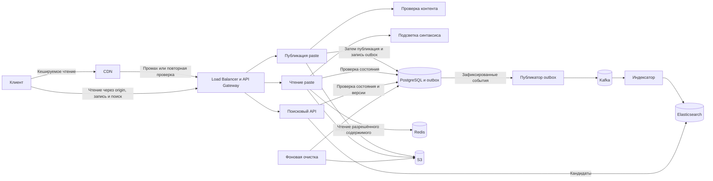

# Вопросы на собеседовании: `Design Pastebin`

`Pastebin` (GitHub Gist, Hastebin, 0bin, JSFiddle для кода) — простой сервис обмена текстом / кодом через короткую ссылку. На интервью это «mini system design»: компактен (укладывается в 30-45 минут), но проверяет ключевые знания: short URL generation, blob vs metadata разделение, syntax highlighting, expiration / TTL, anti-abuse, CDN. Часть параллелей с URL shortener, но с blob payload.

## Полезные ссылки

- [Pastebin (классический сервис)](https://pastebin.com/api)
- [GitHub Gist documentation](https://docs.github.com/en/rest/gists)
- [Hastebin (open source)](https://github.com/toptal/haste-server)
- [0bin (client-side encrypted)](https://github.com/agrm/0bin)
- [Pygments syntax highlighter](https://pygments.org/)
- [Prism.js client-side syntax](https://prismjs.com/)
- [highlight.js](https://highlightjs.org/)
- [System Design Primer](https://github.com/donnemartin/system-design-primer)

## Содержание

**Requirements и capacity**
- [Q1. (!) Функциональные и нефункциональные требования?](#q1--функциональные-и-нефункциональные-требования)
- [Q2. (!) Оценка ёмкости (1M pastes/день, retention 5 лет)?](#q2--оценка-ёмкости-1m-pastesдень-retention-5-лет)
- [Q3. Какие SLA и SLO задать для создания и просмотра?](#q3-какие-sla-и-slo-задать-для-создания-и-просмотра)

**Identifier и storage**
- [Q4. (!) Как генерировать короткий код ссылки (Base62, коллизии)?](#q4--как-генерировать-короткий-код-ссылки-base62-коллизии)
- [Q5. (!) Архитектура хранилища (metadata в DB + blob в S3)?](#q5--архитектура-хранилища-metadata-в-db--blob-в-s3)
- [Q6. Дизайн схемы данных (pastes, users, views)?](#q6-дизайн-схемы-данных-pastes-users-views)
- [Q7. Сжатие при записи (gzip / zstd)?](#q7-сжатие-при-записи-gzip--zstd)

**Endpoints и API**
- [Q8. (!) Raw- и view-эндпоинты (curl против браузера)?](#q8--raw--и-view-эндпоинты-curl-против-браузера)
- [Q9. API для программного создания (CLI / IDE-плагин)?](#q9-api-для-программного-создания-cli--ide-плагин)
- [Q10. Embed-виджеты (gist.github.com `<script>`)?](#q10-embed-виджеты-gistgithubcom-script)

**Rendering**
- [Q11. (!) Подсветка синтаксиса: серверная Pygments или клиентская Prism?](#q11--подсветка-синтаксиса-серверная-pygments-или-клиентская-prism)
- [Q12. Рендеринг Markdown против сырого текста?](#q12-рендеринг-markdown-против-сырого-текста)
- [Q13. Определение языка кода (авто против явного выбора)?](#q13-определение-языка-кода-авто-против-явного-выбора)

**Lifecycle**
- [Q14. (!) Истечение срока / TTL (1h, 1d, 1w, never)?](#q14--истечение-срока--ttl-1h-1d-1w-never)
- [Q15. (!) «Сгореть после прочтения» (одноразовый просмотр)?](#q15--сгореть-после-прочтения-одноразовый-просмотр)
- [Q16. Версионирование (редактирование существующего paste)?](#q16-версионирование-редактирование-существующего-paste)

**Privacy и features**
- [Q17. Режимы приватности (public / unlisted / private / password)?](#q17-режимы-приватности-public--unlisted--private--password)
- [Q18. (!) Полнотекстовый поиск (Elasticsearch, opt-in индексация)?](#q18--полнотекстовый-поиск-elasticsearch-opt-in-индексация)
- [Q19. Папки / многофайловые pastes (Gist)?](#q19-папки--многофайловые-pastes-gist)
- [Q20. Diff и сравнение между ревизиями?](#q20-diff-и-сравнение-между-ревизиями)

**Архитектура**
- [Q21. (!) Высокоуровневая архитектура?](#q21--высокоуровневая-архитектура)
- [Q22. (!) Многоуровневое хранилище (Redis / S3 / Glacier)?](#q22--многоуровневое-хранилище-redis--s3--glacier)
- [Q23. CDN для raw-контента (Cloudflare / CloudFront)?](#q23-cdn-для-raw-контента-cloudflare--cloudfront)
- [Q24. Multi-region и резидентность данных?](#q24-multi-region-и-резидентность-данных)

**Production**
- [Q25. (!) Защита от злоупотреблений (DMCA, malware, scraping)?](#q25--защита-от-злоупотреблений-dmca-malware-scraping)
- [Q26. Аутентификация (OAuth, API-токены)?](#q26-аутентификация-oauth-api-токены)
- [Q27. Rate limiting (анонимы по IP против авторизованных по ключу)?](#q27-rate-limiting-анонимы-по-ip-против-авторизованных-по-ключу)
- [Q28. (!) Какие метрики мониторить?](#q28--какие-метрики-мониторить)
- [Q29. Оптимизация стоимости (сжатие + lifecycle + CDN)?](#q29-оптимизация-стоимости-сжатие--lifecycle--cdn)
- [Q30. (!) Антипаттерны и подводные камни?](#q30--антипаттерны-и-подводные-камни)

## Q1. (!) Функциональные и нефункциональные требования?

Pastebin — это сервис «вставил текст → получил короткую ссылку». Прежде чем рисовать архитектуру, проговорите границы: что система делает, какие у неё нагрузочные характеристики и что осознанно вынесено за скобки. Главный вывод этого блока — преобладание чтения над записью (100:1) и разброс размеров paste (от твита до 10-мегабайтного лога), потому что именно это диктует все дальнейшие решения по хранилищу и кешу.

**Функциональные:**
- Создать paste: текст / код / Markdown с опциональным заголовком.
- Получить paste по короткой ссылке: `pastebin.com/abc1234`.
- Raw-просмотр: `pastebin.com/raw/abc1234` (для curl, wget).
- TTL / истечение срока (опционально).
- Подсветка синтаксиса по языку (или авто-детект).
- Анонимный и авторизованный режимы.
- Режимы приватности: public, unlisted, private, password-protected.
- Опционально: редактирование, история версий (Gist).
- Опционально: полнотекстовый поиск.
- Опционально: embed-виджет.

**Нефункциональные:**
- Пользователи: миллионы DAU (Pastebin ~25M MAU, Gist ~10M+).
- Pastes: 1M+ создаётся/день, retention годами.
- Преобладание чтения: 100:1 reads:writes (один paste просматривают N раз).
- Латентность: просмотр < 100 ms, создание < 500 ms.
- Доступность: 99.9% (не так критично, как для финтеха).
- Хранилище: масштаб TB (сжатые blob-ы).

**За скобками (типично выносят из scope):**
- Совместное редактирование в реальном времени (Codepen, JSFiddle Pro).
- Выполнение кода / sandbox (это replit, не pastebin).
- Форматированный текст (HTML-редактор) — только plain text / markdown.

**Сигнал для интервьюера:** senior сразу отмечает, что paste бывает огромным (логи на 10 MB+), и из этого вытекает ключевое решение — отделить blob storage (крупные неизменяемые байты) от metadata DB (мелкие индексируемые записи). Озвучьте это в самом начале — дальше вся архитектура будет логичным следствием.

## Q2. (!) Оценка ёмкости (1M pastes/день, retention 5 лет)?

**Хранение.** При 1 млн созданий в сутки и среднем размере 10 КБ записывается 10 ГБ в сутки. Пять лет хранения всех записей без ревизий дают около 1,825 млрд объектов и 18,25 ТБ до сжатия. При разных TTL считайте объём по группам. Метаданные, индексы и резервные копии оцените отдельно.

**Чтение.** 100 млн просмотров в сутки дают примерно 1 160 просмотров/с в среднем. При пике ×5 и размере ответа 10 КБ это около 58 МБ/с до сжатия. Суточный объём ответов составляет около 1 ТБ. Если CDN отдаёт 95% байтов без origin, как в Q23, origin передаёт около 50 ГБ тел в сутки.

**Кеш и БД.** 100 тыс. горячих объектов по 10 КБ занимают около 1 ГБ до накладных расходов Redis. Среднее число созданий — около 12/с. Нагрузка PostgreSQL также зависит от проверок метаданных, ревизий и фоновой очистки. Проверьте пиковую нагрузку и хвостовые задержки на выбранной схеме.

## Q3. Какие SLA и SLO задать для создания и просмотра?

Для учебного дизайна зададим месячную цель доступности 99,9% и отдельные бюджеты задержки для создания и просмотра. Считаем долю корректно обработанных запросов каждого пути. Для просмотра измеряем задержку CDN-попаданий и запросов к origin отдельно, чтобы быстрые попадания не скрыли деградацию origin.

| Метрика | Цель | Порог алерта |
|---|---|---|
| `paste_creation_latency_p99` | < 500 ms | > 2 сек |
| `paste_view_latency_p99` | < 100 ms (из cache) | > 500 ms |
| `cdn_hit_ratio` | > 90% | < 70% |
| `creation_success_rate` | ≥ 99,9% за месяц | быстрый расход бюджета ошибок |
| `expiration_gc_lag_minutes` | < 60 мин | > 1440 мин (1 день) |
| `abuse_block_rate` | отслеживается | всплеск > 3× baseline |
| `view_success_rate` | ≥ 99,9% за месяц | быстрый расход бюджета ошибок |

**Сценарии отказа (как деградируем):**
- Если хранилище недоступно, создание не подтверждается. При повторе того же запроса клиент сохраняет ключ идемпотентности (Q5).
- Если недоступна БД метаданных, операции, которым нужна актуальная запись, временно недоступны. Когда приложение может ответить, оно возвращает `503`.
- При отказе origin CDN может обслужить попадание, пока действуют правила доступа и TTL из Q23. Промах или невозможность проверить доступ не дают права выдавать клиенту объект напрямую из S3. [RFC 9110, §15.6.4](https://www.rfc-editor.org/rfc/rfc9110.html#section-15.6.4)

## Q4. (!) Как генерировать короткий код ссылки (Base62, коллизии)?

Короткий код идентифицирует paste в URL. В отличие от [сокращателя ссылок](design-url-shortener-interview.md), он указывает на собственный ресурс сервиса. Выбор генератора влияет на длину кода, предсказуемость и обработку конкурирующих записей.

- **Счётчик + Base62.** Кодирование взаимно однозначно, если счётчик выдаёт уникальные числа и строка сохраняет регистр. Код короткий, но соседние значения предсказуемы.
- **Случайный Base62.** Для этого дизайна используем равномерную генерацию из 62 символов криптографически стойким генератором. Маршрутизация и сравнение в БД должны различать регистр. На запись ставим ограничение UNIQUE и при конфликте именно этого ограничения делаем ограниченное число повторов с новым кандидатом. Предварительное чтение не заменяет ограничение при конкурентных вставках. [PostgreSQL — уникальные ограничения](https://www.postgresql.org/docs/current/ddl-constraints.html#DDL-CONSTRAINTS-UNIQUE-CONSTRAINTS)
- **Префикс хеша содержимого.** Одинаковое тело даёт одинаковый кандидат, а разные тела тоже могут совпасть после усечения. Общий URL смешивает независимые права доступа, сроки жизни и владельцев. Если нужна дедупликация хранения, рассматривайте её отдельно от выдачи ссылки.

**Прикидка длины.** При семи символах пространство составляет 62⁷ ≈ 3,52 трлн кодов, при восьми — 62⁸ ≈ 218 трлн. Если занято n кодов из N, вероятность конфликта очередного равномерного кандидата равна n/N. При 1,825 млрд занятых кодов из сценария Q2 она составляет около 0,052% для семи символов и 0,00084% для восьми. При заполнении с нуля до этого объёма вероятность хотя бы одного конфликта за всё время близка к единице в обоих случаях. Поэтому длину выбирают по допустимой частоте повторов и риску угадывания при данном числе доступных ресурсов.

Случайный код затрудняет перечисление. Для private действуют проверка прав и политика доступа из Q10. Для unlisted ссылка сама даёт доступ в рамках выбранной политики, поэтому здесь особенно важны длина кода и лимиты запросов. Ограничивайте и общий поток, и частоту промахов.

## Q5. (!) Архитектура хранилища (metadata в DB + blob в S3)?

Ключевое решение Pastebin: метаданные и содержимое хранятся раздельно. Метаданные (короткий код, язык, TTL, владелец) — мелкие, их часто читают и фильтруют, поэтому им место в OLTP-базе на SSD. Содержимое (blob) — крупное, неизменяемое, читается целиком и редко индексируется, поэтому его дешевле держать в object storage. Разделение даёт три выгоды: независимое масштабирование, дешёвое хранение байтов и удобное кеширование blob через CDN (он неизменяем).

**Пример метаданных в PostgreSQL:**
```sql
CREATE TABLE pastes (
  id BIGSERIAL PRIMARY KEY,
  short_code VARCHAR(10) UNIQUE NOT NULL,
  user_id BIGINT NULL,
  title TEXT,
  language VARCHAR(20),
  size_bytes INT,
  visibility VARCHAR(20) NOT NULL,  -- public / unlisted / private / password_protected
  password_hash TEXT NULL,
  created_at TIMESTAMP DEFAULT NOW(),
  expires_at TIMESTAMP NULL,
  views_count BIGINT DEFAULT 0,
  blob_key TEXT NOT NULL,  -- S3 key
  blob_compression VARCHAR(10),
  deleted_at TIMESTAMP NULL
);

CREATE INDEX idx_user ON pastes (user_id);
CREATE INDEX idx_expires ON pastes (expires_at) WHERE expires_at IS NOT NULL;
```

**Blob storage (S3 / GCS / Cloudflare R2):**
- Ключ включает идентификатор версии или загрузки. Короткий код остаётся ключом поиска метаданных, а несколько ревизий имеют разные blob-ключи.
- Значение: исходные байты или результат сжатия zstd. Поле `blob_compression` хранит выбранный формат (Q7).
- Неизменяемый (перезапись при редактировании = новая ревизия, отдельный blob).

**Поток записи:** сначала фиксируем в PostgreSQL операцию с отпечатком запроса и зарезервированным blob-ключом. Загружаем объект вне SQL-транзакции. После успешной загрузки одной SQL-транзакцией создаём доступную запись и сохраняем результат операции (Q9). Объект до публикации остаётся закрытым для прямого чтения.

Если ответ S3 потерялся, повторная запись по зарезервированному ключу с `If-None-Match: *` защищает текущий объект от перезаписи. Перед публикацией проверяем, что найденный объект содержит ожидаемые данные, например по сохранённой контрольной сумме. [Amazon S3, условные записи](https://docs.aws.amazon.com/AmazonS3/latest/userguide/conditional-writes.html)

Если операция зависла, очистка сначала атомарно переводит её из незавершённой в отменённую. Публикация и отмена конкурируют за переход из одного состояния. После отмены старый обработчик уже не может опубликовать запись. Уборка повторяется или сверяет оставшиеся объекты, поскольку запись в S3 могла завершиться уже после первого прохода. Зарезервированный ключ отменённой загрузки не выдаём другой операции.

**Поток чтения:**
```
GET /abc1234
  ↓
metadata = pastes WHERE short_code = 'abc1234'
  ↓ проверка доступа и срока (Q17)
  ↓ одноразовая запись → подтверждение без содержимого (Q15)
  ↓
blob = s3.get(metadata.blob_key)
  ↓ декодирование по blob_compression
  ↓
return content
```

**Почему именно так разделяем:**
- Metadata на SSD (дорого за GB) — оправдано высокой частотой запросов и нуждой в индексах.
- Blob в object storage (дёшево за GB) — оправдано большим объёмом и редким доступом к каждому байту.
- Масштабировать слои можно независимо: DB растёт по числу записей, blob — по объёму.
- Неизменяемый blob можно переиспользовать во внутреннем кеше. Для внешней выдачи срок, приватность и отзыв доступа определяют политику CDN (Q23).

**Альтернатива (всё в одном Postgres):**
- Содержимое лежит в колонке TEXT/BYTEA.
- Плюс: проще архитектура, меньше движущихся частей.
- Минусы: размер DB растёт быстро, дорожает SSD-хранение, тяжелеют backup/restore, появляются накладные расходы на уровне строк.

**Когда разделять:** начинаем с PostgreSQL, если объём, нагрузка и окно восстановления укладываются в бюджет. При росте сравниваем стоимость хранения байтов, время восстановления и нагрузку на БД с ценой отдельного хранилища и протокола публикации.

## Q6. Дизайн схемы данных (pastes, users, views)?

Схема строится вокруг одной центральной таблицы `pastes`, к которой привязаны остальные. Дополнительные таблицы добавляют по мере появления фич: `users` — при авторизации, `paste_views` — для аналитики, `paste_revisions` — для версионирования (Gist), `paste_comments` — для обсуждений. Принцип — не тащить всё сразу, а наращивать схему под включённые возможности.

**pastes** — основная таблица (см. Q5).

**users** (если есть авторизация):
```sql
CREATE TABLE users (
  id BIGSERIAL PRIMARY KEY,
  username VARCHAR(40) UNIQUE,
  email VARCHAR(255) UNIQUE,
  oauth_provider VARCHAR(20),  -- github, google, none
  oauth_id TEXT,
  api_token_hash TEXT,
  plan VARCHAR(20),  -- free, paid
  created_at TIMESTAMP
);
```

**views** (для аналитики, опционально):
```sql
CREATE TABLE paste_views (
  id BIGSERIAL,
  paste_id BIGINT NOT NULL,
  viewer_user_id BIGINT NULL,
  viewer_ip_hash VARCHAR(64),
  user_agent VARCHAR(255),
  referrer TEXT,
  viewed_at TIMESTAMPTZ NOT NULL,
  PRIMARY KEY (viewed_at, id)
) PARTITION BY RANGE (viewed_at);

CREATE TABLE paste_views_2026_11 PARTITION OF paste_views
  FOR VALUES FROM ('2026-11-01 00:00:00+00') TO ('2026-12-01 00:00:00+00');
```

В PostgreSQL первичный ключ партиционированной таблицы должен включать все столбцы ключа партиционирования, поэтому уникальность здесь проверяется для пары `(viewed_at, id)`. Месячные секции создают заранее: вставка за пределами существующих диапазонов завершится ошибкой, если нет подходящей секции по умолчанию.

Для удаления событий за ноябрь выполните `DROP TABLE paste_views_2026_11`. PostgreSQL удалит секцию без построчного `DELETE`, но операция требует блокировки `ACCESS EXCLUSIVE` на родительской таблице и может ждать. Если секцию нужно сначала архивировать, рассмотрите `ALTER TABLE paste_views DETACH PARTITION paste_views_2026_11 CONCURRENTLY`. Эта команда оставляет отдельную таблицу для дальнейшей обработки, требует менее строгой блокировки родителя и имеет ограничения, в частности несовместима с секцией по умолчанию.

[PostgreSQL — декларативное партиционирование](https://www.postgresql.org/docs/current/ddl-partitioning.html)

**revisions** (если есть версионирование, Gist):
```sql
CREATE TABLE paste_revisions (
  id BIGSERIAL PRIMARY KEY,
  paste_id BIGINT,
  blob_key TEXT,
  revision_number INT,
  edited_by BIGINT,
  edited_at TIMESTAMP,
  UNIQUE (paste_id, revision_number)
);
```

**comments** (Gist):
```sql
CREATE TABLE paste_comments (
  id BIGSERIAL PRIMARY KEY,
  paste_id BIGINT,
  user_id BIGINT,
  body TEXT,
  created_at TIMESTAMP
);
```

**Индексы:**
- `pastes.short_code` — UNIQUE, основной lookup.
- `pastes.user_id` — страница «мои pastes».
- `pastes.expires_at` — для GC-прохода.
- `paste_views.paste_id, viewed_at` — аналитика.

## Q7. Сжатие при записи (gzip / zstd)?

Для blob в этом дизайне начнём с zstd на умеренном уровне. Сжимаем один раз перед загрузкой неизменяемого объекта. На чтении origin декодирует объект согласно метаданным. Выбор уровня проверяем на реальных размерах paste: сравниваем gzip, zstd и Brotli по размеру результата, CPU на запись и p99 задержки чтения при рабочей нагрузке. Публичный бенчмарк zstd показывает результаты для конкретного корпуса и оборудования. [Zstandard — benchmarks](https://github.com/facebook/zstd#benchmarks)

Для маленького или плохо сжимаемого текста результат может оказаться больше исходных байтов. Пример выделяет два формата хранения. На записи можно пропускать попытку сжатия ниже порога, выбранного по измерениям.

```python
import zstandard as zstd

def encode_text(text):
    raw = text.encode("utf-8")
    compressed = zstd.ZstdCompressor(level=3).compress(raw)
    if len(compressed) < len(raw):
        return "zstd", compressed
    return "identity", raw
```

Кодек и исходный размер сохраняем в метаданных ревизии вместе с blob-ключом. На чтении проверяем поддерживаемый формат и соблюдаем серверный лимит распакованного размера. Например, если сжатые байты занимают 3 КБ вместо 10 КБ, экономия касается объекта. Для ответа клиенту эффект следует измерять отдельно.

**HTTP-выдача.** Origin может вернуть декодированный текст или согласовать отдельное транспортное кодирование по `Accept-Encoding`. Если отправляем сжатый ответ, `Content-Encoding` указывает кодек фактически переданных байтов. При выборе ответа по `Accept-Encoding` кеш должен учитывать этот заголовок, например через `Vary: Accept-Encoding`. Правила доступа и кеширования из Q23 применяются к каждому варианту ответа. [RFC 9110 — Accept-Encoding](https://www.rfc-editor.org/rfc/rfc9110.html#section-12.5.3)

## Q8. (!) Raw- и view-эндпоинты (curl против браузера)?

У Pastebin два класса клиентов с противоположными ожиданиями: браузер хочет красивую HTML-страницу с подсветкой, а скрипт (curl/wget) — голые байты для пайплайна. Поэтому раздают два явных эндпоинта: `/{code}` отдаёт HTML-view, `/raw/{code}` — `text/plain`. Явные URL чище, чем угадывание по `Accept`-заголовку, и предсказуемее для shell-скриптов.

**Браузерные пользователи:**
- Хотят: отрендеренный HTML с подсветкой синтаксиса, навигацией, комментариями.
- URL: `pastebin.com/abc1234`.
- Ответ: полная HTML-страница.

**Программные клиенты (curl, wget, скрипты):**
- Хотят: raw-байты, без HTML-обвязки.
- URL: `pastebin.com/raw/abc1234`.
- Ответ: `Content-Type: text/plain; charset=utf-8` + сырое содержимое.

**Дизайн эндпоинтов:**

```
GET /{short_code}      → HTML view (с decoration)
GET /raw/{short_code}  → text/plain raw
GET /download/{short_code} → Content-Disposition: attachment
GET /embed/{short_code} → minimal HTML for iframe
```

**Почему это важно:**
- `curl pastebin.com/abc1234` без `/raw/` получит HTML — непригодно для shell-пайплайнов.
- Например, `curl --fail https://pastebin.com/raw/abc1234 -o snippet.txt` сохраняет содержимое для просмотра.

**Кеширование:**
- View, raw и download проверяют права и срок записи по общим правилам Q14 и Q17. На одноразовой записи обычный GET не возвращает тело paste. Контент выдаёт операция из Q15. Embed дополнительно проверяет, что запись публичная (Q10).
- Для кешируемых ответов правила Q23 ограничивают TTL сроком доступа. Просроченный счётчик просмотров допустим отдельно от содержимого. [RFC 9111, свежесть](https://www.rfc-editor.org/rfc/rfc9111.html#section-4.2)

**Почему не content negotiation по `Accept`:**
- Технически можно: `Accept: text/plain` от curl → raw, `Accept: text/html` от браузера → view.
- Но Pastebin сознательно использует явные URL — они предсказуемее, их легко вписать в скрипт и закешировать по ключу.

**Граничный случай:** некоторые сервисы для удобства детектят User-Agent (curl/wget) и сами редиректят на raw — компромисс между «магией» и предсказуемостью.

## Q9. API для программного создания (CLI / IDE-плагин)?

Помимо веб-формы, paste создают из скриптов, CLI и плагинов IDE — поэтому нужен полноценный REST API с токен-авторизацией. Две детали, которые отличают «зрелый» ответ: заголовок `Idempotency-Key` (чтобы сетевой retry не плодил дубликаты paste) и квота аккаунта с дополнительным лимитом API-токена (Q27). После публикации API возвращает и человекочитаемый URL, и raw_url — клиенту не приходится их собирать вручную.

**POST /api/v1/pastes:**
```http
POST /api/v1/pastes
Authorization: Bearer <api_token>
Content-Type: application/json
Idempotency-Key: <uuid>

{
  "content": "console.log('hello');",
  "language": "javascript",
  "title": "test paste",
  "expires_in": 3600,
  "visibility": "unlisted"
}
```
После успешной загрузки и фиксации метаданных (Q5) сервер возвращает [201 Created с Location](https://www.rfc-editor.org/rfc/rfc9110.html#section-15.3.2).

```http
HTTP/1.1 201 Created
Location: /api/v1/pastes/abc1234
Content-Type: application/json

{
  "short_code": "abc1234",
  "url": "https://pastebin.com/abc1234",
  "raw_url": "https://pastebin.com/raw/abc1234",
  "expires_at": "2026-05-27T13:00:00Z"
}
```

**Как работает повтор POST:**

- Уникальность `(account_id, operation, idempotency_key)` в PostgreSQL позволяет двум параллельным запросам найти одну операцию. Вместе с ключом храним отпечаток значимых параметров, включая содержимое, видимость и запрошенный TTL. Повтор с другим отпечатком получает ошибку конфликта. [PostgreSQL 19, уникальные ограничения](https://www.postgresql.org/docs/19/ddl-constraints.html#DDL-CONSTRAINTS-UNIQUE-CONSTRAINTS)
- Пока операция выполняется, повтор получает состояние «в процессе» и может повторить запрос с тем же ключом. После фиксации записи повтор возвращает сохранённый результат, включая тот же `short_code` и исходный `expires_at`. Таймаут после commit не создаёт вторую запись.
- Заранее задаём окно хранения результата. По его окончании клиент больше не может полагаться на дедупликацию старого ключа. Это договорённость API. Пример похожего контракта с проверкой параметров и ограниченным окном есть у Stripe. [Stripe, идемпотентные запросы](https://docs.stripe.com/api/idempotent_requests)

**GET /api/v1/pastes/{short_code}:**
- Возвращает метаданные и содержимое обычной записи после проверки видимости, срока и удаления. Для одноразовой записи GET может вернуть данные для подтверждения, а содержимое выдаётся только при отдельном потреблении (Q15).

**DELETE /api/v1/pastes/{short_code}:**
- Владелец с токеном, разрешающим удаление.

**API-токены:**
- Генерируются в UI настроек.
- В БД хранятся хеш секрета и метаданные токена (Q26).
- Запросы расходуют квоту аккаунта и, если он задан, лимит конкретного токена (Q27).

**CLI-инструменты (community):**
- `pastebinit` (загрузчик из командной строки для Linux).
- `gh gist create` (GitHub CLI).
- `pbpaste | gist` (пайплайн для macOS).

**Плагины для IDE:**
- Расширение Gist для VS Code.
- Плагин Gist для IntelliJ.
- gist-it для Sublime Text.

**Квоты на создание через API:**
- Анонимно (без API-ключа): 5 созданий/час.
- Авторизованный free: 25 созданий/час.
- Платный: 1000+ созданий/час.

## Q10. Embed-виджеты (gist.github.com `<script>`)?

Embed позволяет вставить paste/gist прямо в чужую страницу — статью в блоге, документацию. Технически есть два способа: `<script>`-виджет (как у Gist), который сам рендерит inline-HTML, и `<iframe>` на эндпоинт `/embed/{code}`. **Сценарий применения:** показать кусок кода с подсветкой на внешнем сайте, не копируя его руками. Главная сложность здесь не рендеринг, а безопасность — встраивание открывает поверхность для XSS и фишинга, поэтому встраивать можно только public-pastes и только с экранированием содержимого.

**Embed от GitHub Gist:**
```html
<script src="https://gist.github.com/user/abc1234.js"></script>
```
- Загружает JS, который рендерит iframe / inline HTML.
- Подсветка синтаксиса + стилизация GitHub.

**Альтернатива — iframe:**
```html
<iframe src="https://pastebin.com/embed/abc1234"
        width="600" height="400" frameborder="0">
</iframe>
```

**Реализация:**
- Эндпоинт `/embed/{short_code}` возвращает минимальную HTML-страницу с:
  - Только содержимое paste + подсветка синтаксиса.
  - `<style>` для компактной вёрстки.
  - Если встраивание разрешено только партнёрам, задайте их origin в заголовке `Content-Security-Policy: frame-ancestors …`. [CSP, frame-ancestors](https://www.w3.org/TR/CSP3/#directive-frame-ancestors)

**Безопасность (главное в embed):**
- CSP-заголовки (Content-Security-Policy) ограничивают, откуда грузятся ресурсы.
- Атрибут `sandbox` у iframe не даёт встроенному контенту «сбежать» в родительскую страницу.
- Никакого выполнения JS из содержимого paste — HTML экранируется и показывается как plain text.

**Дружелюбно к CDN:**
- Для HTML с содержимым paste действует политика Q23. Статичный HTML тоже может содержать запись, срок которой скоро истечёт.
- Ассеты (CSS, шрифты) отдаются с длинным TTL.

**Приватность:**
- Перед выдачей HTML проверяем, что paste публичный, доступен и не одноразовый. Эти же условия действуют для скриптового виджета, если он поддерживается.
- `frame-ancestors` управляет тем, кто может встроить страницу. Серверная проверка определяет, можно ли вообще вернуть содержимое из embed-эндпоинта.

## Q11. (!) Подсветка синтаксиса: серверная Pygments или клиентская Prism?

При серверной подсветке Pygments разбивает код на токены и формирует HTML с CSS-классами. Браузер показывает подсвеченный код после получения разметки и стилей. При клиентской подсветке страница сразу может показать экранированный текст, а Prism оформит его после загрузки скрипта. Если скрипт недоступен, исходник всё равно можно прочитать.

**Как выбрать место обработки**

- Для популярного публичного фрагмента можно подготовить подсветку при публикации или заполнить кеш при первом чтении. Ключ артефакта включает версию содержимого, язык и версию рендерера. При скачке запросов к новому фрагменту полезно объединять одновременные промахи кеша.
- Для сквозного шифрования, где ключ есть только у клиента, подсветка выполняется после расшифровки на клиенте. Для закрытого фрагмента, чей текст доступен серверу, серверная обработка тоже возможна. Прежде чем выдать кешированный результат, сервер проверяет право чтения.
- Для большого файла ограничиваем объём подсветки и показываем исходник, если обработка выходит за бюджет. Сравниваем время до появления читаемого кода, нагрузку на worker и размер сжатого ответа. Сама подсветка не определяет, будет ли текст индексироваться.

**Пример серверного рендера.** Язык уже выбран по правилам Q13, а размер проверен перед вызовом.

```python
from pygments import highlight
from pygments.formatters import HtmlFormatter
from pygments.lexers import get_lexer_by_name

def render_code(source: str, language: str) -> str:
    lexer = get_lexer_by_name(language)
    return highlight(source, lexer, HtmlFormatter(cssclass="source"))
```

Стили для класса `source` можно сгенерировать через `HtmlFormatter.get_style_defs(".source")` и отдавать отдельным файлом. [Документация Pygments HtmlFormatter](https://pygments.org/docs/formatters/#HtmlFormatter)

## Q12. Рендеринг Markdown против сырого текста?

Для Markdown полезны два представления одной версии объекта. В `/{code}` можно показать отформатированный документ, а в `/raw/{code}` отдать исходник с `Content-Type: text/plain; charset=utf-8` и `X-Content-Type-Options: nosniff`. Закрытый документ требует проверки доступа в обоих режимах. Тип по расширению файла служит подсказкой, а автор может выбрать просмотр обычным текстом.

**Как обработать пользовательский Markdown**

1. Выбираем диалект. CommonMark задаёт базовый синтаксис, GFM добавляет, например, таблицы, списки задач и расширенное распознавание автоссылок. Упоминания пользователей относятся к функциональности платформы GitHub.
2. При разборе отключаем пользовательский HTML, если форматтер поддерживает такую настройку. Подсветку блоков кода добавляем в процессе рендера. Проверяем итоговый HTML санитайзером с разрешёнными тегами, атрибутами и схемами URL. Для подсветки разрешаем только необходимые атрибуты и классы. Ограничиваем или отключаем внешние изображения, если просмотр не должен отправлять запросы сторонним серверам.
3. Кешируем результат по версии содержимого, диалекту и версии политики рендера и очистки. Если политика ужесточается, старый результат перестаёт подбираться по ключу. Проверка доступа остаётся на пути выдачи.

Например, пользователь публикует инструкцию с таблицей и блоком SQL. В режиме GFM читатель видит таблицу и подсвеченный блок. В режиме исходника он получает Markdown для копирования. Если команда отключает внешние изображения, после смены версии политики новое представление применяется и к ранее опубликованным документам.

[Спецификация GFM и примечание об очистке HTML на GitHub](https://github.github.com/gfm/)

## Q13. Определение языка кода (авто против явного выбора)?

Язык определяет, какой лексер раскрасит текст. Храните выбор автора отдельно от догадки сервиса. Явный выбор воспроизводим и позволяет исправить результат, хотя автор может ошибиться. Автоопределение экономит шаг при создании, но короткие и смешанные фрагменты часто неоднозначны.

**Как выбирать язык**

1. Если автор выбрал язык из списка поддерживаемых, используем соответствующий лексер. Явный выбор обычного текста отключает подсветку.
2. В режиме «Авто» имя файла и shebang помогают сузить выбор. В Pygments `guess_lexer_for_filename()` рассматривает лексеры, чьи шаблоны совпадают с именем, а `guess_lexer()` использует эвристики по тексту. Максимальная оценка `analyse_text()` выбирает кандидата. Она сама по себе не даёт вероятность правильного ответа.
3. Если подсказки противоречат друг другу, фрагмент слишком короткий или детектор не нашёл подходящего лексера, отображаем обычный текст. Для большого фрагмента используем тот же режим, если автоопределение превысило бюджет обработки. Автор может указать язык вручную.

Например, для `SELECT 1;` в файле `report.sql` можно выбрать SQL по имени. Для строки `x = 1` без имени файла лучше оставить обычный текст, пока автор не выберет язык. Сохраняем исходник без изменений. Если результат автоопределения кешируется, связываем его с версией содержимого и детектора, чтобы после редактирования не использовать старую догадку.

Качество оцениваем на размеченных фрагментах из целевой нагрузки. Измеряем точность среди фрагментов, для которых сервис выбрал язык, и долю фрагментов, для которых он сделал выбор. Эти две метрики показывают цену более осторожного перехода к обычному тексту.

[Документация Pygments по выбору лексера](https://pygments.org/docs/api/#pygments.lexers.guess_lexer)

## Q14. (!) Истечение срока / TTL (1h, 1d, 1w, never)?

TTL решает две задачи: даёт пользователю контроль («этот paste живёт час») и ограничивает рост хранилища (free-pastes по умолчанию умирают через 30 дней). Ключевая идея реализации — разделить логическое и физическое истечение. Логически paste «умирает» сразу по `expires_at` (запрос отдаёт 404), а физически blob удаляется отложенно, через grace-окно 7-30 дней — чтобы случайно истёкший paste можно было восстановить.

**Опции:**
- `expires_in=null` → никогда (по умолчанию для платных пользователей).
- `expires_in=3600` → 1 час.
- `expires_in=86400` → 1 день.
- `expires_in=604800` → 1 неделя.
- `expires_in=2592000` → 30 дней (по умолчанию для free-пользователей).
- `burn_after_read=true` → одноразовый (Q15).

**Реализация в два слоя:**

**Слой 1 — логическое истечение (проверка на чтение):** запрос сразу фильтрует протухшие записи и отдаёт 404, не дожидаясь физического удаления.
```sql
SELECT * FROM pastes
WHERE short_code = $1
  AND (expires_at IS NULL OR expires_at > NOW())
  AND deleted_at IS NULL;
```

**Слой 2 — физическая очистка (в фоне).** Три варианта, как реально удалить байты:

Вариант 1: фоновый воркер выбирает небольшую пачку записей после grace-окна в порядке `expires_at`. Он атомарно помечает записи для необратимой очистки и надёжно сохраняет задания на удаление blob. После подтверждения удаления воркер завершает очистку метаданных. При сбое задание повторяется. Пока очистка не началась, восстановление должно атомарно исключить запись из её очереди.

Вариант 2: S3 Lifecycle подходит для групп объектов с общей политикой хранения. Префикс и теги фильтруют объекты, а срок задаёт само правило. Тег `expires=2026-06-01` сам не задаёт дату удаления конкретного объекта. Для произвольного `expires_at`, который пользователь может продлить, расписание удаления ведёт приложение. [AWS S3 Lifecycle](https://docs.aws.amazon.com/AmazonS3/latest/userguide/intro-lifecycle-rules.html)

Вариант 3: DynamoDB TTL асинхронно удаляет истёкшие записи, обычно в течение нескольких дней. Чтение всё равно проверяет `expires_at`, а удаление связанного объекта из S3 требует отдельного шага. [AWS DynamoDB TTL](https://docs.aws.amazon.com/amazondynamodb/latest/developerguide/TTL.html)

**Grace-окно (зачем нужно):**
- Логическое истечение — немедленное, paste пропадает из выдачи сразу.
- Физическое удаление — через 7-30 дней, чтобы случайно протухший paste можно было вернуть.

**Под контролем пользователя:**
- Владелец может продлить TTL, пока срок не истёк.
- Владелец может сразу закрыть доступ на origin. Для уже закешированного публичного ответа действует отдельная политика из Q23.

## Q15. (!) «Сгореть после прочтения» (одноразовый просмотр)?

Burn-after-read даёт право раскрыть содержимое только одному запросу. Успех операции на сервере и получение ответа клиентом происходят в разные моменты. Если соединение оборвалось после фиксации, ссылка уже погашена, даже если пользователь ничего не увидел.

**Подтверждение просмотра.** `GET` и `HEAD` возвращают только страницу подтверждения или её метаданные. Явное подтверждение отправляет `POST`, который проверяет право доступа и погашает ссылку. Тогда обычный предпросмотр ссылки через `GET` не расходует её. Raw, embed и прямой доступ к blob не должны обходить погашение. Для ответа с содержимым используйте `Cache-Control: no-store`. [RFC 9110: безопасные методы](https://www.rfc-editor.org/rfc/rfc9110.html#section-9.2.1) · [RFC 9111: no-store](https://www.rfc-editor.org/rfc/rfc9111.html#section-5.2.2.5)

**Атомарное погашение.** В PostgreSQL при `READ COMMITTED` приложение может обновить только ещё доступную запись и получить ключ объекта через `RETURNING`. Пример предполагает уникальный `short_code` и уже проверенное право на раскрытие. Если правила доступа могут меняться конкурентно, их проверку нужно согласовать с той же транзакцией.

```sql
UPDATE pastes
SET deleted_at = statement_timestamp()
WHERE short_code = $1
  AND burn_after_read
  AND deleted_at IS NULL
  AND (expires_at IS NULL OR expires_at > statement_timestamp())
RETURNING blob_key;
```

Если два запроса одновременно обновляют строку, второй ждёт исхода первого. После успешной фиксации первого PostgreSQL повторно проверяет условие второго на обновлённой строке. `deleted_at IS NULL` уже ложно, и второй запрос получает ноль строк. В той же транзакции победитель сохраняет долговечное задание на очистку. Содержимое отправляют после commit. Воркер удаляет blob позже, чтобы чтение победителя успело завершиться в пределах заданного бюджета. [PostgreSQL 19: Read Committed](https://www.postgresql.org/docs/19/transaction-iso.html#XACT-READ-COMMITTED)

**Потеря ответа.** В строгом режиме повтор получает 404. Если продукту нужен повтор после сетевого сбоя, потребуется отдельный контракт. Например, краткоживущее право повторно получить результат можно привязать к той же сессии и тому же запросу. Простая отсрочка физического удаления не возвращает уже погашенную ссылку.

**Клиентское шифрование.** При таком дизайне сервер хранит шифротекст, а ключ остаётся в URI-фрагменте, который браузер не отправляет в HTTP-запросе. Право раскрытия всё равно контролирует сервер. Получатель может сохранить уже полученные данные. [RFC 3986: фрагмент URI](https://www.rfc-editor.org/rfc/rfc3986.html#section-3.5)

## Q16. Версионирование (редактирование существующего paste)?

Редактирование плохо сочетается с неизменяемыми blob, поэтому правку моделируют не как перезапись, а как новую версию. Подход Gist — каждое редактирование создаёт ревизию (как коммит в Git), все версии хранятся. Это естественно ложится на blob storage (новая ревизия = новый blob, старый не трогаем) и позволяет diff между версиями. Плата — линейный рост хранилища по числу ревизий, который гасят дедупликацией одинаковых blob и сборкой мусора старых версий.

**Подход GitHub Gist:**
- Каждое редактирование = новая ревизия (как коммит в Git).
- Gist хранится как Git-репозиторий с историей коммитов и diff. Правила доступа к истории ниже относятся к нашему Pastebin. [GitHub Docs — Creating gists](https://docs.github.com/en/get-started/writing-on-github/editing-and-sharing-content-with-gists/creating-gists#about-gists)
- Таблица `paste_revisions` (Q6).

**Классический Pastebin:**
- Редактирование = создание нового paste со ссылкой на родителя.
- Старая версия при этом остаётся доступной.

**Публикация ревизии:** загрузить новый blob по неизменяемому ключу и опубликовать его через транзакцию метаданных из Q5. В ней добавить запись в `paste_revisions` и переключить указатель текущего содержимого в `pastes`. Для параллельных правок можно обновлять указатель только при совпадении ожидаемой текущей ревизии. При конфликте клиент перечитывает состояние перед повторной правкой.

**Доступ к истории:** в этом дизайне каждая ревизия наследует текущую политику родительского paste, включая приватность, пароль, срок действия и удаление. Origin сначала проверяет эту политику, затем ищет ревизию по паре `(paste_id, revision_number)` и читает blob. История и сравнение недоступны для одноразовых paste. Переход из public в private закрывает дальнейшую выдачу истории через сервис. Уже полученные копии могут остаться у читателей.

**Diff между ревизиями:**
- Считается серверно (unified-формат) или клиентски через JS-библиотеку — детали в Q20.

**Хранилище:**
- Каждая ревизия = новый blob в S3 (это естественно для content-addressable storage).
- Если новая ревизия побайтно совпала со старой → дедупликация: переиспользуем тот же `blob_key`.

**Компромисс:**
- Стоимость хранилища растёт линейно по числу ревизий.
- Гасится сборкой мусора старых ревизий через N лет.

## Q17. Режимы приватности (public / unlisted / private / password)?

Четыре режима покрывают спектр от «виден всем и в поиске» до «только владелец». Критично понимать разницу между unlisted и private: unlisted просто не индексируется и не попадает в листинги, но доступен любому, у кого есть ссылка — это сокрытие, а не безопасность. Настоящая приватность — это private (сервер проверяет владельца и в этом дизайне возвращает 404 чужим) или password-protected (проверка bcrypt-хеша пароля). Эту разницу часто проверяют на собеседовании.

**Режимы:**

| Режим | Виден в листингах | Доступен по URL | Нужна авторизация | Примечания |
|---|---|---|---|---|
| Public | Да | Да | Нет | Индексируется Google, в поиске |
| Unlisted | Нет | Да (любой со ссылкой) | Нет | Как unlisted на YouTube |
| Private | Нет | Да (только владелец) | Нужна авторизация | Сервер проверяет владение |
| Password-protected | Нет | URL валиден, но нужен пароль | Проверка хеша пароля | Пароль через bcrypt |

**Схема:**
```sql
ALTER TABLE pastes ADD COLUMN visibility VARCHAR(15) DEFAULT 'public';
ALTER TABLE pastes ADD COLUMN password_hash TEXT NULL;
```

**Контроль доступа:**

Обработчики view, raw, download и API вызывают общую проверку до чтения blob и до ответа `304`. В примере используем `404` для отсутствующей, удалённой, истёкшей или закрытой для текущего пользователя private-записи. Это позволяет не раскрывать существование последней через статус ответа. [RFC 9110, 403 Forbidden](https://www.rfc-editor.org/rfc/rfc9110.html#section-15.5.4)

```text
paste = find_metadata(short_code)
if paste is missing or deleted or expired: return not_found()
if paste.visibility == private and not is_authenticated_owner(paste):
    return not_found()
if paste.visibility == password_protected and not has_verified_password(paste):
    return password_required()
if paste.burn_after_read:
    return confirmation_without_content()
return render_for_endpoint(read_private_blob(paste.blob_key))
```

Для формы `password_required()` отдаёт приглашение ввести пароль без содержимого записи. Если API использует HTTP-аутентификацию и отвечает `401`, он добавляет подходящий `WWW-Authenticate`. Одноразовый POST повторяет проверки при потреблении, чтобы подтверждение из старой вкладки не давало доступ к удалённой или истёкшей записи. [RFC 9110, 401 Unauthorized](https://www.rfc-editor.org/rfc/rfc9110.html#section-15.5.2)

**Индексация по режимам:**
- Public: индексируется для поиска (Q18).
- Unlisted: НЕ индексируем, добавляем `<meta name="robots" content="noindex">`, чтобы Google его не подобрал.
- Private и password-protected исключены из публичных листингов и индекса.

**Ключевой нюанс (частый вопрос):**
- Unlisted — это не безопасность, а необнаружимость: любой со ссылкой получит доступ, просто ссылку не найти через поиск.
- Настоящая приватность = Private + обязательная проверка владельца на сервере.

## Q18. (!) Полнотекстовый поиск (Elasticsearch, opt-in индексация)?

В публичный поиск попадают только действующие public-pastes, для которых владелец явно включил индексацию. Состояние в PostgreSQL определяет, можно ли показать результат. Elasticsearch ранжирует кандидатов по тексту, а его представление может отставать.

**Индексация:**

```text
PostgreSQL: изменение paste + запись в outbox в одной транзакции
   ↓ после commit
Kafka → indexer → Elasticsearch
```

При публикации новой версии индексатор записывает документ с идентификатором paste и версией его состояния. При удалении, отключении поиска или смене видимости документ убирается из индекса. Обработка повторов должна быть идемпотентной. Монотонная версия состояния и сохранённая отметка об удалении позволяют отклонить запоздалое событие, которое иначе могло бы вернуть скрытый документ в индекс. Изменение становится видимым в поиске после обработки события и refresh Elasticsearch. [Transactional outbox](https://docs.aws.amazon.com/prescriptive-guidance/latest/cloud-design-patterns/transactional-outbox.html) · [Elasticsearch near real-time search](https://www.elastic.co/docs/manage-data/data-store/near-real-time-search)

**Запрос:**

```text
GET /search?q=mysql+timeout
   ↓
Elasticsearch: поиск кандидатов по BM25
   ↓
PostgreSQL: пакетная проверка ID и версии перед выдачей
   ↓
До K разрешённых результатов с фрагментами текста
```

Для каждого кандидата сервис сверяет по актуальному состоянию, что paste существует, действует, остаётся публичным, доступен для поиска и соответствует версии документа в индексе. При ошибке проверки сервис возвращает ошибку запроса. Сырые счётчики и фасеты Elasticsearch тоже могут раскрыть наличие скрытых совпадений. В этой схеме API их не отдаёт.

Например, владелец перевёл paste в private, а Kafka-потребитель ещё не обработал событие. Elasticsearch продолжает находить старый текст. Запрос, чья проверка в PostgreSQL началась после фиксации изменения, пропустит этот результат и не покажет заголовок или фрагмент.

**Стоимость:** основной поиск по тексту выполняет Elasticsearch, а PostgreSQL проверяет ограниченный пакет кандидатов по ID. Если часть кандидатов отфильтрована, сервис может дочитать следующий пакет в пределах бюджета запроса. Размер индекса измеряют на репрезентативном наборе с выбранными анализаторами, хранением полей и репликами. Цели по задержке ответа и свежести индекса задают и измеряют отдельно.

## Q19. Папки / многофайловые pastes (Gist)?

Многофайловый paste полезен, когда сниппет состоит из нескольких частей, например скрипта и конфигурации. GitHub Gist поддерживает создание записи с набором именованных файлов. Ниже — модель для нашего сервиса. [GitHub REST API — Create a gist](https://docs.github.com/en/rest/gists/gists#create-a-gist)

**Схема:** родительский paste хранит короткий код, политику доступа из Q17 и указатель на текущую ревизию. Ревизия хранит неизменяемый список файлов с их именами, языками и blob-ключами. Это расширение однофайловой схемы Q5 и Q16: указатель на ревизию заменяет одиночный `pastes.blob_key` для многофайловой записи.

Список можно хранить в PostgreSQL в таблице `gist_files`. Поле `revision_id` ссылается на `paste_revisions.id`, а `UNIQUE (revision_id, filename)` обеспечивает уникальность имени внутри ревизии. При поддержке папок вместо имени используют нормализованный относительный путь. Неизменённые файлы могут ссылаться на прежние blob-ключи.

**Публикация:** в операции из Q5/Q9 резервируем ключи для всех новых файлов и загружаем их. После подтверждения всех загрузок одной транзакцией PostgreSQL записываем ревизию со списком файлов, переключаем текущий указатель и фиксируем результат операции. Например, если загружен скрипт, а конфигурация ещё нет, читатели по-прежнему видят прежнюю ревизию. При первой публикации они ещё не видят запись. Отменённые загрузки передаём на очистку по Q5. При удалении опубликованных ревизий учитываем, что на файл могут ссылаться другие ревизии. [PostgreSQL — транзакции](https://www.postgresql.org/docs/19/tutorial-transactions.html)

**Чтение:** после проверки доступа к родителю выбираем одну ревизию и ищем файл в её списке. Интерфейс может показать файлы вкладками, а ссылки на вкладки могут закреплять номер ревизии, чтобы два последовательных запроса не смешивали файлы до и после обновления.

**API нашего сервиса:**
```http
POST /api/v1/gists
{
  "files": {
    "main.py": { "content": "import sys..." },
    "utils.py": { "content": "def helper()..." }
  },
  "description": "Multi-file example"
}
```

**Сценарии использования:**
- Код с импортами / зависимостями.
- Конфигурация + скрипт.
- README + код.

## Q20. Diff и сравнение между ревизиями?

Раз есть ревизии (Q16), логично уметь показать, что изменилось. Diff считают либо на сервере (читаем два разрешённых blob, сравниваем алгоритмом Myers или histogram, отдаём unified diff или HTML), либо на клиенте (шлём два raw-текста, браузер рендерит через diff-match-patch). Выбор — тот же компромисс, что с подсветкой: серверный расходует CPU сервиса, а клиентский переносит вычисление в браузер и передаёт ему оба исходных текста. UI обычно копирует знакомые паттерны — side-by-side как в GitHub или inline как в GitLab.

**Проверка перед сравнением:** применить политику Q16 к родителю и разрешить обе ревизии только внутри него. Если родитель скрыт от читателя, вернуть тот же `404`, что и для обычного чтения private paste в Q17. Проверка нужна и для серверного diff, и для обоих raw-запросов в клиентском варианте. В примере endpoint обходит общий CDN-кеш и возвращает `Cache-Control: no-store`, чтобы ранее доступный diff не выдавался из кеша после ограничения доступа. [RFC 9110 — 404](https://www.rfc-editor.org/rfc/rfc9110.html#section-15.5.5) · [RFC 9111 — no-store](https://www.rfc-editor.org/rfc/rfc9111.html#section-5.2.2.5)

**Серверный:**
- Подтянуть blob-ы двух ревизий.
- Вычислить diff библиотекой `diff` (алгоритм Myers, histogram).
- Формат: unified diff или side-by-side HTML.

**Клиентский:**
- Отправить два raw-содержимого в браузер.
- Diff рендерит библиотека diff-match-patch.

**API:**
```http
GET /api/v1/pastes/{short_code}/compare/{rev1}..{rev2}
```
Ответ: формат unified diff.

**UI:**
- Side-by-side вид (в стиле GitHub).
- Inline-diff (в стиле GitLab).
- Подсветка на уровне слов.

**Библиотеки для реализации:**
- `difflib` (стандартная библиотека Python).
- `diff-match-patch` (Google, JS).
- `git diff --no-index` для CLI.

## Q21. (!) Высокоуровневая архитектура?

PostgreSQL хранит состояние paste и определяет, когда содержимое опубликовано, кто может его прочитать и когда истекает срок доступа. S3 хранит неизменяемые blob. Redis ускоряет чтение, а Elasticsearch ранжирует кандидатов для поиска.



- **Чтение.** CDN обслуживает только ответы, для которых допустима выдача в пределах заданной свежести. Срок свежести ограничен временем до истечения paste. Если доступ нужно проверять при каждом запросе, ответ выдаёт origin по правилам Q8, Q17 и Q23. Cache hit с телом не подменяет проверку текущей политики. Для одноразового paste тело выдаётся после успешного погашения через `POST` (Q15). [RFC 9111 — свежесть](https://www.rfc-editor.org/rfc/rfc9111.html#section-4.2)
- **Публикация.** Сервис валидирует запрос, проверяет контент и загружает blob. Затем одной транзакцией публикует метаданные и записывает событие в outbox (Q5, Q18). Отдельный процесс переносит зафиксированное событие в Kafka. Сбой отправки события после commit задерживает обновление индекса, а запись outbox остаётся доступной для повторной отправки. [AWS — Transactional Outbox](https://docs.aws.amazon.com/prescriptive-guidance/latest/cloud-design-patterns/transactional-outbox.html)
- **Поиск.** Индексатор обрабатывает события асинхронно. Поисковый API запрашивает у Elasticsearch кандидатов, затем пакетно проверяет актуальное состояние и версии в PostgreSQL. Только прошедшие проверку результаты попадают в ответ с фрагментами (Q18).
- **Очистка.** Origin учитывает срок при чтении. Фоновые задачи удаляют истёкшие метаданные, освобождают blob согласно политике хранения и дочищают незавершённые загрузки (Q5, Q14).

## Q22. (!) Многоуровневое хранилище (Redis / S3 / Glacier)?

Redis хранит копии горячих объектов, а S3 — исходные данные. После проверки доступа приложение ищет в кеше нужную ревизию. При промахе оно запрашивает объект по ключу и может заполнить кеш. Смена класса хранения S3 сохраняет ключ объекта.

- **S3 Standard** подходит для немедленного чтения.
- **S3 Standard-IA** также поддерживает немедленное чтение. Сравните экономию с платой за извлечение и минимальным оплачиваемым размером и сроком хранения.
- **Glacier Flexible Retrieval и Deep Archive** требуют восстановления перед чтением. Выбирайте их, если продукт допускает ожидание. Первый запрос может инициировать восстановление, а клиент получает состояние ожидания. Для общего SLO просмотра из Q3 этот путь не подходит.

Новые конфигурации S3 Lifecycle по умолчанию не переводят объекты меньше 128 КБ в другой класс. При среднем размере 10 КБ из Q2 изучите распределение размеров и частоту чтения. Плата за переход начисляется за каждый объект. Истечение срока видимости проверяет приложение по Q14. [Amazon S3 Lifecycle](https://docs.aws.amazon.com/AmazonS3/latest/userguide/lifecycle-transition-general-considerations.html)

## Q23. CDN для raw-контента (Cloudflare / CloudFront)?

CDN сокращает задержку и трафик до origin, когда один ответ можно повторно выдавать разным читателям. В Pastebin байты отдельной ревизии неизменяемы. По короткому коду может открываться новая ревизия, а право читать даже старую ревизию определяется текущей политикой paste (Q16).

**Ключ кеша:**
- Различать raw, HTML-view и embed по пути. Если язык или другой параметр меняет представление, учитывать его в ключе.
- Для неизменяемых байтов можно включить номер ревизии в URL, например `/raw/abc1234?rev=7`. В этом случае CDN должен учитывать `rev` в ключе. Ключ блоба остаётся внутренним.

**Свежесть и доступ:**
- Public и unlisted можно кешировать, если продукт допускает повторную выдачу старого ответа до конца TTL. Для HTML-view TTL также учитывает изменение комментариев и счётчиков.
- Для кешируемой записи с `expires_at` ограничить свежесть остатком до истечения срока. Если остаётся 30 секунд, свежесть часового кеша ограничивается 30 секундами. Настройки CDN должны соблюдать эту границу и требовать повторной проверки просроченного ответа.
- Для private, password-protected, одноразовых ответов и других записей с обязательной проверкой доступа на каждый запрос в этой схеме используется origin и `Cache-Control: no-store`. Origin применяет правила доступа и срока до выдачи тела или `304`. Embed с содержимым следует той же политике. [RFC 9111 — свежесть](https://www.rfc-editor.org/rfc/rfc9111.html#section-4.2) · [RFC 9111 — no-store](https://www.rfc-editor.org/rfc/rfc9111.html#section-5.2.2.5)

**Редактирование и отзыв доступа:** номер ревизии направляет чтение новых байтов на новый ключ. URL текущей версии может продолжать выдавать прежний ответ до окончания свежести, если его кешируют. Purge помогает убрать старые ответы из CDN. Для обязательного немедленного отзыва политика должна требовать проверки доступа на каждом запросе уже до отзыва, поскольку ранее сохранённые браузерные копии могут оставаться доступными.

**Пример оценки трафика:** 100 млн просмотров в сутки при среднем ответе 10 КБ дают около 1 ТБ в сутки до сжатия. Если CDN отдаёт 95% байтов без обращения к origin, на передачу тел с origin приходится около 50 ГБ в сутки. Это сценарий для оценки. Реальная доля зависит от распределения просмотров, правил доступа, ключей и TTL. Экономию от Brotli или gzip измеряют на фактических ответах с учётом настроек CDN.

## Q24. Multi-region и резидентность данных?

**По умолчанию хватает одного региона** — глобальный CDN уже снимает основную проблему латентности на чтении. Multi-region добавляют осознанно, под конкретные драйверы: глобальная аудитория (нужна низкая латентность записи), требование продукта хранить данные в выбранном регионе или disaster recovery. Цена решения — сложная репликация метаданных и blob между регионами и привязка пользователя к домашнему региону.

**Драйверы для multi-region:**
- Латентность для глобальных пользователей.
- Договорные или продуктовые ограничения на размещение данных.
- DR: аварийное восстановление при потере региона.

**Владелец записи.** Закрепляем за каждой записью регион-владелец. В нём PostgreSQL принимает запись, публикует ревизии и хранит действующую политику доступа. В разрешённом резервном регионе держим standby PostgreSQL и копии объектов, которые входят в обещанный бюджет восстановления. GeoDNS может направить запрос на ближайший шлюз. Шлюз определяет владельца по каталогу размещения.

**Резидентность данных:**
- В учебном дизайне пользователь может выбрать зону хранения. Для строгого ограничения «только ЕС» размещаем метаданные, blob, реплики, резервные копии и кеши с содержимым в разрешённой зоне.
- GDPR задаёт условия передачи персональных данных за пределы ЕЭЗ. В числе предусмотренных механизмов — решение об адекватности и надлежащие гарантии, например стандартные договорные положения. [Европейская комиссия, международная передача данных](https://commission.europa.eu/law/law-topic/data-protection/international-dimension-data-protection/rules-international-data-transfers_en)

**Чтение.** Публичный объект можно отдавать из CDN в рамках политики Q23. При промахе origin проверяет доступ и срок действия, затем читает байты из разрешённого хранилища. При строгом отзыве доступа нельзя подменять эту проверку чтением отстающей реплики. Например, она может ещё видеть `public` после того, как владелец установил `private`. Если достоверное решение недоступно, возвращаем временную ошибку без содержимого.

**Потеря региона.** Перед открытием записи в резервном регионе нужно исключить дальнейшие записи в прежний primary, затем повысить standby и переключить маршрутизацию. Переключение DNS само по себе не исключает двух писателей. WAL-репликация и репликация объектов идут независимо. Если в новой базе уже есть опубликованный манифест, а один blob ещё не скопирован, восстанавливаем объект из разрешённого источника либо временно не выдаём эту ревизию. Для многофайловой ревизии из Q19 проверяем наличие всего набора перед восстановлением её доступности.

**RPO и RTO.** RPO оцениваем по последней восстанавливаемой точке, для которой есть и состояние базы, и все нужные объекты. При асинхронном копировании часть подтверждённых публикаций может быть потеряна. RTO измеряем до возобновления чтения и записи с рабочими проверками доступа. Если требуется пережить потерю одного региона без потери подтверждённых публикаций, подтверждаем публикацию только после достижения нужной долговечности в обоих слоях. Это увеличивает задержку записи и может остановить подтверждения при разрыве связи. [PostgreSQL 19 — резервный сервер](https://www.postgresql.org/docs/19/warm-standby.html) · [Amazon S3 — репликация](https://docs.aws.amazon.com/AmazonS3/latest/userguide/replication.html)

## Q25. (!) Защита от злоупотреблений (DMCA, malware, scraping)?

Открытый сервис обмена текстом — магнит для злоупотреблений: пиратское ПО, утёкшие credentials, malware, контент ненависти, в худшем случае — CSAM. Это не теоретический риск: у классического Pastebin историческая репутация свалки для утечек, а вместе с ней — юридическая ответственность. Поэтому защита строится в несколько слоёв — от real-time сканирования при создании до реактивных механизмов (DMCA-формы, жалобы пользователей, очередь модерации). Ни один слой не закрывает всё, поэтому их комбинируют.

**1. Сканирование контента в реальном времени:**
- ML-классификатор: спам, язык вражды, NSFW.
- Сопоставление хешей с известным malware-кодом.
- Блокировка при создании, если уверенность > порога.

**2. Процесс DMCA:**
- Правообладатели подают запрос на удаление через веб-форму.
- Автоматический хеш-blocklist (контент под копирайтом).
- То же содержимое загружено снова → авто-блок.

**3. Детект malware:**
- Сканирование ClamAV при создании.
- Подозрительные паттерны (payload в base64, обфусцированный JS).
- Запуск в sandbox для файлов высокого риска (редко).

**4. Детект утечек учётных данных:**
- Сканирование на паттерны AWS-ключей, GitHub-токенов, приватных SSH-ключей.
- Авто-оповещение затронутого сервиса (например, GitHub автоматически отзывает свои утёкшие токены).
- Уведомление пользователя, который случайно вставил секрет.

**5. Защита от скрейпинга:**
- Rate limit по IP (Q27).
- Детект ботов (Cloudflare).
- CAPTCHA на подозрительных паттернах.

**6. Очистка PSI / PII (опционально):**
- Детектировать SSN, банковские карты, email в содержимом.
- Предупредить пользователя перед публикацией в public.

**7. Жалобы пользователей:**
- Кнопка «Пожаловаться на этот paste».
- Очередь модерации.
- Авто-блок при N жалобах.

**8. Запрещённый контент:**
- Сопоставление хешей CSAM (NCMEC / PhotoDNA).
- Обязательная отчётность.

## Q26. Аутентификация (OAuth, API-токены)?

В этой схеме аноним может создать базовую публикацию с отдельной квотой. Вход привязывает действия к учётной записи и позволяет управлять своими публикациями. Доступ к конкретной публикации проверяется отдельно по правилам Q16 и Q20.

**Веб-вход.** Для провайдера с OpenID Connect используем Authorization Code Flow с PKCE и проверяем ID Token. Учётную запись связываем с парой `iss` и `sub`. Если провайдер предоставляет только OAuth и API профиля, идентичность устанавливаем по документированному механизму провайдера. После входа выдаём собственный случайный идентификатор сессии в cookie с `HttpOnly`, `Secure` и подходящим для сценария `SameSite`. Состояние сессии можно хранить в Redis с TTL, чтобы завершать её на сервере. Для изменяющих запросов с cookie предусматриваем защиту от CSRF.

**Доступ из CLI.** Пользователь выпускает отдельный случайный API-токен, видит секрет при выдаче и передаёт его в `Authorization: Bearer …` по HTTPS. Сервис хранит идентификатор токена, хеш его высокоэнтропийного секрета, владельца, срок действия и разрешённые операции. Токен можно отозвать отдельно от веб-сессии. Запрос с недействительным предъявленным токеном завершается ошибкой аутентификации.

Например, токен с разрешением на создание позволяет CLI записать новый paste от имени владельца токена. Удаление требует соответствующего разрешения токена и права на конкретный объект. Секрет исключаем из логов.

[OpenID Connect Core](https://openid.net/specs/openid-connect-core-1_0.html#CodeFlowAuth) · [OAuth 2.0 Security BCP](https://www.rfc-editor.org/rfc/rfc9700.html)

## Q27. Rate limiting (анонимы по IP против авторизованных по ключу)?

Лимит выбираем по тому, кто расходует ресурс и какая операция его расходует. Для анонимных записей используем IP как приближение. За прокси принимаем адрес клиента только из доверенной цепочки передачи. Для вошедших пользователей общую квоту считаем по внутреннему `user_id`. При необходимости добавляем отдельный лимит на идентификатор API-токена. Тогда два токена одного пользователя расходуют общую квоту аккаунта, а каждый дополнительно ограничен своим бюджетом.

**Чтения и запись.** Разделяем бюджеты по операциям. Публичные чтения можно ограничивать на CDN или шлюзе, а обращения к origin дополнительно защищать общим лимитом. Для создания публикаций учитываем также объём загрузок. Например, запись может иметь скорость пополнения 5 разрешений в час и ёмкость 2 разрешения. После простоя допустимы две записи подряд. При равномерном пополнении одно разрешение восстанавливается за 12 минут. Это пример параметров, точные значения зависят от нагрузки. При нескольких экземплярах приложения проверку и списание для одного бакета выполняем атомарно. [Design Rate Limiter](design-rate-limiter-interview.md)

**Общий NAT.** Когда офис исчерпал общий бюджет анонимных записей, предлагаем войти и использовать квоту аккаунта. Общие ограничения на нагрузку остаются и для вошедших пользователей. IP помогает ограничить совокупный трафик и не удостоверяет личность.

**Ответ при исчерпании квоты.** Возвращаем `429 Too Many Requests`. Если известен срок, когда можно повторить запрос, добавляем `Retry-After`. Например, `Retry-After: 720`, если лимитер рассчитал 720 секунд до следующего разрешения. [RFC 6585, раздел 4](https://www.rfc-editor.org/rfc/rfc6585.html#section-4)

## Q28. (!) Какие метрики мониторить?

**Пользовательские SLI.** Для создания и чтения считаем число корректно обслуженных запросов и число учитываемых попыток отдельно. Правильный отказ в доступе или ответ об истечении срока считается корректной обработкой. Сбой базы, из-за которого проверку выполнить не удалось, учитывается как ошибка сервиса. Задержку измеряем от входа до завершения ответа, отдельно для CDN hit и origin. Цели для учебного дизайна заданы в Q3.

**Запись и чтение.**
- Счётчики успешных публикаций, ошибок и байтов записи. Отдельно считаем запросы, которые вернули уже сохранённый результат по ключу идемпотентности, чтобы повторы не раздували число новых paste.
- Возраст старейшей незавершённой публикации и число попыток, застрявших между загрузкой и фиксацией метаданных. Отдельно считаем случаи, когда метаданные уже опубликованы, а нужный объект недоступен.
- Для одноразового чтения различаем успешную фиксацию потребления и сбой потока после неё. Фиксация в базе сама по себе не подтверждает доставку содержимого клиенту.
- Различаем долю попаданий по запросам и долю байтов, отданных из кеша. Первую сопоставляем с задержкой, вторую — с трафиком origin и стоимостью выдачи (Q23, Q29).

**Эксплуатация.** Следим за отставанием очистки просроченных записей, объёмом метаданных и объектов и фактической степенью сжатия. При восстановлении региона измеряем отставание PostgreSQL и готовность копий объектов отдельно. События модерации, CAPTCHA и ограничения частоты показываем отдельно от ошибок сервиса. Число активных пользователей и конверсия остаются продуктовыми показателями.

**Алерты.** Дежурного вызываем при быстром расходе бюджета ошибок создания или чтения, подтверждённом на коротком и длинном окнах. Длительное отставание очистки без влияния на пользовательский путь можно направить в очередь задач. Само по себе падение доли CDN-попаданий служит поводом посмотреть нагрузку origin и задержку, поскольку причиной может быть и изменение состава трафика. [Google SRE Workbook — алерты по SLO](https://sre.google/workbook/alerting-on-slos/)

**Трассировка.** В OpenTelemetry фиксируем реально выполненные операции. Трасса промаха может содержать ожидание PostgreSQL и чтение объекта. При попадании эти операции отсутствуют, поэтому эффект кеша оцениваем по сопоставимым группам запросов или контрольным замерам. Для метрик достаточно ограниченных меток вроде маршрута, региона и результата. Короткий код и содержимое paste не используем в метках. [OpenTelemetry — трассировки](https://opentelemetry.io/docs/concepts/signals/traces/)

## Q29. Оптимизация стоимости (сжатие + lifecycle + CDN)?

При нагрузке из Q2 клиенты получают около 30 ТБ тел ответов за 30 дней до сжатия. Если 95% байтов обслуживаются без origin, он отдаёт около 1,5 ТБ. Если эта доля падает до 80%, origin отдаёт уже 6 ТБ при том же объёме ответов клиентам.

- **Хранение.** Посчитайте объём по классам и срокам жизни. Измерьте степень сжатия по типам paste и время распаковки.
- **Операции.** Добавьте PUT, GET, переходы между классами и извлечение. Для мелких объектов эти расходы могут изменить выбор класса. Проверьте время восстановления по Q22.
- **CDN.** Считайте трафик до клиентов и трафик с origin по тарифам соответствующих участков. Оцените число запросов отдельно от числа байтов. Доля кешируемых ответов и TTL из Q23 определяют возможную разгрузку.
- **БД, кеш и приложение.** Добавьте экземпляры, диски, реплики и резервные копии. Сопоставьте стоимость кеша с количеством обращений, которые он снимает.

Сравните конфигурации при одной нагрузке и подставьте тарифы выбранного региона. [Тарифы Amazon S3](https://aws.amazon.com/s3/pricing/)

## Q30. (!) Антипаттерны и подводные камни?

Сводка ошибок, которые проваливают собеседование по Pastebin. Большинство сводится к трём корневым причинам: смешивание blob с metadata (рост и медленные backup), синхронное выполнение того, что должно быть закешировано или асинхронно (подсветка, счётчик просмотров), и недооценка безопасности/приватности (перечислимые ID, поиск по всему, XSS через общий домен). Для каждого пункта ниже — симптом и фикс со ссылкой на нужный вопрос.

**1. Хранить крупные blob-ы в колонке Postgres.**
- Postgres TOAST справляется с overflow, но размер DB растёт быстро.
- Backup/restore становится мучительно медленным.
- Фикс: blob storage в S3 (Q5).

**2. Синхронная подсветка синтаксиса на каждый просмотр.**
- Если измерение показывает 50 мс CPU на рендер, то при 1 200 рендерах/с нужно около 60 полностью занятых ядер только на эту операцию. Число серверов зависит от конфигурации и запаса под пики.
- Кешируйте представление по ревизии с правилами доступа из Q23. При перегрузке можно отдать plain text через тот же авторизованный путь.

**3. Нет очистки по истечению срока → безграничный рост DB.**
- По сценарию Q2 за пять лет накопится около 18,25 ТБ исходных тел. Объём метаданных и индексов считается отдельно.
- Рост данных увеличивает требования к хранению и бюджету восстановления.
- Фикс: TTL + плановый GC (Q14).

**4. Перечислимые ID (инкрементальный счётчик).**
- Привлекает скрейперов (curl `/1`, `/2`, ...).
- Безопасность: приватность скомпрометирована.
- Фикс: случайный Base62 на 7-8 символов (Q4).

**5. Нет защиты от abuse / DMCA.**
- Pastebin получает takedown-запросы, юридическая ответственность.
- Фикс: хеш-blocklist + ML-сканер + жалобы (Q25).

**6. Синхронный подсчёт просмотров.**
- `UPDATE pastes SET views_count = views_count + 1` на каждый просмотр.
- Конкуренция за строку на популярных pastes.
- Фикс: асинхронно через Kafka + batch-обновление.

**7. Размещение на том же домене, что и пользовательский контент.**
- Риск XSS: вредоносный paste может попытаться угнать сессию.
- Фикс: отдавать raw-содержимое с sandbox-поддомена (например, `pastebincontent.com`) или применять строгий CSP.

**8. Полнотекстовый поиск по ВСЕМ pastes по умолчанию.**
- Нарушение приватности; юридическая ответственность (поиск утёкших паролей).
- Фикс: индексировать только явно публичные; уважать приватность пользователя.

**9. Нет CDN.**
- Origin перегружен на масштабе; стоимость трафика запретительная.
- Фикс: CloudFront / Cloudflare (Q23).

**10. Один Postgres под всё (metadata + blob).**
- Размер DB растёт быстро; латентность запросов деградирует.
- Фикс: blob → S3, metadata → Postgres.

**11. Жёсткое удаление blob-ов при истечении срока.**
- Случайное истечение → безвозвратная потеря.
- Фикс: soft delete + grace-окно 7-30 дней.

**12. Не валидировать язык, заданный пользователем.**
- Pygments падает на некоторых некорректных входных данных.
- Фикс: try/catch + откат к plain text.

**13. Разрешать встраивание с любого домена.**
- Iframe используется для фишинга (правдоподобный embed Pastebin внутри мошеннической страницы).
- Фикс: allowlist по доменам ЛИБО `X-Frame-Options: DENY` по умолчанию.

**14. Нет idempotency-ключа при создании.**
- Сетевой retry создаёт дубликат paste с другим short_code.
- Фикс: `Idempotency-Key` с уникальной записью операции, проверкой параметров и сохранением результата при фиксации paste (Q5, Q9).

**15. Хранение api_token в открытом виде в DB.**
- Утечка DB = компрометация всех токенов.
- Фикс: хешировать токены (sha256 + salt) → хранить хеш; проверять повторным хешированием ввода.

---

## See also

- [Design URL Shortener](design-url-shortener-interview.md) — short code generation parallels
- [Design Dropbox](design-dropbox-interview.md) — blob storage tiering parallels
- [Design Search System](design-search-interview.md) — Elasticsearch indexing
- [System Design Interview](system-design-interview.md) — общая методология
- [Design Rate Limiter](design-rate-limiter-interview.md) — token bucket для anonymous/auth tiers
- [Caching Strategies](../architecture/caching-strategies-interview.md) — multi-tier CDN + Redis
- [CDN](../architecture/cdn-interview.md) — edge caching для raw content
- [Database Sharding](../databases/database-sharding-interview.md) — sharding metadata
- [Redis](../databases/redis-interview.md) — hot paste cache
- [Elasticsearch](../databases/elasticsearch-interview.md) — paste full-text search
- [API Security](../security/application-security-interview.md) — OAuth, API tokens, rate limiting
- [Resilience Patterns](../architecture/resilience-patterns-interview.md) — circuit breaker для blob storage
