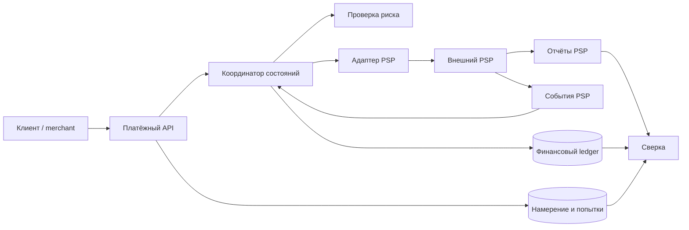

# Вопросы на собеседовании: `Design Payment System`

`Payment System` (Stripe / Adyen / Braintree / Wise) — один из самых жёстких system design кейсов: одновременно требует строгой корректности (нельзя «потерять» деньги), высокой доступности (downtime = прямая потеря выручки), соответствия регуляторам (PCI-DSS, AML, KYC) и распределённой интеграции с десятками внешних провайдеров. Стандарт для senior+.

## Полезные ссылки

- [Stripe Engineering Blog](https://stripe.com/blog/engineering)
- [Designing for Idempotency (Stripe)](https://stripe.com/blog/idempotency)
- [PCI-DSS v4.0 Quick Reference](https://www.pcisecuritystandards.org/document_library/)
- [Adyen Tech Blog](https://www.adyen.com/blog/topics/engineering)
- [Visa Chargeback Management Guidelines](https://usa.visa.com/dam/VCOM/global/support-legal/documents/dispute-management-guidelines-for-visa-merchants.pdf)
- [Square Engineering — Distributed Transactions](https://developer.squareup.com/blog/)
- [System Design Primer — payment](https://github.com/donnemartin/system-design-primer)
- [Microservices.io — Saga pattern](https://microservices.io/patterns/data/saga.html)

## Содержание

**Requirements и capacity**
- [Q1. (!) Functional и non-functional requirements?](#q1--functional-и-non-functional-requirements)
- [Q2. (!) Оценка нагрузки: capacity estimation на 10K txn/sec и 1B пользователей?](#q2--оценка-нагрузки-capacity-estimation-на-10k-txnsec-и-1b-пользователей)
- [Q3. Read-heavy vs write-heavy и SLA на каждой операции?](#q3-read-heavy-vs-write-heavy-и-sla-на-каждой-операции)

**Идемпотентность и ledger**
- [Q4. (!) Idempotency keys: формат, dedup window, response replay?](#q4--idempotency-keys-формат-dedup-window-response-replay)
- [Q5. (!) Двойная запись (double-entry ledger): debit/credit, инварианты, аудит?](#q5--двойная-запись-double-entry-ledger-debitcredit-инварианты-аудит)
- [Q6. Хранилище для ledger: Postgres vs Cassandra vs кастомный append-only?](#q6-хранилище-для-ledger-postgres-vs-cassandra-vs-кастомный-append-only)

**Payment lifecycle**
- [Q7. Жизненный цикл платежа: authorize → capture → settle → refund?](#q7-жизненный-цикл-платежа-authorize--capture--settle--refund)
- [Q8. (!) Распределённые транзакции: saga vs 2PC?](#q8--распределённые-транзакции-saga-vs-2pc)
- [Q9. Saga: хореография vs оркестрация?](#q9-saga-хореография-vs-оркестрация)
- [Q10. (!) Outbox pattern для надёжной публикации событий?](#q10--outbox-pattern-для-надёжной-публикации-событий)

**External integrations**
- [Q11. 3D Secure 2.0: challenge, frictionless и SCA?](#q11-3d-secure-20-challenge-frictionless-и-sca)
- [Q12. (!) Интеграции с PSP (Stripe, Adyen, Braintree)?](#q12--интеграции-с-psp-stripe-adyen-braintree)
- [Q13. Платёжные сети (Visa/MC/Amex), interchange и scheme fees?](#q13-платёжные-сети-visamcamex-interchange-и-scheme-fees)
- [Q14. (!) Tokenization и vault: формат токенов, scope, rotation?](#q14--tokenization-и-vault-формат-токенов-scope-rotation)
- [Q15. Webhooks: доставка, retry, подпись и идемпотентные получатели?](#q15-webhooks-доставка-retry-подпись-и-идемпотентные-получатели)

**Settlement и операции**
- [Q16. Settlement: расчёты T+1, batch-файлы, ACH/SWIFT?](#q16-settlement-расчёты-t1-batch-файлы-achswift)
- [Q17. (!) Reconciliation с PSP report vs internal ledger?](#q17--reconciliation-с-psp-report-vs-internal-ledger)
- [Q18. Refunds (partial, full, idempotency, временные окна)?](#q18-refunds-partial-full-idempotency-временные-окна)
- [Q19. Chargebacks: коды причин Visa, доказательства, доля выигранных споров?](#q19-chargebacks-коды-причин-visa-доказательства-доля-выигранных-споров)

**Risk и fraud**
- [Q20. (!) Антифрод: правила + ML, velocity, device fingerprint?](#q20--антифрод-правила--ml-velocity-device-fingerprint)
- [Q21. AML/KYC и sanction screening?](#q21-amlkyc-и-sanction-screening)

**Money и продукт**
- [Q22. Мультивалютность: FX-курсы, кошелёк, хеджирование?](#q22-мультивалютность-fx-курсы-кошелёк-хеджирование)
- [Q23. Подписки: recurring billing, dunning, стратегия повторов?](#q23-подписки-recurring-billing-dunning-стратегия-повторов)

**Архитектура и compliance**
- [Q24. (!) Соответствие PCI-DSS: SAQ A vs D, сокращение scope?](#q24--соответствие-pci-dss-saq-a-vs-d-сокращение-scope)
- [Q25. (!) Архитектура платежа: состояния, ledger и PCI scope?](#q25--архитектура-платежа-состояния-ledger-и-pci-scope)
- [Q26. Payment orchestrator и smart routing между PSP?](#q26-payment-orchestrator-и-smart-routing-между-psp)
- [Q27. (!) Мультирегиональность: data residency, failover, регуляторика?](#q27--мультирегиональность-data-residency-failover-регуляторика)

**Production**
- [Q28. Бюджет задержки: p99 на authorize, capture, refund?](#q28-бюджет-задержки-p99-на-authorize-capture-refund)
- [Q29. Monitoring, observability и операционные runbooks?](#q29-monitoring-observability-и-операционные-runbooks)
- [Q30. (!) Антипаттерны и подводные камни?](#q30--антипаттерны-и-подводные-камни)

## Q1. (!) Functional и non-functional requirements?

Сначала договоритесь, **какую платёжную операцию** проектируете и что означает её успешный ответ. Создание намерения платежа, подтверждение авторизации у провайдера и окончательный расчёт — разные события. Функции задают границы продукта, а требования к сохранности, восстановлению и наблюдаемости определяют, как эти функции реализовать. Например, Stripe PaymentIntent может перейти в `requires_action` или `processing` до `succeeded`; успешный приём запроса не равен успешному платежу. [Stripe: PaymentIntent lifecycle](https://docs.stripe.com/payments/paymentintents/lifecycle).

**Функциональное ядро для интервью:** создать платёжное намерение с суммой, валютой и идентификатором операции; провести выбранный способ оплаты через провайдера; получить состояние и обработать асинхронное изменение; выполнить capture или refund, если они входят в сценарий. Карты, локальные методы, подписки и выплаты добавляйте только после уточнения scope: их жизненные циклы различаются.

**Нефункциональные требования уточняют отдельно:**
- **Сохранность и корректность:** какие уже подтверждённые операции нельзя потерять, как фиксируются внутренние проводки и как сверяется их результат с PSP. `RPO = 0` может быть целью для подтверждённых проводок, но её нужно обеспечить и проверить при аварийном переключении, а не объявлять свойством любого ledger.
- **Повторы и неопределённый исход:** клиентский запрос и вызов PSP получают устойчивые идентификаторы; после таймаута система выясняет прежний результат, прежде чем пробовать другую попытку (Q4, Q17).
- **Доступность и задержка:** для каждой операции выбирают SLI, окно измерения и целевой SLO. Отдельно измеряют время ответа API и длительность платежа с участием клиента, например 3DS (Q3).
- **Защита данных:** по выбранному способу оплаты определяют PCI DSS scope и сроки хранения конкретных данных. PCI DSS не устанавливает универсальный семилетний срок хранения cardholder data. [PCI SSC FAQ 1318](https://www.pcisecuritystandards.org/faqs/1318/).

Выпуск карт, кредитование, налоги и разделение выплат могут быть отдельными продуктами; включайте их только при явном требовании. Тогда выбор хранилища и интеграций следует из согласованного сценария, а не из придуманного масштаба.

## Q2. (!) Оценка нагрузки: capacity estimation на 10K txn/sec и 1B пользователей?

Заданные **10 тыс. платежей/с на пике** и **1 млрд зарегистрированных пользователей** — условия упражнения, а не опубликованные показатели Stripe. Число пользователей влияет на размер учётных данных и индексов, но не определяет среднюю частоту платежей. Для расчёта нужны отдельные допущения о среднем потоке, размере записей, чтениях, сроке хранения и доле операций, ожидающих PSP.

Например, примем только для этого расчёта средние **2 тыс. платежей/с** (пик в пять раз выше), **1 КБ** метаданных платежа и **две записи по 200 Б** в учебном ledger на платёж. Тогда за сутки получится `2 000 × 86 400 = 172,8 млн` платежей, около **172,8 ГБ** метаданных и **69,1 ГБ** проводок. Это примерно **242 ГБ/сутки до индексов, реплик, журнала, резервных копий и сжатия**. Реальный lifecycle может дать другое число проводок; сначала задайте события, а потом считайте объём.

На пике при условном ожидании внешнего ответа **0,5 с** одновременно будут ожидать около `10 000 × 0,5 = 5 000` операций. Это оценка конкуренции, а не требование к числу JVM-pod: размер пулов и пропускную способность подтверждают нагрузочным тестом. Отдельно оцените число вызовов PSP, запросов статуса и webhook по фактическому сценарию; умножать каждую транзакцию на фиксированные «пять API-запросов» без такого сценария нельзя.

**Восстановление после остановки PSP.** Допустим, система продолжала принимать по 2 000 новых операций в секунду и складывать их в устойчивую очередь, пока отправка была остановлена на пять минут. Накопится около 600 000 операций. Если после восстановления PSP позволяет завершать 3 000 операций в секунду, а новые продолжают поступать по 2 000, очередь будет убывать примерно на 1 000 операций в секунду. На её разбор уйдёт около десяти минут при постоянных скоростях и без дополнительных повторов. При равных скоростях поступления и обработки хвост не сократится. Уже отправленные операции с неизвестным исходом требуют отдельного выяснения результата (Q26).

Срок хранения и стоимость выводят из требований к конкретным данным. [PCI SSC](https://www.pcisecuritystandards.org/faqs/1318/) не устанавливает семилетний срок для cardholder data; политика должна ограничивать хранение необходимым и удалять ненужное.

## Q3. Read-heavy vs write-heavy и SLA на каждой операции?

Read-heavy или write-heavy — свойство **измеренной нагрузки**, а не обязательное свойство любой платёжной системы. В одном продукте много опросов статуса, в другом преобладают новые платежи. При этом записи, повторы и сверка критичны для корректности даже при небольшом QPS. Для каждой операции согласуйте SLI, целевой SLO и точку завершения; SLA — внешнее договорное обязательство, его нельзя вывести из учебной таблицы задержек. [Google SRE: Implementing SLOs](https://sre.google/workbook/implementing-slos/).

| Операция | Что измерять | Где проходит граница результата |
|---|---|---|
| Создание платежа | Долю запросов с устойчивым ID и время ответа API | Принятый запрос может ещё требовать 3DS или ждать PSP |
| Авторизация / capture | Долю определённых исходов, время ожидания PSP и число неопределённых исходов | Таймаут не доказывает отказ; исход выясняют по ID и событиям |
| `GET /payments/{id}` | Доступность, задержку и возраст показанного состояния | Read-модель может отставать от авторитетного состояния |
| Webhook | Задержку доставки, долю доставленных событий и возраст очереди | Повторная доставка требует идемпотентного получателя |
| Reconciliation | Возраст и сумму неразобранных расхождений | Завершение batch не означает отсутствие расхождений |

Если 3DS требует действия пользователя, время до `succeeded` не входит в бюджет синхронного ответа на создание намерения. Stripe различает `requires_action`, `processing` и `succeeded`; асинхронные изменения передаются событиями. Числовые SLO выбирают из требований продукта и измерений, затем проверяют на пике из Q2. [Stripe: lifecycle](https://docs.stripe.com/payments/paymentintents/lifecycle), [webhooks](https://docs.stripe.com/webhooks).

## Q4. (!) Idempotency keys: формат, dedup window, response replay?

Idempotency key связывает **повтор одного намерения** с прежней операцией. После потери ответа клиент повторяет запрос с тем же ключом и теми же параметрами; сервер не должен создавать второй платёж только из-за повтора. Но ключ сам по себе не делает атомарными внутреннюю запись, вызов PSP и ответ клиенту.

Для проектируемого API задайте область уникальности `(merchant_id, тип операции, key)` и сравнивайте существенные параметры запроса: сумму, валюту, получателя и другие поля, влияющие на платёж. Устойчиво фиксируйте соответствие ключа и внутреннего `payment_id` вместе с решением о создании операции. Если результат уже известен, верните его; при другом содержимом под тем же ключом верните ошибку конфликта. Если запрос ещё выполняется, верните документированный промежуточный статус или ошибку для повтора. Конкретный HTTP-код и срок хранения — часть **вашего** контракта, а не универсальные значения Stripe.

Если вызов PSP завершился таймаутом, не отправляйте сразу новый платёж с новым ключом: проверьте прежнюю попытку по устойчивому ID/ключу провайдера и сверяйте её с последующими событиями. По истечении короткого окна dedup собственный бизнес-идентификатор платежа должен по-прежнему защищать от повторной оплаты того же заказа. Это связывает API-повтор с Q17 о сверке, но не обещает «ровно один раз» через границу двух организаций.

**Граница Stripe API:** в **API v1** Stripe рекомендует случайный ключ длиной до 255 символов, сравнивает параметры и сохраняет код с телом первого ответа после начала выполнения endpoint, включая `500`. Ключи могут удаляться спустя **не менее 24 часов**; повтор после удаления считается новым запросом. Ошибка валидации до начала выполнения и конфликт одновременно выполняющихся запросов не дают сохранённого результата. Для **API v2** Stripe считает запрос повтором при совпадении ключа и API в пределах одного аккаунта или sandbox, если между запросами прошло не более 30 дней. Это правило действует для `POST` и `DELETE` в пространстве имён `/v2`. При повторе успешной операции Stripe возвращает обновлённый ответ без новых изменений. Если часть работы завершилась ошибкой, Stripe может повторить эту часть и вернуть новый результат. Например, один ключ в sandbox и в рабочем аккаунте не связывает два запроса. [Stripe: Idempotent requests](https://docs.stripe.com/api/idempotent_requests), [Stripe: API v2 Idempotency](https://docs.stripe.com/api-v2-overview#idempotency).

**Граница Adyen:** для поддерживаемого POST передайте `idempotency-key` длиной до 64 символов. Adyen проверяет уникальность в рамках company account и документирует срок действия ключа от 7 до 14 дней с первой отправки. После таймаута без HTTP-ответа можно повторить тот же запрос с тем же ключом в том же регионе в пределах гарантированного окна. Например, через восемь дней ключ уже нельзя считать гарантированно действующим. Тогда сначала уточните исход по данным попытки, API и событиям. При переключении на другой регион проверка дубликата по этому ключу не действует даже внутри того же company account. [Adyen: API idempotency](https://docs.adyen.com/development-resources/api-idempotency/).

**Практический случай:** первый запрос к Stripe API v1 начал выполняться и вернул `500`. Повтор с тем же ключом может лишь вернуть сохранённый `500`, а не выяснить, возник ли платёж. Сохраните внутреннюю попытку в неопределённом состоянии; если ID объекта Stripe известен, запросите его состояние, сопоставьте события и проведите сверку. Если ID не получен, ищите результат по доступным идентификаторам и данным провайдера либо передайте случай на разбор. Новый ключ или другой PSP допустимы только после выяснения исхода прежней попытки: иначе возможна повторная оплата. Это решение следует из семантики сохранённого ответа Stripe и границы двух систем, а не из гарантии, что каждый `500` создал платёж.

## Q5. (!) Двойная запись (double-entry ledger): debit/credit, инварианты, аудит?

Double-entry ledger записывает одно экономическое событие как связанные дебетовые и кредитовые проводки. В каждой валюте сумма дебетов должна равняться сумме кредитов. Это даёт проверяемый инвариант, но не доказывает, что сумма, получатель и внешнее событие выбраны верно. [TigerBeetle: Financial Accounting](https://docs.tigerbeetle.com/coding/financial-accounting/).

Для примера возьмём **подтверждённый capture** на 100,00 USD с условной комиссией 3,00 USD. Во внутреннем учёте платёжного сервиса можно дебетовать требование к PSP на 100,00 и кредитовать обязательство перед продавцом на 97,00 и доход от комиссии на 3,00. Получается `100,00 = 97,00 + 3,00`. Это пример учётной модели, не сообщение о том, что PSP уже перечислил деньги. Карточная авторизация создаёт внешний hold; она сама по себе не равна переводу между внутренними счетами. Фактический расчёт и расхождения сверяют отдельно (Q7, Q17).

В PostgreSQL таблица `entries` может хранить `transaction_id`, `account_id`, `currency`, целую сумму в младших единицах, направление debit/credit и ссылку на исходный `payment_id`. Сначала задайте типы счетов и правило знака: дебет увеличивает активы, кредит увеличивает обязательства и доходы; «плюс» сам по себе не означает дебет для любого счёта. Проводки, состояние внутренней операции и идентификатор источника фиксируйте в одной транзакции. Перед переводом операции в проведённое состояние проверяйте баланс проводок **по каждой валюте** и уникальность ID события; один комментарий `SUM(entries)=0` в схеме этого не обеспечивает. PostgreSQL гарантирует атомарность локальной транзакции, но не атомарность с PSP. [PostgreSQL 18: transactions](https://www.postgresql.org/docs/18/tutorial-transactions.html).

**Проведение при конкуренции.** В PostgreSQL 18 построчный `CHECK` подходит для проверки суммы отдельной проводки, например `amount_minor > 0`. Равенство дебетов и кредитов проверяют по всему набору строк. Если проводки можно дописывать к черновику отдельными транзакциями, и добавление проводки, и проведение должны сначала блокировать одну и ту же строку операции через `SELECT ... FOR UPDATE`. Под блокировкой проверяют, что операция ещё в состоянии `DRAFT`. Проведение на уровне `READ COMMITTED` читает проводки отдельным запросом после захвата блокировки, сверяет суммы по каждой валюте и переводит операцию в `POSTED` в той же транзакции. Тогда добавление либо успеет до проверки и будет учтено, либо дождётся проведения, увидит `POSTED` и отклонится. Правило действует, если все пути записи соблюдают этот протокол и проведённые строки изменить нельзя. [PostgreSQL 18: CHECK](https://www.postgresql.org/docs/18/ddl-constraints.html#DDL-CONSTRAINTS-CHECK-CONSTRAINTS), [Read Committed](https://www.postgresql.org/docs/18/transaction-iso.html#XACT-READ-COMMITTED).

Исправление записывайте новой корректирующей операцией со ссылкой на исходную, не переписывайте историю. Для быстрого остатка допустима проекция, которую сверяют с авторитетными проводками и внешним отчётом. При FX уравновешивайте каждую валюту через явно определённые конверсионные счета: складывать USD и EUR в один нулевой итог нельзя. Для внутреннего резерва pending/post/void есть отдельная модель, разобранная в [Digital Wallet Q3](design-digital-wallet-interview.md#q3-как-резервировать-средства-и-считать-доступный-остаток).

## Q6. Хранилище для ledger: Postgres vs Cassandra vs кастомный append-only?

Выбирайте хранилище по **границе атомарного перевода** и доказуемым инвариантам, затем по измеренной нагрузке. Для обычного приложения PostgreSQL удобен, если связанные счета и проводки помещаются в одну транзакцию. Но сам выбор PostgreSQL не создаёт double-entry инвариант: его должны обеспечивать схема и код проведения. [PostgreSQL 18: transactions](https://www.postgresql.org/docs/18/tutorial-transactions.html).

| Вариант | Что даёт | Что нужно проверить |
|---|---|---|
| PostgreSQL 18 | Локальную ACID-транзакцию для состояния, счетов и проводок | Блокировки/изоляцию при параллельных списаниях, устойчивость commit, резервирование и восстановление |
| Apache Cassandra 5.0 | Репликацию, batches и LWT/CAS | Границы изоляции: batch не равен SQL-транзакции между независимыми счетами; согласованность и повторы проектируют явно |
| TigerBeetle | Специализированные счета и атомарный transfer между ними в одном ledger | Модель счетов, версия клиента, интеграцию с бизнес-данными и внешний PSP-исход |
| Собственный append-only | Контроль над моделью журнала | Атомарность, уникальность, восстановление, аудит и операционную поддержку приходится реализовать и доказать |

У Cassandra logged batch обеспечивает завершение набора записей или отсутствие набора, но изоляция batch ограничена одним partition key; LWT основан на Paxos. Это не готовая замена транзакции, которая одновременно проверяет два произвольных остатка и проводит перевод. У TigerBeetle атомарный transfer решает внутреннее движение между двумя счетами одного ledger, но внешний PSP всё равно находится вне этой транзакции. [Cassandra: guarantees](https://cassandra.apache.org/doc/latest/cassandra/architecture/guarantees.html), [CQL: BATCH](https://cassandra.apache.org/doc/latest/cassandra/developing/cql/cql_singlefile.html), [TigerBeetle: Transfer](https://docs.tigerbeetle.com/reference/transfer/).

Для PostgreSQL важны настройки долговечности и репликации: `synchronous_commit=off` может потерять уже подтверждённую клиенту транзакцию при сбое. Шардирование по продавцу допустимо только после ответа на вопрос, могут ли два счёта одной проводки оказаться в разных шардах. Не переносите авторитетный журнал в «холодный» архив по фиксированному сроку без проверенной политики хранения и процедуры восстановления. Число TPS на узел и выбор хранилища подтверждают нагрузочным тестом своего сценария. [PostgreSQL 18: asynchronous commit](https://www.postgresql.org/docs/18/wal-async-commit.html), [replication](https://www.postgresql.org/docs/18/warm-standby.html).

**После failover:** `synchronous_commit=on` без настроенного `synchronous_standby_names` ждёт запись WAL на диске *primary*, но streaming replication остаётся асинхронной. Если primary подтвердил проводку и упал до передачи WAL, standby после переключения может её не содержать. Для цели не терять подтверждённые проводки при таком переключении настройте синхронную репликацию с ожиданием durable WAL на выбранной standby и проверяйте, что при failover продвигается узел с подтверждённым журналом. `remote_write` слабее `on`: он не ждёт сброса WAL на диск standby. Синхронное подтверждение увеличивает задержку commit и при недоступности требуемых реплик может остановить новые подтверждения; сценарии отказа проверяйте учением восстановления. [PostgreSQL 18: synchronous_commit](https://www.postgresql.org/docs/18/runtime-config-wal.html), [synchronous replication](https://www.postgresql.org/docs/18/warm-standby.html), [failover](https://www.postgresql.org/docs/18/warm-standby-failover.html).

**Чтение после подтверждения проводки:** в PostgreSQL 18 при настроенной синхронной репликации `synchronous_commit=on` ждёт сброс WAL на диск подтверждающей standby, но та может ещё не применить запись. Например, после успешной оплаты новый запрос выписки к этой standby может вернуть прежний остаток. Для такого чтения выберите primary или настройте `remote_apply` и маршрутизируйте новый запрос с новым снимком на реплику, которая уже применила commit. `remote_apply` ждёт применения на подтверждающих синхронных репликах и добавляет эту задержку к commit. Балансировщик, отправляющий чтения на произвольную реплику, всё равно может вернуть старые данные. [PostgreSQL 18: synchronous_commit](https://www.postgresql.org/docs/18/runtime-config-wal.html#GUC-SYNCHRONOUS-COMMIT).

## Q7. Жизненный цикл платежа: authorize → capture → settle → refund?

Для **карточного платежа с ручным capture** авторизация, capture, расчёт между участниками и refund — разные события. Статус API провайдера не обязательно показывает весь банковский расчёт. Этот маршрут нельзя переносить без проверки на каждый платёжный метод: не все методы поддерживают раздельную авторизацию и capture. [Stripe: manual capture](https://docs.stripe.com/payments/place-a-hold-on-a-payment-method).

1. После подтверждения авторизации сумма доступна для capture до `capture_before`; в Stripe PaymentIntent ожидает его в `requires_capture`. Hold ограничивает доступные средства клиента, но ещё не означает окончательный расчёт с продавцом.
2. Продавец делает capture в допустимом окне. Полный или частичный capture зависит от метода и контракта провайдера; при истечении авторизации средства освобождаются. У Stripe uncaptured PaymentIntent отменяется через установленное число дней (**по умолчанию семь**), но окно конкретной карточной авторизации зависит от сети и типа операции. Проверяйте `capture_before`, а не запускайте capture по универсальному таймеру. [Stripe: capture PaymentIntent](https://docs.stripe.com/api/payment_intents/capture).
3. Settlement и выплата продавцу живут в отдельных процессах с собственными сроками и отчётами. Успешный ответ на capture не равен получению средств продавцом; внутренний ledger сверяют с PSP по Q17.
4. До capture отменяют ещё не списанную сумму, если это допускает состояние объекта. После состоявшегося списания создают refund — полный или частичный, с собственным состоянием и сроком. Refund не является откатом прежнего capture.

**Как запланировать capture в Stripe.** По событию `payment_intent.amount_capturable_updated` можно узнать, что изменилась доступная к списанию сумма. Перед отложенным capture проверьте текущие `status` и `amount_capturable` у PaymentIntent, а срок карточной авторизации возьмите из `payment_method_details.card.capture_before` у Charge. Например, если отгрузка запланирована через шесть дней, а авторизация истекает через пять, переводите заказ на отдельный сценарий оплаты до отгрузки. После истечения Stripe освобождает удержанную сумму и переводит платёж в `canceled`. [Stripe: ручной capture и срок авторизации](https://docs.stripe.com/payments/place-a-hold-on-a-payment-method).

Например, магазин авторизует оплату при оформлении заказа и делает capture после подтверждения отгрузки. Если заказ отменён до capture, он пытается отменить авторизацию; если capture уже прошёл, оформляет refund и учитывает возможную задержку его завершения. Не обещайте мгновенное освобождение hold или отсутствие комиссий для любого банка и метода. [Stripe: hold и сроки](https://docs.stripe.com/payments/place-a-hold-on-a-payment-method), [cancel PaymentIntent](https://docs.stripe.com/api/payment_intents/cancel), [create refund](https://docs.stripe.com/api/refunds/create).

**Несколько отгрузок:** частичный capture обычно завершает право списать остаток авторизации. В Stripe для большинства платежей остаток освобождается; повторный capture возможен только для подходящего multicapture, где `final_capture=false` сохраняет невостребованную часть. У Adyen single partial capture отменяет остаток, а multiple partial captures нужно отдельно включить для поддерживаемых методов. Поэтому до первого capture решите, нужны ли отдельные списания по отгрузкам, и храните ID и сумму каждого capture. У Adyen ответ `status: received` означает приём запроса; `CAPTURE` сообщает о его обработке, но в редких случаях после этого возможен `CAPTURE_FAILED` от банка или сети. Заказ нельзя считать окончательно оплаченным по одному ответу API. [Stripe: partial и multicapture](https://docs.stripe.com/payments/place-a-hold-on-a-payment-method), [Stripe: final_capture](https://docs.stripe.com/api/payment_intents/capture), [Adyen: capture](https://docs.adyen.com/online-payments/capture).

**Сверка при смене версии Stripe API:** начиная с `2025-03-31.basil`, частичный capture с освобождением остатка авторизации и отмена платежа не создают связанный `Refund` только из-за этого освобождения. Balance transaction capture показывает фактически списанную сумму, а `charge.refunded` и `charge.refund.updated` для этих действий не приходят. Сверяйте capture по его сумме и состоянию платежа, отмену — по `payment_intent.canceled` и данным объекта; не создавайте «недостающий refund» из-за отсутствия webhook. Настоящий возврат уже списанной суммы остаётся отдельной операцией. Для более ранней версии проверьте её поведение и данные при миграции: новый формат нельзя безусловно переносить на исторические записи. [Stripe: изменение учёта partial capture и cancellation](https://support.stripe.com/questions/changes-to-balance-transaction-behavior-for-partial-capture-and-payment-cancellation-flows).

## Q8. (!) Распределённые транзакции: saga vs 2PC?

Внутри одного ledger используйте его локальную атомарную операцию или транзакцию (Q5). Когда заказ, запас товара и PSP находятся в разных системах, общий commit доступен только если **каждый** участник поддерживает согласованный протокол. Обычный платёжный API PSP не предоставляет вашей транзакции `prepare/commit`, поэтому рабочий процесс сохраняет собственное состояние и координирует шаги с повторами и компенсациями. Это часто называют saga; название не добавляет атомарности между организациями. [PostgreSQL 18: PREPARE TRANSACTION](https://www.postgresql.org/docs/18/sql-prepare-transaction.html), [Stripe: PaymentIntent](https://docs.stripe.com/payments/paymentintents/lifecycle).

**Граница 2PC при сбое.** На первой фазе внешний координатор просит участников подготовить транзакции. На второй фазе он доводит до каждого участника записанное решение о фиксации или откате. Если координатор стал недоступен после подготовки, PostgreSQL сохраняет подготовленную транзакцию и её блокировки даже после завершения сессии. Например, конкурентное изменение зарезервированной строки может ждать, пока координатор восстановится и завершит операцию через `COMMIT PREPARED` или `ROLLBACK PREPARED`. Возраст таких транзакций можно отслеживать через `pg_prepared_xacts`. Таймаут сам по себе не даёт основания для ручного отката: другой участник мог уже получить решение зафиксировать общую транзакцию. [PostgreSQL 18: PREPARE TRANSACTION](https://www.postgresql.org/docs/18/sql-prepare-transaction.html).

Пример для заказа: локально зарезервировать товар и записать намерение платежа; авторизовать оплату с устойчивым ID; перед отгрузкой проверить действующий резерв и сделать capture. Если авторизация определённо отклонена, освободить товар. Если после успешной авторизации товар уже недоступен, попытаться отменить **непроведённый** платёж. Если capture состоялся, отмена авторизации уже не заменяет refund. Порядок шагов и право на возврат зависят от продукта, но связь ID, исходов и следующего действия должна сохраняться после перезапуска. [Stripe: manual capture](https://docs.stripe.com/payments/place-a-hold-on-a-payment-method), [cancel](https://docs.stripe.com/api/payment_intents/cancel), [refund](https://docs.stripe.com/api/refunds/create).

Компенсация — новая бизнес-операция, она может занять время или завершиться ошибкой. После таймаута PSP сначала выясните прежний исход по ID и событиям, затем решайте, какой шаг повторять; отправка нового capture или refund «на всякий случай» может удвоить эффект. Для каждого шага храните состояние, ключ повтора и задачу сверки; не обещайте строгую изоляцию или автоматический rollback всей цепочки. В PostgreSQL `PREPARE TRANSACTION` существует для настоящего 2PC с поддерживающим координатором, но сам по себе не делает PSP участником вашей транзакции. [Stripe: idempotent requests](https://docs.stripe.com/api/idempotent_requests), [PostgreSQL 18: PREPARE TRANSACTION](https://www.postgresql.org/docs/18/sql-prepare-transaction.html).

**Параллельные команды:** saga не изолирует отмену заказа от подтверждения оплаты и отгрузки. Пока заказ в `PAYMENT_PENDING`, отгрузку следует отклонить или отложить по правилу продукта; запрос отмены переводит заказ в `CANCEL_REQUESTED` условным переходом состояния. Если в это время пришёл результат авторизации, обработчик должен увидеть новое состояние и решить, требуется ли отмена hold, а не пометить заказ готовым к отгрузке по старому снимку. Это пример *semantic lock*: запрет конфликтующего бизнес-действия и проверка версии или ожидаемого состояния в локальной транзакции. Он не блокирует PSP и не заменяет выяснение исхода внешнего вызова. [AWS: saga orchestration и отсутствие изоляции](https://docs.aws.amazon.com/prescriptive-guidance/latest/cloud-design-patterns/saga-orchestration.html).

При отмене заказа после **частичного capture** разделите уже списанную сумму и оставшийся hold. Для подтверждённого списания при допустимых условиях потребуется отдельный refund; остаток можно отменить, только если он ещё зарезервирован и PSP разрешает отмену. Если single partial capture уже освободил остаток, повторно отменять нечего. Отслеживайте исход каждого capture и компенсации по отдельному ID: у Adyen ручной capture обрабатывается асинхронно, поэтому ответ `received` ещё не основание отправлять refund. См. Q7 и Q17. [Adyen: capture и его результат](https://docs.adyen.com/online-payments/capture), [Stripe: cancel PaymentIntent](https://docs.stripe.com/api/payment_intents/cancel), [Stripe: refunds](https://docs.stripe.com/api/refunds/create).

## Q9. Saga: хореография vs оркестрация?

Оба подхода координируют **последовательность локальных действий** без общей транзакции между сервисами. В хореографии участники реагируют на события друг друга; в оркестрации координатор хранит состояние процесса и явно назначает следующий шаг. Выбор зависит от числа участников, ветвлений и того, кому нужен обзор всего процесса. Компенсация — новое действие с собственным исходом, а не откат уже совершённого платежа (Q8). [AWS: saga patterns](https://docs.aws.amazon.com/prescriptive-guidance/latest/cloud-design-patterns/saga-patterns.html).

**Хореография:** после `InventoryReserved` обработчик платежа начинает авторизацию, а результат публикует как событие. Она удобна для короткого процесса с немногими участниками. При росте числа подписчиков труднее понять порядок, повтор и причину остановки. Событиям нужны ID заказа/шага, надёжная публикация (Q10) и защита от повторной обработки; конкретное число топиков Kafka не определяет паттерн.

**Оркестрация:** координатор для заказа хранит, например, `INVENTORY_RESERVED → PAYMENT_PENDING → AUTHORIZED → READY_TO_CAPTURE`. Он задаёт таймауты, проверяет результат PSP и выбирает продолжение либо компенсацию. Состояние координатора должно переживать рестарт; каждый шаг должен распознавать повтор. Централизация делает переходы видимыми, но координатор сам становится важной зависимостью и источником сложности. [AWS: saga orchestration](https://docs.aws.amazon.com/prescriptive-guidance/latest/cloud-design-patterns/saga-orchestration.html).

**Ручное восстановление координатора:** в Temporal `Workflow Reset` начинает новый Run с выбранной точки истории; шаги после неё могут выполниться снова. Если до этой точки или после неё уже был внешний платёж, reset не отменяет его у PSP. Перед повторным запуском изучите историю, состояние платежа и доступные события; связывайте повтор внешнего шага с устойчивым ID бизнес-операции и проверяйте окно идемпотентности конкретного PSP. Например, если платёж подтверждён, а отгрузка застряла, точку восстановления выбирают так, чтобы не отправлять новый платёж. Это частный пример для Temporal, а не обязательное свойство любой оркестрации. [Temporal: Workflow Reset](https://docs.temporal.io/cli/command-reference/workflow#reset), [Temporal: production controls, 29.10.2026](https://temporal.io/blog/production-controls), [Stripe: idempotent requests](https://docs.stripe.com/api/idempotent_requests).

В платёжном сценарии после таймаута авторизации **нельзя** сразу послать новую оплату или компенсацию: прежний запрос мог исполниться. Сначала выясните его исход по устойчивому ID, ключу повтора и событиям PSP, затем продолжите процесс. Уведомление об уже установленном результате может идти отдельным событием, но авторизация, capture и refund остаются управляемыми операциями с состоянием. Здесь нет универсального правила, что любой платёжный happy path обязан быть оркестрированным. [Stripe: idempotent requests](https://docs.stripe.com/api/idempotent_requests), [AWS: choosing a coordination approach](https://docs.aws.amazon.com/prescriptive-guidance/latest/modernization-integrating-microservices/choosing-approach.html).

## Q10. (!) Outbox pattern для надёжной публикации событий?

**Transactional outbox** закрывает разрыв между изменением состояния в локальной БД и намерением опубликовать событие. В одной транзакции пишут бизнес-строку и запись outbox, а отдельный процесс отправляет событие в брокер. Это даёт атомарность *двух записей в БД*, но не общей транзакции БД с Kafka или PSP. [AWS: transactional outbox](https://docs.aws.amazon.com/prescriptive-guidance/latest/cloud-design-patterns/transactional-outbox.html).

```sql
BEGIN;
  WITH changed AS (
    UPDATE payments SET status = 'AUTHORIZED'
    WHERE id = :payment_id AND status = 'AUTHORIZING'
    RETURNING id
  )
  INSERT INTO outbox (event_id, aggregate_id, event_type, payload)
  SELECT :event_id, id, 'PaymentAuthorized', :payload FROM changed;
COMMIT;
```

В примере событие пишут только если строка платежа действительно обновилась. Если транзакция отменится, событие не появится. Если relay упадёт после отправки, но до фиксации прогресса, сообщение может прийти повторно. Поэтому у события есть устойчивый `event_id`, а consumer фиксирует обработанный ID вместе со своим изменением состояния либо иначе обеспечивает идемпотентный эффект. Relay отслеживает отставание и ошибки; удаление или архивирование outbox не должно опережать подтверждённую публикацию. При важном порядке событий используйте ключ одного агрегата и проверьте порядок у выбранного relay и брокера. [AWS: issues and considerations](https://docs.aws.amazon.com/prescriptive-guidance/latest/cloud-design-patterns/transactional-outbox.html).

**Когда relay продвигает прогресс.** В Kafka успешный возврат из асинхронного `send()` означает, что запись принята клиентом к отправке. Relay ждёт успешного результата future или callback с подходящей настройкой `acks`, прежде чем пометить запись отправленной. Если подтверждение потерялось либо relay упал после него, но до сохранения прогресса, новая отправка той же строки сохраняет `event_id`. Идемпотентный Kafka producer защищает от дублей при внутренних повторах клиента в рамках сессии. Повторный вызов `send()` из relay считается новой отправкой, поэтому потребителю по-прежнему нужна дедупликация. [Apache Kafka 4.3: KafkaProducer](https://kafka.apache.org/43/javadoc/org/apache/kafka/clients/producer/KafkaProducer.html).

**Порядок на практике:** для одного платежа `PaymentAuthorized` должен предшествовать `PaymentCaptured`. Два polling-воркера могут взять разные строки outbox и отправить `Captured` раньше `Authorized`; если оба сообщения попадут в одну Kafka partition, в её журнале останется порядок записи, в том числе ошибочный порядок Captured → Authorized. Если порядок нужен потребителю, сериализуйте публикацию для одного `payment_id` либо используйте CDC с проверенным порядком изменений, а переходам присвойте версию агрегата в той же транзакции. Consumer должен распознавать дубль по `event_id` и не применять устаревшую версию поверх новой; обработку пропуска или ожидание недостающей версии задайте в его контракте. [AWS: порядок уведомлений](https://docs.aws.amazon.com/prescriptive-guidance/latest/cloud-design-patterns/transactional-outbox.html), [Debezium: ключ агрегата](https://debezium.io/documentation/reference/stable/transformations/outbox-event-router.html).

**Условие маршрутизации.** В Java producer Kafka 4.3 одинаковый сериализованный ключ направляет записи в одну partition при стандартной маршрутизации по ключу, фиксированном числе partitions и без явно заданной partition. При расширении топика тот же `payment_id` может попасть в другую partition, а старые записи останутся на месте. Тогда даже сериализация отправки у relay не задаёт порядок чтения между partitions. Если от порядка зависят проводки, при расширении сохраните прежнее сопоставление ключей для активных платежей либо обеспечьте применение событий по версиям агрегата с обработкой пропусков. [Apache Kafka 4.3: настройки producer](https://kafka.apache.org/43/configuration/producer-configs/), [расширение топика](https://kafka.apache.org/43/operations/basic-kafka-operations/#modifying-topics).

**Передача:** polling-воркер может забирать и резервировать пачки строк с учётом конкуренции воркеров; CDC-подход читает журнал изменений. В стабильной версии Debezium 3.7 Outbox Event Router помещает `id` события в заголовок, который consumer может использовать для дедупликации, а `aggregateid` — в ключ сообщения, важный для порядка внутри Kafka partition. CDC не отменяет мониторинг слота репликации, задержки и повторов. [Debezium: Outbox Event Router](https://debezium.io/documentation/reference/stable/transformations/outbox-event-router.html), [Debezium 3.7 release](https://debezium.io/blog/2026/09/29/debezium-3-7-final-released/).

`LISTEN/NOTIFY` может разбудить polling-воркер, но само уведомление не является долговременной записью события. Event sourcing — отдельное решение о системе записи, из которого outbox не получается автоматически. Публикация «после commit» без устойчивого намерения теряет событие при падении; публикация «до commit» может показать потребителю состояние, которое затем откатится. [PostgreSQL 18: NOTIFY](https://www.postgresql.org/docs/18/sql-notify.html).

## Q11. 3D Secure 2.0: challenge, frictionless и SCA?

**EMV 3-D Secure** — протокол аутентификации держателя карты в карточном онлайн-платеже; успешная аутентификация сама по себе не означает успешную авторизацию или оплату. В **frictionless flow** ACS эмитента оценивает переданные данные и завершает аутентификацию без дополнительного действия клиента. В **challenge flow** эмитент запрашивает активное подтверждение, например в банковском приложении. Доля этих путей зависит от рынка, эмитента и потока операций; универсальных 85%/15% нет. [EMVCo: 3DS flows](https://www.emvco.com/dynamic/emv-3-d-secure-whitepaper-v2/introduction/), [challenge flow](https://www.emvco.com/dynamic/emv-3-d-secure-whitepaper-v2/challenge-flow/business-overview/).

**Отсутствие challenge ещё не означает frictionless-аутентификацию.** В Adyen `data-only` передаёт данные о покупателе в Visa или Mastercard для оценки риска без обычного запроса на 3DS-аутентификацию. Такой путь доступен для этих схем вне рынков с обязательной PSD2 SCA и не даёт переноса ответственности за мошеннический chargeback. Например, в 3DS Authentication report сочетание `Authentication Flow = Data only` и `Authentication Success = 1` не доказывает прохождение SCA или liability shift: сверяйте тип потока, применимость SCA и итог авторизации отдельно. [Adyen: data-only flow](https://docs.adyen.com/online-payments/3d-secure/data-only), [3DS Authentication report](https://docs.adyen.com/reporting/3d-secure/3ds-authentication-report), [3DS flows](https://docs.adyen.com/online-payments/3d-secure).

Участники потока — компонент merchant/3DS Server, Directory Server платёжной системы и **ACS эмитента**. 3DS Server посылает запрос аутентификации через Directory Server; ACS возвращает результат без challenge либо инициирует взаимодействие с клиентом. Затем результат используют при авторизации карты. Поэтому нельзя изображать 3DS как прямой вызов merchant в ACS, а ответ ACS — как `authorization approved`. [EMVCo: challenge technical features](https://www.emvco.com/dynamic/emv-3-d-secure-whitepaper-v2/challenge-flow/technical-features/).

**Decoupled authentication:** в EMV 3DS 2.2 и 2.3.1.1 ACS может согласовать подтверждение вне обычного challenge, например когда он недоступен или не завершился. 3DS Requestor указывает, допускает ли такой путь и сколько готов ждать; ACS выбирает его при поддержке участников, а поздний результат передаёт 3DS Server через `RReq`. Пока окончательный результат не получен, держите аутентификацию в ожидающем состоянии и не принимайте её за успешную авторизацию карты. Подтверждение в банковском приложении само по себе ещё не доказывает decoupled flow: это может быть обычный out-of-band challenge. Доступность такого пути в конкретной интеграции проверяйте у PSP и эмитента. [EMVCo: Decoupled Authentication](https://www.emvco.com/dynamic/emv-3-d-secure-whitepaper-v2/challenge-flow/decoupled-authentication/).

Merchant может запросить 3DS и выразить предпочтение challenge, но конечный flow определяет эмитент. В Stripe `request_three_d_secure=challenge` не гарантирует показ challenge; фактический `authentication_flow` и результат нужно читать из данных платежа. Успешный 3DS часто связан с переносом ответственности за **подходящий fraud dispute**, но не гарантирует его для каждого платежа и не защищает от претензии о недоставке (Q19). [Stripe: authentication flow and liability shift](https://docs.stripe.com/payments/3d-secure/authentication-flow).

**PSD2 SCA** — требование к сильной аутентификации в применимых европейских электронных платежах, а 3DS — один из способов выполнить его для карт. Порог **€30** в регламенте относится к *возможному освобождению для малой дистанционной операции*, а не к правилу «выше €30 всегда требуется 3DS». Для этой льготы сумма текущей операции должна быть не выше €30. Дополнительно статья 16 задаёт альтернативные условия по предыдущим дистанционным операциям плательщика после последней SCA: совокупная сумма не выше €100 или не более пяти последовательных операций. EBA уточняет, что в счётчики входят успешно инициированные операции. Например, сумма заказа €20 сама по себе не позволяет checkout обещать оплату без SCA: PSP применяет свою политику счётчиков, а эмитент может потребовать подтверждение. Для других освобождений действуют собственные условия. Не обещайте фиксированный код soft decline или одинаковый результат для всех рынков. [EU Delegated Regulation 2018/389, ст. 16](https://eur-lex.europa.eu/eli/reg_del/2018/389/oj), [EBA: which transactions count](https://www.eba.europa.eu/single-rule-book-qa/qna/view/publicId/2019_4785), [EBA: applying the limits](https://www.eba.europa.eu/single-rule-book-qa/qna/view/publicId/2018_4182), [authentication](https://docs.adyen.com/online-payments/authentication).

**Soft decline из-за требуемой аутентификации — сигнал продолжить платёжный flow, а не подтверждение оплаты.** При таком ответе эмитента Stripe может сам повторить попытку с 3DS. Если тот же `PaymentIntent` перешёл в `requires_action`, передайте клиенту его `next_action` и держите заказ в ожидании; `processing` и `succeeded` сверяйте как отдельные состояния. У Adyen проверьте, не выполнил ли PSP повтор автоматически (`SCA Retry` в отчёте), обработайте полученный `IdentifyShopper`, `ChallengeShopper` или `RedirectShopper`, если требуется действие клиента, и обновляйте заказ по итоговому `AUTHORISATION`, а не только по первому `resultCode`. Связывайте события с попыткой и исходным заказом, чтобы ранний отказ не перезаписал результат повтора (Q15). Не создавайте новую попытку из-за одного промежуточного ответа: прежде проверьте фактический исход у PSP (Q4/Q12). Если автоматического повтора нет, путь повторной 3DS-аутентификации зависит от интеграции и причины отказа. [Stripe: 3DS flow](https://docs.stripe.com/payments/3d-secure/authentication-flow), [PaymentIntent lifecycle](https://docs.stripe.com/payments/paymentintents/lifecycle), [Adyen: result codes](https://docs.adyen.com/online-payments/build-your-integration/payment-result-codes), [3DS Authentication report](https://docs.adyen.com/reporting/3d-secure/3ds-authentication-report).

## Q12. (!) Интеграции с PSP (Stripe, Adyen, Braintree)?

**PSP** даёт merchant API и процессы для приёма поддерживаемых методов оплаты. Он снимает необходимость прямой интеграции с каждой карточной сетью, но методы, страны, валюты, статусы и действия клиента различаются даже в рамках одного PSP. Выбор провайдера проверяют по нужным рынкам и методам, модели расчётов, комиссиям, возвратам, disputes, отчётам и качеству интеграции. Сравнение Stripe, Adyen и Braintree без страны, типа merchant и текущего договора не даёт устойчивого рейтинга. [Stripe: supported currencies and methods](https://docs.stripe.com/currencies), [Adyen: payment methods](https://docs.adyen.com/payment-methods/).

Для одного PSP храните **внутренний ID намерения** и связь с ID/состояниями провайдера. До внешнего вызова зафиксируйте попытку и внутренний ключ её повтора; передавайте ключ идемпотентности провайдеру, если конкретный API его поддерживает. После таймаута не считайте попытку отклонённой. Сверяйте API-объект и webhook с локальным состоянием (Q4/Q17). Специфичные состояния, refund и capture не скрывайте под общей абстракцией, которая теряет их смысл. [Stripe: PaymentIntent lifecycle](https://docs.stripe.com/payments/paymentintents/lifecycle), [Adyen: API idempotency](https://docs.adyen.com/development-resources/api-idempotency/).

У **Braintree SDK** `paymentMethodNonce` — одноразовая ссылка на платёжный метод, которую сервер передаёт в `transaction.sale`; для повторных платежей можно использовать сохранённый метод в Vault. Встроенная *Duplicate Transaction Checking* включена по умолчанию и сравнивает сумму, `orderId` (если он передан), статус исходной операции и признаки платёжного метода в настраиваемом окне (по умолчанию 30 секунд). Если шлюз распознал повтор, он сразу возвращает `Gateway Rejected`, не дожидаясь ответа карточной сети на запрос, который ещё обрабатывается. Если первый запрос затем получит отказ, шлюз автоматически не повторит ни один из запросов. Поэтому ответ о дубликате сам по себе не подтверждает успешную оплату. Поэтому после потерянного ответа нельзя просто создать вторую `sale` с новым nonce и считать совпадение `orderId` защитой от повторной оплаты. Сохраните своё намерение и попытку, выясните результат по ID транзакции или поиском по `orderId`, а отсутствие результата поиска сразу после запроса не принимайте за отказ. [Braintree: nonce](https://developer.paypal.com/braintree/docs/guides/payment-method-nonces), [sale](https://developer.paypal.com/braintree/docs/reference/request/transaction/sale/java), [duplicate checking](https://developer.paypal.com/braintree/articles/control-panel/transactions/duplicate-checking/), [transaction search](https://developer.paypal.com/braintree/docs/reference/request/transaction/search/java).

**Ответ о повторе у Adyen.** Если HTTP-ответ получен, для временной ошибки ориентируйтесь на `transient-error: true`: он разрешает повтор позже с прежним ключом. При одновременных запросах с одним ключом код ошибки `704` с HTTP 409 или 422 означает, что запрос уже обработан либо ещё выполняется. Сохраните прежнюю попытку и выясните её состояние. По одному коду `704` нельзя считать платёж ни успешным, ни отклонённым. Отличие от таймаута без ответа и границы ключа разобраны в Q4. [Adyen: API idempotency](https://docs.adyen.com/development-resources/api-idempotency/).

**Несколько PSP** оправданы, если измеренный выигрыш в покрытии, устойчивости или стоимости превышает цену новых маршрутов и сверки. Routing выбирает провайдера для *нового* намерения по методу, рынку и правилам. При известном отказе можно решить, допустим ли новый маршрут; при таймауте исход остаётся неизвестным. Ключи идемпотентности действуют в границах провайдера и его аккаунта, поэтому тот же ключ у другого PSP не предотвращает двойное списание. Даже у Adyen дубликаты между региональными endpoint не исключаются одним ключом. Перед failover выясните исход старой попытки или оставьте её в состоянии расследования, затем отдельно решайте, нужен ли новый платёж. [Adyen: key scope](https://docs.adyen.com/development-resources/api-idempotency/), [Stripe: idempotent requests](https://docs.stripe.com/api/idempotent_requests).

Многопровайдерность добавляет точку отказа в routing, перенос токенов, разные модели ошибок, webhook, возвратов и сверки. Успех авторизации нельзя считать гарантированно выше только из-за второго PSP; проверяйте его по когортам и не переключайте операции без модели неизвестного исхода. Нужна ли такая архитектура, зависит от продукта, а срок новой интеграции нельзя оценивать универсальными «2–4 месяцами». Недавнее исследование Stripe о региональных различиях 3DS и fraud помогает формулировать метрики по рынкам, но его цифры относятся к выборке Stripe. [Stripe, 22.09.2026](https://stripe.com/blog/new-trends-in-global-card-fraud-how-3d-secure-and-regional-mandates-are-affecting-risk).

## Q13. Платёжные сети (Visa/MC/Amex), interchange и scheme fees?

В обычной четырёхсторонней карточной схеме **issuer** обслуживает держателя карты, **acquirer** — продавца, а Visa или Mastercard задаёт правила сети и передаёт сообщения авторизации. **Interchange** — расчёт между acquirer и issuer, а не прямой счёт сети продавцу. Продавец платит своему acquirer/PSP согласованную комиссию за приём платежа (merchant discount / merchant service charge). В ней могут учитываться interchange, сборы сети, обработка и наценка провайдера. [Visa: fees and interchange](https://www.visa.com/en-us/support/business/regulation-fees), [Mastercard: interchange](https://www.mastercard.com/ca/en/business/support/merchant-interchange-rates.html).

**Interchange++** показывает interchange, сборы сети и наценку провайдера раздельно; **blended pricing** объединяет их в тариф продавца. Нельзя подставлять одну таблицу процентов для любой операции: ставки зависят от страны, продукта карты, типа операции и применимых правил. Например, опубликованные [Visa USA Interchange Reimbursement Fees](https://usa.visa.com/content/dam/VCOM/download/merchants/visa-usa-interchange-reimbursement-fees.pdf) действуют для определённого рынка и периода, а не для всех платежей. При сравнении PSP сопоставляют одинаковые когорты операций и фактические выписки, включая дополнительные сборы, возвраты и споры.

**Трансграничный платёж не обязательно требует конвертации валюты.** Например, продавец в США выставил счёт в USD и получает выплату в USD, а карта Visa выпущена за пределами США. В опубликованной таблице Visa USA такие карты выделены в раздел *International Transactions*; одна валюта у платежа и выплаты не превращает операцию в платёж по карте, выпущенной в США. Для оценки стоимости нужны страна выпуска карты, рынок продавца, продукт карты, канал и условия договора, а не только валюта или BIN. Таблица interchange не показывает весь тариф продавца: сборы сети и наценка PSP учитываются отдельно. В Payment accounting report Adyen поля `Interchange (SC)`, `Scheme Fees (SC)` и `Markup (SC)` заполняются раздельно, если эквайер передал детализацию; иначе удержанная комиссия отражается в `Commission (SC)`. Сверяйте эти строки с договором и не смешивайте их с FX-конвертацией из Q22. [Visa USA: international interchange](https://usa.visa.com/content/dam/VCOM/download/merchants/visa-usa-interchange-reimbursement-fees.pdf), [Mastercard: interregional rates](https://www.mastercard.com/ca/en/business/support/merchant-interchange-rates.html), [Adyen: Payment accounting report](https://docs.adyen.com/reporting/invoice-reconciliation/payment-accounting-report/).

**American Express** совмещает роли сети и эмитента для собственных карт, но не всегда сама заключает договор с продавцом: в программе OptBlue это делают сторонние эквайеры, которые определяют цену приёма. Поэтому называть каждый платёж Amex полностью закрытой трёхсторонней схемой или заведомо более дорогим неверно. [American Express OptBlue](https://www.americanexpress.com/en-us/business/optblue/agent/).

Для маршрутизации учитывают доступность сети и провайдера, страну, продукт карты и условия договора. BIN/IIN помогает определить диапазон карты, но сам по себе не выбирает оптимальный маршрут и не подтверждает итоговую комиссию (см. Q26).

**Сверка комиссий с инвойсом:** у Adyen часть комиссий уже удержана из выплат. Например, если итоговые комиссии за месяц составили €120, а в строке `Already Deducted` указано €100, к оплате остаётся €20. Для сверки используйте Interactive Payment Accounting Report (IPAR) за расчётный период. Фильтруйте строки по типу события и сверяйте суммы в валюте соответствующей колонки. Даже отклонённая попытка может дать processing fee в итоговом инвойсе, хотя в строке операции поле `Processing Fee (FC)` пустое. Поэтому сумма удержаний из выплат может отличаться от полной стоимости процессинга за месяц. [Adyen: reconcile your payment processing invoice](https://docs.adyen.com/reporting/invoice-reconciliation/).

## Q14. (!) Tokenization и vault: формат токенов, scope, rotation?

**Токенизация** подменяет PAN (номер карты) другим значением и уменьшает число компонентов, которым нужен PAN. Два разных идентификатора часто называют «токеном»:

- **Токен PSP/vault** — ссылка на сохранённый платёжный метод у конкретного провайдера, например `storedPaymentMethodId` Adyen. Его формат — контракт API провайдера, а не стандарт сети. Провайдер может сам использовать network token при авторизации по этой ссылке. [Adyen: manage tokens](https://docs.adyen.com/online-payments/tokenization/managing-tokens/), [Adyen: network tokenization](https://docs.adyen.com/online-payments/network-tokenization).
- **EMV payment token (network token)** — замена PAN для платёжной сети. Ограничения домена могут задавать устройство, продавца или сценарий применения; нельзя считать, что каждый network token всегда привязан одновременно к устройству и продавцу. Его использование с другим PSP зависит от поддержки сети, эквайера и способа передачи, а не от переноса ID vault. [EMVCo: payment tokenisation](https://emvco.com/wp-content/uploads/2024/10/FINAL_TOKENISATION-QRG-1.pdf), [Adyen: forwarding](https://docs.adyen.com/online-payments/tokenization/forward-payment-details).

**Граница токена Adyen.** По умолчанию `shopperReference` и связанный с ним `storedPaymentMethodId` используются в одном merchant account. Если магазин переводит повторные платежи на другой merchant account того же company account, сначала проверьте, настроены ли для них Token Groups. Эта настройка позволяет делиться ссылками покупателей и токенами между merchant accounts. Граница отличается от области ключей идемпотентности из Q4. При смене PSP согласуйте отдельный способ переноса или повторное сохранение карты. В поддерживаемой интеграции Adyen может переслать платёжные реквизиты третьей стороне по ссылке из своего vault, но принимающий PSP не может использовать эту ссылку как собственный токен. [Adyen: Tokenization](https://docs.adyen.com/online-payments/tokenization), [Adyen: Forward payment details](https://docs.adyen.com/online-payments/tokenization/forward-payment-details).

**Payment Account Reference (PAR)** — нефинансовая ссылка, связывающая операции по PAN и связанным с ним EMV payment tokens. Он помогает сопоставлять операции карты и кошелька для мониторинга мошенничества или программы лояльности, если PSP передаёт PAR; например, у Adyen поле `PaymentAccountReference` включается в дополнительных данных webhook. PAR не является ни реквизитом для авторизации, ни ID сохранённого метода PSP: начать платёж только по PAR нельзя. Сам по себе PAR не считается PCI account data, но система остаётся в PCI DSS scope, если также обрабатывает account data или связана с такой системой. [EMVCo: PAR](https://www.emvco.com/emv-technologies/payment-tokenisation/), [PCI SSC: FAQ 1374](https://www.pcisecuritystandards.org/faqs/1374/), [Adyen: additional settings](https://docs.adyen.com/development-resources/webhooks/webhook-types/additional-settings).

**Общий PAN у разных держателей:** опубликованные EMVCo сценарии PAR учитывают отдельные карты людей с одним PAN, которых нужно различать, например для транспортного тарифа или программы лояльности. Поэтому группировка только по PAN может ошибочно объединить разных держателей. Если PSP передаёт PAR для таких карт, проверяйте его связь с конкретным держателем и токенами в своей интеграции; не используйте PAR как безусловный глобальный ID человека и не предполагайте, что он присутствует в каждом событии. [EMVCo: PAR white paper v2.2 и сценарии, октябрь 2026](https://www.emvco.com/news-publications/emvco-newsletter-q3-2026/), [EMVCo: Payment Tokenisation](https://www.emvco.com/emv-technologies/payment-tokenisation/).

**Жизненный цикл:** при истечении или перевыпуске карты платёжные реквизиты могут обновиться через сеть или account updater; результат зависит от причины перевыпуска и настройки провайдера. У Adyen Real Time Account Updater обновляет сохранённые реквизиты без смены `storedPaymentMethodId`, тогда как новый номер карты, вводимый покупателем, требует нового сохранения. В Adyen событие `recurring.token.updated` сообщает об обновлении сохранённых реквизитов, а `recurring.token.disabled` сообщает об отключении. При отключении пометьте метод недоступным для последующих списаний и предложите клиенту выбрать другой. Автоматическое обновление зависит от провайдера и сценария, универсального срока ротации нет. [Adyen: manage tokens](https://docs.adyen.com/online-payments/tokenization/managing-tokens/).

**PCI scope:** сам факт хранения токена не выводит всю систему из PCI DSS. Vault, детокенизация, хранение PAN, ключи и компоненты с доступом к ним входят в scope; изолированные компоненты, работающие только с токенами, оценивают отдельно. EMV payment token вне среды провайдера токенизации не считается account data при условиях PCI SSC, но соседство с PAN или доступ к cardholder data меняет оценку. Зашифрованный PAN остаётся cardholder data; тип SAQ и уровень merchant определяют по фактическому потоку данных и правилам программы, а не по одному факту шифрования. [PCI SSC: tokenization guidelines](https://www.pcisecuritystandards.org/documents/Tokenization_Guidelines_Info_Supplement.pdf), [PCI SSC: EMV payment tokens FAQ](https://www.pcisecuritystandards.org/faqs/1326/). См. Q24–Q25.

## Q15. Webhooks: доставка, retry, подпись и идемпотентные получатели?

**Webhook** сообщает об изменении у PSP, но успешный HTTP-ответ подтверждает только приём уведомления, а не завершение платежа или проводку в вашем ledger. События могут повториться и прийти не по порядку. Например, Stripe повторяет недоставленные события в live mode до трёх дней с экспоненциальной задержкой; точное расписание попыток не является контрактом. Ручная отправка не отменяет автоматические повторы. [Stripe: webhooks](https://docs.stripe.com/webhooks), [Stripe: recovery](https://docs.stripe.com/events/manage-webhook-endpoints).

**Проверка подлинности:** для Stripe проверяйте `Stripe-Signature` по исходным байтам тела и секрету конкретного endpoint, прежде чем доверять данным. Библиотеки Stripe по умолчанию допускают пять минут расхождения часов; tolerance настраивается, а при повторной доставке Stripe создаёт новую подпись и timestamp. У Adyen формат и место HMAC зависят от типа webhook: используйте соответствующий валидатор, не переносите правило Stripe о заголовке и пяти минутах на другой PSP. [Stripe: signature verification](https://docs.stripe.com/webhooks), [Adyen: HMAC](https://docs.adyen.com/development-resources/webhooks/secure-webhooks/verify-hmac-signatures).

**Доступ к endpoint и подпись события — разные проверки.** Для Adyen Standard webhook можно настроить OAuth 2.0: Adyen получает access token у вашего провайдера идентификации (IdP) и отправляет его с событием. Приёмник проверяет токен и нужные права доступа, а HMAC-подпись — отдельно, если она настроена для события. Валидный токен не заменяет проверку целостности payload; валидная подпись не отменяет настроенную проверку доступа. Например, перед изменением заказа по `AUTHORISATION` отклоните запрос, который не прошёл хотя бы одну требуемую проверку, затем примените обычную идемпотентную обработку. У Adyen документация о поддержке OAuth 2.0 для Balance Platform webhook расходится с общей инструкцией настройки; для такого webhook проверяйте его тип и доступные настройки отдельно. [Adyen: secure webhooks](https://docs.adyen.com/development-resources/webhooks/secure-webhooks/), [webhook types](https://docs.adyen.com/development-resources/webhooks/webhook-types), [configure and manage](https://docs.adyen.com/development-resources/webhooks/configure-and-manage).

**Ротация секрета:** Stripe позволяет сразу погасить прежний signing secret или при ротации в Stripe Workbench отложить его истечение на срок до 7 дней. Пока оба секрета действуют, Stripe добавляет подпись для каждого: приёмник может проверить событие по любому из них, а при переходе поддерживать оба. У Adyen новый HMAC-ключ распространяется не мгновенно, а событие, уже ожидающее доставки, сохраняет подпись старым ключом. Поэтому после смены проверяйте новый и старый ключи, пока возможны такие доставки; фиксированного общего «окна 24 часа» для Adyen нет. В обоих случаях отклоняйте событие, которое не прошло проверку ни одним разрешённым ключом. [Stripe: roll endpoint signing secrets](https://docs.stripe.com/webhooks), [Adyen: changing HMAC key](https://docs.adyen.com/development-resources/webhooks/secure-webhooks/verify-hmac-signatures), [Adyen: queued events](https://help.adyen.com/en_US/knowledge/ecommerce-integrations/webhooks/how-to-generate-a-new-hmac-key).

**Приём и обработка:** после настроенных проверок доступа и подписи надёжно сохраните событие или поместите его в устойчивую очередь и только затем быстро верните `2xx`. Не отвечайте успехом перед потеряемой записью в памяти. Отдельный worker применяет переход состояния и финансовый эффект идемпотентно: фиксирует ключ уже выполненной операции вместе с бизнес-изменением в одной локальной транзакции. Если обработка упала, событие остаётся для повторной попытки. У Adyen на подтверждение есть 10 секунд, но это не целевое время обработки бизнеса. [Adyen: handle webhooks](https://docs.adyen.com/development-resources/webhooks/handle-webhook-events), [Stripe: webhooks](https://docs.stripe.com/webhooks).

**Дедупликация и порядок — разные задачи.** Для повторной доставки Stripe храните `event.id`; Stripe также может создать два разных `Event` для одного изменения — у snapshot events сравнивайте `event.type` и `data.object.id`, затем проверяйте идемпотентность самой операции. У Adyen дубли одного события имеют одинаковые `eventCode` и `pspReference`, но остальные поля могут различаться. Не сортируйте платежи только по timestamp: Stripe предупреждает, что разные snapshot events могут иметь одинаковый `created`. Проверяйте допустимый переход для текущего состояния, при пробеле запрашивайте актуальный объект PSP и сверяйте его с внутренней попыткой и ledger (Q4, Q17). [Stripe: event delivery](https://docs.stripe.com/webhooks), [Adyen: duplicate events](https://docs.adyen.com/development-resources/webhooks/handle-webhook-events).

**Дедупликация финансового эффекта между каналами.** Webhook и фоновая сверка (Q17) могут одновременно обнаружить один и тот же успешный частичный возврат Stripe. У записи сверки нет того же `event.id`, поэтому оба обработчика должны приводить наблюдение к одной внутренней операции. В учебной модели для проведения успешного возврата ключом служит `(provider, account_id, refund_id, effect_type)`, где `refund_id` — ID объекта Stripe Refund, а `effect_type` — проведение возврата. Два отдельных частичных возврата по одному платежу имеют разные ID. В PostgreSQL уникальное ограничение на этот ключ и `INSERT ... ON CONFLICT (...) DO NOTHING RETURNING ...` позволяют записать проводки только обработчику, который вставил ключ. Ключ и проводки фиксируются в одной транзакции. При откате следующий обработчик сможет провести возврат. Корректирующую проводку моделируют отдельным эффектом. [Stripe: Refund](https://docs.stripe.com/api/refunds/object), [PostgreSQL 18: INSERT](https://www.postgresql.org/docs/18/sql-insert.html#SQL-ON-CONFLICT).

**Формат события Stripe выбирают для конкретного event destination.** Snapshot event содержит состояние ресурса на момент создания в `data.object`; к моменту обработки оно может устареть. Thin event передаёт тип, `id` события и ссылку `related_object` на ресурс, а полное событие или актуальный ресурс получают отдельным API-запросом. Не пытайтесь читать `data.object.id` из thin notification и не считайте получение свежего ресурса защитой от повторного финансового эффекта: для него нужен собственный ключ операции. [Stripe: event formats](https://docs.stripe.com/events/how-events-work), [Events v2](https://docs.stripe.com/api/v2/core/events).

**Восстановление:** отслеживайте неуспешные доставки и очередь собственной обработки. В Stripe для событий API v1 список с `delivery_success=false` возвращает события за последние 30 дней, доставка которых ожидается или исчерпала попытки хотя бы для одного endpoint. Ограничьте выборку периодом сбоя и типами событий нужного обработчика. Повторная обработка через API может идти одновременно с автоматической доставкой. Используйте общий ключ обработки и после проверки подписи подтверждайте уже обработанное событие кодом `2xx`. У Adyen используйте retry queue. Если нужный период выходит за окно API событий, восстановите финансовое состояние по объектам и отчётам PSP, затем сверьте его с ledger (Q17). [Stripe: recovery](https://docs.stripe.com/events/manage-webhook-endpoints), [Adyen: troubleshoot](https://docs.adyen.com/development-resources/webhooks/troubleshoot/).

## Q16. Settlement: расчёты T+1, batch-файлы, ACH/SWIFT?

**Settlement** в ответе о карточном платеже нужно отличать от capture и от **payout продавцу**. После capture провайдер проводит клиринг и расчёты по правилам метода оплаты; затем средства становятся доступными на балансе PSP. Перевод с этого баланса на банковский счёт продавца — отдельная выплата со своим расписанием и возможным временем зачисления банком. Например, статус `Settled` у Adyen означает, что средства получены Adyen, но ещё не обязательно выплачены продавцу. [Adyen: payments lifecycle](https://docs.adyen.com/account/payments-lifecycle/), [Stripe: balances](https://docs.stripe.com/payments/balances).

**T+1** означает срок только после определения, что именно считается `T`, календарные это дни или рабочие, и какой этап заканчивается через один день. У Stripe `T` для settlement timing — время подтверждения или capture, после которого деньги становятся доступными на балансе; payout schedule задаёт, когда доступные средства отправят в банк. У Adyen Sales day payout группирует captures по sales day и применяет настроенную задержку; эта выплата может не совпадать со временем поступления средств от схемы. Не обещайте универсальные `T+1` для США и ЕС и не выводите дату банковского зачисления из одного статуса capture. [Stripe: payouts](https://docs.stripe.com/payouts), [Adyen: sales day payout](https://docs.adyen.com/account/sales-day-payout/).

**Пример Sales day payout:** если закрытие sales day настроено на 02:00 по местному времени merchant account, capture в 01:30 относится к ещё открытому дню продаж. Срок до включения в payable batch считают от этого дня с учётом настроенной задержки и банковских праздников. В день выплаты payable batch закрывается в 04:00 по тому же местному времени, через два часа после настроенной границы sales day. После закрытия batch Adyen формирует платёжную инструкцию банку и начинает формировать Settlement Details Report, если включена автоматическая генерация. Дату банковского зачисления проверяют отдельно. [Adyen: sales day и закрытие batch](https://docs.adyen.com/account/sales-day-payout/#payable-batch-closing-and-report-generation).

**Файлы и рельсы:** карточный клиринг и отчёты PSP, перевод продавцу и межбанковские сообщения — разные интерфейсы. Для сверки храните идентификаторы capture, балансной операции и payout, а также сумму, валюту, комиссии и даты доступности; не делайте снимок ledger «раз в день» единственным источником финансового состояния (Q5, Q17). ACH — сеть банковских переводов США с расписанием расчётов, включая Same Day ACH; SEPA относится к европейским переводам и не является названием ACH в ЕС. SWIFT передаёт сообщения между финансовыми организациями и сам не перемещает деньги. FedNow — отдельная круглосуточная инфраструктура мгновенных платежей США. Выбор рельса для payout зависит от страны, банка, PSP и продукта. [Nacha: ACH](https://www.nacha.org/content/ach-payments-fact-sheet), [Swift: who we are](https://www.swift.com/es/node/310155), [Federal Reserve: FedNow](https://www.frbservices.org/financial-services/fednow-service/about-fednow-service/).

**Поздняя корректировка:** доступность или даже выплата средств не исключает refund, dispute либо reversal. Для Sales day payout Adyen описывает `SETTLED_REVERSED`, когда не получил captured funds за 30 дней и списывает сумму из payable batch; событие нужно сопоставить с исходным платежом и провести отдельную корректировку, а не переписать историю capture.

В том же режиме `REFUND_NOT_CLEARED` означает другое: покупатель уже получил средства, но эквайер не обработал возврат за 30 дней, поэтому Adyen зачисляет сумму возврата обратно в payable batch. Это не `REFUND_FAILED`, при котором покупатель денег не получил; автоматически оформлять второй возврат нельзя. Оба webhook нужно включить отдельно. Если возврат позже обработан, в Settlement Details Report появляется новая запись `Refunded`: сверьте её с прежней корректировкой и проведите отдельный финансовый эффект, сохраняя историю. Успешный settlement Adyen не сопровождается отдельным webhook, поэтому отчёт и сверка важнее предположения «все статусы придут push-событиями». [Adyen: webhook types](https://docs.adyen.com/development-resources/webhooks/webhook-types), [payments lifecycle](https://docs.adyen.com/account/payments-lifecycle/), [settlement details report](https://docs.adyen.com/reporting/settlement-reconciliation/transaction-level/settlement-details-report).

## Q17. (!) Reconciliation с PSP report vs internal ledger?

Reconciliation сопоставляет **внутренние операции и проводки** с независимыми данными PSP, а затем при выплате — с банковским поступлением. Проверяйте не только наличие записи, но и её тип, состояние, сумму, валюту, комиссии и время. Успешная карточная авторизация не обязана уже иметь проводку capture в ledger или строку выплаты: её сначала сравнивают с записью об авторизации (Q5, Q7). [Stripe: Balance Transaction](https://docs.stripe.com/api/balance_transactions/object).

Для каждой попытки храните внутренний `payment_id`, ID у PSP, ID capture/refund и, когда появился, ID финансовой операции провайдера. В Stripe `BalanceTransaction` содержит `source`, `amount`, `fee`, `net`, `currency`, `created` и `available_on`; `net` сравнивают с ожидаемым движением на балансе Stripe, а не с полной ценой заказа. Сопоставление делайте по устойчивым ID и типу операции. Календарный день — фильтр для загрузки, не ключ соединения: созданный сегодня платёж может попасть в более позднюю выплату. [Stripe: Balance Transaction](https://docs.stripe.com/api/balance_transactions/object), [Payout reconciliation](https://docs.stripe.com/reports/payout-reconciliation).

**Поздний отказ выплаты Stripe:** `arrival_date` показывает ожидаемую дату. Некоторые выплаты сначала имеют статус `paid`, а затем переходят в `failed`. Сопоставьте исходное движение `balance_transaction`, обратное движение `failure_balance_transaction` и банковскую выписку. Проведите возврат средств на баланс PSP отдельной записью и свяжите её с исходной выплатой. Перед новой выплатой проверьте возвращённую сумму и причину отказа. [Stripe: объект Payout](https://docs.stripe.com/api/payouts/object).

Если сверка подтверждает успешный возврат, который также может прийти через webhook, передайте его в ту же операцию проведения из Q15. Например, в Stripe связь `Refund.balance_transaction` помогает сопоставить финансовое движение с возвратом. Идентификатор выгрузки защищает от повторной загрузки файла, а общий ключ проведения защищает ledger от второй записи при обработке того же возврата другим каналом. [Stripe: Refund](https://docs.stripe.com/api/refunds/object).

**Практический проход:** загрузить отчёт за согласованный период с идентификатором выгрузки; повторную загрузку сделать идемпотентной; сопоставить строки с авторитетным журналом в обе стороны; затем сверить сумму batch-выплаты с банковской выпиской. Отдельно классифицировать: (1) операция у PSP без внутреннего события; (2) операция внутри без подтверждения PSP; (3) другой статус или сумма; (4) ожидаемые различия комиссии, FX и задержки. Для каждой категории задать допустимое время ожидания по контракту PSP, владельца разбора и корректирующее действие. Не удаляйте расхождение автоматически на основании одного таймаута и не проводите дублирующий платёж до выяснения исхода (Q4).

Например, capture в конце месяца может войти в выплату следующего месяца. У Stripe Balance summary перечисляет операции периода, но **не связывает** платежи с конкретными выплатами; для автоматических выплат такую связь даёт Payout reconciliation report либо выборка `BalanceTransaction` по ID стандартной автоматической выплаты после `reconciliation_status=completed`. При `in_progress` дождитесь готовности состава выплаты. [Stripe: объект Payout](https://docs.stripe.com/api/payouts/object). Отчёт группирует выплату по **ожидаемой дате прихода**, а банк может зачислить её позже; сами данные отчёта тоже могут появиться после выплаты. Для ручных и мгновенных выплат Stripe не определяет, какие именно операции составили выплату: сверяйте движение баланса, историю операций и банковский приход самостоятельно. Поэтому сравнение «день T с днём T» и правило «нет строки сегодня → операция потеряна» дают ложные тревоги. [Stripe: Balance summary](https://docs.stripe.com/reports/balance), [Payout reconciliation](https://docs.stripe.com/reports/payout-reconciliation), [API reconciliation](https://docs.stripe.com/payouts/reconciliation).

У Adyen одна операция может дать несколько строк в Settlement Details Report. Для сопоставления используйте `Psp Reference` и `Merchant Reference`, а финансовый эффект определяйте по `Type`, суммам и валютам. Для строк `Settled` и `Refunded` поле `Modification Reference` указывает конкретную модификацию; `Batch Number` связывает записи с выплатой. Так два частичных refund одного платежа не сольются в одну проводку по одному ID исходной оплаты. Если расчёт идёт через внешнего эквайера, понадобится также External settlement detail report или отчёт этого эквайера. [Adyen: settlement details](https://docs.adyen.com/reporting/settlement-reconciliation/transaction-level/settlement-details-report), [transaction-level reconciliation](https://docs.adyen.com/reporting/settlement-reconciliation/transaction-level).

**Комиссии сверяйте по этапу и валюте.** В руководстве Adyen по месячному инвойсу `Processing Fee (FC)` ищут в строках Payment accounting report с `Record Type` `Received` и `SentForRefund`; комиссия за обработку может относиться и к операции, которая позже получила отказ. Для эквайринговых комиссий по рассчитанному платежу смотрят `Settled`: `Commission (SC)` либо раздельные `Markup (SC)`, `Scheme Fees (SC)` и `Interchange (SC)`, если эквайер передал детализацию (Q13). Отдельные `SentForRefund` и `Refunded` привязывайте к нужной модификации, а не уменьшайте исходный capture и его комиссию на глаз. Суммы в `FC` и `SC` не складывайте, пока не приведены к одной валюте по фактическому расчёту. [Adyen: invoice reconciliation](https://docs.adyen.com/reporting/invoice-reconciliation), [Payment accounting report](https://docs.adyen.com/reporting/invoice-reconciliation/payment-accounting-report/), [Settlement details report](https://docs.adyen.com/reporting/settlement-reconciliation/transaction-level/settlement-details-report/), [пример с отказом](https://docs.adyen.com/classic-platforms/reconciliation-use-cases/understand-fees/).

**Месячный инвойс — ещё один слой сверки.** Сопоставьте итог начислений по каждому виду затрат с уже удержанным из settlement; остаток `Amount due` Adyen добавит или вычтет из следующей выплаты как `InvoiceDeduction` в Settlement Details Report. Не прибавляйте этот остаток второй раз к полному итогу инвойса и не разносите общую строку на один платёж без подтверждённой связи. Если итог не сходится, проверьте период и часовой пояс отчёта, округление по операциям и по месячному объёму, скидки, тарифные ступени и другие строки инвойса, прежде чем объявлять потерю денег. [Adyen: invoice reconciliation](https://docs.adyen.com/reporting/invoice-reconciliation), [Payment processing invoice](https://docs.adyen.com/reporting/invoice-reconciliation/payment-processing-invoice), [Settlement details report](https://docs.adyen.com/reporting/settlement-reconciliation/transaction-level/settlement-details-report/).

Частота сверки и порог эскалации зависят от риска и доступности данных. Webhook ускоряет обнаружение смены статуса, но итоговую сверку с финансовым отчётом и банковской выпиской не заменяет. Свежий [разбор Stripe о собственных выплатах](https://stripe.com/blog/stripe-on-stripe-what-we-learned-moving-1b-in-vendor-payments-to-global-payouts) показывает отдельный практический риск: отправитель видит ID и назначение выплаты, а получатель может не узнать платёж в своей выписке без понятного описания.

## Q18. Refunds (partial, full, idempotency, временные окна)?

После состоявшегося списания refund — **новая операция** с собственным ID и состоянием. До capture, когда PaymentIntent ещё `requires_capture`, отменяют авторизацию, если провайдер допускает это состояние; после успешного платежа создают refund. В Stripe Refund указывает исходный Charge или PaymentIntent, а суммарные частичные возвраты не могут превышать сумму исходного списания. [Stripe: cancel PaymentIntent](https://docs.stripe.com/api/payment_intents/cancel), [create refund](https://docs.stripe.com/api/refunds/create).

В своём API назначьте внутренний устойчивый `refund_id` и ключ повтора **до вызова PSP**; ID возврата у провайдера сохраните, когда он станет известен. В локальной транзакции проверьте допустимую сумму с учётом уже выполненных и ожидающих возвратов и зарезервируйте её против конкурентного запроса: например, блокировкой строки платежа либо условным обновлением остатка. Затем вызовите PSP с тем же намерением. Если ответ потерян, выясните исход по прежнему ключу, исходному Charge/PaymentIntent и событиям, сохраняя резерв до определённого результата. HTTP-код повтора и срок хранения ключа зависят от контракта вашего API и версии PSP (Q4); нельзя обещать универсальный `200` и вечный replay.

**Два частичных возврата одновременно.** У платежа на 100 уже возвращено 30 и зарезервировано 20. Два новых запроса с разными ID на 40 и 30 каждый по отдельности укладываются в оставшиеся 50. Если оба прочитают остаток и затем отдельно создадут резерв, они вместе превысят лимит. В PostgreSQL 18 при `READ COMMITTED` можно хранить доступный остаток в одной строке платежа и резервировать его условным обновлением:

```sql
UPDATE payments
SET refundable_remaining = refundable_remaining - :amount
WHERE payment_id = :payment_id
  AND :amount > 0
  AND refundable_remaining >= :amount
RETURNING refundable_remaining;
```

Сумма передаётся в минимальных единицах валюты платежа. Если первым зафиксируется резерв на 40, второй запрос после ожидания блокировки проверит условие на обновлённой строке с остатком 10 и не получит результата. Запись намерения с уникальным `refund_id` и уменьшение остатка фиксируйте одной транзакцией. Повтор прежнего намерения возвращает его состояние без нового резерва. Подтверждение возврата переводит резерв в использованную сумму без второго вычитания. При окончательном отказе возвращайте остаток один раз, в той же транзакции, что и переход из состояния с активным резервом. Этот инвариант требует, чтобы все операции, меняющие остаток, обновляли ту же строку. [PostgreSQL 18: Read Committed](https://www.postgresql.org/docs/18/transaction-iso.html#XACT-READ-COMMITTED).

Создание Refund ещё не доказывает, что клиент получил деньги. У Stripe возможны `pending`, `requires_action`, `succeeded`, `failed` и `canceled`; подписывайтесь на `refund.created`, `refund.updated`, `refund.failed` и при необходимости перечитывайте объект. Финансовый ledger должен отражать выбранную стадию модели учёта и переходы без перезаписи истории; при подтверждённом `failed` или `canceled` снимите резерв и учтите обратное движение у PSP, если оно было. Не выдавайте pending за окончательно возвращённые деньги. [Stripe: Refund object](https://docs.stripe.com/api/refunds/object), [refund events](https://docs.stripe.com/refunds#refund-events).

**Refund одновременно со спором** требует отдельной сверки. Если банк начал dispute, пока возврат ещё `pending`, клиент может получить два зачисления; Stripe может завершить такой Refund с `failure_reason=charge_for_pending_refund_disputed`. Сопоставьте ID возврата и спора с одной исходной оплатой, проверьте их фактические статусы и движения баланса, затем решайте спор по его процедуре. Не отправляйте второй refund для «исправления» ожидания: при открытом формальном споре Stripe не разрешает возврат вне dispute process. Правила других методов оплаты и PSP проверяйте отдельно (Q19). [Stripe: refunds](https://docs.stripe.com/refunds), [dispute lifecycle](https://docs.stripe.com/disputes/how-disputes-work).

Stripe отправляет возврат на **исходный способ оплаты**. Для закрытой карты эмитент обычно зачисляет сумму на замену или доставляет её другим способом; иногда возврат завершается ошибкой. По документации Stripe клиент обычно видит карточный кредит примерно через 5–10 рабочих дней, но срок зависит от банка; быстрый возврат иногда отображается как отмена первоначального списания. Если денег не видно, используйте доступный ARN/STAN/RRN для поиска, а не обещайте фиксированное число дней. В Stripe комиссия за исходную обработку платежа не возвращается; ограничения и правила для других PSP и методов проверяйте отдельно. [Stripe: refund destinations, failures and tracing](https://docs.stripe.com/refunds).

## Q19. Chargebacks: коды причин Visa, доказательства, доля выигранных споров?

**Dispute** открывает держатель карты через эмитента; merchant refund инициирует продавец. При формальном споре процессор может списать оспариваемую сумму и комиссию со счёта merchant. Исход спора определяет эмитент; возврат суммы и комиссии зависит от результата, региона и договора с процессором. Например, у Stripe правила возврата разных dispute fees различаются. Не считайте любое обращение клиента уже оформленным chargeback и не обещайте фиксированную комиссию. [Stripe: dispute lifecycle](https://docs.stripe.com/disputes/how-disputes-work).

До формального chargeback могут появиться другие сигналы. У Stripe early fraud warning сообщает о подозрении эмитента, а inquiry запрашивает сведения и может перерасти в спор; ни один из них сам по себе не доказывает списание по chargeback. У Adyen `NOTIFICATION_OF_FRAUD` также не означает спор или списание, `REQUEST_FOR_INFORMATION` требует ответа, а `NOTIFICATION_OF_CHARGEBACK` открывает срок защиты. Сохраняйте тип события и ID исходной оплаты, проверяйте состояние у PSP и выбирайте действие для этой стадии. Автоматический refund на каждое предупреждение может вернуть деньги за операцию, которая никогда не стала бы спором; после начала формального спора используйте его процедуру и сверяйте возможный уже созданный refund (Q18). [Stripe: dispute lifecycle](https://docs.stripe.com/disputes/how-disputes-work), [Adyen: dispute flow](https://docs.adyen.com/risk-management/understanding-disputes/dispute-process-and-flow).

**Коды Visa зависят от причины:** 10.4 — мошенничество без физического предъявления карты; 13.1 — товар или услуга не получены; 13.3 — не соответствуют описанию; 13.4 — подделка; 12.5 — неверная сумма. Для 10.4 нужны данные об авторизации и использовании аккаунта, для 13.1 — обещанный срок и подтверждение доставки. Не подменяйте доказательство доставки одним лишь успешным 3DS. [Visa Dispute Management Guide for Merchants, октябрь 2026](https://usa.visa.com/dam/VCOM/global/support-legal/documents/merchants-dispute-management-guidelines.pdf).

**Рабочий процесс:** получите событие и сохраните ID спора, причину, сумму и крайний срок; у Stripe это, например, `charge.dispute.created`. Сверьте заказ, платёж, доставку и переписку. Затем примите спор либо отправьте доказательства по конкретной причине до указанного срока и отслеживайте итог `won`/`lost` с отражением движения денег в ledger (Q17). У Stripe окно ответа обычно 7–21 день, но срок задаётся конкретным спором; отсутствие ответа вовремя ведёт к проигрышу. Поддержка этапов эскалации зависит от процессора: Stripe не предоставляет merchant самостоятельное прохождение arbitration через платформу. [Stripe: responding](https://docs.stripe.com/disputes/responding), [lifecycle](https://docs.stripe.com/disputes/how-disputes-work).

**Статус спора и движение денег сверяют отдельно.** В Stripe `charge.dispute.closed` сообщает о завершении спора. События `charge.dispute.funds_withdrawn` и `charge.dispute.funds_reinstated` сообщают о движениях баланса. Например, после `won` ожидайте подтверждения возврата средств, а сумму, валюту и идентификатор движения берите из `Dispute.balance_transactions` или сверяйте с отчётом PSP. При `lost` ранее учтённое списание не проводят повторно. Если одно движение обнаружили из вебхука и при сверке отчёта, для проводки по балансу PSP используйте один ключ из аккаунта провайдера и ID движения. Один `dispute_id` для этого недостаточен: у спора могут быть и списание, и обратное движение (Q17). [Stripe: типы событий](https://docs.stripe.com/api/events/types), [объект Dispute](https://docs.stripe.com/api/disputes/object).

**Compelling Evidence 3.0** применима к определённым спорам Visa 10.4, когда можно предъявить соответствующие требованиям данные о прежних бесспорных операциях. Она не гарантирует победу. Универсального win rate для всех merchants и причин нет: измеряйте долю оспоренных, принятых и выигранных споров отдельно по причине, рынку и периоду. [Visa guide](https://usa.visa.com/dam/VCOM/global/support-legal/documents/merchants-dispute-management-guidelines.pdf), [Stripe: evidence](https://docs.stripe.com/disputes/responding).

**Мониторинг Visa:** прежние VDMP/VFMP объединены в Visa Acquirer Monitoring Program (VAMP). Её базовая метрика для card-not-present операций VisaNet — число сообщений о fraud `TC40` плюс число disputes `TC15`, делённое на число settled transactions `TC05`; предусмотрены исключения и отдельные условия по региону, эквайеру и месячному числу событий. Поэтому старые пороги 0,9%/1,8% и простое `chargebacks / все транзакции` не описывают текущий VAMP. Сверяйте действующую редакцию и параметры с эквайером. [Visa VAMP fact sheet](https://corporate.visa.com/content/dam/VCOM/corporate/visa-perspectives/security-and-trust/documents/visa-acquirer-monitoring-program-fact-sheet-2025.pdf).

Для профилактики используйте понятный billing descriptor, прозрачную доставку и возвраты, антифрод (Q20) и подходящий 3DS. Перенос ответственности после 3DS зависит от результата аутентификации, сети и причины спора; спор о недоставке он не закрывает. [Stripe: 3DS authentication](https://docs.stripe.com/payments/3d-secure/authentication-flow).

## Q20. (!) Антифрод: правила + ML, velocity, device fingerprint?

Антифрод принимает решение с учётом цены пропущенного мошенничества, ложного отказа и задержки оплаты. Правила, скоринг и 3DS дают разные сигналы и действия; фиксированной последовательности или общего лимита в 100 мс нет. Бюджет задержки задавайте для своего checkout и измеряйте вклад каждого внешнего вызова. [Stripe Radar: how it works](https://docs.stripe.com/radar/how-radar-works), [fraud prevention rules](https://docs.stripe.com/radar/rules).

**Сигналы и действия:**
- Velocity считайте по нескольким окнам и сущностям: карте/токену, аккаунту, IP, устройству и получателю. Один IP может объединять честных клиентов через NAT; порог «пять карт за десять минут» нельзя переносить между бизнесами без измерения. По риску выбирайте `allow`, `block`, дополнительную проверку или запрос 3DS; правила и доступные действия зависят от PSP и тарифа.
- ML-скоринг может использовать сумму, историю попыток, платёжный метод, поведение аккаунта и связи между сущностями. Интерпретируйте score по калибровке модели и сегменту, а пороги проверяйте на данных о конверсии и подтверждённом fraud. Сложная модель не обязательна, если достаточно правил и скоринга провайдера.
- Device fingerprint — вероятностный сигнал для связи попыток, а не постоянный уникальный ID клиента. Он меняется, допускает совпадения и обход, требует проверки доступности данных и применимых правил приватности. Не предполагайте доступ к IMEI или рекламному идентификатору каждого устройства.
- Запрос 3DS или предпочтение challenge не означает, что challenge непременно покажут: сценарий выбирает эмитент. Даже успешная аутентификация не гарантирует liability shift для каждого платежа и причины спора. [Stripe: 3DS authentication flow](https://docs.stripe.com/payments/3d-secure/authentication-flow), [EMVCo: challenge flow](https://www.emvco.com/dynamic/emv-3-d-secure-whitepaper-v2/challenge-flow/business-overview/).

**Граница решения:** собственный сервис может до вызова PSP разрешить попытку, отклонить её или отправить на дополнительную проверку, сохранив причину и ID решения. Но семантика `review` у PSP бывает другой: правило Stripe Radar `Review` обрабатывает платёж обычным образом и помещает его в очередь просмотра, а не обязательно удерживает авторизацию. Поэтому явно проектируйте, на каком этапе блокируется заказ, платёж или отгрузка. [Stripe Radar rules](https://docs.stripe.com/radar/rules).

**Пример с отгрузкой.** Магазин отправляет дорогой заказ только после списания и одобрения антифродом. В Stripe при ручном capture одобрение закрывает review, но само по себе не списывает средства. Приложение отдельно запрашивает capture для ещё действующей авторизации и разрешает отгрузку после подтверждения списания. При автоматическом capture списание может произойти до завершения review, поэтому магазин отдельно удерживает отгрузку. Событие `review.closed` проверяйте по полю `reason`: закрытие может означать, например, возврат или спор. События Stripe могут прийти в другом порядке, поэтому проверяйте оба условия перед переходом заказа к отгрузке и применяйте этот переход идемпотентно (Q30). [Stripe: review payments](https://docs.stripe.com/radar/transaction-reviews#actions), [review.closed](https://docs.stripe.com/api/events/types#event_types-review.closed), [доставка webhook](https://docs.stripe.com/webhooks#event-ordering).

**Петля обратной связи:** соединяйте решение со статусом авторизации, последующей жалобой, результатом спора (Q19) и подтверждённой классификацией. Не размечайте любой chargeback как fraud: причина может быть в недоставке или неверной сумме. Измеряйте fraud/dispute rate, долю ложных отказов, конверсию и задержку по рынкам и способам оплаты; проверяйте дрейф и меняйте правила или модель по наблюдаемому результату, без обязательного еженедельного переобучения. [Visa: dispute reason codes](https://usa.visa.com/dam/VCOM/global/support-legal/documents/merchants-dispute-management-guidelines.pdf), [Stripe: 2026 card fraud trends](https://stripe.com/blog/new-trends-in-global-card-fraud-how-3d-secure-and-regional-mandates-are-affecting-risk).

**Риск за пределами checkout:** один и тот же клиент может создавать новые аккаунты ради пробных периодов, накапливать неоплаченное потребление или злоупотреблять возвратами уже после успешной оплаты. Для этих сценариев сопоставляйте аккаунты, способ оплаты, устройство, историю использования и возвратов в допустимых границах приватности; решение принимайте при регистрации, в ходе расчётного периода и после покупки, а не только в момент авторизации. Высокая частота refund или совпадение устройства — повод для проверки, не доказательство мошенничества. Stripe отдельно документирует оценку риска при регистрации и входе (live mode требует Radar Pro либо trial) и сигнал неоплаты для usage-based billing; доступность конкретных API и preview-версию проверяйте до внедрения. [Stripe: account evaluations](https://docs.stripe.com/radar/customer-account-evaluations), [pay-as-you-go abuse](https://docs.stripe.com/radar/pay-as-you-go-abuse), [Adyen: fraud report 2026](https://www.adyen.com/press-and-media/fraud-report-2026).

## Q21. AML/KYC и sanction screening?

**KYC/CDD, AML-мониторинг и санкционные проверки решают разные задачи.** KYC (для компании часто KYB) устанавливает клиента и, где требуется, его бенефициаров; CDD добавляет цель отношений, риск-профиль и актуализацию данных. AML-мониторинг ищет подозрительное поведение в ходе отношений. Санкционный контроль проверяет, разрешены ли конкретная сторона, активность и операция по применимым ограничениям. Сначала определите юридическое лицо, его роль (например, merchant, PSP или регулируемый money transmitter), рынки и применимое право: требования к SAR или составу CDD нельзя автоматически назначить каждому интернет-магазину. В США FinCEN связывает CDD с *covered financial institutions*, а SAR для money services businesses — с перечисленными категориями и условиями. [FinCEN: CDD FAQs](https://www.fincen.gov/resources/statutes-and-regulations/cdd-rule-faqs), [FinCEN: MSB SAR](https://www.fincen.gov/money-services-business-msb-suspicious-activity-reporting).

**Идентификация и мониторинг:** при onboarding установите необходимые сведения о физическом или юридическом лице, проверьте их доступным методом и сохраните основание решения. Селфи, OCR и конкретный поставщик данных — варианты реализации, а не обязательная для всех форма KYC. Для поднадзорного лица риск-профиль определяет дополнительные сведения и дальнейший мониторинг; значимое изменение сведений или поведения может вызвать пересмотр. FinCEN не требует универсального ежедневного или иного фиксированного графика обновления CDD. Выявленный сценарий `structuring` или нетипичная цепочка переводов — сигнал к разбору, а не автоматическое доказательство отмывания и не безусловная отправка SAR. Если компания действительно обязана подать SAR, используйте процедуру соответствующей юрисдикции и не раскрывайте клиенту факт подачи; для указанных FinCEN MSB это отдельное требование, не функция любого merchant backend. [FinCEN: CDD monitoring](https://www.fincen.gov/resources/statutes-and-regulations/cdd-rule-faqs), [FinCEN: MSB SAR](https://www.fincen.gov/money-services-business-msb-suspicious-activity-reporting).

**Санкционный alert — ещё не подтверждённое совпадение.** Выбирайте списки и программы по применимой юрисдикции: OFAC ведёт SDN и другие списки, а также ограничения, не сводимые к именам в списке; ЕС публикует собственные ограничительные меры и сводный список. Скрининг релевантных сторон и операций делайте в точках риска, предусмотренных программой: при начале отношений, перед подходящим платежом, после изменения данных или списка, при периодическом пересмотре. Нет общего предписания «API на каждом платеже плюс ночной batch» для всех организаций. Сохраняйте версию списка, сопоставленные поля, источник alert и решение. [OFAC: compliance framework](https://ofac.treasury.gov/system/files/126/framework_ofac_cc.pdf), [OFAC: FAQ 5](https://ofac.treasury.gov/faqs/5), [Еврокомиссия: санкционные ресурсы](https://finance.ec.europa.eu/eu-and-world/sanctions-restrictive-measures/overview-sanctions-and-related-resources_en).

**Разбор совпадения:** если имя похоже, сопоставьте полную запись списка с доступными датой рождения, идентификаторами, адресом, юрисдикцией и данными компании. Одно совпадение имени может быть false positive; при неопределённости передайте case на проверку и не выполняйте запрещаемый шаг до решения по правилам организации. Для подтверждённого совпадения compliance определяет применимую программу, возможную лицензию или исключение и исход: разрешить, отклонить операцию либо блокировать имущество — это разные действия. Например, OFAC различает `block` и `reject`; нельзя автоматически замораживать средства по каждому fuzzy match. Сохраните обоснование, исполненное действие и необходимые отчёты. [OFAC: FAQ 5, обновлено 09.09.2026](https://ofac.treasury.gov/faqs/5), [OFAC: blocking and rejecting](https://ofac.treasury.gov/faqs/updated/2026-10-26).

**PEP** — отдельный признак риска: публичная должность сама по себе не означает санкцию или преступление. Применимые правила могут требовать усиленную проверку PEP, семьи и близких лиц, включая источник средств и дальнейший мониторинг; коммерческая база PEP не заменяет собственное решение. Для backend полезна явная машина состояний `pending_review → cleared / prohibited_action`, чтобы неопределённый санкционный case не выглядел как обычный fraud score из Q20. Порог совпадения, синхронность проверки и порядок действий при недоступности источника задают по риску и юридическим обязанностям, сохраняя журнал решения. [FATF: PEP guidance](https://www.fatf-gafi.org/en/publications/Fatfrecommendations/Peps-r12-r22.html), [OFAC: FAQ 5](https://ofac.treasury.gov/faqs/5).

## Q22. Мультивалютность: FX-курсы, кошелёк, хеджирование?

Мультивалютный платёж разделяет **валюту предъявления клиенту**, валюту внутреннего остатка и валюту расчёта с PSP или банком. Они могут совпадать, а могут различаться: сама оплата в EUR ещё не означает, что merchant получит выплату в EUR. В кошельке храните отдельный остаток для каждой валюты и явно связывайте счета с владельцем; у одного владельца может быть несколько счетов одной валюты с разным назначением. Суммы хранятся как целые младшие единицы по правилам конкретной валюты и PSP. Нельзя сложить 100 USD и 92 EUR в «192 единицы» или провести transfer напрямую между счетами разных валют в одном ledger TigerBeetle. [Stripe: presentment и settlement](https://docs.stripe.com/currencies), [TigerBeetle: currency exchange](https://docs.tigerbeetle.com/coding/recipes/currency-exchange/).

**Котировка:** покажите клиенту направление пары, сколько он отдаёт и получает, курс, отдельную комиссию или spread, время истечения и условие фиксации. Устойчиво сохраните `quote_id`, исходную и целевую суммы, валюты, курс, версию тарифа и выбранное правило округления. При подтверждении проверяйте срок и условия quote. Если продукт обещал фиксированный курс и не предусматривал согласованный переход на плавающий, после истечения получите новую котировку и согласие клиента вместо молчаливой конвертации по другому курсу. Wise допускает перевод по текущему курсу после истечения своей гарантии в условиях соответствующего продукта; это нужно показывать заранее. В Wise Platform API документированный authenticated quote фиксирует курс на 30 минут, а unauthenticated quote служит только оценкой; это **условие Wise Platform**, не стандартная длительность FX-котировки. ECB публикует справочные курсы в рабочие дни около 16:00 CET и прямо не рекомендует использовать их для сделок. [Wise Platform: quotes](https://docs.wise.com/guides/product/send-money/quotes), [Wise: guaranteed rate conditions](https://wise.com/help/articles/2448203/whats-a-guaranteed-rate), [ECB: reference rates](https://www.ecb.europa.eu/stats/exchange_rates/html/index.en.html).

**Проводки:** для условной котировки `100,00 USD → 92,00 EUR` при курсе `1 USD = 0,92 EUR` операция связывает два движения: `10000` центов USD со счёта клиента на USD-счёт ликвидности провайдера и `9200` евроцентов с EUR-счёта ликвидности провайдера на EUR-счёт клиента. В каждой валюте отправитель и получатель одной записи уравновешены. Если дополнительно берут `0,40 USD` комиссии, это *отдельный* перевод `40` центов USD от клиента на доходный счёт по принятой учётной модели: клиент отдаст `100,40 USD`, а не `100,00 USD`. Для double-entry дебет/кредит и тип каждого счёта задаются учётной моделью (Q5); простая строка `fx_revenue_USD +40` без встречной проводки нарушила бы инвариант. В TigerBeetle обмен оформляют двумя атомарно связанными переводами между парами счетов одного ledger на каждую валюту; связь с внешним исполнением FX у провайдера требует отдельной сверки (Q17). [TigerBeetle: currency exchange](https://docs.tigerbeetle.com/coding/recipes/currency-exchange/), [Adyen: FX rate and fee](https://docs.adyen.com/development-resources/currency-codes).

**Частичный возврат после конвертации.** Покупатель заплатил 100 EUR картой, а PSP зачислил продавцу сумму в USD. При возврате 30 EUR через Stripe укажите исходный платёж и `amount=3000`. Оставшийся лимит возврата по исходному платежу станет 70 EUR после успешного возврата. Проводку в USD сверяйте по фактической операции по балансу, связанной с возвратом. Сумма для клиента и изменение баланса продавца относятся к разным валютам. Курс исходного списания сам по себе не определяет сумму новой проводки. Храните связь с исходным платежом, ID возврата и обе суммы с их валютами. [Stripe: создание возврата](https://docs.stripe.com/api/refunds/create), [операции по балансу](https://docs.stripe.com/api/balance_transactions/object).

**Округление и риск:** разрядность валюты, режим округления, момент его применения и учёт остатка должны быть частью продукта и договора с провайдером. Универсального правила «в финансах всегда half-even» нет: нельзя подменять согласованную сумму повторным округлением на каждом промежуточном шаге. Проверьте также отличия minor units в API PSP от ISO 4217. Предварительное пополнение валютного счёта помогает исполнить обмен, но оставляет риск изменения стоимости запасов и недостатка ликвидности. Каждую операцию не обязательно немедленно хеджировать; лимиты открытой позиции, внешнее покрытие и cut-off расчётов выбирают по продукту и согласуют с treasury. Сверяйте отдельно сумму предъявления, сумму после конверсии, комиссию и фактическую выплату: это разные события и даты (Q17). [Stripe: currency amounts](https://docs.stripe.com/currencies), [Adyen: currency codes and FX fee](https://docs.adyen.com/development-resources/currency-codes), [TigerBeetle: exchange and rounding](https://docs.tigerbeetle.com/coding/recipes/currency-exchange/).

## Q23. Подписки: recurring billing, dunning, стратегия повторов?

Подписка связывает условия доступа, расчётный период, счёт (invoice), способ оплаты и состояние взыскания. Создание счёта, попытка оплаты и предоставление доступа — разные события. При Stripe Billing провайдер сам создаёт счета, собирает платежи, выполняет настроенные повторы и меняет статус подписки; второй локальный scheduler списаний дал бы риск двойного платежа. При собственной реализации счёту нужен устойчивый ключ периода, а каждой попытке — ID и идемпотентность; после таймаута исход уточняют у PSP, а не создают новый платёж вслепую (Q4/Q17). [Stripe: lifecycle](https://docs.stripe.com/billing/subscriptions/overview), [Stripe: subscription webhooks](https://docs.stripe.com/billing/subscriptions/webhooks).

План, trial, купон и изменение тарифа влияют на сумму и дату следующего счёта. В типичном автоматическом Stripe flow первая подписка с немедленной оплатой имеет `incomplete` до оплаты первого счёта; при неудачном продлении возникает `past_due` уже после отказа, а не только после всех повторов. Дальнейший переход в `unpaid`, `canceled` или сохранение `past_due` определяется настройкой взыскания. Для отложенных способов оплаты и `send_invoice` действуют другие условия. Доступ выдавайте по выбранной продуктовой политике на основе оплаченного счёта и актуального права (entitlement), учитывая trial и grace period; одного поля `active` недостаточно для вывода «каждый счёт оплачен». [Stripe: subscription lifecycle](https://docs.stripe.com/billing/subscriptions/overview).

**Dunning** — восстановление оплаты после отказа: классификация причины, допустимые повторы, уведомление клиента, обновление способа оплаты и конечное решение о долге и доступе. Для исправимого отказа вроде `insufficient_funds` график выбирают по правилам PSP и бизнеса, а не универсальным «3, 5, 7 дням». При hard decline, включая потерянную или украденную карту, новое списание требует нового пригодного способа оплаты; у Stripe запланированная попытка может увеличить `attempt_count`, но до появления нового пригодного способа оплаты Stripe не создаёт новый `Charge`. Проверьте, где задан способ оплаты: `subscription.default_payment_method` имеет приоритет перед `customer.invoice_settings.default_payment_method`, поэтому обновление только поля клиента не исправит подписку с собственным default. Smart Retries или пользовательский график настраиваются отдельно; `invoice.payment_failed` сообщает об отказе, а `next_payment_attempt` помогает отследить следующий плановый повтор (при Billing Automations он приходит в `invoice.updated`). Network tokens и account updater могут помочь при перевыпуске карты, но не гарантируют оплату и не дают универсальной оценки оттока. [Stripe: Smart Retries](https://docs.stripe.com/billing/revenue-recovery/smart-retries), [Adyen: Account Updater](https://docs.adyen.com/online-payments/account-updater).

**Граница автоматических повторов.** Правила для карт нельзя переносить на все способы оплаты. В Stripe Cash App Pay и Amazon Pay не поддерживают автоматические повторы. Если продление с таким способом оплаты не прошло, запланированная политика повторов для карт не восстановит оплату. В этом сценарии приложение может предложить клиенту оплатить тот же открытый счёт поддерживаемым способом и обновить доступ после подтверждения оплаты. Для подходящих способов прямого дебета настройки повторов отдельные. [Stripe: автоматические повторы и ограничения](https://docs.stripe.com/billing/revenue-recovery/smart-retries).

**CIT/MIT и SCA в применимой юрисдикции ЕС:** CIT инициирует плательщик; SCA может применяться, но не каждый CIT обязан пройти именно 3DS. Если плательщик создаёт, меняет или впервые запускает серию платежей *одинаковой суммы одному получателю*, статья 14 Регламента 2018/389 требует SCA для этого действия и допускает освобождение для последующих платежей серии. Это освобождение не тождественно MIT. Для MIT получатель инициирует платёж без нового действия плательщика на основании ранее данного мандата; при удалённом оформлении мандата нужна SCA. Такой последующий платёж находится вне требования SCA к платежу, инициированному плательщиком, пока выполняются условия мандата. При изменении суммы или участии плательщика заново проверяют классификацию и путь аутентификации; отказ `authentication_required` требует вернуть клиента в подходящий интерактивный flow. [EUR-Lex: ст. 14](https://eur-lex.europa.eu/eli/reg_del/2018/389/oj/eng), [EBA Q&A 2018_4031](https://eba.europa.eu/single-rule-book-qa/qna/view/publicId/2018_4031), [Adyen: SCA](https://docs.adyen.com/online-payments/psd2-sca-compliance-and-implementation-guide/sca-options), [Stripe: Smart Retries](https://docs.stripe.com/billing/revenue-recovery/smart-retries).

## Q24. (!) Соответствие PCI-DSS: SAQ A vs D, сокращение scope?

**PCI DSS** применяется к системам, которые хранят, обрабатывают или передают cardholder data либо sensitive authentication data, а также к компонентам, способным повлиять на их безопасность. **Scope** — граница этих систем и связей; **SAQ** — способ самооценки для тех, кому он разрешён программой платёжного бренда или эквайера. Уровень merchant, тип SAQ и объём технического scope определяются разными правилами. Например, порог Visa Level 1 связан с годовым объёмом *Visa* операций и другими условиями программы, а не с одним фактом хранения PAN. [PCI SSC: merchants](https://www.pcisecuritystandards.org/merchants/), [Visa: compliance validation](https://corporate.visa.com/en/resources/security-compliance.html).

**SAQ A** предназначен для подходящего card-not-present продавца, который полностью передал обработку account data PCI DSS compliant провайдеру и не хранит, не обрабатывает и не передаёт эти данные электронно в своих системах. При hosted redirect или встроенной странице PSP возможность SAQ A проверяют по *всем* критериям версии анкеты и подтверждают с принимающей стороной. Для embedded iframe все элементы сбора карточных данных должны приходить от соответствующего провайдера; в PCI DSS v4.0.1 SAQ A r1 есть дополнительный критерий защиты страницы продавца от script attacks. Этот конкретный критерий относится к встроенной странице, а не к redirect. [PCI SSC: SAQ types](https://listings.pcisecuritystandards.org/pci_security/completing_self_assessment), [FAQ 1438: iframe](https://www.pcisecuritystandards.org/faqs/1438/), [FAQ 1588: scripts](https://www.pcisecuritystandards.org/faqs/1588/).

**SAQ A-EP** относится к определённым e-commerce интеграциям, где продавец передал обработку платежа провайдеру и его серверы не получают карточные данные, но сайт влияет на безопасность платёжной страницы. Например, при Direct Post страница сбора может формироваться сайтом продавца и отправлять данные прямо провайдеру. **SAQ D для merchants** — анкета для тех, кто вправе проходить самооценку, но не подходит под критерии других SAQ. Собственное хранение PAN исключает предпосылку «нет электронного хранения» для SAQ A/A-EP, но не превращает продавца автоматически в Visa Level 1 и не определяет без проверки весь формат отчётности. [PCI SSC: SAQ types](https://listings.pcisecuritystandards.org/pci_security/completing_self_assessment), [FAQ 1291: Direct Post и iframe](https://www.pcisecuritystandards.org/faqs/1291/).

**Как уменьшить scope:** начните со схемы прохождения PAN от браузера или терминала через приложения, логи, очереди, резервные копии и подрядчиков. Размещённая страница PSP может убрать PAN из вашей серверной части; это не снимает ответственность за безопасную интеграцию и контроль провайдера. Токены уменьшают область хранения PAN, но собственный vault, детокенизация и доступные к ним компоненты остаются в scope (Q14, Q25). Шифрование PAN само по себе не выводит данные из scope; PCI-listed P2PE может уменьшить применимые требования для подходящего card-present сценария, но не отменяет PCI DSS полностью. [PCI SSC: outsourcing](https://www.pcisecuritystandards.org/faqs/does-pci-dss-apply-to-merchants-who-outsource-all-payment-processing-operations-and-never-store-process-or-transmit-cardholder-data/), [encrypted PAN](https://www.pcisecuritystandards.org/faqs/1086/), [tokenization guidance](https://www.pcisecuritystandards.org/documents/Tokenization_Guidelines_Info_Supplement.pdf).

**Пример с повторным списанием.** Если продавец получил CVV/CVC для первой покупки, после её авторизации PCI DSS v4.0.1 запрещает сохранять этот код даже в зашифрованном виде и даже в системе без PAN. Для следующих списаний используйте ссылку на сохранённый способ оплаты у PSP (Q14, Q23). Проверьте, что исходный код не остаётся в логах запросов, очередях повторов и резервных копиях (Q29–Q30). [PCI SSC: FAQ 1319](https://www.pcisecuritystandards.org/faqs/1319/), [FAQ 1280](https://www.pcisecuritystandards.org/faqs/1280/), [FAQ 1533](https://www.pcisecuritystandards.org/faqs/1533/).

**Практическая проверка:** зафиксируйте канал приёма, кто отдаёт каждый элемент страницы оплаты, где оказывается PAN, какой TPSP отвечает за каждый контроль, затем выберите подходящий SAQ или ROC вместе с эквайером и оценщиком. Даже SAQ A не означает «никаких проверок»: PCI SSC в июне 2026 подтвердил требования ASV-сканирования e-commerce страниц продавца с redirect или iframe. Количество пунктов анкеты, перечень иных проверок и стоимость нельзя брать из универсальной таблицы: они зависят от версии, каналов, инфраструктуры и программы подтверждения. [PCI SSC: FAQ 1604](https://www.pcisecuritystandards.org/faqs/1604/), [SAQ v4.0.1 bulletin](https://www.pcisecuritystandards.org/wp-content/uploads/2024/10/SAQs_for_PCI_DSS_v4.0.1_Bulletin.pdf).

## Q25. (!) Архитектура платежа: состояния, ledger и PCI scope?

Архитектуру платежа удобно описывать через **границы состояний и денег**, а не обязательный список сервисов. API принимает намерение с устойчивым внутренним ID; координатор ведёт жизненный цикл и сохраняет попытки обращения к PSP; risk даёт сигнал до разрешения операции; ledger отражает финансовые изменения; reconciliation сравнивает внутренние записи с внешним результатом. Разнести эти роли по процессам или начать с модулей одного сервиса решают по нагрузке, команде и требованиям безопасности. Ни Kafka, ни Redis, ни Temporal сами по себе не создают платёжных гарантий (Q4–Q8).



**На пути оплаты** сначала закрепите ID намерения и ключ повтора, затем фиксируйте маршрут и конкретную попытку до внешнего вызова. После таймаута сохраняйте неопределённый исход, а не запускайте новый платёж. События PSP и чтение его API уточняют состояние; подтверждённый capture, refund и движения средств учитывают в ledger по принятой модели, не смешивая авторизацию с окончательным расчётом. Обновление локального состояния и outbox-события можно делать в одной транзакции (Q10); PSP в неё не входит. [Stripe: PaymentIntent lifecycle](https://docs.stripe.com/payments/paymentintents/lifecycle), [idempotent requests](https://docs.stripe.com/api/idempotent_requests).

**Восстановление после сбоя между локальной записью и вызовом PSP.** Если API принимает платёж асинхронно, сохраните намерение, попытку и команду на отправку в одной локальной транзакции до ответа клиенту. После перезапуска воркер сможет подобрать команду, даже если процесс завершился до первого сетевого вызова. Если воркер успел вызвать PSP, но потерял ответ до записи результата, повторная доставка команды возможна. Привяжите её к прежней попытке, параметрам, аккаунту PSP и ключу идемпотентности. Повторяйте запрос только в пределах гарантий конкретного API. Если окно истекло и результат не установлен, сверьте попытку по доступным внешним данным и оставьте её на разборе, пока повтор может создать второе списание. Возраст незавершённых попыток помогает обнаруживать зависшие команды и неопределённые исходы. [AWS: transactional outbox](https://docs.aws.amazon.com/prescriptive-guidance/latest/cloud-design-patterns/transactional-outbox.html), [Stripe: idempotent requests](https://docs.stripe.com/api/idempotent_requests).

**PCI DSS scope** определяется путём данных карты и доступом к ним. Если merchant использует размещённый сбор данных провайдера, собственный vault может не понадобиться. Если система сама токенизирует PAN, vault, управление ключами и доступные к ним компоненты остаются в PCI scope; одно лишь название отдельного сервиса или mTLS не выводит соседние системы из scope. Точную границу подтверждают по схеме потоков данных и оценке конкретной интеграции. [PCI SSC: tokenization guidance](https://www.pcisecuritystandards.org/documents/Tokenization_Guidelines_Info_Supplement.pdf), [FAQ 1117](https://www.pcisecuritystandards.org/faqs/1117/).

**Ledger и сверка** имеют отдельные требования к целостности и доступности. Сверяйте операции по устойчивым ID, типу и сумме с отчётами PSP и банковским поступлением (Q17); не делайте отчёт или аналитическую копию источником истины для ответа об уже принятом платеже. Ресурсы тяжёлой сверки стоит ограничить, чтобы она не вытесняла обработку оплат. Postgres, шардирование, склад данных и срок хранения выбирают по измеренной нагрузке, инвариантам и политике данных: `merchant_id`, 90 дней hot и Spark on EMR не являются обязательной архитектурой. [Stripe: payout reconciliation](https://docs.stripe.com/reports/payout-reconciliation), [PCI SSC: data retention FAQ](https://www.pcisecuritystandards.org/faqs/1318/).

## Q26. Payment orchestrator и smart routing между PSP?

**Routing** выбирает допустимый путь для нового платёжного намерения; **orchestrator** сохраняет выбранный путь, состояние попытки и правила переходов. Сначала отфильтруйте PSP по стране merchant, валюте, методу оплаты, договору, доступности токена и требованиям аутентификации. Затем сравните измеренные комиссии, авторизации и ошибки по подходящим сегментам. BIN или страна клиента сами по себе не обещают меньшую комиссию или более высокий acceptance rate. Внутренний выбор acquiring route одним PSP и переключение *между* PSP — разные задачи. [Adyen: Intelligent Payment Routing](https://www.adyen.com/uplift/optimize), [Stripe: card declines](https://docs.stripe.com/declines/card).

Для каждой попытки храните `payment_id`, `attempt_id`, провайдера, ключ повтора, сумму, валюту и известный результат. Переходы могут быть `NEW → ROUTED → SUBMITTED → AUTHORIZED/DECLINED/UNKNOWN`. `UNKNOWN` после таймаута не равен отказу: выясните исход по прежнему ключу, API и событиям PSP до новой попытки у другого провайдера (Q12). Ключ Adyen не дедуплицирует запросы между региональными endpoint; тем более он не является общей защитой для двух разных PSP. [Adyen: API idempotency](https://docs.adyen.com/development-resources/api-idempotency/), [Stripe: idempotent requests](https://docs.stripe.com/api/idempotent_requests).

**Ошибка инфраструктуры PSP не равна отказу эмитента.** У Adyen `503` с кодом `703` означает временную недоступность хранилища идемпотентности; при `transient-error: true` документация разрешает повторить запрос позже с тем же `idempotency-key`. Ответ `409` или `422` с кодом `704` означает, что запрос с этим ключом уже обработан или ещё выполняется, а не что карта отклонена. Решение о повторе принимайте по `transient-error` и состоянию прежней попытки; если безопасный повтор не подтверждён, выясняйте результат через API и webhook. Переход на другой регион с тем же ключом не сохраняет дедупликацию Adyen, а удаление ключа ради обхода `703` превращает запрос в новую незащищённую попытку. При массовых `703` Adyen допускает режим отправки без ключа. Для уже отправленного платежа с неизвестным исходом сохраните `UNKNOWN` и дождитесь выяснения результата. Новый вызов без ключа может создать вторую авторизацию. [Adyen: API idempotency](https://docs.adyen.com/development-resources/api-idempotency/).

**Повтор после известного отказа** зависит от кода, совета сети/эмитента, метода оплаты и ограничений на повторы. `do_not_honor` сам по себе не означает «повторить через другой PSP»: причина может остаться неясной; Stripe отдельно сообщает `advice_code`, включая `do_not_try_again`. При `lost_card` или запрете повтора запрос не маршрутизируют снова. Параллельная отправка одной оплаты в два PSP опасна: оба могут авторизовать или списать средства, а отмена проигравшей попытки не атомарна и может не успеть. [Stripe: card declines](https://docs.stripe.com/declines/card), [decline codes](https://docs.stripe.com/declines/codes).

**Гонка при переключении.** После подтверждённого отказа два воркера могут одновременно решить, что пора отправить новую попытку. Запишите выбранный PSP, новый `attempt_id` и его ключ идемпотентности в одной транзакции с условным переходом из состояния, где повтор разрешён. Только победивший переход создаёт команду отправки (Q10). Повтор доставки этой команды использует тот же PSP и ключ. Если ответ потерялся, попытка снова становится `UNKNOWN`, и переключение ждёт подтверждения её исхода.

**Сохранённый способ оплаты** тоже ограничивает routing. Токен PSP обычно не является готовым идентификатором для другого PSP. Например, Adyen описывает forwarding сохранённых карточных данных или network token к PCI compliant получателю, но требует подходящую интеграцию Checkout API v70+, роли, включение функции и соблюдение ограничений. Проверяйте переносимость до обещания failover без нового ввода карты. [Adyen: forward payment details](https://docs.adyen.com/online-payments/tokenization/forward-payment-details).

Temporal может хранить историю workflow и восстановить его после падения worker, но Activity по умолчанию повторяется; внешний платёжный вызов всё равно требует идемпотентности, выяснения неизвестного исхода и осознанной retry policy. Платёжную state machine можно реализовать и без Temporal. Срок действия авторизации берите из сети/PSP и конкретного платежа (Q7), а не из универсального таймера «7 дней». [Temporal: tasks](https://docs.temporal.io/tasks), [retry policies](https://docs.temporal.io/encyclopedia/retry-policies).

## Q27. (!) Мультирегиональность: data residency, failover, регуляторика?

Сначала определите, **какие данные и операции обязаны остаться в конкретной юрисдикции**, затем задайте для платежа допустимый регион записи и восстановления. Мультирегиональность нужна при подтверждённом требовании к размещению данных, задержке или восстановлению после потери региона; сама по себе она не гарантирует ни законность, ни сохранность денег. IP клиента не определяет применимость закона, а токен PSP нельзя считать переносимым между регионами и провайдерами (Q26).

Правила различаются по предмету и адресату. В РФ ч. 5 ст. 18 закона № 152-ФЗ ограничивает использование баз **за пределами РФ при сборе персональных данных граждан РФ** для перечисленных операций и предусматривает исключения; это не готовая схема шардирования по гражданству. GDPR не вводит общего требования хранить персональные данные в ЕС: глава V регулирует передачу в третьи страны через решение об адекватности, надлежащие гарантии или предусмотренные исключения. Решение об адекватности — не единственный механизм; при SCC оценивают условия конкретной передачи. RBI установил локальное хранение данных платёжных систем для операторов, на которых распространяется его режим; применимость к конкретному merchant и его поставщикам нужно проверить отдельно. [Минтруд: 152-ФЗ, ст. 18](https://mintrud.gov.ru/docs/laws/130), [GDPR, ст. 45–49](https://eur-lex.europa.eu/eli/reg/2016/679/oj/eng/pdf), [EDPB: международные передачи](https://www.edpb.europa.eu/sme/be-compliant/international-data-transfers_en), [RBI: решение о хранении платёжных данных](https://www.rbi.org.in/commonman/Upload/English/PressRelease/PDFs/PR264205042018.PDF).

**Разметьте потоки данных до выбора регионов:** PAN и учётные данные, токены PSP, персональные данные, идентификаторы платежа, события и записи ledger. Для каждого потока определите место записи, реплику, резервную копию, доступ операторов и место обработки. Метка «нечувствительный» не делает историю транзакций свободной для трансграничной репликации. Изоляция регионального vault может быть необходима для конкретного режима, но не является универсальным требованием ко всем токенам и всем странам.

**Регион PSP включает зависимое состояние.** У Adyen платежи и risk-проверки по умолчанию обрабатываются в EU data center; при переходе на location-based endpoint документация рекомендует заранее разместить ShopperDNA в целевом регионе. Для live-настройки Adyen описывает стадию `Storing data` с рекомендуемыми 60 днями репликации, затем `Active` и только после этого отправку платежей в новый endpoint; изменение ещё проходит проверку Support. Это плановая миграция конкретной конфигурации Adyen, а не универсальный таймер аварийного failover. Проверьте право на репликацию этих данных, готовность risk-профиля, токена и ключей повтора до переключения трафика: одинаковый ключ Adyen не дедуплицируется между региональными endpoint (Q26). [Adyen: risk region configuration](https://docs.adyen.com/risk-management/configure-risk-settings), [API idempotency](https://docs.adyen.com/development-resources/api-idempotency/).

**Модель записи зависит от требуемых RPO и RTO.** При active-passive перед открытием записи в новом регионе отстраните прежнего writer и установите границу восстановленных операций; отсутствующие на реплике подтверждения требуют восстановления или разбирательства. При active-active по регионам можно закрепить платежи за домашним регионом и запретить конкурентную запись одного `payment_id` в двух местах. Асинхронная репликация допускает отставание: после аварии новый регион может не знать о платеже, на который клиент уже получил ответ. Если для подтверждённых проводок задан `RPO = 0`, нужны проверяемые гарантии подтверждения записи и процедура failover, а не только асинхронная копия. Перед новой попыткой у PSP выясняйте неизвестный исход по устойчивому ID (Q4, Q12, Q17). [AWS: RTO и RPO](https://docs.aws.amazon.com/wellarchitected/2025-02-25/framework/rel_planning_for_recovery_objective_defined_recovery.html), [AWS: режимы multi-region consistency](https://docs.aws.amazon.com/amazondynamodb/latest/developerguide/V2globaltables_HowItWorks.html).

**Переключение воркеров, отправляющих запросы в PSP.** Старый регион мог забрать команду об оплате до переключения и ещё держать её в памяти. Если запретить ему только запись в БД, он всё ещё может отправить запрос в PSP, а новый регион параллельно подберёт ту же команду. Поэтому процедура передачи владения должна остановить и обработчики внешних команд. Например, после переключения только новый владелец может отправлять команды через контролируемый шлюз, который проверяет актуальное поколение владельца. Вызовы, уже прошедшие эту проверку, могли дойти до PSP, даже если ответа нет. Считайте такие попытки неопределёнными и сверяйте их до повторной отправки в другой endpoint. Ключ из старого региона сам по себе не защищает новый endpoint Adyen от дубля (Q25, Q26). [Adyen: область действия ключа идемпотентности](https://docs.adyen.com/development-resources/api-idempotency/#key-scope-and-validity-time).

DNS или health check могут перенаправить запрос, но **не подтверждают готовность ledger и право нового региона принять запись**. На учении проверьте fencing старого writer, целостность восстановленных данных, допуск PSP и токенов в новом регионе, задержку маршрутизации и сверку с провайдером. DNS-кеши тоже влияют на время переключения. Поэтому «5 минут RTO», «<100 мс из любой точки» и ежеквартальные учения остаются возможными целями проекта, а не свойствами выбранного паттерна. [AWS: Route 53 и TTL](https://docs.aws.amazon.com/prescriptive-guidance/latest/dynamodb-global-tables/route-53-request-routing.html).

## Q28. Бюджет задержки: p99 на authorize, capture, refund?

Бюджет задержки начинайте с **границы результата**, а не с готовых миллисекунд. Для `authorize` различайте время до ответа API, время до известного решения PSP и время до завершения действия клиента, например 3DS. Для `capture` и `refund` отдельно измеряйте принятие запроса и достижение конечного состояния: они могут завершаться асинхронно. `p99 < 2 с` или `refund < 1 с` — возможные цели продукта после измерений, а не гарантии Stripe, Adyen или любого PSP. [Google SRE: построение SLO](https://sre.google/workbook/implementing-slos/), [Stripe: PaymentIntent lifecycle](https://docs.stripe.com/payments/paymentintents/lifecycle), [Stripe: refunds](https://docs.stripe.com/api/refunds/object).

Для синхронного пути зафиксируйте один `payment_id` и измеряйте сквозное время от входа запроса до ответа. В trace разбейте его на приём и аутентификацию, идемпотентность и запись состояния, проверку риска, подготовку платёжного метода, сетевое ожидание PSP, локальный переход состояния и ответ. Повторный вызов PSP и ожидание в очереди учитывайте как отдельные ветви. Сравнивайте распределения по операции, региону, PSP, способу оплаты и исходу; один общий p99 скрывает редкие долгие пути. **Сумма p99 этапов не равна p99 всего запроса**: этапы выполняются в разных комбинациях и могут пересекаться во времени. Проверяйте вклад этапов на трассах того же набора запросов.

Практический сценарий: API подтвердил приём `refund` и вернул его ID, но PSP оставил возврат в `pending`. Быстрый ответ API не означает завершение возврата; наблюдайте отдельно задержку до конечного статуса и возраст `pending`. Аналогично, `requires_action` для 3DS не является ошибкой авторизации, а время действий клиента не стоит смешивать с p99 синхронного API. [Stripe: Refund object](https://docs.stripe.com/api/refunds/object), [PaymentIntent lifecycle](https://docs.stripe.com/payments/paymentintents/lifecycle).

**Учитывайте возвраты, которые ещё идут.** p99 по завершённым возвратам может выглядеть лучше во время сбоя: самые медленные ещё в `pending` и не попали в выборку. Для SLO «99% принятых возвратов доходят до известного конечного статуса за T» берите когорту по времени приёма и оценивайте её после истечения T для каждого возврата. Если из 1 000 принятых возвратов 980 завершились вовремя, а 20 всё ещё ожидают после T, значение SLI — 98%. Своевременный `failed` входит в этот показатель времени до известного исхода. Долю успешных возвратов измеряйте отдельно (Q29). [Google SRE: построение SLO](https://sre.google/workbook/implementing-slos/), [Stripe: Refund object](https://docs.stripe.com/api/refunds/object).

Оптимизируйте подтверждённое узкое место: лишние локальные обращения, ожидание пула, сетевой путь к PSP или ненужные последовательные шаги. Risk и подготовку токена можно выполнять параллельно, если они независимы и решение risk всё равно блокирует недопустимый внешний вызов. Но таймаут PSP не доказывает отказ: ограничьте ожидание согласно клиентскому дедлайну, сохраните `UNKNOWN` и выясняйте результат до нового маршрута (Q26). Ответ `GET /payments/{id}` должен обозначать актуальность показанного состояния; синхронный refresh из PSP меняет его бюджет. Внешний вызов не обязательно доминирует: это покажут только измерения. [AWS: задержка и клиентский таймаут](https://docs.aws.amazon.com/whitepapers/latest/availability-and-beyond-improving-resilience/measuring-availability.html), [Stripe: idempotent requests](https://docs.stripe.com/api/idempotent_requests).

## Q29. Monitoring, observability и операционные runbooks?

Наблюдаемость должна отвечать на три вопроса: **что видит клиент, что произошло с деньгами и где застряла операция**. Не считайте один `payment_success_rate` без определения знаменателя: доля успешных первых авторизаций, доля завершённых намерений и доля успешных повторных попыток показывают разные вещи. Разделяйте исходы по PSP, методу оплаты, региону и типу отказа; отдельные сегменты нужны для расследования, но `payment_id` не стоит делать меткой метрики из-за кардинальности. [Google SRE: SLI и SLO](https://sre.google/workbook/implementing-slos/).

| Сигнал | Что он позволяет заметить |
|---|---|
| Время ответа API и время до конечного статуса по операциям (Q28) | Медленный API отдельно от долгого 3DS, capture или refund |
| Доля `UNKNOWN`, возраст попыток без исхода, отказы PSP | Таймауты и неполадки маршрута до опасного повторного списания |
| Возраст очереди и ошибки webhook/outbox, доля повторных событий | Задержку обновления состояния и повторную доставку (Q10, Q15) |
| Статус endpoint у PSP, возраст первого недоставленного webhook и число ожидающих событий | Сбой доставки до вашей очереди, который локальные worker-метрики не покажут |
| Небаланс проводок по валюте, нарушение лимитов, возраст и сумма неразобранной сверки | Ошибку внутреннего учёта отдельно от расхождения с PSP и банком (Q5, Q17) |
| Доля и причина споров по применимому отчёту сети/PSP | Риск по сегменту без выдуманного общего порога chargeback |

**Для 3DS считайте путь попытки и итог заказа отдельно.** Отмечайте первый ответ эмитента, soft decline, запуск 3DS, запрошенный и фактический flow, результат аутентификации, повторную авторизацию и окончательное состояние платежа (Q11). Рост отказов *первой* попытки при стабильной доле оплаченных заказов может указывать на успешные SCA retry; проверьте их долю по фактическим данным. Рост ожидающих `requires_action` без конечного исхода указывает на другое место задержки. Не называйте такой заказ брошенным по одному истекшему таймеру: сначала сверьте статус у PSP и допустимое время ожидания. У Adyen `3DS Authentication report` содержит `SCA Retry`, `Requested Authentication Flow`, `Authentication Flow`, `Authentication Success` и `Acquirer Response`; его выборка исключает операции, где не было ни попытки 3DS, ни применённого освобождения, а также операции с другим провайдером аутентификации. `3D Secure Conversion report` охватывает другую выборку, поэтому делить число успехов из одного отчёта на число строк другого нельзя. Новый `3DS Authentication report` также нельзя без пересчёта склеивать с прежним `3D Secure Authentication report`: Adyen изменил фильтрацию строк. Для сквозной конверсии задайте когорту по собственным заказам, свяжите попытки по ID и сравнивайте её с подтверждённым исходом PSP, не считая retry новой покупкой. [Stripe: 3DS flow](https://docs.stripe.com/payments/3d-secure/authentication-flow), [Adyen: 3DS Authentication report](https://docs.adyen.com/reporting/3d-secure/3ds-authentication-report), [Conversion report](https://docs.adyen.com/reporting/3d-secure/conversion-report).

При всплеске soft decline сравните сегменты по эмитенту, стране и PSP, долю `SCA Retry`, возраст ожидающих действий и конечный ответ эквайера. Если 3DS успешно завершается, а авторизация всё равно падает, исследуйте отказ после аутентификации; если растёт возраст ожидания, проверьте показ действия клиенту и доставку итоговых событий (Q15). Для каждого случая сначала определите затронутые заказы, затем решайте, нужен ли повтор или смена маршрута (Q26).

Для расследования сохраняйте внутренний `payment_id`, `attempt_id`, ID PSP и ID финансовой записи. Trace context передавайте между своими синхронными и асинхронными компонентами, если транспорт и инструментация это поддерживают; не ожидайте, что PSP продолжит ваш trace. `payment_id` связывает бизнес-события, а trace ID связывает наблюдаемый путь выполнения — это разные идентификаторы. Не кладите PAN, CVV, ключи API или персональные данные в logs, span attributes и `baggage`. Предотвращайте запись чувствительных полей у источника; regex-фильтр на выходе полезен лишь как дополнительная защита. Срок хранения логов задают по применимым требованиям и политике, а не универсальными «90 днями online и годом в архиве». [OpenTelemetry: context propagation](https://opentelemetry.io/docs/concepts/context-propagation/), [PCI SSC: хранение CVV после авторизации](https://www.pcisecuritystandards.org/faqs/1533/).

**Алерты связывайте с действием.** Для доступности и задержки используйте согласованные SLO и скорость расходования error budget; для денежных инвариантов и накопившихся неизвестных исходов нужны отдельные сигналы. Пороги выбирайте по объёму операций, обычной вариативности и цене пропуска, затем проверяйте на инцидентных данных. «Успех упал на 1% за 5 минут», «расхождение > $1M» и «webhook старше часа» сами по себе не являются правилами для любой системы. [Google SRE: alerting on SLOs](https://sre.google/workbook/alerting-on-slos/).

В runbook укажите владельца, проверку состояния и безопасное действие. При сбое PSP остановите **новые** попытки на больном маршруте и выясните исход уже отправленных по ID до переноса (Q26). При задержке webhook определите, где остановилась работа. Если Stripe показывает успешную доставку, а локальная проводка отсутствует, проверьте запись о приёме и состояние своего обработчика. Если endpoint не подтвердил доставку, восстановите пропущенные события по правилам Q15. В обоих случаях сопоставьте результат с ledger. При расхождении ledger/PSP сначала определите затронутые операции и доступность отчёта, затем ограничивайте только те выплаты, для которых риск обоснован. При подозрении на фрод разберите сегмент и допустимое действие команды риска; автоматическое ужесточение всех платежей может увеличить ложные отказы. [Stripe: webhooks](https://docs.stripe.com/webhooks), [payout reconciliation](https://docs.stripe.com/reports/payout-reconciliation).

У Adyen сбой приёма одного webhook может задержать следующие события **того же endpoint** в его retry queue, хотя ваш локальный worker и другие endpoint здоровы. Смотрите статус `Failing` и ошибку в Customer Area → Developers → Webhooks → Troubleshoot; отдельно измеряйте время от события PSP до устойчивого приёма и от приёма до применения локального эффекта. После устранения причины проверьте ручной `Retry`, готовность обработать накопленный поток и сверку пропущенного периода с API и отчётом. HTTP 2xx подтверждает приём webhook, а не завершение финансовой обработки. `Ignore` необратимо убирает событие из очереди Adyen, поэтому его используют только после проверки, что событие не нужно или его эффект восстановлен независимо (Q30). [Adyen: troubleshoot webhooks](https://docs.adyen.com/development-resources/webhooks/troubleshoot/), [configure and manage](https://docs.adyen.com/development-resources/webhooks/configure-and-manage/).

## Q30. (!) Антипаттерны и подводные камни?

Главный антипаттерн — считать локальное состояние окончательным, когда внешний исход ещё неизвестен. На интервью полезно сгруппировать ошибки по нарушаемому инварианту, а затем показать безопасный следующий шаг.

1. **Повтор и переключение PSP без выяснения исхода.** Таймаут не доказывает отказ. Сохраняйте ID попытки и ключ повтора; проверяйте результат у прежнего PSP и в последующих событиях до новой попытки. Несколько PSP могут повышать доступность для *новых* платежей, но не делают перенос текущего платежа безопасным автоматически (Q4, Q26).
2. **Ключ идемпотентности без сравнения существенных параметров.** Повтор с тем же ключом и другой суммой должен быть обнаружен как конфликт по контракту вашего API; точный код ответа не универсален. Сравнение параметров не обязано быть хешем всего JSON: порядок полей и несущественные поля могут меняться (Q4). [Stripe: idempotent requests](https://docs.stripe.com/api/idempotent_requests).
3. **Попытка включить PSP в локальную транзакцию или отправить событие отдельной записью.** Внешний PSP не участвует в транзакции вашего ledger. Сохраняйте локальный переход и outbox-событие атомарно; relay может отправить событие повторно. Если получатель пишет в свою БД, он сохраняет ID обработанного события и выполняет бизнес-изменение в одной транзакции. Иначе сбой между двумя записями может привести к повторному эффекту или пропуску обработки. Webhook от PSP обрабатывайте по его правилам подписи, повторов и порядка (Q8, Q10, Q15). [AWS: transactional outbox](https://docs.aws.amazon.com/prescriptive-guidance/latest/cloud-design-patterns/transactional-outbox.html), [Stripe: webhooks](https://docs.stripe.com/webhooks).
4. **Непроверяемые деньги и переписанная история.** Не рассчитывайте денежный остаток в бинарном `double`: используйте точное представление, например целые младшие единицы с учётом валюты или decimal. Проведённые записи исправляйте новой корректирующей операцией и проверяйте баланс дебетов и кредитов по каждой валюте. Выбор шарда по `merchant_id` или времени проверяйте на нагрузке и границе атомарного перевода; субшардирование не является готовым лекарством от перегрева (Q5, Q6). [Stripe: currency units](https://docs.stripe.com/currencies), [TigerBeetle: correcting transfers](https://docs.tigerbeetle.com/coding/recipes/correcting-transfers/).
5. **Чувствительные данные в БД или телеметрии.** PAN не следует сохранять там, где он не нужен; если он хранится, требуется соответствующая защита и PCI scope. CVV/CVC нельзя удерживать **после авторизации**, даже в зашифрованном виде; правила платёжной сети могут быть строже и для периода до неё. Не надейтесь на regex как единственную защиту логов — исключайте поля до записи (Q24, Q29). [PCI SSC: FAQ 1533](https://www.pcisecuritystandards.org/faqs/1533/), [FAQ 1154](https://www.pcisecuritystandards.org/faqs/1154/).
6. **Слепые повторы, несверенные статусы и автоматический refund по спору.** Повтор PSP ограничивают только после оценки ошибки, права на повтор и устойчивого ключа; backoff и jitter не исправят двойное списание при неизвестном исходе. Webhook и запрос статуса дополняют друг друга: события могут опоздать или прийти повторно, а API помогает разобраться с пропуском. Сверку запускают по доступности внешних данных и риску, а не по универсальному календарю. При споре проверьте его состояние и уже выданные refunds: у Stripe во время открытого dispute нельзя сделать refund вне процедуры спора, но раннее предупреждение ещё не равно открытому dispute (Q17–Q19, Q29). [Stripe: disputes](https://docs.stripe.com/disputes/how-disputes-work), [webhooks](https://docs.stripe.com/webhooks).
7. **Очистка очереди PSP вместо восстановления события.** У Adyen `Ignore` навсегда удаляет webhook из retry queue, и он не будет повторно доставлен. Если событие финансово значимо, сначала устраните причину отказа endpoint и выполните `Retry`; если доставить его уже нельзя, восстановите состояние по API и отчёту и зафиксируйте проверенный результат. Успешный HTTP 2xx после починки показывает приём события, но не заменяет проверку применения проводки (Q15, Q17, Q29). [Adyen: troubleshoot webhooks](https://docs.adyen.com/development-resources/webhooks/troubleshoot/).

---

## See also

- [Design Feed System](design-feed-system-interview.md) — saga + outbox patterns в high-throughput системе
- [Design Twitter](design-twitter-interview.md) — fanout patterns, applicable to webhook delivery
- [Design Chat System](design-chat-system-interview.md) — at-least-once delivery + idempotent receivers
- [System Design Interview](system-design-interview.md) — общая методология кейсов
- [Caching Strategies](../architecture/caching-strategies-interview.md) — idempotency store, velocity counters
- [Resilience Patterns](../architecture/resilience-patterns-interview.md) — circuit breaker, bulkhead, fallback PSP
- [Distributed Systems](../architecture/distributed-systems-interview.md) — eventual consistency, CAP, saga
- [Database Replication](../databases/database-replication-interview.md) — multi-region ledger
- [Database Sharding](../databases/database-sharding-interview.md) — ledger sharding by merchant_id
- [Kafka](../messaging/kafka-interview.md) — outbox publisher, events backbone
- [API Security](../security/application-security-interview.md) — webhook signing, mTLS, secrets
- [Microservices](../architecture/microservices-interview.md) — service boundaries
