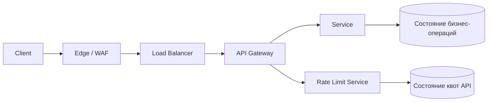

# Вопросы на собеседовании: `Design Rate Limiter`

`Rate Limiter` — защита API от перегрузки и злоупотреблений, обязательный компонент любой public-платформы (Stripe, GitHub, Twitter, Cloudflare). На интервью проверяет понимание алгоритмов (token/leaky bucket, sliding window), distributed coordination (Redis + Lua atomicity), trade-offs (memory vs accuracy, fail-open vs fail-closed), а также способность собрать архитектуру edge → gateway → service.

## Полезные ссылки

- [Cloudflare — How we built rate limiting](https://blog.cloudflare.com/counting-things-a-lot-of-different-things/)
- [Stripe API rate limits](https://stripe.com/docs/rate-limits)
- [GitHub REST rate limits](https://docs.github.com/en/rest/overview/resources-in-the-rest-api#rate-limiting)
- [RFC 6585 — Additional HTTP Status Codes (429)](https://www.rfc-editor.org/rfc/rfc6585)
- [Envoy global rate limit filter](https://www.envoyproxy.io/docs/envoy/latest/configuration/http/http_filters/rate_limit_filter)
- [System Design Primer — rate-limiter](https://github.com/donnemartin/system-design-primer)
- [Designing Data-Intensive Applications, гл. 11 (Stream Processing)](https://www.oreilly.com/library/view/designing-data-intensive-applications/9781491903063/)

## Содержание

**Requirements и capacity**
- [Q1. (!) Functional и non-functional requirements?](#q1--functional-и-non-functional-requirements)
- [Q2. (!) Оценка нагрузки и ёмкости (1M req/sec, 1B пользователей)?](#q2--оценка-нагрузки-и-ёмкости-1m-reqsec-1b-пользователей)
- [Q3. Что в scope (per-user/IP/key) и что out-of-scope?](#q3-что-в-scope-per-useripkey-и-что-out-of-scope)

**Алгоритмы**
- [Q4. (!) Token bucket — алгоритм, формулы, burst handling?](#q4--token-bucket--алгоритм-формулы-burst-handling)
- [Q5. (!) Leaky bucket — как отличается от token bucket?](#q5--leaky-bucket--как-отличается-от-token-bucket)
- [Q6. Fixed window counter — простота и проблема краёв?](#q6-fixed-window-counter--простота-и-проблема-краёв)
- [Q7. (!) Sliding window log — точность vs память?](#q7--sliding-window-log--точность-vs-память)
- [Q8. (!) Sliding window counter — компромисс точности и стоимости?](#q8--sliding-window-counter--компромисс-точности-и-стоимости)
- [Q9. Сравнительная таблица 5 алгоритмов?](#q9-сравнительная-таблица-5-алгоритмов)

**Распределённая координация**
- [Q10. (!) Distributed rate limiting на Redis (Lua atomic)?](#q10--distributed-rate-limiting-на-redis-lua-atomic)
- [Q11. Локальный счётчик vs распределённый: компромисс latency и согласованности?](#q11-локальный-счётчик-vs-распределённый-компромисс-latency-и-согласованности)
- [Q12. (!) Hot key problem на популярных API keys?](#q12--hot-key-problem-на-популярных-api-keys)
- [Q13. Clock drift между nodes — как влияет на window?](#q13-clock-drift-между-nodes--как-влияет-на-window)
- [Q14. Consistent hashing для sharding rate-limit keys?](#q14-consistent-hashing-для-sharding-rate-limit-keys)

**Многоуровневость и стоимость**
- [Q15. (!) Многоуровневые лимиты (per-user + per-IP + per-API-key + per-endpoint)?](#q15--многоуровневые-лимиты-per-user--per-ip--per-api-key--per-endpoint)
- [Q16. Лимитирование по стоимости запроса (weighted requests)?](#q16-лимитирование-по-стоимости-запроса-weighted-requests)
- [Q17. Квоты на тенанта и всплески (паттерны Stripe/GitHub)?](#q17-квоты-на-тенанта-и-всплески-паттерны-stripegithub)

**HTTP контракт**
- [Q18. (!) HTTP 429, заголовки Retry-After и X-RateLimit-* (RFC 6585)?](#q18--http-429-заголовки-retry-after-и-x-ratelimit--rfc-6585)
- [Q19. Поведение клиента: exponential backoff + jitter?](#q19-поведение-клиента-exponential-backoff--jitter)

**Архитектура и расположение**
- [Q20. (!) Архитектура верхнего уровня (edge / gateway / service)?](#q20--архитектура-верхнего-уровня-edge--gateway--service)
- [Q21. Где лимитировать: edge (Cloudflare/Envoy) vs API gateway vs внутри сервиса?](#q21-где-лимитировать-edge-cloudflareenvoy-vs-api-gateway-vs-внутри-сервиса)
- [Q22. Bloom filter для экономного по памяти лимитирования множеств?](#q22-bloom-filter-для-экономного-по-памяти-лимитирования-множеств)

**Production**
- [Q23. (!) Fail-open vs fail-closed при недоступности Redis?](#q23--fail-open-vs-fail-closed-при-недоступности-redis)
- [Q24. Плавная деградация: локальный fallback-счётчик?](#q24-плавная-деградация-локальный-fallback-счётчик)
- [Q25. (!) Защита от DDoS: per-IP + geo-fence + эскалация до CAPTCHA?](#q25--защита-от-ddos-per-ip--geo-fence--эскалация-до-captcha)
- [Q26. Адаптивное лимитирование (авто-подстройка по latency/error)?](#q26-адаптивное-лимитирование-авто-подстройка-по-latencyerror)
- [Q27. Мониторинг: какие метрики обязательны?](#q27-мониторинг-какие-метрики-обязательны)
- [Q28. (!) Sticky routing vs random routing — влияние на общее состояние?](#q28--sticky-routing-vs-random-routing--влияние-на-общее-состояние)
- [Q29. Тестирование rate limiter: unit, integration, load?](#q29-тестирование-rate-limiter-unit-integration-load)
- [Q30. (!) Антипаттерны и подводные камни?](#q30--антипаттерны-и-подводные-камни)

## Q1. (!) Functional и non-functional requirements?

Rate limiter — компонент, который на каждый входящий запрос отдаёт вердикт `allow`/`deny` и отсекает излишек нагрузки. Прежде чем выбирать алгоритм, на интервью нужно зафиксировать требования: именно они задают и алгоритм, и архитектуру, и поведение при сбоях.

**Функциональные требования** (что система обязана делать):
- Принимать решение `allow` / `deny` для входящего запроса.
- Решать на основе ключа: user_id, IP, API key, endpoint или их комбинация.
- Поддерживать конфигурируемые лимиты (10 req/sec на пользователя, 1000 req/min на IP).
- Возвращать HTTP 429 при исчерпании клиентской квоты. Указать в контракте, когда ответ содержит `Retry-After` (Q18).
- Если клиентам нужна информация об остатке и сбросе квоты, определить поля ответа и их семантику.

**Пример нефункциональных требований для учебного дизайна:**
- **Throughput:** 100K–1M решений/сек на global edge.
- **Задержка:** p99 решения < 10 ms — проверка лежит на critical path каждого API-запроса, и любая её задержка добавляется ко всем запросам.
- **Availability:** 99.99% — сам limiter не должен стать SPOF, иначе он положит API, который призван защищать.
- **Точность:** согласовать допустимое превышение и долю лишних отказов для конкретного интервала. Приближённый алгоритм проверить на пиках и границах окон (Q8, Q29).
- **Согласованность:** определить, должен ли лимит соблюдаться глобально при конкуренции и сетевом разделении. Отдельно согласовать поведение при отказе хранилища (Q21, Q23).
- **Fairness:** один тяжёлый пользователь не должен задушить остальных — изоляция по ключу.

**Что вне scope** (проговорить явно, чтобы сузить задачу):
- Бизнес-логические квоты уровня приложения (квота = $1000/месяц).
- Долгосрочный биллинг — это metering, а не rate limiting.
- Throttling отдельных строк БД — забота приложения.

**Ловушка senior-уровня:** если кандидат сразу прыгает в алгоритм (`будем использовать token bucket`) без явных NFR, интервьюер уведёт разговор в сторону fairness и failure modes — и без зафиксированных требований кандидат там поплывёт. Сначала NFR, потом алгоритм.

## Q2. (!) Оценка нагрузки и ёмкости (1M req/sec, 1B пользователей)?

При 1 млн входящих запросов в секунду оцените отдельно число решений, объём живого состояния, распределение ключей и задержку. Миллиард зарегистрированных пользователей задаёт масштаб аудитории. Для памяти важны ключи, которые реально появились и ещё не истекли.

- **Команды.** Если каждый запрос проверяет одну квоту и вызывает один атомарный скрипт, верхняя оценка входного потока на Redis составляет 1 млн вызовов скрипта в секунду. Скрипт может вернуть решение и остаток одним ответом (Q10). Несколько политик могут потребовать нескольких операций. Локальные отказы на edge уменьшают поток до Redis.
- **Память.** Допустим, на пике одновременно живут 200 млн ключей, а измеренный размер ключа вместе со значением составляет в среднем 100 байт. Оценка для данных на primary составляет 20 ГБ. Количество ключей оценивайте по уникальным комбинациям атрибутов за срок хранения состояния и проверяйте на пиковом трафике. Добавьте запас на служебные расходы и фрагментацию, а память реплик посчитайте отдельно. [Redis MEMORY USAGE](https://redis.io/docs/latest/commands/memory-usage/)
- **Шарды.** Если измеренная рабочая производительность одного primary при целевой p99 составляет 50 тыс. вызовов этого скрипта в секунду, деление даёт 20 primary при равномерной нагрузке. При двух репликах на primary это 60 узлов. Это стартовая оценка. Оставьте запас под всплески и переключения и отдельно проверьте горячие ключи, которые нельзя ускорить простым добавлением шардов (Q12). [Redis Benchmarks](https://redis.io/docs/latest/operate/oss_and_stack/management/optimization/benchmarks/)
- **Сеть и регионы.** При 100 байтах запроса и 100 байтах ответа на один вызов полезный трафик составит по 100 МБ/с в каждом направлении до накладных расходов протокола и репликации. Сравните измеренную задержку маршрута с бюджетом принятия решения. Региональное размещение уменьшает задержку обращения к счётчику. Если контракт требует общей квоты, для неё отдельно нужен владелец состояния или распределение бюджета между регионами (Q21).

Стоимость посчитайте по выбранной топологии с учётом реплик, трафика и резерва ёмкости. Сравните варианты на одинаковом профиле нагрузки и при одном бюджете ошибок.

## Q3. Что в scope (per-user/IP/key) и что out-of-scope?

В scope — ограничение по техническим ключам (кто и откуда стучится); вне scope — бизнес-квоты и блокировки данных. Ключевая идея: лимит вешается не на «запрос вообще», а на конкретное измерение трафика, и каждое измерение закрывает свой вектор атаки.

| Уровень | Ключ | Сценарий |
|---|---|---|
| Per-user | user_id | Защита от индивидуального злоупотребления |
| Per-IP | client IP | Защита от скрапинга, DDoS |
| Per-API-key | api_key | B2B-партнёрский tier |
| Per-endpoint | (key, route) | Защита дорогих endpoint-ов |
| Per-region | region_code | Geo-aware throttling |
| Global | `*` | Общий бюджет защищаемого сервиса |

**В scope:**
- Один или несколько уровней из перечисленных выше.
- Если применимые политики обязательны, допуск требует выполнения каждой. Любая исчерпанная клиентская квота даёт отказ по квоте. Условия выбора политики и правила списания при нескольких проверках задаются отдельно (Q15, Q23).

**Вне scope** (обычно — и это стоит проговорить, чтобы не размывать задачу):
- Биллинг квот ($1000/месяц — это metering, считается отдельным сервисом не на critical path).
- Конкуренция за блокировки строк БД — забота уровня приложения, а не limiter-а.
- Мягкое предупреждение vs жёсткая блокировка — продуктовое решение.

**Пример.** У пользователя осталось 8 запросов в минутном окне, а у его API-ключа исчерпан часовой бюджет. Запрос отклоняется по второй политике. Сравнение номинальных лимитов через минимум теряет единицы времени, текущее потребление и различия в области действия.

## Q4. (!) Token bucket — алгоритм, формулы, burst handling?

**Идея:** ведро объёмом `capacity` токенов непрерывно пополняется со скоростью `refill_rate` (токенов/сек). Каждый запрос забирает 1 токен; если токенов 0 → deny. Аналогия: токены капают в ведро как вода, запрос «выпивает» один; пока ведро не пусто — пропускаем. Это позволяет накопить запас и потратить его всплеском.

**Состояние на ключ:** всего два числа — `(tokens: float, last_refill: timestamp)`. Отсюда O(1) памяти.

Хитрость в том, что токены не доливают по таймеру — это дорого для миллионов ключей. Вместо этого при каждом запросе считают, сколько токенов «накапало» с момента `last_refill`, и доливают лениво (lazy refill):

**Алгоритм (на каждый запрос):**
```
now = current_time()
elapsed = now - last_refill
tokens = min(capacity, tokens + elapsed * refill_rate)
last_refill = now
if tokens >= 1:
    tokens -= 1
    return ALLOW
else:
    return DENY
```

**Два независимых параметра** — в этом вся гибкость алгоритма:
- `capacity` = размер всплеска (например 100 — разрешает 100 запросов мгновенно, если токены накоплены).
- `refill_rate` = устойчивая скорость (например 10/sec — долгосрочное ограничение).

Разделив их, мы получаем «строгий средний лимит + допустимый короткий всплеск» — то, что реально нужно живым API.

**Обработка всплесков:**
- Token bucket пропускает **всплеск до capacity** мгновенно (если ведро было полным).
- После исчерпания запаса скорость падает до `refill_rate`.
- Поэтому он идеален для API со случайными пиками (Stripe: всплеск 100 req/sec при устойчивых 25 req/sec): клиент не штрафуется за редкие всплески, но в среднем держится в рамках.

**Плюсы:**
- Простой и интуитивный, нативно поддерживает всплески.
- O(1) памяти на ключ (два числа).
- Отраслевой стандарт (AWS, Stripe, GitHub).

**Минусы:**
- Точность зависит от точности часов — при дробном `refill_rate` важны микросекунды.
- В распределённом случае чтение-модификация-запись над `(tokens, last_refill)` должна быть атомарной, иначе две ноды одновременно «снимут» один токен (см. Q10).

В распределённой реализации переносим расчёт, списание и запись остатка в один Redis Lua-скрипт. Рабочий пример и границы его гарантий разобраны в Q10.

## Q5. (!) Leaky bucket — как отличается от token bucket?

В этом сравнении **leaky bucket** — очередь с ограниченной ёмкостью и регулируемым выпуском. **Token bucket** списывает токены при допуске и может пропустить несколько запросов подряд, если токены накопились. [RFC 3290, приложение A](https://www.rfc-editor.org/rfc/rfc3290.html#appendix-A)

**Как работает очередь.** На входе запрос добавляется в FIFO, если есть место. При заполнении очереди новые запросы отклоняются. Планировщик забирает запросы с заданным интервалом, пока очередь непуста. Если планировщик проснулся позже, политика без догоняющего выпуска сохраняет интервал между отправками ценой дополнительного ожидания.

**Пример.** Пустая очередь вмещает 10 запросов. Если все 10 пришли одновременно и помещаются в очередь до первого выпуска, система их примет и будет отправлять по одному каждые 100 мс. Token bucket с десятью доступными токенами и стоимостью 1 может допустить все 10 сразу. Размер очереди задаёт запас на входной всплеск и влияет на время ожидания. Интервал выпуска ограничивает темп отправки, а для числа одновременно выполняемых запросов нужен отдельный лимит (Q26).

**Проверка без очереди.** Под названием leaky bucket также встречается алгоритм допуска с одним счётчиком, который уменьшается с течением времени. Такой счётчик может решить, принимать ли запрос прямо сейчас, используя O(1) памяти на ключ. Если допущенные запросы сразу отправляются дальше, они могут образовать всплеск. Для сглаживания нужен фактический планировщик, а для очереди — память под ожидающие запросы. [NGINX — limit_req](https://nginx.org/en/docs/http/ngx_http_limit_req_module.html)

## Q6. Fixed window counter — простота и проблема краёв?

Самый простой алгоритм: один счётчик на окно, инкремент на каждый запрос. Платой за простоту служит проблема границы — на стыке двух окон трафик может удвоиться.

**Идея:** разбить время на фиксированные окна (например, по 1 минуте); на каждую пару (key, window) держать counter. На каждый запрос: `INCR`; если `> limit` → deny. Старое окно протухает по TTL, так что память не растёт.

**Состояние:** `counter:{key}:{window_start}` → integer.

**Алгоритм:**
```
window = floor(now / window_size) * window_size
MULTI
  INCR counter:{key}:{window}
  EXPIRE counter:{key}:{window} (window_size * 2)
count, expiry_set = EXEC
if count > limit:
    return DENY
return ALLOW
```

Псевдокод показывает результат успешного `EXEC`: решение принимает gateway по результату `INCR`. Если вызвать `INCR` и `EXPIRE` отдельно, обрыв клиента после первого вызова может оставить новый ключ без TTL. В этом примере обе команды выполняются через `MULTI`/`EXEC`. TTL обновляется при каждом запросе и нужен для очистки. Границу допуска задаёт номер окна в ключе. Если TTL требуется задавать только при первом инкременте, условие можно выполнить внутри Lua-скрипта (см. Q10). [Redis INCR — Rate limiter](https://redis.io/docs/latest/commands/incr/#pattern-rate-limiter)

**Плюсы:**
- Один целочисленный счётчик на ключ и окно. Общая память зависит от числа ключей, которые ещё не истекли.
- `INCR` атомарно выдаёт новое значение счётчика, а транзакция выполняет инкремент и установку TTL вместе.
- Легко мониторить: `key=count` видно напрямую.

**Минусы — проблема границ (boundary problem):**
- Окна нарезаны по абсолютному времени, а не относительно запросов, поэтому на стыке возможен **двойной всплеск (2×)**.
- Пример: limit 100/min. В 00:59 клиент шлёт 100 запросов (окно 00:00–01:00 заполнено). В 01:00 счётчик обнуляется (новое окно) — и клиент шлёт ещё 100. Итого 200 запросов за ~2 секунды на границе, хотя лимит «100 в минуту».

```
window 1 (00:00-01:00):  ____________________100 requests at 00:59
window 2 (01:00-02:00):  100 requests at 01:00____________________
                                    ↑
                            200 requests in 2 seconds!
```

**Когда подходит:**
- Очень неточные лимиты (throttling аналитики).
- Когда абсолютная точность не критична и всплеск на границе допустим.
- Когда нужна максимальная простота.

**Когда НЕ подходит:**
- Защита от DDoS (2×-всплеск недопустим).
- Строгие per-second лимиты.

## Q7. (!) Sliding window log — точность vs память?

Храним время каждого принятого запроса и считаем записи в скользящем окне. При едином источнике времени и атомарном допуске это даёт точный лимит с выбранной дискретностью часов. На ключ нужно до O(limit) записей.

**Идея:** для каждого ключа держать отсортированный список отметок принятых запросов за последнее окно. На каждый запрос:
1. Удалить из лога все timestamp-ы с отметкой времени ≤ `now - window_size` (вышли из окна).
2. Если `len(log) >= limit` → deny.
3. Иначе добавить `now` → allow.

Окно «скользит» вместе с текущим временем — нет фиксированных границ, нет 2×-всплеска.

**Состояние:** Redis sorted set, где score — время в миллисекундах, а member — уникальный идентификатор попытки допуска. Два запроса в одной миллисекунде имеют одинаковый score и разные member. Если использовать время и как member, повторный `ZADD` обновит существующий элемент, и счётчик занизит нагрузку.

**Алгоритм:** все шаги выполняются внутри одного Lua-скрипта на Redis. Граница окна — `(now - window_ms, now]`.

```
now = redis_time_ms()
cutoff = now - window_ms
ZREMRANGEBYSCORE key -inf cutoff
count = ZCARD key
if count >= limit:
    return DENY
ZADD key now attempt_id
PEXPIRE key window_ms
return ALLOW
```

Без общей атомарной операции два gateway могут увидеть одно свободное место и оба принять запрос. [Redis ZADD](https://redis.io/docs/latest/commands/zadd/) · [Lua в Redis](https://redis.io/docs/latest/develop/programmability/eval-intro/)

**Плюсы:**
- Счётчик основан на фактическом времени принятых запросов.
- Без всплеска на границе.

**Минусы:**
- **Память O(limit) на ключ.** Фактический расход зависит от представления sorted set и длины идентификаторов.
- Очистка зависит от числа удаляемых элементов. Горячий ключ может стать узким местом даже при небольшом общем числе ключей.

**Когда подходит:**
- Низкий лимит (< 100 req/окно), точность критична.
- Финтех: 10 транзакций в минуту, ошибиться нельзя.
- Безопасность: 5 попыток логина в час.

**Когда НЕ подходит:**
- Высоконагруженные API (1000+ req/sec на ключ) — память взрывается.
- Edge-защита масштаба Cloudflare.

## Q8. (!) Sliding window counter — компромисс точности и стоимости?

Два счётчика дают оценку нагрузки скользящего окна с постоянным объёмом состояния на ключ. Ошибка зависит от распределения запросов в предыдущем окне.

**Идея:** объединить fixed window и sliding window log. Хранить только counter текущего и предыдущего окна; при решении считать не сумму, а **взвешенную оценку**: какую долю предыдущего окна всё ещё «видит» скользящее окно прямо сейчас.

**Алгоритм:**
```
now = current_time()
current_window = floor(now / window_size) * window_size
previous_window = current_window - window_size
elapsed_in_current = (now - current_window) / window_size  # 0.0..1.0

current_count = GET counter:{key}:{current_window} or 0
previous_count = GET counter:{key}:{previous_window} or 0

# Взвешенная: какая доля previous window попадает в sliding view
estimated = previous_count * (1 - elapsed_in_current) + current_count

if estimated + 1 > limit:
    return DENY

INCR counter:{key}:{current_window}
EXPIRE counter:{key}:{current_window} window_size * 2
return ALLOW
```

При распределённом допуске чтение обоих счётчиков, проверка с учётом нового запроса и обновление должны выполняться вместе. В Redis Cluster Lua-скрипту передают оба ключа явно и используют одинаковый hash tag для одного клиента, чтобы ключи попали в один слот. Счётчик окна должен пережить и следующее окно. [Lua в Redis](https://redis.io/docs/latest/develop/programmability/eval-intro/)

**Пример:**
- Limit = 100/min, window_size = 60s.
- Сейчас 01:00:42 → elapsed_in_current = 42/60 = 0.7.
- previous_count (00:00–01:00) = 80, current_count (01:00–02:00) = 30.
- estimated = 80 × (1 − 0.7) + 30 = 24 + 30 = **54** → после добавления запроса оценка составит 55, допуск разрешён.

**Плюсы:**
- O(1) памяти на ключ.
- Для оценки достаточно прочитать два счётчика.

**Минусы:**
- Формула оценивает оставшуюся долю предыдущего окна по времени, предполагая равномерное распределение запросов.
- В примере выше оценка вклада предыдущего окна равна 24. Если все 80 запросов пришли в его последние 18 секунд, фактический вклад равен 80, а нагрузка до допуска нового запроса уже составляет 110. Если все 80 пришли раньше, фактический вклад равен нулю.

## Q9. Сравнительная таблица 5 алгоритмов?

Выбор алгоритма — это выбор по трём осям: память, нужен ли всплеск и требуемая точность. Сводка ниже отвечает на эти три вопроса для каждого варианта.

| Алгоритм | Память | Всплеск | Точность | Atomic | Сценарий |
|---|---|---|---|---|---|
| Token bucket | O(1) | до запаса токенов | по модели пополнения | атомарный расчёт остатка и списание | API с краткими всплесками |
| Leaky bucket с очередью | O(ёмкость очереди) | буфер на входе, дозированный выпуск | выпуск зависит от планировщика | согласованные постановка в очередь и выпуск | Traffic shaping |
| Fixed window | O(1) | 2×-всплеск на границе | низкая (на границе) | INCR и TTL через MULTI/EXEC | Простой throttle аналитики |
| Sliding window log | O(limit) | до остатка квоты окна | По фактическим записям | атомарная очистка, проверка и вставка | Строгий низкий объём (попытки логина) |
| Sliding window counter | O(1) | зависит от распределения | взвешенная оценка | атомарное решение по двум счётчикам | Лимит с допустимой погрешностью |

**Выбор:**
- Высокий объём + нужны всплески → **token bucket**.
- Высокий объём + допустима погрешность оценки → **sliding window counter**.
- Низкий лимит + строгий учёт в скользящем окне → **sliding window log**.
- Защита downstream → **leaky bucket**.
- Допустим всплеск на стыке, важна простота → **fixed window**.

## Q10. (!) Distributed rate limiting на Redis (Lua atomic)?

Суть распределённого случая: счётчик общий (в Redis), но читают и пишут его N подов параллельно, поэтому шаг «проверить, потом изменить» обязан быть атомарным. Решение — выполнять всю логику одним Lua-скриптом на стороне Redis.

**Проблема — гонка read-modify-write.** Каждый под не видит, что прямо сейчас делают остальные. Наивный `GET` + `INCR` двумя командами оставляет окно между чтением и записью:
- Pod A: `GET counter` = 99 → 99 < 100, шлёт `INCR` → 100.
- Pod B (в том же окне): `GET counter` = 99 → 99 < 100, шлёт `INCR` → 101.
- Оба разрешили запрос, хотя лимит уже был на грани — реальное превышение.

Проблема обостряется с числом подов: чем их больше, тем вероятнее пересечение операций.

**Решение — атомарный RMW одним Lua-скриптом.** Redis выполнит чтение, расчёт и запись неделимо, без окна гонки:

```lua
-- token_bucket.lua
local key = KEYS[1]
local capacity = tonumber(ARGV[1])
local refill_rate = tonumber(ARGV[2])
local requested = tonumber(ARGV[3])
local clock = redis.call('TIME')
local now = tonumber(clock[1]) * 1000 + math.floor(tonumber(clock[2]) / 1000)

local data = redis.call('HMGET', key, 'tokens', 'last_refill')
local tokens = tonumber(data[1])
local last_refill = tonumber(data[2])

if tokens == nil then
    tokens = capacity
    last_refill = now
end

-- При откате часов не переносим отметку пополнения назад.
now = math.max(now, last_refill)
local elapsed_seconds = (now - last_refill) / 1000
tokens = math.min(capacity, tokens + elapsed_seconds * refill_rate)

local allowed = 0
if tokens >= requested then
    tokens = tokens - requested
    allowed = 1
end

local ttl_ms = math.ceil(capacity / refill_rate * 1000)
redis.call('HSET', key, 'tokens', tostring(tokens), 'last_refill', tostring(now))
redis.call('PEXPIRE', key, ttl_ms)
return {allowed, tostring(tokens)}
```

Пример рассчитан на Redis 7.0+ и заранее проверенные параметры. Скорость пополнения задаётся в токенах в секунду, ёмкость и скорость положительны, а стоимость запроса положительна и не выше ёмкости. TTL равен времени, за которое пустое ведро становится полным. Если ключ исчез после этого интервала без обращений, новое полное ведро даёт тот же результат. Дробный остаток возвращаем строкой, поскольку при стандартном RESP2 числовой результат Lua преобразуется в целое. [Модель репликации скриптов](https://redis.io/docs/latest/develop/programmability/eval-intro/#script-replication) · [Преобразование типов Lua](https://redis.io/docs/latest/develop/programmability/lua-api/#data-type-conversion)

**Вызов из приложения**
```python
allowed, remaining = redis.eval(lua_script, 1, key, capacity, refill_rate, 1)
remaining = float(remaining)
```

**Границы атомарности.** На primary другие команды не вклиниваются между чтением и записью. Длинный скрипт задерживает обработку других команд на том же узле, поэтому пропускную способность измеряют на реальном распределении ключей. При асинхронной репликации новый primary может получить более старое состояние ведра. Например, если последнее списание не попало на реплику, после переключения станет доступно больше токенов. [Redis Lua](https://redis.io/docs/latest/develop/programmability/eval-intro/) · [Redis Replication](https://redis.io/docs/latest/operate/oss_and_stack/management/replication/)

**Предзагрузка скрипта.** `SCRIPT LOAD` добавляет скрипт в кеш узла, а `EVALSHA` передаёт его хеш. После перезапуска, переключения primary или очистки кеша клиент может получить `NOSCRIPT`. Это означает, что скрипт не запускался. Клиент может выполнить `EVAL` на узле, обслуживающем ключ, либо загрузить туда скрипт и повторить `EVALSHA`. Если ответ потерялся по таймауту, состояние неизвестно. Слепой повтор способен снять токен второй раз. [Redis Script Cache](https://redis.io/docs/latest/develop/programmability/eval-intro/#cache-volatility)

**Повтор после потери ответа.** Если gateway хочет повторить проверку того же входящего запроса, он назначает проверке внутренний идентификатор, который сохраняется при повторном вызове Redis. Например, первый вызов списал последний токен, но gateway не получил ответ. При повторе с тем же идентификатором скрипт возвращает сохранённое решение о допуске и сохраняет баланс без изменений. Следующий самостоятельный HTTP-запрос получает новый идентификатор и проходит отдельную проверку.

Один вариант реализации хранит баланс, отметку пополнения и решения в одном Redis hash. Скрипт сначала ищет решение по идентификатору. Если его ещё нет, он вычисляет результат и записывает новое состояние ведра вместе с решением одним `HSET`. Параметры следует проверить до записи. Для сохранённых решений задают срок хранения, покрывающий допустимое окно повторов, и ограничивают их число. Гарантия повторного чтения решения действует, пока запись сохранилась: истечение срока, вытеснение ключа или потеря обновления при переключении Redis её снимают. Идентификатор проверки квоты относится только к списанию токена. Повторную обработку самой бизнес-операции регулирует отдельный контракт из Q19.

## Q11. Локальный счётчик vs распределённый: компромисс latency и согласованности?

Локальный счётчик принимает решение в процессе gateway без сетевого запроса. Если у каждого из 10 подов лимит 100 запросов за окно, вместе они могут принять до 1000 запросов за это окно. При неравномерной балансировке один под может исчерпать свои 100, пока остальные почти пусты.

Общий счётчик даёт единый допуск для запросов, которые приходят на один и тот же ключ и обслуживаются одним Redis primary. Цена — сетевой вызов на каждую проверку. Границы при failover разобраны в Q10.

**Гибрид в штатном режиме.** Локальный фильтр сразу отклоняет часть трафика. Каждый пропущенный им запрос всё равно проходит общую проверку. Поэтому фильтр может сэкономить вызовы Redis при всплеске, но способен и отклонить запрос, который ещё укладывается в общий лимит. Порог выбирают по допустимому числу таких отказов и фактическому распределению нагрузки. Во время сбоя Redis локальный счётчик может стать самостоятельным источником решения, как описано в Q24.

## Q12. (!) Hot key problem на популярных API keys?

Redis Cluster распределяет ключи по слотам, каждый слот обслуживает один мастер. У популярного API-ключа может закончиться пропускная способность этого мастера, даже если у кластера в целом есть запас. Перенос слота меняет владельца, а все обращения к конкретному ключу по-прежнему идут одному владельцу.

**Как подтвердить диагноз.** Сопоставьте по шардам частоту команд, загрузку CPU и p99. Проверьте, растёт ли задержка других ключей на том же мастере при всплеске по одному клиенту. [Redis Cluster — распределение ключей](https://redis.io/docs/latest/operate/oss_and_stack/reference/cluster-spec/#key-distribution-model)

**Как уменьшить нагрузку:**

- Локальный фильтр или лимит на edge отбрасывает заведомо лишний трафик. Запросы, прошедшие фильтр, всё ещё требуют общего допуска, если он не был зарезервирован заранее. Снижение нагрузки зависит от доли локальных отказов.
- Выдача квоты пакетами позволяет списывать токены локально. При бюджете 1000 запросов на фиксированное окно центральный владелец может зарезервировать по 200 для пяти узлов одной атомарно учитываемой операцией на выдачу. Каждый узел тратит только свою квоту до конца окна. Горячий счётчик обновляется при выдаче, а часть бюджета может простаивать на узлах с низким трафиком. Перевыдача остатка безопасна после окончания срока его действия либо после подтверждённого отзыва.
- Независимые счётчики с периодической агрегацией снижают нагрузку, если допустима погрешность. Если пять узлов разрешают запросы по одному и тому же устаревшему остатку в 100, общий допуск может дойти до 500. Для строгой границы нужны непересекающиеся бюджеты или координация.
- Выделенный шард изолирует влияние на соседние ключи. Предел обработки одного горячего ключа всё ещё определяется его владельцем.

## Q13. Clock drift между nodes — как влияет на window?

Если экземпляры приложения сами определяют время, запросы у границы фиксированного окна могут попасть в разные счётчики. В sliding window log часы, ушедшие вперёд, могут удалить свежие записи раньше срока. Для token bucket с пополнением 10 токенов/с скачок вперёд на 2 секунды даёт до 20 дополнительных токенов относительно ожидаемого пополнения, с учётом ёмкости ведра.

**Один источник на одно состояние.** Для общего ключа вычисляйте время внутри той же операции Redis, которая меняет счётчик. `TIME` возвращает время сервера, исполняющего команду. Пока ключ обслуживает один мастер, клиенты опираются на его часы. У разных мастеров часы могут расходиться, а после failover или переноса слота источник времени меняется. [Redis TIME](https://redis.io/docs/latest/commands/time/) · [Спецификация Redis Cluster](https://redis.io/docs/latest/operate/oss_and_stack/reference/cluster-spec/)

С Redis 7.0 для Lua реплицируются эффекты скрипта. Реплика применяет команды записи и не вычисляет `TIME` заново для того же решения. При смене владельца ключа следующее решение опирается на часы нового владельца. Для строгой квоты между шардами отдельно задают общую границу окна и способ согласовать списания. [Репликация Lua-скриптов](https://redis.io/docs/latest/develop/programmability/eval-intro/#script-replication)

Для token bucket ограничьте отрицательное прошедшее время нулём и сохраняйте отметку пополнения монотонной относительно предыдущего состояния, как в Q10. Это защищает расчёт от повторного начисления за уже учтённый интервал при откате часов. Скачок вперёд по-прежнему может ускорить пополнение. Синхронизируйте часы мастеров и реплик и измеряйте их смещение. Допустимую погрешность определяют длительность окна и цена лишнего допуска.

## Q14. Consistent hashing для sharding rate-limit keys?

При равномерном хеше и стабильной нумерации шардов переход с `hash(key) % 20` на `hash(key) % 21` меняет назначение примерно для 20 из 21 ключа. В кольце consistent hashing ключ принадлежит первому узлу по часовой стрелке. При добавлении узла меняется владелец только тех участков кольца, которые занял новый узел. С виртуальными узлами и равными весами ожидаемая доля перемещённых ключей близка к доле нового узла, а фактическая зависит от распределения.

**Redis Cluster использует фиксированное пространство слотов.** По умолчанию ключ попадает в `CRC16(key) mod 16384`. При добавлении мастера на него переносят выбранные слоты вместе с их ключами. Номера слотов ключей сохраняются. Доля перемещённых данных зависит от выбранных слотов и объёма данных в каждом. [Redis Cluster — слоты и миграция](https://redis.io/docs/latest/operate/oss_and_stack/reference/cluster-spec/)

При `MOVED` клиент обновляет представление о владельце слота. `ASK` при миграции перенаправляет только текущую команду: клиент посылает `ASKING` перед ней на целевом узле. [Перенаправления Redis Cluster](https://redis.io/docs/latest/operate/oss_and_stack/reference/cluster-spec/#ask-redirection)

**Hash tag задаёт совместное размещение.** Ключи `limit:{user42}:all` и `limit:{user42}:export` хешируются по `user42`. Их можно передать одной многооперандной операции в штатном состоянии слота. Два разных слота на одном мастере этого свойства не дают. Во время миграции слота операция по нескольким ключам может временно получить `TRYAGAIN`. Чем больше квот помещают в один слот ради совместного списания, тем выше риск перегрузить одного владельца (Q12). [Redis Cluster — hash tags и многооперандные операции](https://redis.io/docs/latest/operate/oss_and_stack/reference/cluster-spec/#hash-tags)

## Q15. (!) Многоуровневые лимиты (per-user + per-IP + per-API-key + per-endpoint)?

Запрос проходит, когда получен допуск по всем обязательным лимитам. Сначала определите, что учитывает каждый лимит. Per-IP может считать все попытки, включая последующие отказы. Квота тарифа может считать только допущенные запросы. От этого зависит, считается ли раннее списание ошибкой.

**Один слот.** Для общей квоты пользователя и его квоты на экспорт разместите оба ключа под тегом `{user42}`. Одна короткая Lua-операция читает состояние обоих лимитов и рассчитывает новые остатки. Если хотя бы одна квота исчерпана, операция возвращает отказ до списания. Если обе достаточны, операция записывает оба остатка. При одном оставшемся токене два конкурентных запроса не смогут оба пройти между чтением и записью. Отдельные клиентские проходы check и consume оставляют именно это окно гонки. Проверку типов и условий выполните до записи: ошибка в скрипте после записи не откатывает сделанные изменения. [Redis — выполнение Lua](https://redis.io/docs/latest/develop/programmability/eval-intro/)

**Разные слоты.** Общая квота IP может охватывать запросы нескольких пользователей, а один пользователь может обращаться с разных IP. Тег пользователя сделал бы IP-счётчик отдельным для каждого пользователя и изменил смысл лимита. Для такой схемы выберите контракт:

- Если per-IP считает попытки, применяйте его первым и списывайте квоту пользователя только после прохождения этого фильтра. Тогда отказ по квоте пользователя сохраняет уже учтённую попытку по IP.
- Если все квоты должны списываться только вместе, храните состояние в общей транзакционной границе. При распределении между независимыми владельцами нужен протокол резервирования с идентификатором запроса, сроком резерва и обработкой частичного сбоя. Последовательный вызов скриптов на разных слотах оставляет риск частичного списания.

Окна выбираются по назначению лимитов. Например, 100 попыток в минуту на IP ограничивают устойчивый поток, а 10 запусков экспорта в секунду на пользователя ограничивают короткий всплеск дорогой работы. Атомарность внутри мастера защищает от конкурентных запросов на нём. Сохранность списания при смене мастера зависит от репликации (Q10). [Redis Cluster — гарантии записи](https://redis.io/docs/latest/operate/oss_and_stack/reference/cluster-spec/#write-safety)

## Q16. Лимитирование по стоимости запроса (weighted requests)?

Взвешенный token bucket списывает стоимость операции вместо одного токена за запрос. Например, чтение профиля стоит 1 токен, поиск — 5, полный экспорт — 100. Веса задают бюджет оценочной нагрузки. Если экспорт занимает рабочий поток надолго, отдельно ограничивают число одновременных экспортов.

**Пример с Lua из Q10.** Сервис вычисляет вес по проверенным параметрам операции. Скрипт получает ёмкость, скорость пополнения и вес, берёт время через Redis `TIME` и возвращает признак допуска и остаток в виде строки. Ниже конфигурация проверена заранее: `capacity > 0`, `refill_rate > 0`, для разрешённой операции `0 < cost <= capacity`.

```python
allowed, remaining = redis.eval(
    token_bucket_lua, 1, key, capacity, refill_rate, cost
)
if not allowed:
    deficit = max(0, cost - float(remaining))
    retry_after = math.ceil(deficit / refill_rate)
    return too_many_requests(retry_after=retry_after)
```

При остатке 25 токенов, цене 100 и пополнении 20 токенов/с дефицит исчезнет через 3,75 секунды, если по пути никто не спишет токены. Для `Retry-After` это 4 секунды. Если цена превышает ёмкость, ожидание не поможет. Для такого экспорта измените конфигурацию или предложите меньший размер операции согласно контракту API. [RFC 9110 §10.2.3](https://www.rfc-editor.org/rfc/rfc9110.html#section-10.2.3)

Взвешенный бюджет в реальном API иллюстрирует GitHub GraphQL: каждому запросу начисляются баллы, а первичный лимит задаёт бюджет баллов на период. Это пример единицы учёта. Документация не связывает его с конкретной реализацией token bucket. [GitHub GraphQL — лимиты и стоимость запросов](https://docs.github.com/en/graphql/overview/rate-limits-and-query-limits-for-the-graphql-api)

## Q17. Квоты на тенанта и всплески (паттерны Stripe/GitHub)?

Для тенанта задают независимые ограничения. Скорость пополнения ограничивает длительную нагрузку, ёмкость ведра задаёт запас для краткого всплеска, а квота на период ограничивает суммарное потребление. Если тяжёлые операции занимают ресурсы надолго, добавляют отдельный предел одновременных операций.

**Что показывают публичные API.** Stripe документирует лимиты скорости и параллельности на уровне API и отдельных эндпоинтов. GitHub REST различает лимиты пользователя и установки GitHub App, а для поиска действует отдельный бюджет. Для GitHub GraphQL первичный бюджет измеряется в баллах. Цифры зависят от продукта и способа аутентификации. [Stripe — Rate limits](https://docs.stripe.com/rate-limits) · [GitHub REST — Rate limits](https://docs.github.com/en/rest/using-the-rest-api/rate-limits-for-the-rest-api) · [GitHub GraphQL — Rate limits](https://docs.github.com/en/graphql/overview/rate-limits-and-query-limits-for-the-graphql-api)

**Учебный тариф.** Сервис определяет тенанта по аутентифицированному API-ключу. Для его общего ведра настроены 1000 токенов/с и ёмкость 5000 токенов, один обычный запрос стоит один токен. При полном ведре и равномерном входящем потоке 2000 запросов/с запас расходуется со скоростью 1000 токенов/с. Он позволяет поддержать такой поток около пяти секунд. Если ведро заполнено частично, всплеск закончится раньше. Отдельная квота поиска может сработать первой.

**Квота на месяц.** Если она нужна для отчётов и биллинга, metering может собирать события асинхронно с дедупликацией. Если это жёсткий потолок допуска, параллельные запросы должны до начала работы атомарно списать или зарезервировать квоту. Асинхронный отчёт увидит превышение только после факта. При совместном списании месячной и краткосрочной квот действуют ограничения общей транзакционной границы из Q15.

## Q18. (!) HTTP 429, заголовки Retry-After и X-RateLimit-* (RFC 6585)?

HTTP 429 сообщает, что запрос превысил применимый лимит. RFC 6585 рекомендует объяснить причину в ответе и разрешает добавить `Retry-After`. Если сервис временно не может обслужить запрос из-за перегрузки или недоступности обязательного лимитера, уместен 503 (Q23). [RFC 6585 §4](https://www.rfc-editor.org/rfc/rfc6585.html#section-4) · [RFC 9110 §15.6.4](https://www.rfc-editor.org/rfc/rfc9110.html#section-15.6.4)

```http
HTTP/1.1 429 Too Many Requests
Retry-After: 30
Content-Type: application/json

{"error":"rate_limit_exceeded","retry_after_seconds":30}
```

`Retry-After` может содержать целое неотрицательное число секунд или HTTP-дату. Клиент использует его как рекомендуемое минимальное ожидание. По истечении паузы квоту могут уже занять другие запросы. [RFC 9110 §10.2.3](https://www.rfc-editor.org/rfc/rfc9110.html#section-10.2.3)

Поля семейства `X-RateLimit-*` описываются контрактом конкретного API. Если их публикуете, укажите, к какой квоте относятся значения, что именно измеряет остаток и как закодировано время сброса. Это полезно и в успешном ответе, когда клиент может заранее замедлиться.

## Q19. Поведение клиента: exponential backoff + jitter?

Для временного отказа используйте экспоненциальную задержку с верхним пределом и jitter. Если сервер указал корректный `Retry-After`, случайная задержка добавляется к паузе сервера. Если пауза не помещается в общий дедлайн, верните последний ответ без повторной попытки.

```python
for attempt in range(max_attempts):
    remaining = deadline - monotonic()
    response = call_api(timeout=remaining)
    if response.status != 429 or attempt + 1 == max_attempts:
        return response
    if not can_retry(request, response):
        return response

    server_wait = retry_after_seconds(response.headers)  # секунды или HTTP-date
    backoff_cap = min(max_backoff, base_delay * 2 ** attempt)
    delay = server_wait + random.uniform(0, backoff_cap)
    if monotonic() + delay >= deadline:
        return response
    sleep(delay)
    if monotonic() >= deadline:
        return response
```

Здесь `deadline` задан в будущем до первой попытки, а `max_attempts` включает исходный вызов. Функция разбора возвращает ноль при отсутствующем или некорректном заголовке и ограничивает отрицательную задержку для прошедшей HTTP-даты нулём. Для дедлайна используется монотонное время, а для разбора HTTP-даты — календарное. Например, при `Retry-After: 30` и jitter до двух секунд повтор уйдёт через 30–32 секунды. При общем остатке 20 секунд клиент вернёт текущий 429. [RFC 9110 §10.2.3](https://www.rfc-editor.org/rfc/rfc9110.html#section-10.2.3) · [AWS — Exponential Backoff and Jitter](https://aws.amazon.com/blogs/architecture/exponential-backoff-and-jitter/)

**Безопасность повторной попытки.** GET и PUT идемпотентны по семантике HTTP. Повтор POST после неопределённого исхода допустим, когда контракт операции обеспечивает идемпотентность, например сервер сохраняет результат по ключу запроса, либо когда клиент знает, что первый запрос не применён. Поддержку ключа и срок его действия определяет API. [RFC 9110 §9.2.2](https://www.rfc-editor.org/rfc/rfc9110.html#section-9.2.2)

## Q20. (!) Архитектура верхнего уровня (edge / gateway / service)?

Размещают проверку там, где уже известен её ключ и ещё можно остановить работу, расходующую защищаемый ресурс. В этой схеме edge ограничивает шум до входа в инфраструктуру, шлюз применяет квоты API, а сервис защищает собственные зависимости и бизнес-операции.



- **Edge** ограничивает всплески по признакам, доступным до аутентификации, например по источнику и пути запроса. Несколько легитимных клиентов могут делить IP, поэтому такой порог выбирают с учётом ложных отказов.
- **Gateway** после аутентификации знает клиента, арендатора и маршрут. Если квота по арендатору общая для всех экземпляров шлюза, решение требует общего состояния или распределения частей единого бюджета. В примере Envoy может обращаться к внешнему сервису лимитов по gRPC. Redis используется в эталонной реализации этого сервиса. [Envoy — Global rate limiting](https://www.envoyproxy.io/docs/envoy/latest/intro/arch_overview/other_features/global_rate_limiting)
- **Service** знает цену конкретной операции и текущую загрузку. Он может ограничить число одновременных обращений к БД на экземпляр. Для общего лимита на число успешных бизнес-операций резервирование или списание связывают с фиксацией операции и её ключом идемпотентности.

Для каждого правила задают владельца, ключ, единицу измерения и область учёта. Отдельно фиксируют причину отказа и задержку проверки на каждом уровне. Это позволяет отличить превышение квоты клиента от насыщения сервиса и выбрать поведение при сбое проверки по Q23.

## Q21. Где лимитировать: edge (Cloudflare/Envoy) vs API gateway vs внутри сервиса?

| Где | Что ограничивать | Граница |
|---|---|---|
| Edge (CDN/WAF) | Входящий трафик по источнику и пути, например всплески на публичном входе | Охватывает трафик, проходящий через этот edge. В Cloudflare есть задержка обновления счётчиков, поэтому часть запросов сверх порога может достичь origin. |
| Gateway | Запросы аутентифицированного клиента или арендатора по маршруту | Охватывает маршруты, проходящие через шлюз. Общая квота между экземплярами требует координации. |
| Service | Дорогие операции, конкурентность и правила, зависящие от состояния предметной области | Охватывает входы, где сервис применяет правило, включая внутренние вызовы через другие маршруты. |

Например, edge ограничивает всплески на публичном API. Шлюз разрешает арендатору суммарно 100 запросов в секунду. Если каждый из четырёх экземпляров шлюза имеет независимый лимит 100 запросов в секунду, арендатор при равномерной нагрузке может получить до 400 в секунду в установившемся режиме. Общий бюджет можно проверять в одном логическом сервисе квот или распределять между экземплярами. У этих подходов разные затраты на сетевые обращения и разные последствия перекоса нагрузки.

Даже при соблюдении квоты по запросам сервис может упереться в пул подключений из-за медленных отчётов. Здесь помогает отдельный предел одновременных отчётов, потому что допустимый RPS сам по себе не ограничивает число операций в работе. Совмещать уровни имеет смысл, когда у них разные правила. У одной общей квоты должна быть единая семантика списания, иначе один запрос может потратить её дважды.

Envoy можно разместить на edge или на шлюзе. Его локальный фильтр полезен для раннего отсечения всплесков, а глобальный сервис позволяет учитывать общий бюджет. Задержку выбранной схемы измеряют на своём маршруте с учётом сетевого вызова и нагрузки. [Envoy — Global rate limiting](https://www.envoyproxy.io/docs/envoy/latest/intro/arch_overview/other_features/global_rate_limiting) · [Cloudflare — Rate limiting rules](https://developers.cloudflare.com/waf/rate-limiting-rules/)

## Q22. Bloom filter для экономного по памяти лимитирования множеств?

Bloom filter экономит память, когда нужно узнать, входит ли ключ в уже известное множество. Например, edge может держать фильтр ключей, которые точный счётчик пометил как превысившие квоту. Отрицательный ответ исключает принадлежность к набору, представленному в фильтре. Положительный ответ может быть ложным, поэтому перед отказом его можно подтвердить в точном хранилище. Если фильтр запаздывает относительно источника, отрицательный ответ относится только к его текущему снимку. Повторная вставка ключа в обычный Bloom filter выставляет те же биты и не увеличивает счётчик событий. [Redis — Bloom filter](https://redis.io/docs/latest/develop/data-types/probabilistic/bloom-filter/)

Counting Bloom filter хранит счётчики в ячейках вместо битов, чтобы поддержать удаление ранее добавленных элементов при корректном балансе вставок и удалений. Ячейки разделяются между ключами. Само наличие счётчиков не задаёт ни точную частоту ключа, ни период учёта.

**Приближённая частота.** Для потока с неотрицательными приращениями Count-Min Sketch увеличивает одну ячейку на ключ в каждой строке, а при запросе берёт минимум по этим ячейкам. Коллизии могут завысить оценку. Для стандартного алгоритма с шириной `ceil(e/ε)` и глубиной `ceil(ln(1/δ))` ошибка для отдельной оценки не превышает `ε × N` с вероятностью не ниже `1 − δ`, где `N` — суммарный вес всего потока. Это добавочная ошибка относительно общего трафика. При миллионе запросов и `ε = 0.0001` её граница равна 100 запросам. Для лимита 1000 запросов на ключ это уже 10% порога. [Cormode и Muthukrishnan — Count-Min Sketch, теорема 1](https://dimacs.rutgers.edu/~graham/pubs/papers/cm-full.pdf) · [Redis — Count-Min Sketch](https://redis.io/docs/latest/develop/data-types/probabilistic/count-min-sketch/)

**Пример окна.** Для оценки за последний час обновляем отдельный sketch на каждый пятиминутный интервал и суммируем оценки по интервалам, пересекающим окно. Старые интервалы целиком удаляем. Например, в 12:03 окно начинается в 11:03. Если включить интервал 11:00–11:05 целиком, события с 11:00 до 11:03 завысят результат независимо от коллизий. Если исключить его целиком, потеряем события с 11:03 до 11:05. Для приблизительного отбора кандидатов это допустимый компромисс. Для строгого отказа у порога используем точную проверку с нужными границами времени и атомарным учётом запроса, как в Q7.

## Q23. (!) Fail-open vs fail-closed при недоступности Redis?

Когда Redis возвращает решение о превышении квоты, gateway обычно отвечает `429 Too Many Requests`. Таймаут Redis оставляет решение неизвестным. Если политика требует отклонить запрос из-за временной недоступности проверки, для этого подходит `503 Service Unavailable`. При известном интервале ожидания можно добавить `Retry-After`. [RFC 6585 §4](https://www.rfc-editor.org/rfc/rfc6585.html#section-4) · [RFC 9110 §15.6.4](https://www.rfc-editor.org/rfc/rfc9110.html#name-503-service-unavailable)

- **Fail-open:** пропустить запрос при сбое проверки. Подходит, когда важнее сохранить доступность и у зависимостей есть собственная защита от перегрузки.
- **Fail-closed:** отклонить запрос при сбое проверки. Подходит, когда выполнять операцию без подтверждённого допуска нельзя.
- **Локальный fallback:** временно применять лимит одного пода. Этот режим ограничивает трафик, но его совокупный допуск зависит от числа подов и их состояния (Q24).

У клиента Redis задают дедлайн в рамках бюджета запроса. Circuit breaker ограничивает продолжение вызовов к деградировавшей зависимости. Обычный отказ по квоте считают результатом проверки, а таймауты и ошибки транспорта — сбоями. Измеряют время работы в fallback и долю пропущенных и отклонённых запросов. [Resilience4j CircuitBreaker](https://resilience4j.readme.io/docs/circuitbreaker)

## Q24. Плавная деградация: локальный fallback-счётчик?

Локальный fallback принимает решения в памяти gateway, пока общий счётчик недоступен. Например, при бюджете 100 запросов за окно и не более 10 одновременно допускающих подов каждый под получает 10 запросов. Сумма составляет до 100 **в режиме fallback**, если окна одинаковы, счётчики не сбрасываются и все допуски проходят через эти поды. Перекос трафика может исчерпать бюджет отдельного пода раньше остальных.

При добавлении или замене подов в пределах окна, пересечении штатного и аварийного режимов или сбросе локальных счётчиков сумма может оказаться выше. Например, если Redis уже разрешил 80 запросов, переключение на пустые локальные счётчики с суммарным бюджетом 100 позволит принять до 180 за то же окно. Для строгой общей квоты нужны заранее учтённые непересекающиеся бюджеты либо отказ от новых допусков без общего решения.

**Переходы между режимами**
1. В `CLOSED` запрос идёт на проверку в Redis. Превышение квоты возвращается как штатный отказ.
2. При ошибке зависимости применяем локальный лимит, если политика эндпоинта это разрешает. В `OPEN` breaker не обращается к Redis и сразу выбирает аварийный путь.
3. В `HALF_OPEN` breaker разрешает ограниченное число пробных обращений. К штатной проверке возвращаются по результатам проб, с учётом того, что Redis не учитывал локальные допуски. Если это важно для контракта, заранее определяют, можно ли вернуться сразу или нужно дождаться границы аварийного окна. [Resilience4j CircuitBreaker](https://resilience4j.readme.io/docs/circuitbreaker)

## Q25. (!) Защита от DDoS: per-IP + geo-fence + эскалация до CAPTCHA?

Если перегружен канал связи или сетевое оборудование, отбрасывать трафик нужно до перегруженного участка. Для этого используют сетевую защиту L3/L4 у провайдера или на распределённом edge. Прикладная защита L7 ограничивает HTTP-запросы, которые уже дошли до точки разбора HTTP. Защита действует на трафик, проходящий через неё. Поэтому для origin ограничивают прямой вход, например закрывают публичный вход и подключают origin через приватный туннель. [Cloudflare — DDoS Protection](https://developers.cloudflare.com/ddos-protection/about/) · [Cloudflare — Protect your origin server](https://developers.cloudflare.com/fundamentals/security/protect-your-origin-server/)

**Как выбрать ключ.** На публичном входе лимит по IP и маршруту даёт грубую защиту от всплесков. За одним IP могут одновременно работать многие клиенты, например через корпоративный NAT. При распределённом всплеске одного счётчика на IP также мало. Добавляют независимые ограничения по маршруту и ёмкости сервиса, а после аутентификации — по подтверждённому клиенту или арендатору. Пороги выбирают по нормальному трафику и возможностям origin. Следует учитывать область и задержку обновления счётчиков конкретного edge. [Cloudflare — Rate limiting rules](https://developers.cloudflare.com/waf/rate-limiting-rules/)

**Пример.** На странице входа можно применить временный challenge для подозрительного браузерного трафика, продолжая контролировать общий поток на маршрут. Страница challenge меняет HTTP-ответ и может сломать интеграцию, ожидающую JSON. Для машинного API применяют машинную аутентификацию, лимиты ключа и структурированный отказ. Превышение квоты клиента и временную перегрузку сервиса различают по Q23. [Cloudflare — Challenge Pages](https://developers.cloudflare.com/cloudflare-challenges/challenge-types/challenge-pages/)

**География и обратная связь.** Geo-fence уместен, когда продукт обслуживает заданные регионы или есть обоснованное временное правило. Геолокация IP служит сигналом, а решение блокировать целый регион влияет и на легитимный трафик. Перед ужесточением политики полезно сопоставить отказы и прохождение challenge с успешными входами и нагрузкой origin. Одной ошибки challenge или необычного User-Agent недостаточно для постоянной блокировки.

## Q26. Адаптивное лимитирование (авто-подстройка по latency/error)?

Адаптивный лимитер меняет допустимую нагрузку по измерениям сервиса. Лимит частоты ограничивает число новых запросов за период. Лимит параллельности ограничивает число уже допущенных запросов, которые ещё выполняются. Первый подходит для управления скоростью входящего потока, второй — для защиты ресурсов, занятых до завершения работы.

**Пример.** При устойчивом потоке 200 запросов/с и среднем времени выполнения 50 мс в работе находится в среднем 10 запросов. Если время вырастет до 250 мс при той же пропускной способности, в работе будет уже в среднем 50 запросов. Это оценки по закону Литтла для устойчивого режима. Если зависимость выдерживает 30 одновременных операций, одного прежнего ограничения по RPS мало. Сервис ограничивает число допущенных операций и при заполнении либо быстро отказывает, либо ждёт в ограниченной очереди в пределах дедлайна.

**Пример обратной связи.** В контроллере с AIMD после устойчивых признаков перегрузки уменьшают текущий лимит в выбранной пропорции. После нескольких здоровых окон добавляют небольшой фиксированный шаг, если трафика достаточно, чтобы оценить эффект. Нижнюю и верхнюю границы задают явно. Перед стартом измерений или при нехватке выборки можно держать консервативный лимит. Такое правило само по себе не гарантирует устойчивость или справедливость. Например, если метрика запаздывает, несколько последовательных снижений могут произойти до того, как проявится эффект первого. Разные пороги снижения и восстановления и пауза между изменениями помогают сгладить колебания. При настройке проверяют задержку, насыщение защищаемого ресурса, отказы лимитера и ошибки upstream отдельно. Иначе собственные отказы могут стать сигналом к дальнейшему снижению.

**Пример реализации.** Envoy Adaptive Concurrency регулирует число запросов в работе. Его градиентный контроллер сравнивает задержки завершённых запросов с базовой задержкой, которую периодически измеряет при малом параллелизме. Для работы контура фильтр должен контролировать запросы к защищаемому кластеру в своей области. Несколько независимо настроенных прокси не образуют единый лимит на общий ресурс. Если требуется общий жёсткий потолок, его обеспечивают на стороне защищаемого ресурса или координируют бюджеты прокси. [Envoy — Adaptive Concurrency](https://www.envoyproxy.io/docs/envoy/latest/configuration/http/http_filters/adaptive_concurrency_filter)

## Q27. Мониторинг: какие метрики обязательны?

По метрикам нужно ответить на три вопроса. Какое решение получил запрос? Сколько времени заняла проверка и сработал ли fallback? Какой ресурс насыщен?

| Метрика | Тип | Что показывает |
|---|---|---|
| `rate_limit_decisions_total{layer,outcome,reason}` | counter | Итог проверки. Например, `deny/quota_exhausted`, `deny/overload`, `deny/backend_unavailable` или `allow/fallback`. |
| `rate_limit_decision_duration_seconds{layer}` | histogram | Время принятия решения целиком, включая обращение к хранилищу и fallback, если они были. |
| `rate_limit_backend_calls_total{status}`, `rate_limit_backend_call_duration_seconds` | counter, histogram | Таймауты, ошибки и задержка хранилища квот. |
| `rate_limit_fallback_total{policy}` | counter | Сколько проверок перешло на резервную политику, в том числе когда запрос в итоге прошёл. |
| `admission_in_flight_requests`, `admission_concurrency_limit`, `admission_queue_depth` | gauge | Текущая параллельность, действующий предел и глубина очереди, если очередь предусмотрена. Сравнивают в одной области учёта. |

**Диагностика.** Рост `quota_exhausted` при стабильном времени проверки и отсутствии fallback указывает на срабатывание квот. Он сам по себе не доказывает атаку. Рост `overload` вместе с заполнением очереди или достижением предела параллельности указывает, где проверять ёмкость сервиса. Рост таймаутов хранилища и fallback показывает деградацию проверки, даже если при fail-open клиент продолжает получать успешные ответы. Решения нескольких слоёв считают по слоям. Для доли отказов, реально полученных клиентами, используют отдельный счётчик HTTP-ответов в одной точке наблюдения. См. Q20, Q23 и Q26.

**Кардинальность.** Используют конечные наборы значений меток, например слой, тип причины, тариф и шаблон маршрута. IP, пользовательский ID, API-ключ, trace ID и исходный URL не помещают в метки. Даже top-K с меняющимися ключами со временем создаёт новые ряды. Для разбора конкретных случаев подходят выборочные трассы или журналы с ограничением доступа и редактированием чувствительных полей. [Prometheus — Metric and label naming](https://prometheus.io/docs/practices/naming/)

**Алерт.** Для SLO «99,9% проверок завершились в пределах согласованного бюджета задержки» полезно настроить границу корзины классической гистограммы на бюджет и считать долю проверок за его пределами. Если таких проверок 1%, скорость расходования бюджета в этом окне равна `1% / 0,1% = 10`. Алерт настраивают на коротком и длинном окнах, чтобы видеть и быстрый расход бюджета, и устойчивую деградацию. Ожидаемые отказы по квоте не включают в ошибки доступности автоматически. Их классификация зависит от определения SLI и контракта клиента. [Prometheus — Histograms and summaries](https://prometheus.io/docs/practices/histograms/) · [Google SRE — Alerting on SLOs](https://sre.google/workbook/alerting-on-slos/)

## Q28. (!) Sticky routing vs random routing — влияние на общее состояние?

Маршрутизация определяет, какие реплики увидят запросы с одним ключом квоты. Если лимит действует на tenant, привязка по cookie отдельной сессии не собирает все запросы этого tenant на одной реплике.

- **Sticky routing.** Балансировщик старается направлять запросы с одним ключом на тот же экземпляр. Это позволяет держать состояние рядом с обработчиком, пока у ключа один владелец. Горячий ключ может перегрузить его. При отключении узла или выкладке ключи могут сменить владельца. Consistent hashing сокращает число таких перемещений, а перенос счётчика требует отдельного механизма. [AWS ALB — Sticky sessions](https://docs.aws.amazon.com/elasticloadbalancing/latest/application/edit-target-group-attributes.html#sticky-sessions), [Envoy — Ring hash](https://www.envoyproxy.io/docs/envoy/latest/intro/arch_overview/upstream/load_balancing/load_balancers#ring-hash)
- **Маршрутизация без привязки.** Запросы одного tenant могут обрабатываться разными репликами. При двух независимых локальных бюджетах по 100 запросов на то же окно tenant сможет исчерпать оба бюджета и провести до 200 запросов. Для общего лимита реплики атомарно списывают квоту в общем хранилище либо расходуют заранее выделенные доли. При отказе экземпляра общий счётчик обычно остаётся доступен другим экземплярам, если доступно само хранилище. Его отказ и потерю подтверждённых обновлений при переключении разбирают отдельно (Q10, Q23).

**Сценарий при выкладке.** Реплика A уже пропустила 80 запросов из 100 для tenant, когда балансировщик начал направлять этот ключ на B. Если B начнёт с пустого счётчика в том же окне, она сможет пропустить ещё 100. При передаче локального состояния нужно сохранить использованный бюджет и исключить параллельные списания у старого владельца. С общим атомарным счётчиком обе реплики списывают из оставшихся 20.

Переключение primary Redis меняет условия сценария. Если прежний primary подтвердил списание, но реплика ещё не получила запись, после её повышения оставшийся бюджет может вырасти. Кроме того, доступ к общему счётчику может прерваться на время переключения. Политика на этот период описана в Q23–Q24. [Гарантии записи Redis Cluster](https://redis.io/docs/latest/operate/oss_and_stack/reference/cluster-spec/#write-safety)

**Гибрид.** Привязка помогает сохранить локальность, а общий счётчик удерживает квоту при смене маршрута. Чтобы убрать сетевой вызов из обработки каждого запроса, реплика может заранее и атомарно зарезервировать часть общего бюджета и списывать её локально. Размер и срок резерва ограничивают объём квоты, который может простаивать на недоступной реплике. Возвращать остаток в общий бюджет можно, когда прежний владелец больше не сможет его потратить (Q12). Каждому новому запросу требуется собственное списание.

## Q29. Тестирование rate limiter: unit, integration, load?

Тесты проверяют три свойства: алгоритм соблюдает бюджет, реплики одинаково применяют его при конкуренции, а при перегрузке и сбоях система выполняет оговорённый контракт.

**Unit-тесты с управляемыми часами.** Полный token bucket ёмкостью 100 при стоимости 1 пропустит 100 запросов в один момент и отклонит следующий. Затем отдельно продвиньте время на интервал пополнения одного токена и проверьте, что снова проходит один запрос. Добавьте взвешенные запросы, насыщение ёмкости и пограничные значения времени. [RFC 3290 — Token Buckets](https://www.rfc-editor.org/rfc/rfc3290.html#appendix-A.2)

**Property-based тесты.** Генерируйте последовательности времени и стоимости и сверяйте решения с простой эталонной моделью. Для fixed window проверяйте бюджет каждого фиксированного окна и отдельно воспроизводите всплеск на стыке. Для точного sliding window проверяйте сумму допущенных запросов в скользящем интервале с той же договорённостью о границах, что у реализации. Для приближённого sliding window counter сравнивайте с его формулой и отдельно измеряйте расхождения с точным окном на разных профилях трафика.

**Интеграционные тесты.** Запустите несколько клиентов с общим ключом на реальном Redis, например в Testcontainers. Подайте 150 конкурентных запросов с лимитом 100 в одном фиксированном окне без перехода границы. Проверьте 100 допусков, 50 отказов по квоте и изоляцию другого ключа. При отказе хранилища отдельно проверьте таймаут после возможного списания, переход на выбранный fallback и восстановление (Q10, Q23). Одиночный Redis подходит для проверки атомарной операции. Переключение primary и возможную потерю счётчика проверяйте на стенде с той же схемой репликации, что у системы. [Redis — Lua scripting](https://redis.io/docs/latest/develop/programmability/eval-intro/)

**Нагрузочные тесты.** Возьмите целевой поток запросов из требований к системе и отдельно прогоните устойчивую нагрузку, всплеск и горячий ключ. Измеряйте входной и допущенный поток, p99 времени решения, таймауты хранилища и долю срабатываний fallback. При переключении primary сравните фактическое превышение квоты и время восстановления с заявленными границами.

**Контракт HTTP.** Проверьте 429 при исчерпании клиентской квоты и согласованный ответ при недоступности инфраструктуры. RFC 6585 допускает Retry-After в ответе 429. Если API обещает этот заголовок или дополнительные поля о квоте, проверяйте их наличие и значения по контракту API (Q18, Q23). [RFC 6585, раздел 4](https://www.rfc-editor.org/rfc/rfc6585.html#section-4)

## Q30. (!) Антипаттерны и подводные камни?

Начните с симптома: превышается квота, растёт задержка на проверке или отказы получают клиенты, у которых ещё есть бюджет. Затем проверьте счётчик, маршрут запроса и политику при сбоях.

1. **Горячая строка в БД.** Обновления одного счётчика могут сериализоваться на блокировке строки. Измерьте ожидание блокировок и задержку под нагрузкой. Перенос в Redis может сократить стоимость запроса, но горячий ключ сохранится (Q12).
2. **Синхронная запись на диск для каждой проверки.** Согласуйте долговечность с допустимой потерей квоты после сбоя. При AOF с политикой `appendfsync everysec` Redis может потерять недавние записи при аварии. Потери при переключении реплики оцениваются отдельно. [Redis Persistence](https://redis.io/docs/latest/operate/oss_and_stack/management/persistence/)
3. **Синхронные повторы.** Клиенты, повторяющие запрос через одинаковый интервал, создают новый всплеск. Добавьте jitter с учётом `Retry-After` и общего дедлайна (Q18–Q19).
4. **Единственная точка отказа.** Репликация и переключение уменьшают зависимость от одного узла. Заранее определите, какие операции можно пропустить при сбое, какие требуют отказа и где допустим ограниченный локальный бюджет (Q23).
5. **Раздельные проверка и списание.** Если две реплики читают один остаток и затем списывают его отдельной командой, обе могут пропустить запрос на последний токен. Свяжите чтение, проверку и обновление атомарной операцией (Q10).
6. **Каждый запрос идёт в общее хранилище.** Всплеск может перегрузить сам limiter. Грубый лимит на edge или на реплике снижает поток до общей проверки. Эффект зависит от профиля трафика и выбранного ключа (Q20, Q25).
7. **Отдельный полный бюджет на каждой реплике.** Десять реплик с независимым лимитом 100 запросов за одинаковое окно могут пропустить суммарно до 1000. Для общего лимита используйте общий счётчик или выделяйте доли из одного бюджета (Q28).
8. **Счётчик переживает своё окно или исчезает раньше времени.** Устанавливайте TTL при создании ключа атомарно с изменением счётчика. Для ключа фиксированного окна храните состояние как минимум до конца окна с запасом на выбранную модель времени. Для счётчика с окном от первого запроса продление TTL при каждом инкременте сдвинет срок сброса. [Redis INCR — Rate limiter](https://redis.io/docs/latest/commands/incr/#pattern-rate-limiter)
9. **Лимит фиксированного окна принимают за предел на любом интервале.** Почти двойная квота может пройти на стыке окон. Если контракт ограничивает любой скользящий интервал, проверьте точный sliding window. Если допустим контролируемый burst, рассмотрите token bucket (Q4, Q6–Q9).
10. **Общий ответ на исчерпание квоты и сбой зависимости.** Для исчерпанной клиентской квоты используйте 429. При временной недоступности сервиса возможен 503, если операция не может продолжаться. Очередь имеет смысл для задач, которые переживут ожидание, и требует ограничения размера и времени жизни (Q23–Q24).
11. **Диагностика только по логам каждого отказа.** Считайте отказы по причинам и маршрутам. При всплесках используйте выборочные журналы или агрегаты. Не добавляйте сырые идентификаторы в метки метрик (Q27).
12. **Разные версии политики на репликах.** При постепенной выкладке общий счётчик может обслуживаться разными правилами. Определите момент вступления версии в силу и совместимость форматов состояния. Проверьте переход при действующей нагрузке.
13. **IP берётся без учёта границы доверия.** Адрес соединения может принадлежать балансировщику. Извлекайте клиентский адрес по настроенной цепочке доверенных прокси. Пограничный прокси должен обрабатывать входящие заголовки по явной политике, а приложение — принимать их только из доверенного пути. [Envoy — X-Forwarded-For](https://www.envoyproxy.io/docs/envoy/latest/configuration/http/http_conn_man/headers#x-forwarded-for)
14. **Защита входа только по IP.** Один IP может представлять много легитимных пользователей, а попытки входа могут поступать с разных адресов. Комбинируйте лимиты по источнику и аккаунту и выбирайте дополнительную проверку по риску. Учитывайте, что жёсткая блокировка аккаунта позволяет нарушить доступ его владельцу (Q25).
15. **Сброс учёта при смене тарифа.** Если договорённость сохраняет историю окна, пересчитайте остаток из нового лимита и уже использованного бюджета. Например, после 80 из 100 запросов при повышении до 150 остаётся 70. Удаление счётчика выдаст все 150 заново. Отдельно задайте правила для понижения тарифа и повторной доставки события.

---

## See also

- [Design Payment System](design-payment-system-interview.md) — webhook signing + idempotency + rate-limiting на authorize
- [Design Feed System](design-feed-system-interview.md) — fanout с rate-limiting на celebrity-posts
- [Design URL Shortener](design-url-shortener-interview.md) — rate limit на link creation
- [System Design Interview](system-design-interview.md) — общая методология кейсов
- [Caching Strategies](../architecture/caching-strategies-interview.md) — Redis в production
- [Resilience Patterns](../architecture/resilience-patterns-interview.md) — circuit breaker, bulkhead, fail-open
- [Distributed Systems](../architecture/distributed-systems-interview.md) — eventual consistency, clock drift
- [Redis](../databases/redis-interview.md) — Lua atomic, cluster sharding, AOF
- [API Security](../security/application-security-interview.md) — DDoS, bot detection, CAPTCHA
- [Microservices](../architecture/microservices-interview.md) — edge / gateway / service layering
- [Load Balancing](../architecture/load-balancing-interview.md) — sticky vs random routing
