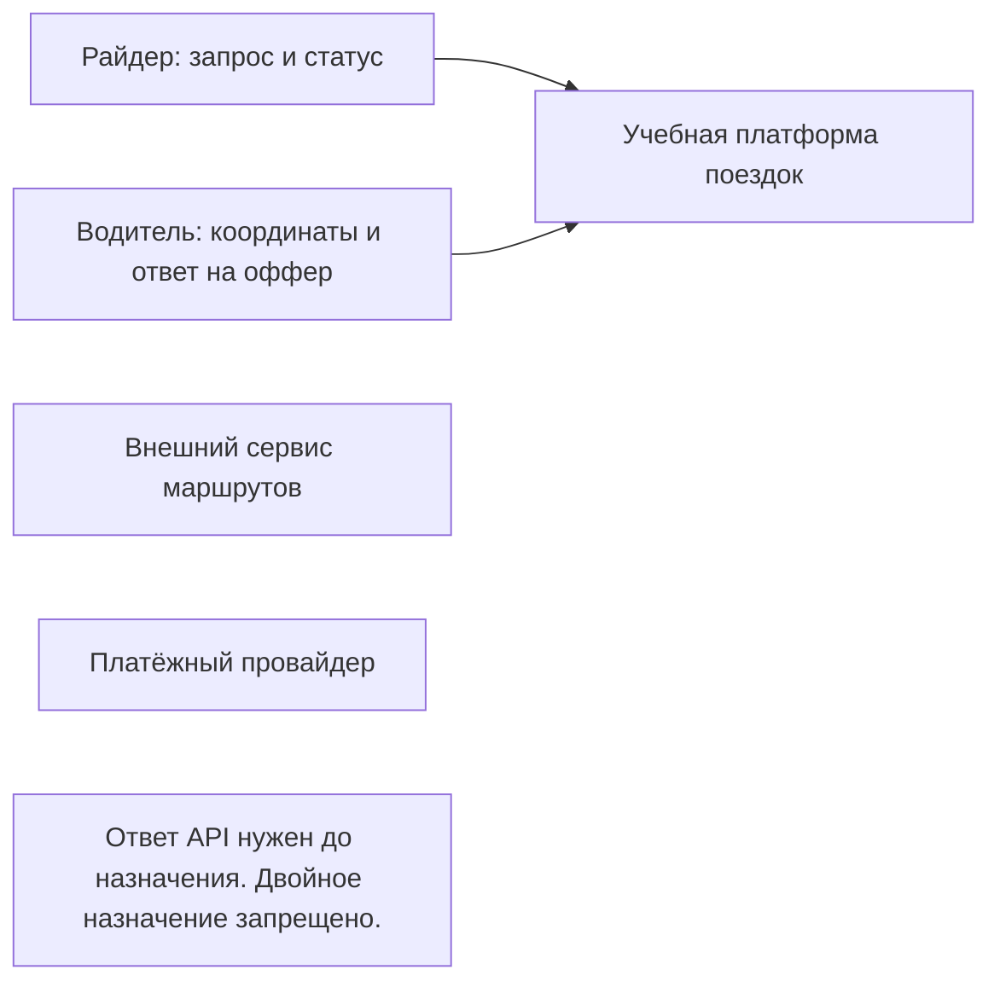
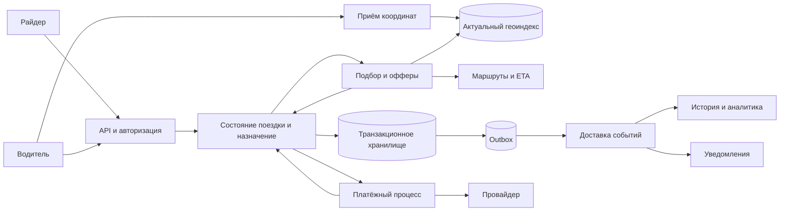
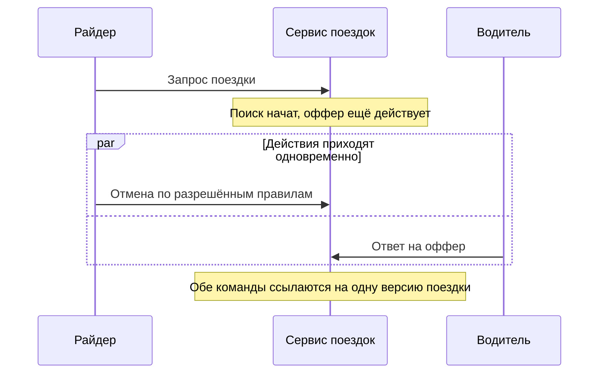
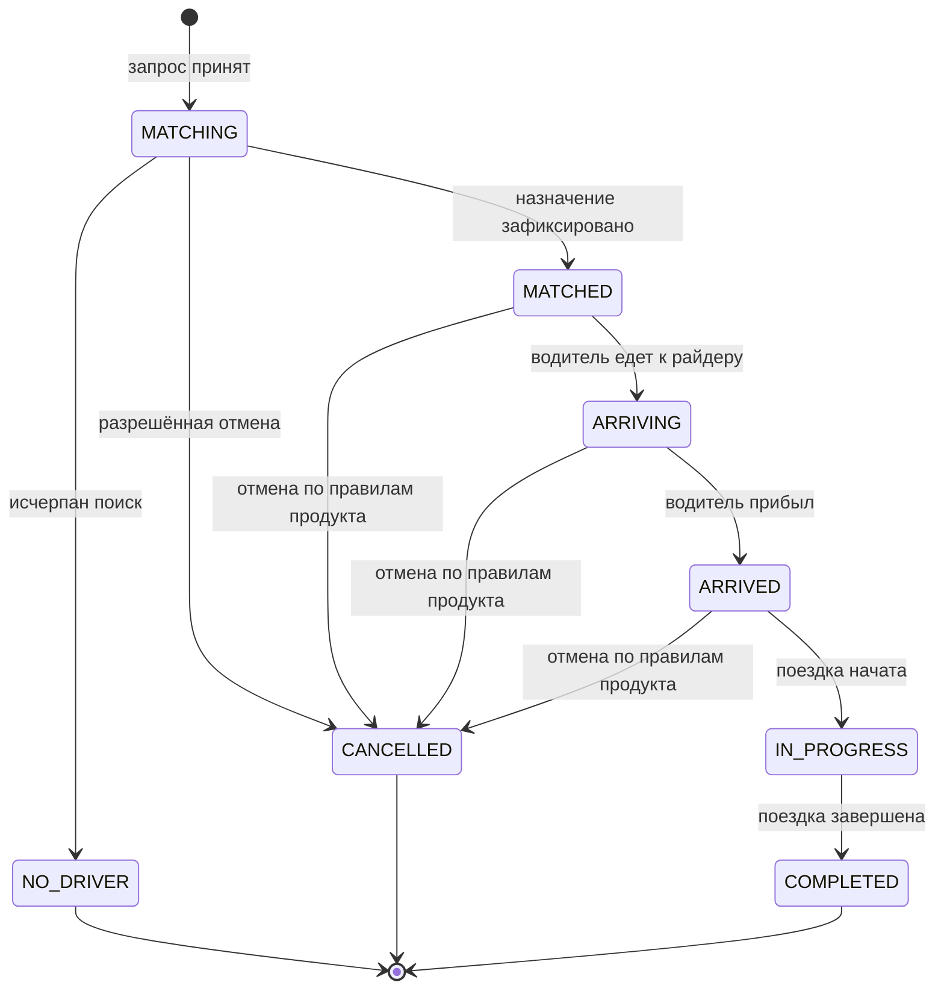

# System Design: Дизайн Uber/Lyft

Кейс senior/staff-уровня: матчинг водителей и райдеров в реальном времени, geo-spatial-индексы (`H3` / `S2` / `geohash`), потоковая обработка локаций, surge pricing, машина состояний поездки, поток оплаты и геораспределение. Главное напряжение дизайна — двойственность нагрузки: поток обновлений локаций write-heavy, а матчинг latency-critical. Хороший рассказ по этому кейсу заходит на любую позицию backend- или infra-уровня.

## Полезные ссылки

- [Uber Engineering Blog](https://www.uber.com/blog/engineering/) — десятки разборов про matching, surge, H3, marketplace.
- [H3: Uber's Hexagonal Hierarchical Spatial Index](https://www.uber.com/blog/h3/) — оригинальный анонс H3.
- [H3 Documentation](https://h3geo.org/docs/) — концепты, API, разрешения.
- [PostGIS ST_DWithin](https://postgis.net/docs/ST_DWithin.html) — индексируемый поиск в радиусе.
- [Google S2 Geometry Library](https://s2geometry.io/) — конкурирующий sphere-based index.
- [Lyft Engineering Blog](https://eng.lyft.com/) — matching, ETA, marketplace.
- [DoorDash — Building Faster Indexing with Apache Kafka and Elasticsearch](https://doordash.engineering/) — близкий по проблематике geo-marketplace.
- [Designing Data-Intensive Applications, M. Kleppmann](https://dataintensive.net/) — stream processing глава.

## Содержание

**Requirements и capacity**
- [Q1. (!) Функциональные требования к системе?](#q1--функциональные-требования-к-системе)
- [Q2. (!) Нефункциональные требования и SLA?](#q2--нефункциональные-требования-и-sla)
- [Q3. (!) Прикидка нагрузки на салфетке (capacity estimation)?](#q3--прикидка-нагрузки-на-салфетке-capacity-estimation)
- [Q4. Дизайн API — какие эндпоинты?](#q4-дизайн-api--какие-эндпоинты)

**High-level design**
- [Q5. (!) Высокоуровневая архитектура?](#q5--высокоуровневая-архитектура)
- [Q6. Модели данных — User, Driver, Trip, Location?](#q6-модели-данных--user-driver-trip-location)

**Geo-spatial indexing**
- [Q7. (!) Зачем geo-spatial index — почему не SQL `WHERE lat BETWEEN ...`?](#q7--зачем-geo-spatial-index--почему-не-sql-where-lat-between-)
- [Q8. (!) Geohash — как работает, плюсы и минусы?](#q8--geohash--как-работает-плюсы-и-минусы)
- [Q9. Google S2 — иерархический индекс на сфере?](#q9-google-s2--иерархический-индекс-на-сфере)
- [Q10. (!) Uber H3 — гексагональный индекс, почему его выбрал Uber?](#q10--uber-h3--гексагональный-индекс-почему-его-выбрал-uber)
- [Q11. Geohash vs S2 vs H3 — сравнительная таблица?](#q11-geohash-vs-s2-vs-h3--сравнительная-таблица)

**Location streaming и storage**
- [Q12. (!) Как водители стримят координаты — WebSocket / MQTT / HTTP?](#q12--как-водители-стримят-координаты--websocket--mqtt--http)
- [Q13. (!) Где хранить локации водителей — Redis, Cassandra, in-memory grid?](#q13--где-хранить-локации-водителей--redis-cassandra-in-memory-grid)
- [Q14. Redis GEO vs собственный H3-grid — что выбрать?](#q14-redis-geo-vs-собственный-h3-grid--что-выбрать)

**Matching algorithm**
- [Q15. (!) Алгоритм матчинга — pipeline от запроса до accept?](#q15--алгоритм-матчинга--pipeline-от-запроса-до-accept)
- [Q16. Последовательный, широковещательный или батчевый матчинг?](#q16-последовательный-широковещательный-или-батчевый-матчинг)
- [Q17. Как ранжировать кандидатов — ETA, рейтинг, баланс спроса?](#q17-как-ранжировать-кандидатов--eta-рейтинг-баланс-спроса)

**Surge pricing**
- [Q18. (!) Surge pricing — как считается и где?](#q18--surge-pricing--как-считается-и-где)

**Trip state machine, storage и payment**
- [Q19. (!) Машина состояний поездки — какие состояния и события?](#q19--машина-состояний-поездки--какие-состояния-и-события)
- [Q20. (!) Какую БД выбрать под поездки, локации и платежи?](#q20--какую-бд-выбрать-под-поездки-локации-и-платежи)
- [Q21. Оценка ETA — Google Maps, ML: что и когда применять?](#q21-оценка-eta--google-maps-ml-что-и-когда-применять)
- [Q22. Поток оплаты — холд, списание, возвраты, выплата водителю?](#q22-поток-оплаты--холд-списание-возвраты-выплата-водителю)

**Geo-distribution и hot regions**
- [Q23. Геораспределение — региональные дата-центры и роутинг?](#q23-геораспределение--региональные-дата-центры-и-роутинг)
- [Q24. Горячие регионы (NYC, SF, London) — как масштабировать?](#q24-горячие-регионы-nyc-sf-london--как-масштабировать)
- [Q25. Стратегия шардинга — по какому ключу делить поездки, локации, платежи?](#q25-стратегия-шардинга--по-какому-ключу-делить-поездки-локации-платежи)

**Anti-fraud и trade-offs**
- [Q26. Anti-fraud — подмена GPS, фейковые водители, платёжный фрод?](#q26-anti-fraud--подмена-gps-фейковые-водители-платёжный-фрод)
- [Q27. (!) CAP — где выбираем AP, где CP?](#q27--cap--где-выбираем-ap-где-cp)
- [Q28. (!) Антипаттерны — типичные ошибки в дизайне Uber?](#q28--антипаттерны--типичные-ошибки-в-дизайне-uber)
- [Q29. Заказы заранее и поездки с остановками — отдельный поток?](#q29-заказы-заранее-и-поездки-с-остановками--отдельный-поток)
- [Q30. Главные компромиссы дизайна?](#q30-главные-компромиссы-дизайна)

## Q1. (!) Функциональные требования к системе?

```text
На первом релизе райдер заказывает машину на сейчас, а водитель работает через мобильное приложение. Доступны внешние карты и платёжный провайдер. Что должно входить в базовый сценарий поездки и какие функции можно согласовать отдельно?
```

Для интервью зафиксируйте ядро сценария «заказать обычную поездку и довести её до завершения». Райдер видит предложение цены и примерное время подачи, создаёт запрос, получает результат подбора, наблюдает статус и положение машины, может отменить поездку и получить итоговый чек. Водитель сообщает о доступности и местоположении, принимает предложение, подтверждает прибытие, начало и завершение поездки. Система не должна назначить одного водителя двум несовместимым поездкам. Подробные переходы и повторы разбираются в Q15–Q19.

Вопросы интервьюеру до выбора архитектуры: какие города и виды поездок входят в задачу, когда цена считается принятой, что происходит при отмене, какие платежные методы поддерживаются, нужны ли поездки заранее, остановки и Share. Surge, рейтинг, чаевые и разбор фрода добавляйте в объём по договорённости, а не объявляйте обязательными для минимального сценария. На публичной странице Uber показана цена до заказа, но её доступность и правила изменения зависят от рынка и типа поездки. [Uber upfront pricing](https://www.uber.com/us/en/ride/how-it-works/upfront-pricing/), [surge pricing](https://www.uber.com/us/en/marketplace/pricing/surge-pricing/).

Карты, маршруты и платёжный провайдер можно принять как внешние зависимости, но их задержки, ошибки и правила оплаты остаются частью дизайна (Q21–Q22). Отсутствие собственного построителя маршрутов не означает, что ETA и переходы поездки можно не проектировать.

## Q2. (!) Нефункциональные требования и SLA?

```text
При обычной нагрузке API подтверждает запись запроса за 180 мс на p99. В одном районе водитель назначается через 20 с на p99, а на экране видны координаты 12-секундной давности. Как задать отдельные цели и точки измерения для этих трёх операций?
```

Сначала согласуйте **измеримые цели для операций**, а не приписывайте системе набор «четырёх девяток». В этом кейсе особенно важно разделить задержку подтверждения запроса, время до назначения водителя и возраст координаты на экране.

| Что измерять | Как сформулировать требование |
|---|---|
| Принятие запроса поездки | p95/p99 от получения `POST /rides` до сохранённого запроса и ответа; отказ и таймаут учитывать отдельно. |
| Подбор | Время от принятого запроса до назначения либо честного результата «водитель не найден»; измерять по городу, времени и доступному предложению водителей. |
| Трекинг | Возраст последней координаты при показе, частоту пропусков и поведение при потере связи; задержка сети не делает старую координату текущей. |
| Доступность | Долю успешных запросов по ключевым операциям, окно измерения и допустимое поведение при частичном отказе. |
| Сохранность | RPO/RTO для поездки и платежного журнала, последствия неизвестного результата и процедуру сверки. |
| Защита | Право райдера и водителя читать конкретную поездку, ограничение доступа к координатам и срок их хранения. |

Числовые SLO задают вместе с интервьюером или явно маркируют как предположение для расчёта Q3. Нагрузка по городам и времени неоднородна; один глобальный p99 скрывает локальный провал. «Доступность матчинга» не означает, что в каждой зоне обязательно найдётся свободный водитель. Поиск кандидатов может использовать устаревающую геопроекцию, а фиксация назначения требует проверки инварианта (Q15 и Q27).

Для платежа сохранность и идемпотентность не выводятся из лозунга «CP». Правила при сетевом разделе, требования к репликам и допустимый RPO обсуждают отдельно (Q22–Q23, Q27). Публичная отчётность Uber считает `Trips` вместе для Mobility и Delivery, поэтому её нельзя напрямую использовать как число пассажирских поездок или одновременно активных водителей. [Uber Q2 2026 results](https://investor.uber.com/news-events/news/press-release-details/2026/Uber-Announces-Results-for-Second-Quarter-2026/default.aspx).

В примере 180 мс относится к приёму запроса, 20 с относится к времени подбора, а 12 с характеризуют возраст показанной точки. У этих показателей разные начала измерения и причины деградации.

## Q3. (!) Прикидка нагрузки на салфетке (capacity estimation)?

```text
Учебная нагрузка: 100 000 одновременно активных водителей, одна точка каждые 5 с, 200 байт полезной нагрузки на точку. За сутки приходит 1 млн новых запросов на поездку. Для пика этих запросов используйте коэффициент 10. При оценке сырой истории считайте частоту координат постоянной. Каковы потоки и объёмы без реплик и сжатия?
```

Считайте от согласованных входных параметров. **Иллюстрация, не показатели Uber:** 100 000 одновременно активных водителей присылают координату раз в 5 секунд; за сутки создаётся 1 млн запросов поездок; для пика запросов принят коэффициент 10; условный размер сериализованного обновления — 200 байт.

| Поток | Расчёт для примера | Что это означает |
|---|---|---|
| Обновления координат | `100 000 / 5 = 20 000` сообщений/с; `× 200 Б = 4 МБ/с` полезной нагрузки | Пик по городу, заголовки, индексы, реплики и повторные попытки считаются дополнительно. |
| Запросы поездок | `1 000 000 / 86 400 ≈ 11,6` запросов/с в среднем; при условном `×10` — около `116`/с | Это новые запросы, а не число одновременно активных поездок или событий. |
| Актуальные координаты | `100 000 × 200 Б = 20 МБ` только для одного значения на водителя | Память индекса, служебные данные и репликация могут быть существенно больше полезного тела. |
| Сохранение всех точек | `20 000 × 86 400 × 200 Б ≈ 346 ГБ/сутки` без сжатия и реплик | Такой объём возникает лишь если действительно сохранять каждое обновление; срок и детализацию истории задаёт продукт. |

Отдельно оцените активные поездки через среднюю длительность, чтения трекинга через число наблюдателей и частоту обновления экрана, а стоимость геопоиска — через число кандидатов и перекос по зонам. Не умножайте поездки на выдуманные «20–50 событий»: схема событий определяется состояниями и выбранной детализацией. [Q13](#q13--где-хранить-локации-водителей--redis-cassandra-in-memory-grid) различает актуальную позицию и историю; Q20 сравнивает хранилища под операции.

Вывод из прикидки — **измерить** приём координат, горячие зоны, память индекса и задержку назначения. Она сама по себе не доказывает, что обязательны Cassandra, Kafka, собственная сетка H3 или определённое число шардов. Публичные квартальные `Trips` Uber включают и Delivery, и особый подсчёт Shared rides; числа выше предназначены только для интервью-сценария. [Uber Q2 2026 results](https://investor.uber.com/news-events/news/press-release-details/2026/Uber-Announces-Results-for-Second-Quarter-2026/default.aspx).

## Q4. Дизайн API — какие эндпоинты?

```text
Райдер подтверждает предложение цены. API успевает сохранить запрос раньше, чем появляется водитель. Ответ может потеряться, и приложение повторит создание. Какой контракт должен связать создание, повтор и получение статуса?
```

Контракт должен различать предложение цены, принятый запрос и окончательное назначение. Ниже **пример API проектируемой системы**, а не опубликованный API Uber:

```http
POST /api/v1/ride-estimates
  {pickup, destination, ride_type}
  -> {estimate_id, price, currency, pickup_eta, expires_at}

POST /api/v1/rides
  Idempotency-Key: <stable-request-key>
  {estimate_id, pickup, destination, payment_method_ref}
  -> 202 Accepted {ride_id, status: "MATCHING", status_url: "/api/v1/rides/{ride_id}"}

GET  /api/v1/rides/{ride_id}
  -> {ride_id, status, driver, updated_at}
POST /api/v1/rides/{ride_id}/cancel
POST /api/v1/rides/{ride_id}/accept
  {offer_id}
POST /api/v1/rides/{ride_id}/arrive
POST /api/v1/rides/{ride_id}/start
POST /api/v1/rides/{ride_id}/complete
PUT  /api/v1/drivers/me/availability
POST /api/v1/drivers/me/locations
```

`202 Accepted` означает, что запрос **принят к обработке**, а не что водитель уже назначен. В этом контракте возвращайте его после надёжной записи запроса вместе с URL для проверки статуса; затем клиент получает изменение через подписку или повторяет `GET`. Без подтверждённой записи сервер не может обещать клиенту принятие запроса по этому контракту. Повтор `POST /rides` с тем же ключом и тем же содержимым должен вернуть тот же логический запрос, а повтор принятия оффера проверяет текущую версию поездки и занятость водителя. [RFC 9110 §15.3.3](https://www.rfc-editor.org/rfc/rfc9110.html#section-15.3.3).

Координаты можно передавать HTTP-запросами (`POST /drivers/me/locations`) или сообщениями по WebSocket; это **разные контракты**, а не HTTP `POST` «через WebSocket». WebSocket даёт двусторонний поток, но требует авторизации соединения, повторного подключения и обработки пропусков. Клиент не должен произвольно переводить чужую поездку между состояниями: каждый переход проверяет участника и допустимое исходное состояние (Q19). `payment_method_ref` — ссылка на токен провайдера, а не данные карты; авторизация/списание выполняются серверным процессом по правилам Q22. [RFC 6455](https://www.rfc-editor.org/rfc/rfc6455).

Если POST в другом контракте означает синхронное создание ресурса запроса поездки, возможен `201 Created` с `Location`. Статус этого ресурса всё ещё может быть `MATCHING`. [RFC 9110 §15.3.2](https://www.rfc-editor.org/rfc/rfc9110.html#section-15.3.2).

Пример не навязывает gRPC внутренним сервисам или WebSocket каждому клиенту. Транспорт выбирают по частоте сообщений, требованиям к обратному каналу и возможностям мобильной сети (Q12).

## Q5. (!) Высокоуровневая архитектура?

Начните с потоков команд и инварианта назначения, а не с перечня микросервисов. Райдер создаёт запрос; ядро поездки надёжно сохраняет его и передаёт в подбор. Водители обновляют координаты и доступность; геоиндекс даёт кандидатов. Подбор оценивает ETA и предлагает поездку, но **единственное подтверждённое назначение** фиксирует владелец состояния поездки. Платёжный результат и уведомления не должны менять эту запись в обход допустимых переходов (Q15–Q22).



Разбор схемы.



**Горячий путь:** после успешного ответа на `POST /rides` запрос уже существует, а клиент видит `MATCHING`. Подбор получает кандидатов из геоиндекса, проверяет свежесть координат и ранжирует по дорожному ETA. При принятии оффера переход и ограничение «водитель не занят другой активной поездкой» проверяются атомарно. Потерянный ответ водителю или райдеру не должен создавать второе назначение (Q4, Q15–Q19).

**Побочные потоки:** состояние поездки и запись outbox сохраняются в одной транзакции; отдельный процесс публикует событие для уведомлений, истории и аналитики. Доставка может повториться, поэтому потребители дедуплицируют или применяют события идемпотентно. Kafka и Debezium — возможная реализация, а не обязательная магистраль. Если история точных координат не нужна продукту, не требуется архивировать каждую точку. [PostgreSQL 18 transactions](https://www.postgresql.org/docs/18/tutorial-transactions.html), [Debezium 3.7 Outbox Event Router](https://debezium.io/documentation/reference/stable/transformations/outbox-event-router.html).

**Границы отказа:** геоиндекс может отставать, но окончательное назначение проверяется у владельца поездки; недоступный маршрутный сервис не превращает расстояние по прямой в надёжный ETA; таймаут платёжного провайдера оставляет исход неизвестным до сверки. Компоненты можно разворачивать вместе и выделять по мере измеренного роста нагрузки. Схема показывает обязанности и поток данных, не подтверждённую внутреннюю архитектуру Uber. [Uber Marketplace Matching](https://www.uber.com/us/en/marketplace/matching/), [Google Routes API](https://developers.google.com/maps/documentation/routes/compute_route_matrix).

## Q6. Модели данных — User, Driver, Trip, Location?

```text
PostgreSQL 18, одна непартиционированная таблица поездок. Одна поездка может быть ещё без водителя. После назначения и до завершения либо отмены водитель может принадлежать только одной поездке. Отдельно нужен поиск по последней точке водителя. Как отразить эти правила в схеме?
```

Модель строят от операций: профиль и доступность водителя, **один активный владелец назначения**, запрос поездки, текущее положение, журнал переходов и платежей. Для базового варианта PostgreSQL 18 с PostGIS может хранить состояния и индексировать актуальные координаты. Это пример проектирования, а не утверждение о БД Uber и не требование держать все данные в одном узле.

```sql
CREATE EXTENSION IF NOT EXISTS postgis;

CREATE TABLE drivers (
  driver_id       bigint PRIMARY KEY,
  availability    text NOT NULL CHECK (availability IN ('OFFLINE', 'ONLINE'))
);

CREATE TABLE trips (
  trip_id         bigint PRIMARY KEY,
  rider_id        bigint NOT NULL,
  driver_id       bigint REFERENCES drivers(driver_id),
  status          text NOT NULL CHECK (status IN
                    ('MATCHING', 'MATCHED', 'ARRIVING', 'ARRIVED',
                     'IN_PROGRESS', 'COMPLETED', 'CANCELLED', 'NO_DRIVER')),
  version         bigint NOT NULL DEFAULT 0,
  pickup          geography(Point, 4326) NOT NULL,
  destination     geography(Point, 4326) NOT NULL,
  created_at      timestamptz NOT NULL DEFAULT now(),
  CHECK (status NOT IN ('MATCHED', 'ARRIVING', 'ARRIVED', 'IN_PROGRESS')
         OR driver_id IS NOT NULL)
);

CREATE UNIQUE INDEX one_active_trip_per_driver ON trips (driver_id)
  WHERE driver_id IS NOT NULL
    AND status IN ('MATCHED', 'ARRIVING', 'ARRIVED', 'IN_PROGRESS');

CREATE TABLE driver_positions (
  driver_id       bigint PRIMARY KEY REFERENCES drivers(driver_id),
  position        geography(Point, 4326) NOT NULL,
  observed_at     timestamptz NOT NULL
);
CREATE INDEX driver_positions_geo ON driver_positions USING gist (position);

CREATE TABLE trip_outbox (
  event_id        bigint PRIMARY KEY,
  trip_id         bigint NOT NULL REFERENCES trips(trip_id),
  event_type      text NOT NULL,
  payload         jsonb NOT NULL,
  created_at      timestamptz NOT NULL DEFAULT now()
);
```

При принятии оффера условно обновите `trips` с ожидаемыми `status`/`version` и запишите событие в `trip_outbox` **в той же транзакции**. Частичный уникальный индекс даёт дополнительную защиту от двух активных поездок одного водителя в этой непартиционированной таблице; он не заменяет проверку переходов и не обеспечивает глобальную уникальность после произвольного шардинга. Историю райдера ускоряет индекс по `(rider_id, created_at)`, если такой запрос подтверждён. [PostgreSQL 18 partial indexes](https://www.postgresql.org/docs/18/indexes-partial.html), [transactions](https://www.postgresql.org/docs/18/tutorial-transactions.html), [partitioning](https://www.postgresql.org/docs/18/ddl-partitioning.html).

`driver_positions` — только последняя известная координата. Не заменяйте её более старой по `observed_at`, проверяйте срок свежести при подборе и удаляйте или исключайте неактивных водителей. Если поток координат или масштаб индекса требуют отдельного слоя, Redis GEO может стать проекцией актуального положения; её обновление и восстановление нужно проектировать отдельно. В Redis GEO нет TTL отдельного участника. Точные точки истории хранят по отдельной политике, а не как обязательную копию каждого сообщения (Q12–Q14). [Redis geospatial](https://redis.io/docs/latest/develop/data-types/geospatial/).

В примере `rider_id` ссылается на профиль райдера, хранящийся вне показанной схемы. Если профили находятся в той же БД, эту связь можно закрепить внешним ключом.

Платёжные намерения, результаты провайдера и проводки имеют собственные идентификаторы операций и правила сверки (Q22). Не смешивайте `CAPTURE`, `REFUND` и выплату водителю в одну условную строку с произвольным `status`; выбор модели журнала зависит от денежного контракта. Для цены используйте точное числовое представление и валюту, а не `float`; принятое предложение и изменения цены связывают с конкретной поездкой (Q18–Q19). [PostgreSQL 18 numeric types](https://www.postgresql.org/docs/18/datatype-numeric.html).

## Q7. (!) Зачем geo-spatial index — почему не SQL `WHERE lat BETWEEN ...`?

```text
В PostgreSQL с PostGIS хранятся точки WGS84. Нужно вернуть водителей на расстоянии до 500 м от точки подачи. Как получить точный результат с индексным отбором и чем он отличается от двух диапазонов по координатам?
```

SQL подходит, если у него есть нужный пространственный индекс и он выдерживает измеренную нагрузку. Два диапазона по широте и долготе дают прямоугольную область кандидатов; они не равны условию «водитель в радиусе». Обычный составной B-tree может помочь отфильтровать часть строк, но не превращает запрос в точный поиск по расстоянию.

Для PostgreSQL/PostGIS тип `geography(Point, 4326)` позволяет передать расстояние в метрах. `ST_DWithin(position, center, radius_m)` использует доступный пространственный индекс для предварительного отбора и проверяет расстояние; фактический план и стоимость обновления GiST измеряют на рабочем распределении точек. [PostGIS ST_DWithin](https://postgis.net/docs/ST_DWithin.html), [PostgreSQL 18 index types](https://www.postgresql.org/docs/18/indexes-types.html).

В Redis GEO `GEOADD` обновляет положение участника, а `GEOSEARCH` находит точки внутри радиуса или прямоугольника. Результат всё равно фильтруют по доступности и времени последней координаты; истёкший TTL отдельного ключа не удаляет участника из общего GEO-индекса. Ячеечная сетка H3/S2 также даёт кандидатов, но требует покрытия границ области и проверки точного расстояния (Q8–Q14). [Redis GEOSEARCH](https://redis.io/docs/latest/commands/geosearch/).

Пример: водитель близко по прямой, но за рекой. Геоиндекс быстро сокращает число кандидатов; затем сервис маршрута сравнивает **время подъезда**, а окончательное назначение ещё раз проверяет состояние водителя. Ни PostGIS, ни Redis GEO, ни H3 сами по себе не дают ETA или эксклюзивного назначения. [Uber Marketplace Matching](https://www.uber.com/us/en/marketplace/matching/), [Google Routes API](https://developers.google.com/maps/documentation/routes/compute_route_matrix).

## Q8. (!) Geohash — как работает, плюсы и минусы?

```text
Точка подачи находится у края ячейки Geohash. Один водитель находится по другую сторону границы в 10 м, другой находится внутри ячейки в 100 м. Радиус поиска 50 м. Какие данные нужно прочитать и проверить?
```

**Geohash** кодирует долготу и широту в строку base32: алгоритм попеременно делит диапазоны координат пополам и группирует биты по пять. Общий длинный префикс указывает на одну небольшую ячейку, поэтому его удобно использовать как ключ группировки или диапазон строкового индекса. Но обратное неверно: две близкие точки по разные стороны границы ячеек могут иметь короткий общий префикс. [Redis: secondary indexing](https://redis.io/docs/latest/develop/clients/patterns/indexes/), [Redis geospatial](https://redis.io/docs/latest/develop/data-types/geospatial/).

Для поиска **в радиусе** одного префикса недостаточно. Нужно выбрать покрывающие область ячейки, включая соседние через их границы, получить кандидатов и проверить фактическое расстояние. Размер ячейки зависит от длины строки и широты: одинаковые интервалы долготы сужаются по мере приближения к полюсам. Граница ±180° также требует отдельной обработки. Если задача сводится к радиусному поиску в Redis, `GEOSEARCH` уже выполняет нужный отбор поверх собственного геоиндекса; ручное префиксное сканирование не является обязательным. [Redis GEOSEARCH](https://redis.io/docs/latest/commands/geosearch/).

В примере нужна и соседняя ячейка с водителем в 10 м. Водитель из исходной ячейки на расстоянии 100 м не входит в радиус.

## Q9. Google S2 — иерархический индекс на сфере?

```text
Районы заданы полигонами, для агрегации требуются вложенные разбиения, а на границе полигона нужен точный результат. Какие свойства S2 здесь используются?
```

**S2** разбивает сферу на ячейки с точной иерархией: шесть граней куба проецируются на сферу, а каждая ячейка делится на четыре дочерние. На сфере это четырёхугольники, ограниченные геодезическими дугами, а не одинаковые плоские квадраты. Уровни идут от 0 до 30; `S2CellId` — 64-битное число, упорядоченное вдоль кривой Гильберта для локальности хранения. [S2 Cells](https://s2geometry.io/devguide/s2cell_hierarchy.html).

При поиске области используйте покрытие из S2-ячеек: оно отбирает кандидатов, после чего геометрию проверяют точно. Близость номеров полезна для индекса, но не заменяет расстояние на сфере. На уровне 15 средняя площадь ячейки около 79 тыс. м², а на уровне 30 размер **по стороне** порядка сантиметра, не квадратного сантиметра; площадь зависит от положения. [S2 Cell Statistics](https://s2geometry.io/resources/s2cell_statistics).

Сильная сторона S2 — точное логическое и геометрическое вложение четырёх потомков в родителя. Это удобно для покрытия регионов и иерархических запросов. Для задачи только «найти ближайших водителей» выбор S2 сам по себе не даёт ETA: после отбора кандидатов всё равно нужны проверка расстояния, актуальности позиции и дорожного маршрута.

## Q10. (!) Uber H3 — гексагональный индекс, почему его выбрал Uber?

```text
Команда изучает опубликованный Uber индекс H3 4.x для сравнения соседних зон спроса. Что нужно учитывать при обходе соседей и при переходе между разрешениями?
```

**H3** строит сетку на проекции сферы на икосаэдр. Его гексагональные ячейки удобны для агрегирования пространственных данных: в идеальной сетке у шести соседей одинаковая геометрическая роль, в отличие от сторон и диагоналей квадрата. Uber описывает H3 прежде всего как инструмент анализа рынка и пространственных метрик; из этого не следует, что любой поиск водителей или расчёт ETA у Uber выполняется только через H3. [Uber Engineering: H3](https://www.uber.com/us/en/blog/h3/), [H3 introduction](https://h3geo.org/docs/).

В H3 16 разрешений, от 0 до 15. На каждом уровне есть 12 пятиугольников, поэтому нельзя обещать ровно шесть соседей **каждой** ячейке. Средняя площадь гексагона на уровне 9 — около 0,105 км², на уровне 15 — около 0,895 м²; это средние значения, а не размеры любой конкретной ячейки. `gridDisk(cell, k)` возвращает ячейки на расстоянии до `k` шагов по сетке, не метрический круг. [H3 cell statistics](https://h3geo.org/docs/core-library/restable/), [gridDisk](https://h3geo.org/docs/api/traversal/).

Иерархия H3 **логически** точная, но геометрически только приблизительная: дочерние ячейки могут выходить за границу родителя. При агрегации по родительскому ID это означает смену геометрической границы, а не арифметическую ошибку библиотеки. Для поиска без потерь отберите все ячейки, которые могут содержать точки нужной области, и проверяйте координаты по исходной геометрии. Обычный `polygonToCells` проверяет попадание центра ячейки, поэтому им одним нельзя построить такое покрытие границы. [H3 region functions](https://h3geo.org/docs/api/regions/). [H3 indexing](https://h3geo.org/docs/highlights/indexing/).

## Q11. Geohash vs S2 vs H3 — сравнительная таблица?

```text
Один запрос группирует записи по строковому префиксу, другой требует геометрически вложенных ячеек, третий считает агрегаты по соседним зонам. Как сравнить Geohash, S2 и H3 по этим операциям?
```

Выбирайте индекс по операции, которую нужно выполнять, и по доступному хранилищу. Все три разбивают пространство на ячейки, но **ячейка не является точным расстоянием** и сама по себе не находит ETA.

| Свойство | Geohash | S2 | H3 |
|---|---|---|---|
| Ячейка и ID | Интервалы широты/долготы, строка base32 | Сферический четырёхугольник, 64-битный ID | В основном гексагон, 64-битный ID. На каждом уровне 12 пятиугольников |
| Иерархия | Префиксы строк | Четыре геометрически вложенных потомка | Логическое вложение; геометрические границы детей приблизительны |
| Сильная сторона | Простой префиксный ключ | Покрытие регионов с точной иерархией | Агрегация и соседство ячеек для пространственной аналитики |
| Ограничение для радиуса | Проверка соседних префиксов и точного расстояния | Покрытие может включать лишние точки | `gridDisk` измеряет шаги сетки, а не метры |

Если текущий индекс в Redis GEO удовлетворяет задержке и частоте обновлений, отдельная H3-сетка добавит работу без доказанной выгоды. S2 или H3 оправданы, когда нужны их операции покрытия и агрегации, а не только потому, что система «глобальная». Для всех вариантов измерьте число кандидатов, стоимость обновлений и точной фильтрации; границы выбора текущих позиций обсуждаются в [Q14](#q14-redis-geo-vs-собственный-h3-grid--что-выбрать). [S2 Cells](https://s2geometry.io/devguide/s2cell_hierarchy.html), [H3 introduction](https://h3geo.org/docs/), [Redis geospatial](https://redis.io/docs/latest/develop/data-types/geospatial/).

## Q12. (!) Как водители стримят координаты — WebSocket / MQTT / HTTP?

```text
Телефон отправляет точки каждые 5 с, сеть периодически рвётся, офферы нужно доставлять между обновлениями. В одном варианте требуется один двусторонний канал, в другом допустим отдельный канал офферов. Чем отличаются HTTP, WebSocket и MQTT в этих условиях?
```

Для обновлений координат подойдут повторные HTTP-запросы, WebSocket или MQTT. Выбор зависит от частоты сообщений, качества мобильной сети и того, нужен ли на **том же соединении** канал офферов водителю. WebSocket даёт двусторонний поток; HTTP POST проще для редких обновлений, а офферы можно доставлять отдельным каналом. MQTT добавляет брокер, подписки и уровни QoS; его доставка до брокера сама по себе не подтверждает, что оффер принят водителем. HTTP/1.1 уже допускает повторное использование соединения: один POST не означает новое TLS-рукопожатие. [RFC 6455](https://www.rfc-editor.org/rfc/rfc6455), [RFC 9112](https://www.rfc-editor.org/rfc/rfc9112.html#section-9.3), [MQTT 5.0](https://docs.oasis-open.org/mqtt/mqtt/v5.0/os/mqtt-v5.0-os.html).

Для WebSocket шлюз держит открытое соединение и направляет оффер в процесс, которому оно сейчас принадлежит. Балансировщик выбирает шлюз **при установлении соединения**; липкая маршрутизация последующих подключений не является требованием протокола. После разрыва клиент подключается заново, а сервер обновляет реестр `driver_id → gateway`; офферы и подтверждения получают ID, чтобы повторная доставка не создавала второе назначение. При нескольких шлюзах этот реестр и маршрутизацию нужно проектировать явно. [RFC 6455](https://www.rfc-editor.org/rfc/rfc6455).

На приёме проверяйте подлинность водителя, допустимость координат и время измерения. Пишите для каждой позиции `driver_id`, координаты и `observed_at` либо монотонный номер; при поздней доставке не заменяйте более свежую позицию старой. Отдельно задайте срок свежести для матчинга: если водитель перестал присылать обновления, он не должен оставаться кандидатом. Сохранение истории для аналитики — отдельная потребность; конкретная частота сообщений, формат и срок хранения выбираются по измеренной нагрузке и правилам продукта.

## Q13. (!) Где хранить локации водителей — Redis, Cassandra, in-memory grid?

```text
Для поиска нужна последняя пригодная точка каждого водителя. Отдельный запрос читает траекторию водителя за сутки. В Redis истёк ключ метаданных одного водителя, координата была записана в общий GEO-ключ. Как проектировать эти операции?
```

Для матчинга нужен **актуальный** пространственный индекс, а для истории поездки — последовательность наблюдений. Их можно хранить отдельно: Redis GEO или PostGIS для текущих кандидатов, долговечный журнал и выбранное хранилище для истории. Локальный H3-кэш на воркерах полезен только при подтверждённой нагрузке и требует собственного механизма обновления и восстановления; обязательного «тёплого» слоя нет.

В Redis `GEOADD` обновляет позицию участника внутри sorted set, а `GEOSEARCH` ищет кандидатов в заданной области. У отдельного участника GEO-ключа нет собственного TTL. Можно проверять `last_seen` при выдаче и удалять устаревшего участника из геоиндекса; ключ с метаданными водителя может иметь свой TTL, но его истечение **само по себе не удалит** участника из GEO. Если индекс разделён на несколько зон, перемещение водителя требует удалить его из старой зоны и записать в новую; при гонке обновлений сверяйте версию или время позиции. [Redis geospatial](https://redis.io/docs/latest/develop/data-types/geospatial/), [GEOADD](https://redis.io/docs/latest/commands/geoadd/), [ZREM](https://redis.io/docs/latest/commands/zrem/).

Историю можно вести в журнале и затем складывать в базу или объектное хранилище с ключом, удобным для чтения траектории одного водителя и периода. Срок хранения задают договор продукта и применимые требования к данным, а не название Cassandra. Не переносите оценку объёма одного актуального состояния на историю: при `n` водителях, `f` обновлениях в секунду и `t` секундах хранения число сырых точек порядка `n × f × t`, до учёта реплик, индексов и сжатия.

## Q14. Redis GEO vs собственный H3-grid — что выбрать?

```text
В городе один GEO-ключ в Redis Cluster. Операции по радиусу сейчас укладываются в SLO, но при моделировании пика запись в этот ключ превышает бюджет. Водители пересекают границы зон. Что изменится при разбиении по ячейкам?
```

Начните с требуемого запроса и измерений. Если достаточно радиуса и последующей фильтрации небольшого списка кандидатов, `GEOADD`/`GEOSEARCH` проще в поддержке. Один общий GEO-ключ в Redis Cluster принадлежит одному hash slot, поэтому добавление узлов не распределит **запись в этот ключ**; это ограничение становится причиной шардирования только при измеренном узком месте. Redis Search — отдельный вариант, если нужны индексируемые атрибуты вместе с геоусловием. [Redis GEOSEARCH](https://redis.io/docs/latest/commands/geosearch/), [Cluster specification](https://redis.io/docs/latest/operate/oss_and_stack/reference/cluster-spec/), [Redis geospatial queries](https://redis.io/docs/latest/develop/ai/search-and-query/query/geo-spatial/).

H3-сетка даёт ключи по ячейкам и позволяет хранить рядом отобранные метаданные. Но это уже собственный пространственный индекс: нужно выбрать разрешение, охватить **все** ячейки, пересекающие нужный радиус, учесть границы и пятиугольники, затем проверить точное расстояние и свежесть каждого кандидата. `gridDisk(cell, 1)` возвращает ячейки в одном шаге, а не универсальный радиус поиска; около пятиугольника соседей может быть меньше шести. Несколько ключей могут разойтись по слотам Redis Cluster, поэтому перенос водителя между ними не становится атомарным автоматически. [H3 grid traversal](https://h3geo.org/docs/api/traversal/), [Redis Cluster multi-key operations](https://redis.io/docs/latest/operate/oss_and_stack/management/scaling/).

Для одного гео-ключа сначала измерьте задержку `GEOSEARCH`, частоту `GEOADD`, размер кандидатов и стоимость фильтрации. Переходите к ячейкам, когда эти измерения оправдывают дополнительную логику маршрутизации, обновления, удаления старых позиций и восстановления индекса. При любом варианте финальный выбор водителя по ETA и доступности делает сервис матчинга, а не сам геоиндекс.

## Q15. (!) Алгоритм матчинга — pipeline от запроса до accept?

```text
Райдер отправил один запрос. Два водителя ответили на его действующие офферы, и один из них одновременно принимает оффер другой поездки. Как разделить поиск, ответ на оффер и подтверждение с учётом обоих ограничений назначения?
```

Матчинг сначала находит подходящих водителей, затем выбирает, кому предложить поездку, и только после подтверждённого назначения переводит поездку в `MATCHED`. Ответ водителя на оффер ещё не означает, что он получил поездку: за этого же водителя и поездку могут одновременно бороться другие запросы.

1. `trip-service` создаёт поездку в `MATCHING` с идемпотентным ключом запроса и передаёт точку подачи, требования к машине и условия поездки сервису матчинга.
2. Поиск получает **кандидатов**, а не готовое назначение. Один вариант — `GEOSEARCH` по радиусу вокруг точки подачи в Redis GEO. Другой — собственный индекс по H3-ячейкам с обходом нужной области. Это разные способы поиска; `GEOSEARCH` не принимает H3-ячейку и число колец. В обоих случаях проверяют свежесть позиции и точное расстояние после выборки. См. Q13–Q14. [Redis GEOSEARCH](https://redis.io/docs/latest/commands/geosearch/), [H3 grid traversal](https://h3geo.org/docs/api/traversal/).
3. Сервис отбрасывает недоступных водителей и тех, кому поездка не подходит по типу машины, ограничениям безопасности или предпочтениям. Для оставшихся оценивает время подъезда по дорожной сети и выбирает офферы по политике Q16–Q17. Ближайший по прямой водитель не обязательно быстрее всех приедет. [Uber Marketplace Matching](https://www.uber.com/us/en/marketplace/matching/).
4. Оффер содержит идентификатор, срок действия и версию условий. При принятии сервис повторно проверяет доступность водителя и состояние поездки. Назначение фиксирует атомарно в источнике истины: условное обновление или транзакция должны допустить только одну активную поездку у водителя и одного назначенного водителя у поездки. Уникальное ограничение по активным назначениям может быть дополнительной защитой. Лишь после фиксации публикуют событие и уведомляют приложения. [PostgreSQL explicit locking](https://www.postgresql.org/docs/18/explicit-locking.html), [partial indexes](https://www.postgresql.org/docs/18/indexes-partial.html).

Повторный `accept` с тем же ID должен вернуть тот же результат, а опоздавший или проигравший конкурентный `accept` — понятный отказ и актуальное состояние. Таймаут оффера, расширение зоны поиска и предел ожидания райдера задаются продуктом и измерениями; универсальных чисел для них нет.

## Q16. Последовательный, широковещательный или батчевый матчинг?

```text
В одном сценарии старт первого оффера важнее общего времени подачи. В другом можно подождать до двух секунд, чтобы оценить пары двух райдеров и двух водителей вместе. Отдельно допускается рассылка одного оффера нескольким водителям, но подтверждение нужно выдать одному. Какие компромиссы у трёх политик?
```

Это разные политики выбора и отправки офферов. При любой политике назначение должно выдерживать конкурентные запросы: даже один оффер одному водителю не исключает, что другая поездка предложит ему себя одновременно.

| Политика | Что происходит | Цена выбора |
|---|---|---|
| Последовательная | Одному кандидату дают ограниченное время на ответ; после отказа или истечения срока переходят к следующему. | Меньше одновременных офферов, но каждый неуспешный шаг прибавляет ожидание. |
| Параллельная | Несколько кандидатов видят оффер одновременно; сервис выбирает одно подтверждённое назначение. | Ответ может прийти быстрее, но часть согласившихся не получит поездку. Нужны атомарное назначение и уведомление проигравших. |
| Батчевая | Несколько райдеров и водителей рассматриваются вместе, чтобы улучшить результат для группы. | Окно накопления и расчёт добавляют задержку; целевую функцию и размер окна выбирают по метрикам. |

[Uber описывает](https://www.uber.com/us/en/marketplace/matching/) батчевую оценку ближайших райдеров и водителей через несколько секунд после запроса и цель сократить среднее ожидание группы. Из этого описания нельзя вывести точную длину окна, конкретный алгоритм назначения или SLA. Параллельные предложения — отдельная продуктовая механика: в [Trip Radar](https://help.uber.com/driving-and-delivering/article/what-is-trip-radar?nodeId=aa3d4d28-1fd6-45eb-bd08-1a043ca0ba4b) Uber прямо указывает, что предложение видят несколько исполнителей, поездку получает один и решение не обязано зависеть от самого раннего нажатия. Доступность функции зависит от города и типа поездки.

Выбор политики проверяют на времени ожидания, доле назначенных поездок, отменах, лишних офферах водителю и распределении заказов. Утверждение «первый принял — получил» допустимо только как явно заданное правило собственного сервиса; оно не следует из факта параллельной рассылки.

## Q17. Как ранжировать кандидатов — ETA, рейтинг, баланс спроса?

```text
Точка подачи у моста. У водителя A подъезд 3 минуты, но автомобиль другого класса. У B подъезд 7 минут, у C 5 минут. B и C подходят по классу и доступности. Цель кейса после допуска состоит в минимизации времени подъезда при прочих равных. Как сравнить кандидатов?
```

Сначала отделяют **допуск** от **ранжирования**. Недоступного водителя, неподходящую машину или запрещённую пару райдер–водитель нельзя сделать подходящими большим score. В учебной модели запрет повторного подбора конкретной пары можно хранить как правило допуска. В публичной справке Uber описаны оценки поездок и обратная связь. [Uber Rating FAQs](https://help.uber.com/en/riders/article/rating-faqs/?nodeId=0539e772-747c-49a7-8c26-f28c65e6f14d).

Для допущенных кандидатов полезно оценить время подъезда по дорогам с учётом движения, вероятность принятия оффера и ограничения продукта. Расстояние по прямой или номер H3-ячейки подходят для поиска кандидатов, но сами по себе не определяют ETA: река, развязка или пробка меняют время пути. Можно начать с понятного правила и позже сравнить его с обучаемым ранжированием на исторических данных. Конкретные веса, модель и признаки нельзя объявлять практикой Uber без источника.

Баланс спроса и предложения влияет на охват поиска и на цену ожидания: при недостатке кандидатов сервис может расширить область, но обязан контролировать время подачи и нагрузку. Политика офферов может учитывать, сколько предложений недавно получил водитель. Предпочтение маршрута тоже бывает условием допуска: Uber описывает выбор поездок по направлению к заданному водителем пункту назначения, а в [обновлении Destination Mode от 12.05.2026](https://www.uber.com/us/en/blog/destination-mode/) — более широкий или узкий поиск в зависимости от выбора водителя. Это пример продуктового ограничения, а не формула общего ранжирования.

Сравнивайте правила по среднему и хвостовому времени подачи, доле принятых и завершённых поездок, отменам и распределению предложений между водителями. Ранжирование должно улучшать измеримый результат, не нарушая ограничения допуска и единственность назначения из Q15.

В заданном примере A исключается по классу, а C опережает B по времени подъезда. Такой порядок зависит от явно заданной цели ранжирования.

## Q18. (!) Surge pricing — как считается и где?

```text
После концерта спрос растёт в одной зоне. Правила сервиса фиксируют принятую цену и допускают пересчёт только для новых предложений, если маршрут не меняется. Сигнал о спросе приходит с задержкой. Как разделить расчёт новой оценки и обслуживание уже подтверждённых поездок?
```

Динамическая цена реагирует на локальный дисбаланс спроса на поездки и доступных водителей. Uber описывает частые обновления по районам города: более высокая цена побуждает часть райдеров подождать, а водителей — работать в зоне спроса. В отдельных обстоятельствах, например при чрезвычайной ситуации, Uber может ограничить рост цены. Способ показа надбавки зависит от города: множитель, дополнительная сумма или уже рассчитанная цена поездки. [Uber Marketplace: surge pricing](https://www.uber.com/au/en/marketplace/pricing/surge-pricing/), [Uber: how surge works](https://www.uber.com/us/en/drive/driver-app/how-surge-works/).

Для **проектируемого сервиса** разделите расчёт и фиксацию цены:

1. Агрегируйте запросы и доступных водителей по географическим зонам за выбранное окно. Размер зоны, длительность окна и источник прогнозов подбирайте по нагрузке и качеству данных. H3, потоковый движок и Redis могут быть реализацией, но не являются обязательными частями алгоритма Uber.
2. `pricing-service` получает свежий результат, применяет тарифные и продуктовые ограничения и показывает райдеру конкретное предложение до подтверждения заказа. Если агрегат устарел или нет доступных водителей, используйте явно заданную политику: пересчёт, обычный тариф, отказ либо предложение подождать. Не выдавайте устаревшее значение за актуальное.
3. Сохраните принятую версию цены и её условия вместе с заказом. Изменение локального спроса после подтверждения не должно незаметно менять уже принятое предложение. События обновления цены и тепловая карта водителей остаются отдельными проекциями.

Проверьте на всплеске после концерта: соседние зоны могут иметь разное предложение водителей, а агрегат может задержаться. Измеряйте возраст ценового сигнала, долю отклонённых предложений и расхождение между показанной и применённой ценой. Публичные материалы Uber не раскрывают точную формулу, окно, верхний множитель или выбранный стек.

## Q19. (!) Машина состояний поездки — какие состояния и события?

Состояние поездки меняется только допустимым переходом, который сервис фиксирует один раз с учётом версии и причины. Назначение водителя из Q15 — конкурентный переход: два ответа на оффер не должны создать два назначения. Конкретные названия состояний — часть контракта продукта; полезный пример:



Разбор схемы.



Для гонки отмены и принятия оффера обе команды проверяют версию. Если первой фиксируется допустимая отмена, назначение из прежней версии отклоняется. Если первым фиксируется назначение, отмену оценивают заново по правилам нового состояния.

При команде `accept(offer_id)` проверьте срок оффера, текущее состояние и версию поездки. Условное обновление `MATCHING → MATCHED` должно затронуть одну поездку; отдельно нужен инвариант, что водитель не назначен другой активной поездке. В варианте с PostgreSQL это можно провести в одной транзакции с блокировками и ограничением уникальности активного назначения. Проигравший конкурентный запрос получает актуальное состояние, а повтор той же команды — прежний результат. [PostgreSQL 18: explicit locking](https://www.postgresql.org/docs/18/explicit-locking.html), [partial unique indexes](https://www.postgresql.org/docs/18/indexes-partial.html).

Переход и намерение опубликовать событие записывайте согласованно. В реляционной БД для этого подходят строка поездки и запись **outbox в одной транзакции**; отдельный издатель доставляет событие после commit. Простая последовательность «записать БД, затем отправить в Kafka» оставляет окно потери события. Событие несёт `event_id`, `trip_id`, версию, тип перехода и время; потребитель хранит результат обработки или дедупликационный ключ в своём источнике истины. Один только `event_id` не делает внешний платёж идемпотентным. [Debezium 3.7: Outbox Event Router](https://debezium.io/documentation/reference/stable/transformations/outbox-event-router.html).

У платежа свой жизненный цикл: авторизация, списание, возврат и повтор после ошибки не являются обязательными состояниями **поездки**. Например, поездка может быть `COMPLETED`, пока списание ожидает ответа платёжного провайдера; `payment-service` сообщает свой результат отдельно и использует устойчивый ключ операции. Уведомления и аналитика могут читать события поездки, но не должны менять её состояние без явной команды и проверки перехода.

## Q20. (!) Какую БД выбрать под поездки, локации и платежи?

```text
Нужны четыре операции: назначить ровно одного водителя, искать недавние позиции поблизости, читать историю по райдеру и сверять денежные операции. Как оценить пригодность хранилищ, если геопоиск измерен отдельно и долговечность платежей обязательна?
```

Выбирайте хранилище по операциям и инвариантам каждой подсистемы. Один сервис поездок может начать с PostgreSQL для состояния, назначения и истории; другой при измеренном объёме вынесет архив истории или поток координат в отдельное хранилище. Название «write-heavy» само по себе не доказывает, что Cassandra обязательна, а PostgreSQL непригоден.

| Данные | Что проверить | Возможный выбор |
|---|---|---|
| Активная поездка и назначение | Условные переходы, единственность водителя, чтение по `trip_id` | Реляционная транзакция и ограничения в PostgreSQL; при ином выборе нужны равнозначные гарантии для обоих инвариантов. |
| Текущие координаты водителя | Частота обновлений, срок свежести, поиск поблизости | Redis GEO для поиска по радиусу либо PostgreSQL/PostGIS с индексируемым `ST_DWithin`; H3-индекс возможен при измеренной пользе. См. Q13–Q14. |
| История поездок и траекторий | Запросы по водителю/райдеру и времени, срок хранения, объём записи | Сначала подходящая схема и партиционирование основной БД; при необходимости — отдельное хранилище истории или объектное хранилище. |
| Платежи | Атомарность записей журнала, уникальность операций, аудит и восстановление | Транзакционная БД с журналом операций и устойчивыми ключами; доступность в нескольких регионах проектируется отдельно. |
| События и аналитика | Доставка и повторная обработка, агрегаты, срок хранения | Outbox плюс брокер для доставки; OLAP-проекция только если нужны аналитические запросы. |

Для сценария «два райдера одновременно выбрали одного водителя» решающим становится хранилище **активного назначения**, а не хранилище архивной поездки. Для сценария «покажи ближайших доступных» важны свежесть координат и индексируемый геозапрос. PostgreSQL с PostGIS поддерживает индексируемый `ST_DWithin`, поэтому исключать его без измерений нельзя. Redis GEO тоже возвращает кандидатов, но состояние поездки и платёжный журнал требуют самостоятельного долговечного источника истины. [PostGIS: spatial queries](https://postgis.net/docs/using_postgis_query.html), [Redis GEOSEARCH](https://redis.io/docs/latest/commands/geosearch/), [PostgreSQL 18: transactions](https://www.postgresql.org/docs/18/tutorial-transactions.html).

## Q21. Оценка ETA — Google Maps, ML: что и когда применять?

```text
Сервис сравнивает дорожное время подъезда десяти кандидатов к одной точке. Подробный маршрут нужен только для назначенного водителя. Часть пар может не иметь маршрута. Как разделить эти запросы и обработать недостающие оценки?
```

ETA — оценка времени, а не обещание. Нужны разные ответы: до заказа — примерное ожидание машины и длительность маршрута; после назначения — время подъезда конкретного водителя; во время поездки — время прибытия в пункт назначения. Uber прямо указывает, что ETA меняется из-за трафика и дорожных работ и обновляется в ходе поездки. [Uber Help: How do ETAs work?](https://help.uber.com/en/riders/article/how-do-etas-work?nodeId=6a4dbe13-0a86-4d11-a0ab-cc88f8171fb8).

Для матчинга сначала отберите географически близких кандидатов (Q15), затем оцените дорожное время от каждого водителя до точки подачи. Google Maps **Routes API `computeRouteMatrix`** может рассчитать длительность для набора пар «водитель — точка подачи»; при подходящем `routingPreference` поле `duration` учитывает трафик. Ответ каждого элемента проверяйте: маршрут может не существовать или сервис может применить резервный способ расчёта. Для маршрута с подробными шагами нужен `Compute Routes`, а не матрица. `Distance Matrix API` в документации Google имеет статус **Legacy**; с октября 2026 года его нельзя включить для нового Google Cloud проекта. [Routes API: route matrix](https://developers.google.com/maps/documentation/routes/compute_route_matrix), [`computeRouteMatrix` response](https://developers.google.com/maps/documentation/routes/reference/rest/v2/TopLevel/computeRouteMatrix), [Distance Matrix API (Legacy)](https://developers.google.com/maps/documentation/distance-matrix/overview).

Свой дорожный граф и модель времени проезда имеют смысл, когда измерены стоимость и пределы внешнего API, требуемая география, точность и доступность. ML может корректировать базовую оценку по историческим поездкам, времени суток и текущим дорожным условиям, если есть данные и проверка качества. Ни собственный граф, ни XGBoost/DNN не становятся обязательными после условного числа запросов или объёма данных.

Кешировать можно только сопоставимые расчёты: учитывайте координаты или нормализованные точки, направление, тип маршрута, время отправления и свежесть трафика. Устаревший кеш для другой стороны реки или после перекрытия дороги даст ложный ETA. Обновляйте оценку после значимого изменения позиции, маршрута или дорожной обстановки; интервал подбирайте по нагрузке и требуемой точности, а не по универсальным «30 секундам». Измеряйте ошибку ETA отдельно для подачи и поездки, долю случаев без маршрута и задержку расчёта.

## Q22. Поток оплаты — холд, списание, возвраты, выплата водителю?

```text
Поездка завершена. По карте есть действующая ручная авторизация Stripe на 30 EUR, итог 24 EUR. Ответ на попытку списания потерялся. Как завершить операцию и чем отличается отмена до списания от возврата после него?
```

У оплаты свой жизненный цикл, независимый от состояний поездки в Q19. Для **подходящего способа оплаты** можно авторизовать сумму до выполнения поездки и списать её после расчёта итога. В Stripe это `PaymentIntent` с `capture_method=manual`: после успешной авторизации он переходит в `requires_capture`. Момент авторизации, её размер и политика при отказе определяются продуктом; запас «20%» и холд строго при заказе не являются общими правилами. Не все способы оплаты поддерживают отложенное списание. [Stripe: place a hold](https://docs.stripe.com/payments/place-a-hold-on-a-payment-method).

1. `payment-service` сохраняет платёжную операцию и ID провайдера. При неизвестном результате сетевого вызова он сверяет состояние у провайдера, прежде чем создавать новую операцию. Повторы одной операции используют устойчивый ключ идемпотентности; ключ не заменяет сверку, в том числе потому, что Stripe API v1 возвращает сохранённый ответ первого вызова и для `500`. [Stripe: idempotent requests](https://docs.stripe.com/api/idempotent_requests).
2. После завершения поездки сервис рассчитывает итог по принятому тарифу и разрешённым изменениям маршрута. Если `PaymentIntent` ещё в `requires_capture`, можно вызвать `capture` с `amount_to_capture` не больше доступной авторизованной суммы. При частичном списании остаток обычно освобождается; для большинства платежей повторно списать его из той же авторизации нельзя. Авторизация истекает: срок проверяйте по `capture_before`, а при истечении нужен отдельный путь оплаты. [Stripe: capture a PaymentIntent](https://docs.stripe.com/api/payment_intents/capture), [Stripe: place a hold](https://docs.stripe.com/payments/place-a-hold-on-a-payment-method).
3. При отмене **до списания** отменяют авторизацию (`PaymentIntent cancel`); если списание уже состоялось и правила требуют вернуть деньги, создают `Refund`. Это разные операции. Штраф за отмену, чаевые и разделение счёта — отдельные продуктовые сценарии со своими платёжными операциями; они не следуют автоматически из базового потока. [Stripe: cancel a PaymentIntent](https://docs.stripe.com/api/payment_intents/cancel), [create a refund](https://docs.stripe.com/api/refunds/create).
4. После подтверждения денег записывайте факт и коррекции в долговечный журнал с уникальным ID операции. Баланс можно получать из записей или поддерживать проверяемую проекцию; одна формула `SUM(amount)` сама по себе не решает повторы, возвраты и сверку с провайдером. Асинхронные события провайдера обрабатывайте с проверкой подписи и дедупликацией, а расхождения исправляйте сверкой. [Stripe webhooks](https://docs.stripe.com/webhooks).

**Перевод водителю и выплата на внешний счёт — разные шаги.** В модели Stripe Connect средства можно перевести на баланс подключённого аккаунта, а payout выводит их на банк или карту по настройкам и доступным режимам. График и скорость зависят от страны, аккаунта и продукта; мгновенная выплата бывает доступна, поэтому обязательного ожидания «1–2 дня» нет. При неуспешном списании поездка может уже быть `COMPLETED`: платёж остаётся в состоянии задолженности или требует другого способа оплаты по правилам продукта, без переписывания факта поездки. [Stripe Connect: manage payouts](https://docs.stripe.com/connect/manage-connected-account-payouts), [separate charges and transfers](https://docs.stripe.com/connect/separate-charges-and-transfers).

В примере после выяснения результата попытки итоговое списание должно составить 24 EUR. При обычном частичном списании оставшиеся 6 EUR освобождаются. При неизвестном исходе не создавайте новое списание на ту же сумму.

## Q23. Геораспределение — региональные дата-центры и роутинг?

```text
Поездка началась в регионе A. Телефон подключился через регион B, а связь B с A потерялась. Цель состоит в сохранении единственности назначения, допустимая потеря данных должна быть задана до failover. Как маршрутизировать команды и безопасно переключать владельца?
```

Несколько регионов нужны, когда этого требуют измеренная задержка для пользователей, отказоустойчивость при потере региона или правила размещения данных. Начните с целевых RTO/RPO и географии поездок. Для меньшего масштаба один регион с несколькими зонами доступности может покрывать требования и проще в эксплуатации. Число «4–6 регионов» и задержка между конкретными городами не являются общим проектным правилом. [AWS: multi-Region decision framework](https://docs.aws.amazon.com/prescriptive-guidance/latest/security-reference-architecture/multi-region-architecture.html).

Если сервис работает в нескольких регионах, у **активной поездки** должен быть один владелец записи. Направляйте команды этой поездки в регион владельца и сохраняйте там инварианты назначения из Q15 и переходов из Q19. Ближайший к телефону регион не обязательно владелец: райдер может переместиться после создания заказа. Маршрутизатору нужны `trip_id → owner_region`, проверка здоровья региона и правило на время переключения. Живые координаты и геоиндекс можно держать рядом с рынком, где ищут водителей; история и профили могут иметь отдельные проекции для чтения в других регионах с явно обозначенной задержкой.

При аварии региона нельзя рассчитывать на штатное завершение уже работающих поездок в упавшем регионе. Для переключения нужен резервный источник состояния с известным RPO, процедура выбора **одного** нового владельца и защита от записи прежнего владельца после его возвращения. Если резервной копии активного состояния нет, честно фиксируйте невозможность автоматического продолжения и сценарий восстановления. DNS или глобальный балансировщик меняют маршрут запросов, но сами не переносят состояние. [Google Cloud: multi-regional deployment](https://docs.cloud.google.com/architecture/deployment-archetypes/multiregional).

Для платежей выбирайте границу транзакции и размещение журнала исходя из платёжных операций и требований к данным. Синхронная репликация **каждого** платёжного события между всеми регионами не следует из требования «не потерять деньги»: возможны один пишущий регион, резервная реплика, региональные журналы с последующей сверкой и другие варианты. У каждого решения свои задержка, RPO и процедура восстановления. При международной поездке отдельно проверьте разрешённое место хранения персональных и платёжных данных. [AWS: data residency and recovery, 13.08.2026](https://aws.amazon.com/blogs/architecture/recovery-strategies-to-meet-data-residency-requirements/).

## Q24. Горячие регионы (NYC, SF, London) — как масштабировать?

```text
После концерта p99 назначения растёт только в одной зоне. Проверяются две причины: очередь подбора при насыщении вычислений и нехватка водителей при свободном CPU. Какие метрики различат причины и какие меры подходят каждой?
```

Горячей бывает **часть нагрузки**, а не весь регион сразу: центр города, аэропорт, концерт или популярная точка подачи. Сначала измерьте входящие запросы на матчинг, частоту обновления позиций, число кандидатов на запрос, задержку геопоиска, ожидание свободного водителя и очередь офферов по зонам. Задержка матчинга может расти из-за нехватки водителей, даже когда CPU сервисов свободен; добавление pod не создаст предложение на рынке.

Разделите меры по причине перегрузки:

- При перегрузке сервиса матчинга увеличьте число обработчиков и ограничьте работу одного запроса: охват геопоиска, число кандидатов, число расчётов ETA. В Kubernetes `autoscaling/v2` HPA может использовать CPU, пользовательские и внешние метрики; для очереди запросов полезнее её длина и возраст, чем только CPU. Предварительно поднятая ёмкость помогает при предсказуемом пике, но не заменяет реакцию на фактическую нагрузку. [Kubernetes HPA](https://kubernetes.io/docs/concepts/workloads/autoscaling/horizontal-pod-autoscale/).
- При горячем ключе или ячейке распределите обработку **по измеренной нагрузке**, а не по площади. H3 resolution 8 имеет среднюю площадь гексагона около 0,737 км², но размеры ячеек отличаются и число ячеек, пересекающих Манхэттен, нельзя получать делением площади района на эту среднюю величину. Соседние ячейки и границы всё равно участвуют в поиске; см. Q14. [H3 cell statistics](https://h3geo.org/docs/core-library/restable/).
- При нехватке водителей улучшайте видимость спроса и измеряйте эффект ценовой политики из Q18. Цена может изменить спрос и предложение, но это продуктовый механизм с ограничениями, а не гарантия уменьшения нагрузки на конкретный сервис.

Проверьте отказ горячего шарда и региона: где хранятся офферы, кто владеет активной поездкой, как отменяются просроченные предложения и как восстановить индекс позиций. Для сервиса задайте свои SLO по задержке и доле успешных поездок из данных продукта; значения `p99 < 5 сек`, `< 1%` отказов и `> 80%` принятий нельзя выдавать за требования Uber без источника.

## Q25. Стратегия шардинга — по какому ключу делить поездки, локации, платежи?

```text
Команды приходят по trip_id, история читается по rider_id и месяцу, геопоиск охватывает соседние зоны. Один водитель может принять офферы двух поездок на разных шардах. Какие ключи подходят операциям и где проверять инвариант?
```

Ключ выбирают по **основной операции и инвариантам**, а не по названию сущности. Партиционирование внутри БД, отдельные шарды сервиса и региональное владение — разные решения. Прежде чем делить данные, измерьте горячие запросы, размер таблиц/индекса, частоту записи и стоимость операций между разделами.

| Данные и операция | Возможная организация | Проверка границы |
|---|---|---|
| Активная поездка: команда по `trip_id` | Владение по `trip_id` или региону создания | Назначение одного водителя одной поездке не может остаться локальной проверкой, если конкурентные поездки одного водителя попали в разные шарды. Нужна общая транзакционная граница, резервирование водителя или иной доказанный протокол. |
| История: «поездки райдера за период» | Индекс/проекция по `rider_id` и времени; при объёме — партиции по времени | Запись активной поездки и её список для райдера могут иметь разные ключи, если проекция обновляется надёжно и допускает известную задержку. |
| Текущие координаты: кандидаты около точки подачи | Redis GEO по измеренно выбранным зонам или отдельный H3-индекс | Запрос охватывает соседние зоны; смена зоны требует удаления старой позиции, а один общий GEO-ключ в Redis Cluster не распределяется по узлам. См. Q13–Q14. |
| Платёжный журнал: операция по ID и проводки | Транзакционная граница по платёжной операции/счётам | Ключ `user_id` сам по себе не делает перевод между двумя счетами атомарным. Шардирование не должно нарушать уникальность операции и сверку проводок. |

`trip_id` может быть хорошим ключом для команд к активной поездке. Он неудобен как **единственный** путь для списка поездок райдера, но это решается индексом или отдельной проекцией, а не запретом на `trip_id`. Если используете декларативное партиционирование PostgreSQL 18, учитывайте его ограничение: уникальный ключ на партиционированной таблице должен включать все столбцы ключа партиционирования. Поэтому глобальную уникальность или «один активный водитель» нельзя предполагать автоматически после разбиения по `rider_id` и месяцу. [PostgreSQL 18 partitioning](https://www.postgresql.org/docs/18/ddl-partitioning.html).

Горячую геоячейку можно дополнительно разделить по `driver_id`, когда измерен перекос. Тогда поиск по всей области читает больше разделов; заранее оцените fan-out, перемещение водителя между зонами и восстановление после сбоя. В Redis Cluster операции над несколькими ключами разных hash slots не образуют одну атомарную операцию. [Redis Cluster specification](https://redis.io/docs/latest/operate/oss_and_stack/reference/cluster-spec/).

## Q26. Anti-fraud — подмена GPS, фейковые водители, платёжный фрод?

```text
Две точки показывают резкий скачок, у второй низкая точность и нет системной пометки тестовой локации. Операция оплаты подозрительна по независимому сигналу провайдера. Какие дополнительные проверки нужны до решения о блокировке?
```

Anti-fraud — отдельное решение о риске на разных этапах поездки и оплаты. Сначала определите действие: отклонить запрос, запросить дополнительную проверку, временно ограничить выплату или передать случай человеку. Сигнал не равен доказательству мошенничества: пороги и долю ложных блокировок проверяют на данных продукта.

| Сценарий | Сигналы для проверки | Возможное действие |
|---|---|---|
| Подмена координат | Скачок между последовательными точками с учётом времени и погрешности GPS; несоответствие маршруту; пометка тестового источника на устройстве | Повторно запросить координату, сопоставить с серверной историей, направить подозрительный случай на разбор |
| Фиктивная поездка или сговор | Повторяющиеся пары аккаунтов, нехарактерные маршруты, частые отмены или необычные выплаты | Проверить историю и связанные события; ограничивать действие только по правилам риска |
| Злоупотребление аккаунтами и промокодами | Общие устройства или платёжные реквизиты, частые регистрации и использование бонусов | Дополнительная проверка и лимиты на конкретную акцию |
| Платёжный фрод | Сигналы платёжного провайдера, споры и необычные операции | Использовать доступные правила, 3-D Secure или ручную проверку согласно платёжному сценарию |

В Android `Location.isMock()` доступен с API 31, а `isFromMockProvider()` — с API 18 и deprecated с API 31. Флаг сообщает о пометке тестовой локации в Android; отсутствие флага **не доказывает** подлинность координат. [Android Location](https://developer.android.com/reference/android/location/Location).

Поток событий, правила и модель могут оценивать риск, но Flink, конкретный score и еженедельное переобучение не обязательны. Нужны проверяемая версия правил, журнал решения, контроль ложных срабатываний и возможность пересмотра. Stripe Radar относится к платежам и аккаунтному риску, а не подтверждает GPS или факт поездки. [Stripe Radar](https://docs.stripe.com/radar), [обновление Radar от 27.05.2026](https://stripe.com/blog/expanding-stripe-radar-to-protect-more-of-your-business).

## Q27. (!) CAP — где выбираем AP, где CP?

```text
Во время сетевого разделения обе стороны получают команды назначения одного водителя. Двойное назначение запрещено, а для экрана трекинга допустима последняя известная координата с возрастом. Какое поведение допустимо для каждой операции?
```

CAP говорит о сетевом разделении: для одного распределённого объекта нельзя одновременно гарантировать выполнение каждого запроса, полученного исправным узлом, и линейризуемость операций. Это не классификация БД или микросервисов на «AP» и «CP» при обычной работе. Слово «доступность» здесь имеет формальный смысл; быстрый отказ клиенту не равен успешному выполнению операции. [Gilbert и Lynch, 2002](https://www.cs.princeton.edu/courses/archive/spr22/cos418/papers/cap.pdf).

На интервью разберите **операцию при разделении сети**:

| Операция | Допустимое поведение |
|---|---|
| Показать последнюю позицию водителя | Вернуть локальную копию с временем измерения и признаком устаревания, если продукт допускает такой результат. |
| Найти кандидатов на поездку | Использовать доступный геоиндекс как предварительную проекцию; перед назначением проверить актуальность кандидата. |
| Назначить водителя или перевести поездку в новое состояние | Запись проходит у владельца/кворума с условием версии и уникальности. Если связь с ним потеряна, новое назначение откладывают или отклоняют; второй изолированный узел не должен подтвердить то же назначение. См. Q15 и Q19. |
| Показать цену | Можно показать устаревший расчёт как предварительный, если это явно допустимо. Принятое пользователем предложение фиксируют и проверяют по версии; сетевой сбой не разрешает тихо изменить цену. См. Q18. |
| Провести платёж | Не создают вторую денежную операцию из-за таймаута: используют идентификатор операции, выясняют исход у провайдера и сверяют журнал. Требования к RPO и размещению реплик определяют отдельно. См. Q22–Q23. |
| Показать историю или аналитику | Проекция может отставать, если интерфейс показывает это состояние и восстановление повторяет события безопасно. |

Итак, выбор делается по **инварианту и допустимому ответу конкретной операции**. Ни «все real-time данные всегда AP», ни «все деньги требуют синхронной межрегиональной репликации» из CAP не следуют.

## Q28. (!) Антипаттерны — типичные ошибки в дизайне Uber?

```text
После записи перехода поездки процесс падает до публикации события. В другом сценарии платёжный провайдер не ответил, и клиент предложил повтор с новым ID операции. Какие гарантии нарушаются и как восстановиться в каждом случае?
```

Антипаттерн здесь — нарушение инварианта или непризнанный отказ, а не само название технологии.

1. **Считать геокандидата уже назначенным водителем.** Поиск по Redis GEO, PostGIS или H3 даёт кандидатов. Актуальность и исключительность назначения проверяют при фиксации состояния. См. Q14–Q16.
2. **Принимать устаревшую координату за текущую.** Храните время получения, срок пригодности и удаляйте неактивных участников из индекса. Выбор хранилища зависит от нагрузки и запросов. См. Q12–Q14 и Q20.
3. **Давать двум разделённым регионам подтвердить одну поездку.** Нужны правило владения и защита от старого владельца при failover; цену, состояние и платежи сверяют с их инвариантами. См. Q19 и Q23–Q27.
4. **Записать состояние поездки, а событие отправить отдельно без восстановления.** Сбой между этими действиями оставит потребителей без перехода. Транзакционный outbox помогает публиковать записанное событие; потребитель всё равно обрабатывает повторы. См. Q19.
5. **Повторить денежный запрос после таймаута с новым идентификатором.** Сначала выясняют исход и повторяют одну логическую операцию с тем же ключом идемпотентности. Повтор webhook защищают отдельно: фиксируют обработанный event ID либо идентичность объекта и тип события. Сам webhook не выполняет повторное списание автоматически. [Stripe idempotent requests](https://docs.stripe.com/api/idempotent_requests), [webhooks](https://docs.stripe.com/webhooks); см. Q22.
6. **Считать, что outbox устраняет недоступность платёжного или картографического провайдера.** Outbox решает публикацию локально записанного события. Для внешнего вызова нужны ограниченное время ожидания, состояние «результат неизвестен», безопасный повтор и сверка; для ETA — честное сообщение об отсутствии маршрута или отдельно проверенный fallback. См. Q21–Q22.
7. **Назначить фиксированные пороги без требований и измерений.** Единственный GEO-ключ, HTTP-запросы, SQL/PostGIS, размер холда и размещение регионов оценивают по нагрузке, задержкам и правилам оплаты. Пространственный индекс может быть уместен; Redis GEO-ключ делят только при измеренном перекосе. См. Q12–Q14, Q20 и Q23–Q25.
8. **Хранить подробную историю координат без политики жизненного цикла.** Срок, детализацию и доступ определяют целью обработки и применимыми требованиями; универсального периода «90 дней» нет. При этом срок жизни Redis-ключа не удаляет отдельного участника GEO-индекса. См. Q13.

## Q29. Заказы заранее и поездки с остановками — отдельный поток?

```text
Бронирование имеет время подачи, планировщик может повторить запуск после сбоя. В отдельной обычной поездке райдер меняет порядок остановок, а в совместной поездке добавляется второй пассажир. Что остаётся общим и что меняется в модели каждого сценария?
```

Это отдельные **сценарии в модели поездки**, но не обязательно отдельные микросервисы. Общие инварианты назначения водителя, переходов состояния и оплаты остаются теми же. Дополнительная логика зависит от сценария: у заказа заранее есть время исполнения и повторное назначение, у маршрута с остановками — изменяемый список точек, у совместной поездки — несколько райдеров, места и ограничения на объезд.

**Заказ заранее.** Сохраните время и часовой пояс подачи, состояние брони и правила изменения/отмены. Планировщик должен безопасно повторять запуск после сбоя: одно бронирование не создаёт два активных назначения. Предварительный подбор и повторный подбор при отказе водителя используют тот же инвариант назначения, что и обычная поездка (Q15–Q19). В Uber Reserve водитель может принять поездку заранее; момент подбора и гарантии зависят от региона и продукта. Поэтому правило «запустить за 15 минут» и обещание найти водителя к этому сроку не универсальны. [Uber Reserve FAQ](https://help.uber.com/en/riders/article/uber-reserve---faq?nodeId=372cf23c-d122-4b7c-864f-a14dc7746ec4), [Uber Hong Kong, 10.08.2026](https://www.uber.com/hk/en/blog/reserve-riderfaq/).

**Поездка с остановками.** Храните упорядоченные waypoints и версию маршрута. ETA включает дорожное время между точками и ожидаемое ожидание на остановках; изменение маршрута требует пересчёта предложения цены по правилам продукта, а не только умножения расстояния на тариф. При изменении во время поездки обновляйте маршрут и цену согласованно с состоянием поездки (Q18–Q22). В справке Uber остановки выполняются в заданном порядке; добавление или изменение остановки может изменить показанную заранее цену. [Uber Help: multiple stops](https://help.uber.com/riders/article/best%C3%A4ll-en-resa-med-flera-stopp?nodeId=26f09874-91e9-4fe1-9537-ec680a47ecbe).

**Совместная поездка.** Подбор должен проверять вместимость, направление, допустимый объезд и последовательность посадок/высадок для каждого райдера. На действующем маршруте могут появляться новые пассажиры; цена и ETA принадлежат каждому райдеру отдельно. Это не просто батч из фиксированного числа поездок и не обычный multi-stop: по текущей странице UberX Share райдер не может добавить остановку или изменить пункт назначения. [UberX Share](https://www.uber.com/us/en/ride/uberx-share/).

Начать можно с одной машины состояний поездки и отдельных обработчиков правил Reserve, multi-stop и Share. Выделять сервисы и очереди стоит, когда их нагрузка, жизненный цикл или владение данными действительно требуют раздельного масштабирования. Публичные материалы Uber описывают поведение продукта, а не его внутренние границы сервисов.

## Q30. Главные компромиссы дизайна?

```text
Базовая архитектура укладывается в SLO геопоиска. Во время пиков одна зона перегружена, платежи иногда завершаются с неизвестным исходом, двойное назначение недопустимо. Какие изменения обосновать измерениями и где сохранить строгие гарантии?
```

На интервью итог — не список «лучших» технологий, а выбор под заявленные операции и инварианты. Для каждого решения назовите выигрыш, цену и условие пересмотра:

| Развилка | Возможный выбор и выигрыш | Цена и когда пересмотреть |
|---|---|---|
| Геоиндекс: PostGIS, Redis GEO или сетка H3/S2 | Начать с индекса, который покрывает поиск кандидатов при измеренной нагрузке; сетка удобна для агрегации по ячейкам | Горячие ключи, обновления между ячейками и точная проверка радиуса требуют отдельного решения; шардировать после измерения перекоса (Q8–Q14, Q20) |
| Матчинг: немедленный или короткая пакетная оценка | Пакет даёт больше вариантов для общего времени ожидания | Ожидание пакета увеличивает задержку отдельного запроса; назначение всё равно фиксируют атомарно (Q15–Q17) |
| Локации: HTTP-запросы, WebSocket или MQTT | Выбор зависит от частоты обновлений, нужного обратного канала и сетевых условий | Постоянные соединения требуют управления reconnect и состоянием шлюзов; HTTP может повторно использовать соединение (Q12–Q13) |
| Состояние поездки: транзакционная БД и проекции | Условный переход и outbox сохраняют локальный инвариант и событие | Проекции отстают, потребители обрабатывают повторы; модель хранения проверяют по запросам (Q19–Q20) |
| Цена и ETA: свежесть против затрат на пересчёт | Можно кешировать предварительную оценку и пересчитывать по изменению маршрута | Клиенту показывают возраст оценки; принятое предложение и правила его изменения фиксируют отдельно (Q18, Q21, Q29) |
| Регионы: один владелец или несколько регионов | Дополнительный регион сокращает задержку или улучшает восстановление при подтверждённой потребности | Нужны RTO/RPO, владение поездкой и защита от старого владельца; active-active не является обязательной целью (Q23, Q27) |
| Оплата: синхронный результат или отложенное завершение | Синхронный результат проще для UX, отложенная обработка изолирует задержку провайдера | При неизвестном исходе нужны один ключ операции, сверка и явное состояние для пользователя; outbox не заменяет запрос к провайдеру (Q22, Q28) |

Выборы связаны: более свежий геоиндекс не устраняет гонку при назначении, а второй регион не заменяет идемпотентность платежа. Итоговый дизайн проверяют нагрузкой, допустимой задержкой, правилами продукта и последствиями отказа. Публичное описание [матчинга Uber](https://www.uber.com/us/en/marketplace/matching/) подтверждает короткую пакетную оценку, но не предписывает конкретный стек всей системы.

---

## See also

- [System Design Interview — общий процесс](system-design-interview.md)
- [Дизайн Twitter (timeline и fan-out)](design-twitter-interview.md)
- [Дизайн Instagram (media и feed)](design-instagram-interview.md)
- [Дизайн Payment System (ledger, idempotency)](design-payment-system-interview.md)
- [Дизайн Rate Limiter](design-rate-limiter-interview.md)
- [Scalability patterns](../architecture/scalability-patterns-interview.md)
- [Distributed systems fundamentals](../architecture/distributed-systems-interview.md)
- [CAP theorem](../architecture/cap-theorem-interview.md)
- [CDN](../architecture/cdn-interview.md)
- [Latency numbers every programmer should know](../architecture/latency-numbers-interview.md)
- [Cassandra — wide-column store](../databases/cassandra-interview.md)
- [Redis — in-memory store](../databases/redis-interview.md)
- [Database sharding](../databases/database-sharding-interview.md)
- [Apache Kafka](../messaging/kafka-interview.md)
- [System Design: Доставка маркетплейса (Ozon / Яндекс Маркет / Wildberries)](design-ecommerce-delivery-interview.md) — модели фулфилмента FBO/FBS/DBS/FBY, сортировочные центры, магистраль,…
