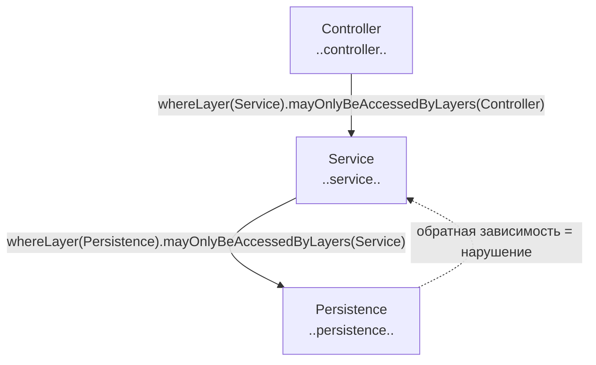
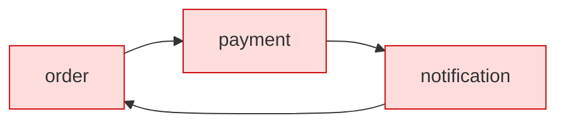
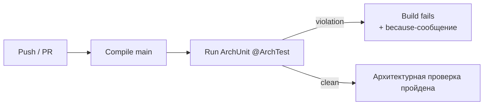
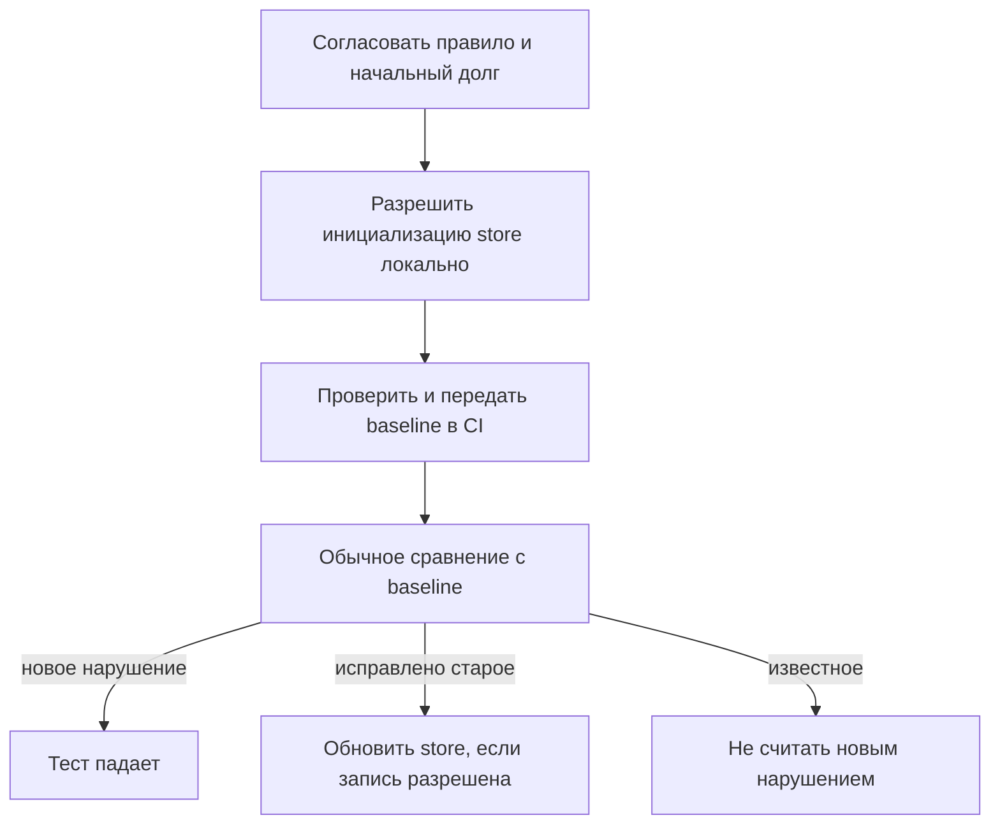

# Вопросы на собеседовании: `ArchUnit`

`ArchUnit` — библиотека от `TNG Technology Consulting` для проверки архитектурных правил Java-проекта обычными юнит-тестами. Она импортирует байт-код в графовую модель (`JavaClass`, `JavaMethod`, зависимости) и позволяет писать декларативные правила: «слой A не зависит от слоя B», «нет циклов между пакетами», «классы с суффиксом `Controller` лежат в `..controller..`». На собеседовании тему спрашивают, чтобы проверить понимание fitness functions, направления зависимостей и того, как защитить архитектуру от деградации в CI.

Дата последнего обновления: 2026-11-05

## Полезные ссылки

### Официальная документация

- [ArchUnit User Guide](https://www.archunit.org/userguide/html/000_Index.html) — официальный гайд: core API, Library API, интеграция с JUnit, freezing
- [TNG/ArchUnit (GitHub)](https://github.com/TNG/ArchUnit) — исходники, issues, релизы
- [Baeldung: ArchUnit](https://www.baeldung.com/java-archunit-intro) — туториал
- [Baeldung: DDD with jMolecules](https://www.baeldung.com/java-jmolecules-domain-driven-design) — jMolecules + ArchUnit-интеграция
- [xmolecules/jmolecules-integrations (archunit)](https://github.com/xmolecules/jmolecules-integrations/tree/main/jmolecules-archunit) — готовые правила для DDD-аннотаций

## Содержание

- [Полезные ссылки](#полезные-ссылки)
- [See also](#see-also)

**Основы и модель импорта**
- [Q1. Что такое ArchUnit и зачем нужны юнит-тесты на архитектуру](#q1)
- [Q2. Как ArchUnit импортирует классы: ClassFileImporter и ImportOptions](#q2)
- [Q3. Как устроено базовое правило: classes().that().should()](#q3)

**Library API: слои и циклы**
- [Q4. Как описать слоистую архитектуру через layeredArchitecture()](#q4)
- [Q5. Чем onionArchitecture() отличается от layeredArchitecture()](#q5)
- [Q6. Как обнаружить циклические зависимости через slices().beFreeOfCycles()](#q6)

**Naming, типовые правила, кастомные условия**
- [Q7. Как проверять naming conventions](#q7)
- [Q8. Какие типовые правила пишут чаще всего](#q8)
- [Q9. Как написать кастомное правило через ArchCondition](#q9)

**JUnit 5, производительность, CI**
- [Q10. Как интегрировать ArchUnit с JUnit 5: @AnalyzeClasses и @ArchTest](#q10)
- [Q11. Как исключить тестовые классы: ImportOption.DoNotIncludeTests](#q11)
- [Q12. Как работает кэширование импорта и производительность](#q12)
- [Q13. Как встроить ArchUnit в CI](#q13)

**Легаси, экосистема, практика**
- [Q14. Как внедрить правило в легаси: FreezingArchRule](#q14)
- [Q15. Что даёт jMolecules и как этот проект использует ArchUnit](#q15)

<a id="q1"></a>

## Q1. Что такое ArchUnit и зачем нужны юнит-тесты на архитектуру

`ArchUnit` — это Java-библиотека, которая позволяет проверять архитектурные ограничения проекта обычными тестами (`JUnit`, `TestNG`). Идея: архитектура — это набор правил («домен не зависит от инфраструктуры», «контроллеры не лезут в репозитории напрямую»), и эти правила можно выразить как код и прогонять в CI вместе с остальными тестами.

Такие тесты — это **fitness functions** из словаря Evolutionary Architecture: автоматическая, исполняемая проверка нефункционального свойства системы (в данном случае — структурной целостности).

Зачем это нужно:

- Архитектурные диаграммы в Confluence устаревают, а нарушения границ накапливаются молча. ArchUnit делает правило исполняемым — нарушение ломает сборку.
- Ревью не ловит каждое «протекание» зависимости; тест ловит его воспроизводимо — в пределах написанного правила и импортированного scope. Вне поля зрения остаются связи через рефлексию, имена классов в строках и внешних конфигах.
- Правило живёт в репозитории рядом с кодом и эволюционирует вместе с ним.

Под капотом ArchUnit разбирает байт-код (не исходники) через свой импортёр и строит графовую модель: `JavaClass`, `JavaMethod`, `JavaField`, рёбра зависимостей (`extends`, `implements`, вызовы методов и конструкторов, обращения к полям, типы полей и сигнатур, аннотации, объявления `throws`). Поверх модели — fluent-DSL для правил.

```java
@Test
void domainShouldNotDependOnSpring() {
    JavaClasses classes = new ClassFileImporter()
            .importPackages("com.myapp.domain");

    ArchRule rule = noClasses()
            .that().resideInAPackage("..domain..")
            .should().dependOnClassesThat()
            .resideInAPackage("org.springframework..")
            .because("домен должен быть свободен от фреймворка");

    rule.check(classes);
}
```

**Итог:** ArchUnit превращает архитектурные договорённости в тесты, которые падают при нарушении. Это дешёвая страховка от энтропии в больших долгоживущих проектах.

<a id="q2"></a>

## Q2. Как ArchUnit импортирует классы: ClassFileImporter и ImportOptions

`ClassFileImporter` — точка входа для загрузки классов в модель. Он читает скомпилированный байт-код (`.class`-файлы), а не `.java`-исходники, поэтому проект должен быть собран до запуска.

Способы импорта:

- `importPackages("com.myapp", "com.other")` — пакеты из classpath;
- `importPackagesOf(SomeClass.class)` — пакет указанного класса;
- `importClasspath()` — все доступные локации classpath, включая JAR-зависимости. Если они не нужны, добавляют `.withImportOption(ImportOption.Predefined.DO_NOT_INCLUDE_JARS)`;
- `importJar(...)` / импорт по `URL` / `Path` — локации как JAR-файлы или каталоги.

Результат — объект `JavaClasses` (коллекция `JavaClass`), к которому применяют правила через `rule.check(classes)`.

`ImportOption` фильтрует локации, из которых классы попадут в модель. Частые предопределённые опции:

| Опция | Что делает |
|-------|------------|
| `ImportOption.Predefined.DO_NOT_INCLUDE_TESTS` | исключает тестовые классы по каталогу сборки: `target/test-classes` (Maven), `build/classes/<lang>/test` (Gradle), `out/test/classes` (IntelliJ) |
| `ImportOption.Predefined.DO_NOT_INCLUDE_JARS` | исключает классы из JAR-зависимостей |
| `ImportOption.Predefined.DO_NOT_INCLUDE_ARCHIVES` | исключает JAR и другие архивы |

```java
JavaClasses prodClasses = new ClassFileImporter()
        .withImportOption(ImportOption.Predefined.DO_NOT_INCLUDE_TESTS)
        .importPackages("com.myapp");
```

Можно написать **свою** опцию, реализовав интерфейс `ImportOption` с методом `boolean includes(Location location)` — например, исключать сгенерированные классы.

**Подвох:** так как импортируется байт-код, нельзя «сходить» в исходники за комментариями или форматированием. Зато видны реальные зависимости после компиляции, включая те, что не очевидны в исходнике (синтетические классы, мосты).

<a id="q3"></a>

## Q3. Как устроено базовое правило: classes().that().should()

Ядро DSL — статические фабрики из `ArchRuleDefinition`: `classes()`, `noClasses()`, `methods()`, `fields()`, `constructors()`. Дальше идёт fluent-цепочка из двух логических частей, а её результат — объект `ArchRule`, который потом применяют к классам.

- **Селектор** — `that()` отбирает подмножество классов: `resideInAPackage("..service..")`, `haveSimpleNameEndingWith("Controller")`, `areAnnotatedWith(Service.class)`.
- **Условие** (`ArchCondition`) — `should()` задаёт проверку: `beAnnotatedWith(...)`, `notBePublic()` завершают правило сразу, а `dependOnClassesThat()` и `onlyBeAccessed()` требуют продолжения — `resideInAPackage(...)`, `byAnyPackage(...)`. Предикат же — это то, что принимает `that()` (`DescribedPredicate`).
- **Применение** — отдельный шаг уже поверх готового правила: `rule.check(classes)` вручную или автоматическое исполнение `@ArchTest`-полей. Само построение цепочки ничего не проверяет — правило существует до того, как ему покажут классы.

Разница `classes()` и `noClasses()` ключевая:

- `classes().that(A).should(B)` — **все** классы из множества A обязаны удовлетворять B.
- `noClasses().that(A).should(B)` — **ни один** класс из A не должен удовлетворять B.

```java
// Все @Service-классы должны лежать в ..service..
ArchRule r1 = classes()
        .that().areAnnotatedWith(Service.class)
        .should().resideInAPackage("..service..");

// Ни один класс из ..persistence.. не должен зависеть от ..api..
ArchRule r2 = noClasses()
        .that().resideInAPackage("..persistence..")
        .should().dependOnClassesThat().resideInAPackage("..api..");
```

Полезные модификаторы:

- `.because("причина")` — попадёт в текст ошибки, объясняя _зачем_ правило.
- `.allowEmptyShould(true)` — послабление для правила, у которого `that()` не отобрал ни одного класса: по умолчанию такой прогон считается ошибкой конфигурации. Снимается точечно этим вызовом либо глобально свойством `archRule.failOnEmptyShould=false` в `archunit.properties`.
- `..` в паттерне пакета — любое число пакетов, включая ноль; `*` — любая последовательность символов внутри одного сегмента, кроме точки: `com.*.service` матчит `com.foo.service`, а `com.myapp*` — `com.myapplication`.

**Итог:** правило читается как английское предложение «no classes that reside in X should depend on Y». Эта читаемость — главное преимущество core API перед ручным разбором графа.

<a id="q4"></a>

## Q4. Как описать слоистую архитектуру через layeredArchitecture()

В **ArchUnit 1.3.0** фабрика `Architectures.layeredArchitecture()` сначала возвращает **`DependencySettings`**. Выбор `consideringAllDependencies()` или другого режима `considering*` даёт `LayeredArchitecture`, реализующий `ArchRule`. Начальный объект не является `DescribedPredicate` для `that()`. Так настраивают составное правило слоёв, а готовое правило отдельно применяют через `check(classes)`. [Architectures 1.3.0](https://github.com/TNG/ArchUnit/blob/v1.3.0/archunit/src/main/java/com/tngtech/archunit/library/Architectures.java).

Шаги:

1. Выбрать режим учёта зависимостей через `considering*`.
2. `layer("Имя").definedBy("..пакет..")` — объявить слой и привязать к пакетам.
3. `whereLayer("Имя").mayOnlyBeAccessedByLayers(...)` или `mayNotBeAccessedByAnyLayer()` — задать, кто имеет право обращаться к слою.

```java
ArchRule layers = layeredArchitecture()
        .consideringAllDependencies()
        .layer("Controller").definedBy("..controller..")
        .layer("Service").definedBy("..service..")
        .layer("Persistence").definedBy("..persistence..")

        .whereLayer("Controller").mayNotBeAccessedByAnyLayer()
        .whereLayer("Service").mayOnlyBeAccessedByLayers("Controller")
        .whereLayer("Persistence").mayOnlyBeAccessedByLayers("Service");
```

Здесь зафиксировано направление зависимостей: `Controller` → `Service` → `Persistence`, и обратные обращения запрещены. `mayNotBeAccessedByAnyLayer()` означает «это верхний слой, в него никто не входит».



Нюансы:

- `consideringAllDependencies()` против `consideringOnlyDependenciesInLayers()` — учитывать ли зависимости на классы вне объявленных слоёв. Важно при наличии «свободных» пакетов вроде `..dto..` или `..util..`.
- `mayOnlyAccessLayers(...)` — обратная формулировка: «этот слой может обращаться только к перечисленным», полезна, когда удобнее описывать исходящие зависимости.
- `optionalLayer(...)` — слой может быть пустым без ошибки.

Составное правило удобно для согласованной модели слоёв. Отдельные `noClasses()`-правила остаются вариантом для границ, которые не укладываются в эту модель.

<a id="q5"></a>

## Q5. Чем onionArchitecture() отличается от layeredArchitecture()

`onionArchitecture()` — специализированное составное правило из того же Library API для архитектуры с доменным ядром в центре и адаптерами по краям. Этот вариант близок к идее гексагональной и clean architecture, но их правила не тождественны. В отличие от линейной слойки, здесь зависимости направлены **внутрь**: внешние кольца могут зависеть от домена, а домен не зависит ни от application-сервисов, ни от адаптеров. Модель нужно сопоставить с реальными пакетами и импортированными классами. Имя необъявленного пакета само не делает его адаптером, а зависимость домена от произвольной JDK-библиотеки не становится запрещённой просто из-за её внешнего происхождения.

В **1.3.0** метод принимает заранее именованные роли; ниже фрагмент создания правила, предполагающий импорт классов из всех перечисленных пакетов:

```java
ArchRule onion = onionArchitecture()
        .domainModels("..domain.model..")
        .domainServices("..domain.service..")
        .applicationServices("..application..")
        .adapter("rest", "..adapter.rest..")
        .adapter("persistence", "..adapter.persistence..");
```

Сравнение двух составных правил:

| Критерий | `layeredArchitecture()` | `onionArchitecture()` |
|----------|-------------------------|------------------------|
| Модель | линейные слои, доступ задаёшь вручную | фиксированные роли (domain / application / adapters) |
| Направление зависимостей | как опишешь через `whereLayer` | жёстко внутрь, к домену |
| Гибкость | высокая | ниже, но правила уже встроены |
| Когда применять | классическая N-слойка | DDD / hexagonal / clean architecture |

Что `onionArchitecture()` проверяет автоматически:

- `domainModels` и `domainServices` не зависят ни от application, ни от адаптеров;
- application-сервисы могут пользоваться доменом, но не адаптерами;
- адаптеры (`adapter("name", ...)`) изолированы друг от друга — один адаптер не должен зависеть от другого напрямую.

**Проверка полноты модели:** обязательные роли в 1.3.0 должны содержать импортированные классы. Пропущенный `domainServices` или слишком узкая область импорта может дать ошибку пустого слоя. `withOptionalLayers(true)` разрешает пустые роли, но не исправляет ошибочную модель. Если persistence adapter не объявлен, связь REST→этот пакет нельзя считать проверенной как связь двух adapters. При двух объявленных и импортированных adapters такая прямая зависимость нарушает правило.

Внутри onion используется layered-проверка с `consideringAllDependencies()`: зависимости из классов вне ролей в объявленные слои тоже могут оказаться нарушениями. Утверждение «все необъявленные пакеты всегда игнорируются» неверно. Проверяйте состав импорта, роли и направление конкретной связи. [Onion implementation 1.3.0](https://github.com/TNG/ArchUnit/blob/v1.3.0/archunit/src/main/java/com/tngtech/archunit/library/Architectures.java).

<a id="q6"></a>

## Q6. Как обнаружить циклические зависимости через slices().beFreeOfCycles()

Циклы между пакетами/модулями — одна из главных архитектурных болезней: они мешают выделять модули, ломают порядок сборки и затрудняют понимание кода. ArchUnit ищет их через **slices** (срезы) из `SlicesRuleDefinition`.

Slice — это группа классов, выделенная по паттерну пакета. Капчер-группа `(*)` в паттерне определяет, по какому сегменту резать.

```java
ArchRule noCycles = slices()
        .matching("com.myapp.(*)..")   // срез = первый пакет под com.myapp
        .should().beFreeOfCycles();
```

- `matching("com.myapp.(*)..")` — каждый прямой подпакет `com.myapp` становится отдельным срезом; `..` после группы захватывает всё внутри.
- `(**)` захватывает несколько сегментов пакета. Для срезов по одному прямому подпакету достаточно `(*)`.
- `.namingSlices("$1")` — задаёт человекочитаемые имена срезам в отчёте об ошибке: `$1`, `$2` подставляют значения капчер-групп паттерна. Ссылаться можно только на существующие группы — для `com.myapp.(*)..` доступна одна, а `"$2 of $1"` пишут при двух, как в `com.(*).(*)..`.



На диаграмме `order → payment → notification → order` — цикл, который `beFreeOfCycles()` пометит как нарушение и перечислит все рёбра, образующие петлю.

Нюансы:

- Поиск циклов дороже простых правил: ArchUnit обходит граф зависимостей. На больших проектах ограничивайте срез разумным паттерном, а не всем classpath.
- Цикл может быть «длинным» (через 4-5 пакетов) — ArchUnit найдёт и его, отчёт покажет полную цепочку.

**Итог:** `slices().matching(...).should().beFreeOfCycles()` — стандартный способ держать модули ацикличными. Это часто первое правило, которое добавляют при разбиении монолита на модули.

<a id="q7"></a>

## Q7. Как проверять naming conventions

Соглашения об именовании легко описываются связкой «селектор по имени → ожидание по пакету/аннотации». Базовые предикаты: `haveSimpleNameEndingWith`, `haveSimpleNameStartingWith`, `haveSimpleNameContaining`, `haveNameMatching` (регулярка по полному имени).

```java
// Классы-контроллеры лежат в ..controller..
ArchRule controllerNaming = classes()
        .that().haveSimpleNameEndingWith("Controller")
        .should().resideInAPackage("..controller..");

// И наоборот: всё в ..controller.. оканчивается на Controller
ArchRule controllerPackage = classes()
        .that().resideInAPackage("..controller..")
        .should().haveSimpleNameEndingWith("Controller");
```

Двусторонняя проверка ловит обе ошибки: и «`UserController` оказался не в том пакете», и «в `controller` затесался класс без суффикса».

Можно комбинировать имя и аннотацию:

```java
ArchRule serviceConvention = classes()
        .that().areAnnotatedWith(Service.class)
        .should().haveSimpleNameEndingWith("Service")
        .orShould().haveSimpleNameEndingWith("ServiceImpl");
```

Операторы `.and()`, `.or()`, `.andShould()`, `.orShould()` собирают сложные условия. `.haveNameMatching(".*Repository")` пригодится, когда нужен regex по полному имени класса — здесь именно `java.util.regex`, а не пакетная нотация: точка-точка как «любой пакет» работает только внутри `resideInAPackage("..repository..")`.

**Два допустимых способа:** конкретное `haveSimpleNameEndingWith("Service")` отвергнет `UserServiceImpl`, потому что это имя оканчивается на `Impl`. Для имён `UserService` и `UserServiceImpl` подходит показанное `orShould`, но оно не обязательно: один regex тоже может выразить оба разрешённых окончания. Например, альтернативное правило для тех же `@Service`-классов:

```java
ArchRule serviceConventionRegex = classes()
        .that().areAnnotatedWith(Service.class)
        .should().haveNameMatching(".*Service(Impl)?");
```

Это проверка полного имени через регулярное выражение, а не пакетный шаблон `..service..`. В примерах предполагается `org.springframework.stereotype.Service`; для другой аннотации задайте свой селектор. [ClassesShould 1.3.0](https://github.com/TNG/ArchUnit/blob/v1.3.0/archunit/src/main/java/com/tngtech/archunit/lang/syntax/elements/ClassesShould.java).

<a id="q8"></a>

## Q8. Какие типовые правила пишут чаще всего

Частые правила касаются общих практик кодирования и границ конкретного проекта. Часть готовых проверок есть в `GeneralCodingRules`.

- **Нет field injection** — `GeneralCodingRules.NO_CLASSES_SHOULD_USE_FIELD_INJECTION` (поля с `@Autowired` и `@Value` из Spring, `@Inject` из javax, jakarta или Guice и `@Resource` из javax/jakarta); поощряет конструкторную инъекцию.
- **Нет стандартного логирования JDK** — `NO_CLASSES_SHOULD_USE_JAVA_UTIL_LOGGING` (используйте SLF4J).
- **Нет `System.out`/`System.err`** — `NO_CLASSES_SHOULD_ACCESS_STANDARD_STREAMS`.
- **Нет бросков обобщённых исключений** (`Exception`, `RuntimeException`, `Throwable`) — `NO_CLASSES_SHOULD_THROW_GENERIC_EXCEPTIONS`.
- **Контроллеры не зовут репозитории напрямую** — между ними должен быть сервисный слой.

```java
@ArchTest
static final ArchRule noFieldInjection =
        NO_CLASSES_SHOULD_USE_FIELD_INJECTION;

@ArchTest
static final ArchRule controllersDontTouchRepos = noClasses()
        .that().resideInAPackage("..controller..")
        .should().dependOnClassesThat().resideInAPackage("..repository..")
        .because("контроллер обязан ходить в репозиторий через сервис");
```

Ещё частые правила:

- репозитории аннотированы `@Repository` и оканчиваются на `Repository`;
- DTO не зависят от сущностей persistence;
- `@Test`-методы в JUnit 5 не публичные (артефакт миграции с JUnit 4);
- утилитные классы `final` с приватным конструктором.

**Вывод:** начните с подходящих правил `GeneralCodingRules` и нескольких правил про границы слоёв. Состав зависит от архитектуры проекта; готовые правила не заменяют проверку его конкретных зависимостей.

<a id="q9"></a>

## Q9. Как написать кастомное правило через ArchCondition

Когда встроенных предикатов не хватает, пишут своё условие — наследник `ArchCondition<T>` с методом `check(T item, ConditionEvents events)`. Внутри проверяете объект (`JavaClass`, `JavaMethod`, `JavaField`) и добавляете `SimpleConditionEvent` с вердиктом «удовлетворяет / нарушает».

```java
ArchCondition<JavaClass> notUseFieldInjection =
        new ArchCondition<>("not use field injection") {
            @Override
            public void check(JavaClass clazz, ConditionEvents events) {
                clazz.getFields().forEach(field -> {
                    boolean injected = field.isAnnotatedWith("org.springframework.beans.factory.annotation.Autowired");
                    if (injected) {
                        String msg = field.getFullName() + " использует field injection";
                        events.add(SimpleConditionEvent.violated(field, msg));
                    }
                });
            }
        };

ArchRule rule = classes()
        .that().resideInAPackage("..service..")
        .should(notUseFieldInjection);
```

Ключевые приёмы:

- `SimpleConditionEvent.violated(item, message)` — зафиксировать нарушение; сообщение попадёт в отчёт.
- `SimpleConditionEvent.satisfied(item, message)` — реже, для условий, где нужно явно показать выполнение.
- Условия комбинируются: `condA.and(condB)`, `condA.or(condB)`.
- Симметрично можно описать кастомный **предикат** для `that()` через `DescribedPredicate<JavaClass>`.

Когда это оправдано:

- проверка специфична для домена (например, «команды реализуют интерфейс `Command` и лежат в `..command..`»);
- нужна логика, которой нет в DSL (анализ сигнатур методов, конкретных аннотаций с атрибутами).

**Подвох:** не плодите кастомные условия там, где хватает `classes().that().should()`. Кастом — это код, который тоже надо поддерживать; начинайте с готового DSL и опускайтесь до `ArchCondition` только при реальной необходимости.

<a id="q10"></a>

## Q10. Как интегрировать ArchUnit с JUnit 5: @AnalyzeClasses и @ArchTest

Для JUnit 5 есть отдельный артефакт `archunit-junit5`, который убирает бойлерплейт ручного импорта. Вместо `new ClassFileImporter()` в каждом тесте используется аннотация на классе.

```java
@AnalyzeClasses(
        packages = "com.myapp",
        importOptions = {ImportOption.DoNotIncludeTests.class}
)
class ArchitectureTest {

    @ArchTest
    static final ArchRule services_do_not_depend_on_controllers =
            noClasses()
                .that().resideInAPackage("..service..")
                .should().dependOnClassesThat().resideInAPackage("..controller..");

    @ArchTest
    static final ArchRule no_field_injection =
            NO_CLASSES_SHOULD_USE_FIELD_INJECTION;
}
```

Как это работает:

- `@AnalyzeClasses(packages = ...)` — указывает, какие пакеты импортировать один раз для всего класса.
- `importOptions = {...}` — те же `ImportOption`, что и в core API (часто `DoNotIncludeTests`).
- `@ArchTest` помечает поля типа `ArchRule` (или методы `void m(JavaClasses classes)`) — движок `archunit-junit5` сам вызовет `check()` для каждого.

Правила можно вынести в отдельный класс-«библиотеку» и подключать через `@ArchTest static final ArchTests myRules = ArchTests.in(MyRulesLibrary.class)` (до ArchUnit 1.0 тип назывался `ArchRules`), переиспользуя один набор в нескольких модулях.

**Итог:** интеграция с JUnit 5 делает архитектурные правила обычными тест-полями — импорт происходит автоматически и кэшируется, а каждый `@ArchTest` отображается как отдельный тест в отчёте.

<a id="q11"></a>

## Q11. Как исключить тестовые классы: ImportOption.DoNotIncludeTests

По умолчанию импортёр тянет всё, что попадает под пакет, включая скомпилированные тестовые классы. Это почти всегда нежелательно: архитектурные правила пишут про **production**-код, а тесты живут по своим правилам (например, field injection в тестах допустим).

`ImportOption.DoNotIncludeTests` исключает классы из «тестовых» каталогов сборки: `target/test-classes` (Maven), `build/classes/java/test`, `build/classes/<lang>/test` (Gradle).

```java
@AnalyzeClasses(
        packages = "com.myapp",
        importOptions = {ImportOption.DoNotIncludeTests.class}
)
class ArchitectureTest { /* ... */ }
```

Важные оговорки:

- Фильтр работает по **расположению** скомпилированных классов, а не по имени или суффиксу `Test`. Если тестовый класс случайно собрался в `main`-каталог, он не отфильтруется.
- Для Kotlin синтетические/inline-классы могут попадать в импорт — иногда нужна дополнительная кастомная `ImportOption`.
- В core API ту же опцию подключают через `.withImportOption(ImportOption.Predefined.DO_NOT_INCLUDE_TESTS)`.

Именно так настроен ArchUnit в этом проекте — см. `LayeredArchitectureTest` ниже (Q15).

**Вывод:** `DoNotIncludeTests` — почти обязательная опция для архитектурных тестов: без неё широкие правила, не сузившие область через `that()`, начинают проверять и код самих тестов и дают ложные срабатывания — например, на field injection в тестовом классе.

<a id="q12"></a>

## Q12. Как работает кэширование импорта и производительность

Импорт строит модель `JavaClasses` из байт-кода; проверка правил — отдельный этап. В JUnit-интеграции **ArchUnit 1.3.0** `ClassCache` содержит кэш для текущего тест-класса и общий кэш переиспользования. Ключ общего кэша включает **набор локаций и классы `ImportOption`**, а не только URL или имя теста. При одинаковых локациях разные типы фильтров дают разные ключи. [ClassCache 1.3.0](https://github.com/TNG/ArchUnit/blob/v1.3.0/archunit-junit/src/main/java/com/tngtech/archunit/junit/internal/ClassCache.java).

| `cacheMode` в `@AnalyzeClasses` | Поведение в 1.3.0 |
|---|---|
| `CacheMode.FOREVER` — по умолчанию | Допускает переиспользование импорта между тест-классами при совпадении локаций и типов фильтров. Общий кэш использует мягкие ссылки (soft references): название режима не гарантирует удержание модели независимо от памяти. |
| `CacheMode.PER_CLASS` | Импорт переиспользуется внутри одного тест-класса; общий кэш локаций для такого запроса не используется. |

```java
@AnalyzeClasses(packages = "com.myapp.special", cacheMode = CacheMode.PER_CLASS)
class IsolatedArchTest { /* ... */ }
```

Пользовательская `ImportOption` должен стабильно отвечать для одной `Location`: состояние экземпляра фильтра или внешнего файла не является отдельной частью общего ключа. Иначе один и тот же тип фильтра может дать несовместимые результаты при переиспользовании. [ImportOption contract 1.3.0](https://github.com/TNG/ArchUnit/blob/v1.3.0/archunit/src/main/java/com/tngtech/archunit/core/importer/ImportOption.java).

Кэш не хранит готовый результат каждого `ArchRule`: одинаковый импорт не отменяет повторное выполнение условия или поиска циклов. Данные также не являются общим кэшем между отдельными процессами CI.

Для производительности отдельно измеряйте импорт и применение правил. Сужайте `packages` до нужной области, задавайте необходимые фильтры и проверяйте дорогие циклы на осмысленных срезах. Несколько `@ArchTest` могут использовать один импорт, а разные тест-классы с одинаковым ключом могут разделять его при `FOREVER`; универсального обещания ускорения от объединения тест-классов нет.

<a id="q13"></a>

## Q13. Как встроить ArchUnit в CI

Архитектурные проверки можно включить в обычную тестовую фазу сборки. Ручной `rule.check(classes)` выполняется внутри выбранного тестового фреймворка. Для автоматического исполнения `@AnalyzeClasses`/`@ArchTest` в JUnit Platform нужен отдельный **`ArchUnitTestEngine`** из `archunit-junit5-engine`; один Jupiter engine эти поля не исполняет. Агрегирующая зависимость `archunit-junit5:1.3.0` подключает соответствующие модули.

Настройте сборку на JUnit Platform. В Gradle обычный способ — `Test.useJUnitPlatform()`, но Platform может выбрать JVM test suite или convention plugin: буквальная строка не обязательна в каждом build-файле. В данном проекте `modules/quiz-app/build.gradle.kts` содержит `useJUnitPlatform()` и зависимость ArchUnit. Для Maven нужен совместимый настроенный тестовый runner, например Surefire с поддержкой Platform. [Gradle test suites](https://docs.gradle.org/8.9/userguide/jvm_test_suite_plugin.html), [ArchUnit JUnit support](https://www.archunit.org/userguide/html/000_Index.html#_junit_support).

```bash
# Maven
mvn test

# Gradle — тот же таск test, при желании с фильтром
./gradlew test --tests "*ArchitectureTest"
```

Практики интеграции:

- **Запускать на каждом PR.** Нарушение границ должно ломать сборку до мержа, а не обнаруживаться через месяц.
- **Держать архитектурные тесты в отдельном пакете/теге** (`@ArchTag("architecture")` — обычная `@Tag` из Jupiter на `@ArchTest`-поля не действует), чтобы при необходимости гонять их отдельно — для проверки нужен собранный байт-код; стоимость зависит от импорта и правил.
- **Сообщение `.because(...)`** в каждом правиле — чтобы упавший CI сразу объяснял разработчику, _какую_ договорённость он нарушил.



Где окупается:

- большие команды и долгоживущие монолиты, где границы легко размываются;
- разбиение монолита на модули — правило `beFreeOfCycles()` страхует от новых циклов;
- enforce-политик уровня компании (нет `java.util.logging`, нет field injection) на множестве сервисов через переиспользуемую библиотеку правил.

Убедитесь по тестовому отчёту, что правила обнаружены и выполнены. Для блокировки merge успешную проверку нужно сделать обязательной в настройках репозитория/CI; само наличие теста такой политики не создаёт.

<a id="q14"></a>

## Q14. Как внедрить правило в легаси: FreezingArchRule

`FreezingArchRule` сравнивает текущие нарушения с согласованным **baseline**. Известный долг можно оставить на время, а новые нарушения правило обнаружит. Это требует подготовленного хранилища и исправной конфигурации: утверждение «первый запуск всегда проходит» не описывает стандартный файловый store **ArchUnit 1.3.0**.

```java
@ArchTest
static final ArchRule frozen =
        FreezingArchRule.freeze(
            noClasses()
                .that().resideInAPackage("..service..")
                .should().dependOnClassesThat().resideInAPackage("..controller..")
        );
```

**Подготовка baseline для стандартного файлового store:**

1. Локально задайте согласованный путь и **явно разрешите создание** store. Пример разовой настройки `archunit.properties` на тестовом classpath:

```properties
freeze.store.default.path=archunit_store
freeze.store.default.allowStoreCreation=true
```

2. Выполните правило, проверьте сохранённые нарушения и передайте согласованный каталог в CI через Git или другой воспроизводимый механизм. Текущий байт-код не содержит исторического списка уже принятого долга.
3. Для обычного CI используйте готовый store; `freeze.store.default.allowStoreCreation=false` запрещает создавать новый индекс вместо отсутствующего. Это значение по умолчанию в 1.3.0: без `stored.rules` возникает `StoreInitializationFailedException`. Оно не запрещает все изменения уже существующего store.

Файловый store содержит `stored.rules` и отдельные файлы нарушений. Настройки **1.3.0** различаются:

| Свойство | По умолчанию | Смысл |
|---|---|---|
| `freeze.store.default.allowStoreCreation` | `false` | Разрешить создание нового файлового индекса. Для первой подготовки требуется осознанное включение. |
| `freeze.store.default.allowStoreUpdate` | `true` | Разрешить запись baseline. При `false` попытка записи даёт `StoreUpdateFailedException`, в том числе при удалении исправленного долга. |
| `freeze.refreeze` | `false` | При `true` заменить baseline текущими нарушениями вместо обычного сравнения; это может принять новый долг. |

При обычном сравнении с разрешённым обновлением исправленные нарушения вычёркиваются; их возвращение считается новым. `refreeze` и запрет записи не являются двумя равнозначными способами выключить этот «храповик». Новое правило с другой строкой описания также требует проверки baseline: запрет создания индекса сам по себе не запрещает добавление записи правила в существующий store. [FreezingArchRule 1.3.0](https://github.com/TNG/ArchUnit/blob/v1.3.0/archunit/src/main/java/com/tngtech/archunit/library/freeze/FreezingArchRule.java), [file store 1.3.0](https://github.com/TNG/ArchUnit/blob/v1.3.0/archunit/src/main/java/com/tngtech/archunit/library/freeze/TextFileBasedViolationStore.java).



Стандартный line matcher игнорирует номера строк и автоматически сгенерированные номера анонимных классов/лямбд; он не доказывает смысловую эквивалентность произвольных изменений. Пользовательский `ViolationStore` и matcher задают свои контракты. Ошибки чтения, записи и конфигурации тоже могут уронить тест — причину падения нужно различать с новым архитектурным нарушением.

<a id="q15"></a>

## Q15. Что даёт jMolecules и как этот проект использует ArchUnit

**jMolecules** — библиотека от `xmolecules` для выражения архитектурных абстракций аннотациями и интерфейсами: `@AggregateRoot`, `@Entity`, `@ValueObject`, `@Repository`, аннотации слоёв/гексагона/onion. Для автоматической проверки этих ограничений подключают подходящую интеграцию.

Связка с ArchUnit идёт через модуль `jmolecules-archunit`: он даёт **готовые** правила, проверяющие целостность DDD-концептов, выраженных аннотациями jMolecules.

```java
@ArchTest
static final ArchRule onion = JMoleculesArchitectureRules.ensureOnionSimple();

@ArchTest
static final ArchRule ddd = JMoleculesDddRules.all();
```

Что даёт связка:

- не нужно вручную описывать пакеты — роли берутся из аннотаций;
- правила DDD (агрегаты ссылаются на другие агрегаты только по идентификатору, сущности не торчат наружу) проверяются «из коробки»;
- архитектурный стиль (onion/hexagonal/layered) валидируется по аннотациям, а не по соглашению об именах пакетов.

**Как ArchUnit используется в этом проекте** (`cheat-sheet`). Модуль `quiz-app` содержит `LayeredArchitectureTest`, который исполняет собственный движок JUnit Platform из `archunit-junit5-engine` (`ArchUnitTestEngine`), а не Jupiter-расширение; аннотации `@AnalyzeClasses` и `@ArchTest` приходят из `archunit-junit5-api`:

```java
@AnalyzeClasses(
        packages = "com.cheatsheet.quiz",
        importOptions = {ImportOption.DoNotIncludeTests.class}
)
class LayeredArchitectureTest {

    @ArchTest
    static final ArchRule domainIsIndependent = noClasses()
            .that().resideInAPackage("..domain..")
            .should().dependOnClassesThat()
            .resideInAnyPackage("..api..", "..service..", "..persistence..", "..config..")
            .because("доменный слой должен оставаться независимым от инфраструктуры и транспорта");
    // + serviceDoesNotDependOnApi, persistenceDoesNotDependOnApi
}
```

Фактические правила фиксируют три границы: `domain` не зависит от `api`/`service`/`persistence`/`config`; `service` не зависит от `..api.controller..`, `..api.security..` и `..api.exception..` (зависимость от `api.dto` разрешена); `persistence` не зависит от `..api..`.

**Вывод:** связка jMolecules и `jmolecules-archunit` позволяет проверять выраженные в коде DDD-правила. В `quiz-app` используется ArchUnit без jMolecules: три правила `noClasses()` проверяют перечисленные выше границы.

---

## See also

- [Юнит-тестирование](unit-testing-interview.md) — база юнит-тестов, на которых строятся архитектурные правила ArchUnit
- [Интеграционное тестирование](integration-testing-interview.md) — уровень тестов выше архитектурного: проверка взаимодействия компонентов
- [JUnit](junit-interview.md) — фреймворк, через который запускаются `@ArchTest`-правила (`archunit-junit5`)
- [Clean Architecture](../architecture/clean-architecture-interview.md) — правила зависимостей, которые ArchUnit и enforce-ит (`layeredArchitecture`)
- [Гексагональная архитектура](../architecture/hexagonal-architecture-interview.md) — стиль, проверяемый через `onionArchitecture()` и порты/адаптеры
- [Spring Modulith](../frameworks/spring/spring-modulith-interview.md) — модульные границы в Spring, родственная ArchUnit задача (модули и циклы)
