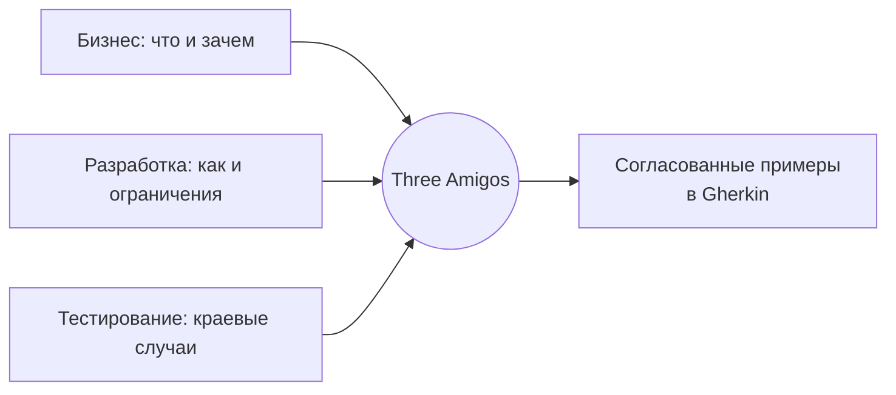

# Вопросы на собеседовании: `Cucumber и BDD`

`Cucumber` — это инструмент для Behavior-Driven Development (BDD): он позволяет описывать поведение системы на человекочитаемом языке `Gherkin` и автоматически превращать эти описания в исполняемые тесты. На собеседовании по тестированию проверяют не столько синтаксис `Given-When-Then`, сколько понимание, когда BDD оправдан, как избежать хрупких сценариев и как связать `.feature`-файлы с `Spring`-приложением.

Дата последнего обновления: 2026-11-05

## Полезные ссылки

### Официальная документация

- [Cucumber Docs: Gherkin Reference](https://cucumber.io/docs/gherkin/reference/) — справочник по синтаксису Gherkin
- [Cucumber Docs: Step Definitions](https://cucumber.io/docs/cucumber/step-definitions/) — определения шагов и Cucumber Expressions
- [Cucumber Expressions (GitHub)](https://github.com/cucumber/cucumber-expressions) — человекочитаемая альтернатива regex
- [Baeldung: Cucumber и BDD](https://www.baeldung.com/cucumber-spring-integration) — туториал

## Содержание

- [Полезные ссылки](#полезные-ссылки)
- [See also](#see-also)

**BDD-философия и основы**
- [Q1. Что такое BDD и чем он отличается от TDD?](#q1)
- [Q2. Что такое ubiquitous language и Three Amigos?](#q2)
- [Q3. Что такое executable specifications и living documentation?](#q3)

**Gherkin и структура feature-файлов**
- [Q4. Из чего состоит Gherkin-сценарий: Feature, Scenario, Given-When-Then?](#q4)
- [Q5. Что такое Background и когда его применять?](#q5)
- [Q6. Декларативный или императивный стиль сценариев?](#q6)

**Step definitions и параметризация**
- [Q7. Как связаны Gherkin-шаги и step definitions?](#q7)
- [Q8. Cucumber Expressions против регулярных выражений?](#q8)
- [Q9. Что такое Scenario Outline и Examples?](#q9)
- [Q10. Что такое DataTable и как его трансформировать?](#q10)

**Hooks, теги и организация**
- [Q11. Какие бывают hooks и в каком порядке они выполняются?](#q11)
- [Q12. Что такое теги и как фильтровать сценарии?](#q12)

**Интеграция и эксплуатация**
- [Q13. Как запустить Cucumber на JUnit 5?](#q13)
- [Q14. Как интегрировать Cucumber со Spring и шарить состояние между шагами?](#q14)
- [Q15. Когда BDD оправдан, а когда становится лишним слоем?](#q15)

<a id="q1"></a>

## Q1. Что такое BDD и чем он отличается от TDD?

`BDD` (Behavior-Driven Development) — это практика разработки, где требования формулируются как примеры поведения системы на языке, понятном и бизнесу, и разработчикам, и тестировщикам. Эти примеры служат спецификацией и могут стать автоматическими тестами после связывания с исполняемыми проверками.

`TDD` задаёт рабочий цикл «сначала тест → реализация → рефакторинг». `BDD` добавляет совместное обсуждение примеров поведения на общем языке команды. Подходы можно сочетать, а тесты TDD не обязательно ограничены внутренней реализацией.

Типичные акценты при их применении:

| Аспект | TDD | BDD |
|--------|-----|-----|
| Фокус | обратная связь от теста до реализации | согласование ожидаемого поведения на примерах |
| Язык | обычно код теста | общий язык команды; в Cucumber — Gherkin |
| Аудитория | чаще разработчики | бизнес, разработка и тестирование |
| Гранулярность | зависит от выбранного теста | примеры поведения фичи или правила |

BDD вырос из TDD и не заменяет его: команда может согласовать критерии приёмки на примерах BDD, а затем вести реализацию короткими циклами TDD.

**Подвох:** BDD — это в первую очередь про коммуникацию и общий язык, а не про конкретный инструмент. `Cucumber` — лишь один из инструментов; можно делать BDD без него (через разговоры и примеры) и можно использовать `Cucumber`, не делая настоящего BDD (если `.feature`-файлы пишет один автотестер в изоляции).

**Итог:** TDD помогает строить систему через обратную связь от тестов, BDD помогает команде договориться, какое поведение проверять.

<a id="q2"></a>

## Q2. Что такое ubiquitous language и Three Amigos?

`Ubiquitous language` (единый язык) — это согласованный словарь предметной области, которым пользуются все участники: бизнес, разработка, тестирование. Один и тот же термин («заказ», «отгрузка», «бонус») означает одно и то же в требованиях, в коде и в тестах. В BDD этот язык напрямую попадает в `.feature`-файлы.

`Three Amigos` объединяет три перспективы перед реализацией выбранного изменения. Это не требование ровно трёх людей или одной встречи на весь проект:

- **Бизнес** (product owner / аналитик) — что нужно и зачем.
- **Разработка** — как это технически реализуемо и какие есть ограничения.
- **Тестирование** — какие краевые случаи, что может пойти не так.



Цель встречи — выработать общее понимание и набросать конкретные примеры до начала кодирования. Эти примеры затем могут стать сценариями.

Обсуждение помогает согласовать поведение, а файлы сохраняют сформулированные примеры. Автоматизация уже готовой системы одним специалистом тоже может находить регрессии; сам этот факт не подтверждает совместное discovery в BDD. Оценивайте качество обсуждения отдельно от наличия `.feature`-файлов. [Cucumber: myths](https://cucumber.io/docs/bdd/myths/), [Three Amigos](https://cucumber.io/docs/bdd/who-does-what/).

<a id="q3"></a>

## Q3. Что такое executable specifications и living documentation?

`Executable specifications` (исполняемые спецификации) описывают ожидаемое поведение примерами, связанными с исполняемыми проверками. В Cucumber `.feature`-текст участвует и в спецификации, и в запуске тестов, но для исполнения нужны подходящие step definitions, проверки, данные и настроенный запуск (Q7/Q13). Один текст файла не реализует действие.

`Living documentation` (живая документация) возникает, когда команда поддерживает сценарии и регулярно их запускает. Если покрытое сценарием поведение изменилось, тест может показать расхождение. Непокрытые требования и неверно написанные сценарии такой прогон не обнаружит.

Как это работает на практике:

- Сценарии пишутся на `Gherkin` и хранятся в репозитории рядом с кодом.
- На CI они выполняются как тесты; при падении проверьте поведение, ожидание, реализацию проверки, тестовые данные и среду. Красный статус сам не доказывает ошибку требований.
- Отчёты (`html`, `json`) показывают результаты обнаруженных и запущенных сценариев; из них нельзя вывести полноту покрытия всех требований.

Фрагмент настройки отчётов для Suite из Q13; plugin не заменяет обнаружение и исполнение сценариев:

```java
@Suite
@IncludeEngines("cucumber")
@SelectClasspathResource("features")
@ConfigurationParameter(
    key = PLUGIN_PROPERTY_NAME,
    value = "html:target/cucumber-report.html,json:target/cucumber.json")
public class RunCucumberTest {
}
```

**Подвох:** документация остаётся живой только при дисциплине. Если сценарии часто падают по техническим причинам, команда может начать их игнорировать или отключать — и доверие к ним пропадёт.

<a id="q4"></a>

## Q4. Из чего состоит Gherkin-сценарий: Feature, Scenario, Given-When-Then?

`Gherkin` — это структурированный текстовый язык с набором ключевых слов. Базовая иерархия: один файл = одна `Feature`, внутри которой несколько `Scenario`, каждый из шагов.

```gherkin
Feature: Перевод денег между счетами
  Как клиент банка
  Я хочу переводить деньги между своими счетами

  Scenario: Успешный перевод при достаточном балансе
    Given на счёте "A" лежит 1000 рублей
    And на счёте "B" лежит 0 рублей
    When я перевожу 300 рублей со счёта "A" на счёт "B"
    Then на счёте "A" останется 700 рублей
    But на счёте "B" окажется 300 рублей
```

Назначение ключевых слов:

- **`Feature`** — заголовок фичи и свободное описание (зачем она нужна).
- **`Scenario`** — конкретный пример поведения.
- **`Given`** — предусловие, исходное состояние мира.
- **`When`** — действие, событие-триггер.
- **`Then`** — ожидаемый результат, проверка.
- **`And` / `But`** — продолжение предыдущего типа шага для читателя. При поиске step definition Cucumber учитывает текст шага, а не ключевое слово.

**Подвох на собеседовании:** у шага после `And` может быть собственный обработчик, но отдельный тип обработчика «для `And`» не нужен: шаг сопоставляется по тексту.

**Итог:** структура `Given-When-Then` повторяет паттерн `arrange-act-assert` из unit-тестов, но на языке предметной области.

<a id="q5"></a>

## Q5. Что такое Background и когда его применять?

`Background` задаёт общие видимые шаги для применимых сценариев своей `Feature` или `Rule`. Они выполняются заново после `Before` hooks и перед собственными шагами сценария; у `Scenario Outline` — для каждого запуска по строке Examples. Это не однократная подготовка файла. [Gherkin Background](https://cucumber.io/docs/gherkin/reference/#background).

```gherkin
Feature: Корзина покупок

  Background:
    Given пользователь авторизован
    And каталог содержит товар "Книга" по цене 500

  Scenario: Добавление товара в корзину
    When пользователь добавляет "Книга" в корзину
    Then в корзине 1 товар

  Scenario: Очистка корзины
    Given в корзине есть "Книга"
    When пользователь очищает корзину
    Then корзина пуста
```

Когда применять:

- Когда несколько сценариев в файле требуют одинаковой подготовки.
- Когда предусловие важно для понимания сценария (в отличие от `@Before`-hook, `Background` виден в `.feature`).

В пределах одной Feature или Rule допускается один Background. Если общие предусловия различаются, пересмотрите группировку сценариев по Rules/Features. Длинная подготовка затрудняет чтение; оставьте здесь контекст, нужный читателю, а технические подробности вынесите в подходящие hooks или более высокоуровневые шаги.

Повторное выполнение шагов **не гарантирует reset** БД, cookies, singleton-объектов или внешнего сервиса. Обработчики и hooks должны сами организовать нужные предусловия и очистку; один сценарий не должен зависеть от следов другого. Background виден в feature-файле, а не является скрытым аналогом hook.

<a id="q6"></a>

## Q6. Декларативный или императивный стиль сценариев?

Это один из самых частых вопросов о качестве Gherkin.

| | Императивный | Декларативный |
|--|--------------|---------------|
| Описывает | КАК (шаги UI) | ЧТО (бизнес-намерение) |
| Пример шага | `When я кликаю кнопку "Войти"` | `When клиент входит в систему` |
| Привязка текста к UI | высокая | низкая; код шага всё ещё требует поддержки |
| Читаемость для бизнеса | низкая | высокая |

Императивный пример (плохо):

```gherkin
  When я ввожу "user" в поле "login"
  And я ввожу "pass" в поле "password"
  And я нажимаю кнопку "Submit"
  Then я вижу элемент с id "welcome"
```

Декларативный пример (хорошо):

```gherkin
  When клиент входит как зарегистрированный пользователь
  Then он попадает на главную страницу
```

Декларативный стиль предпочтителен: сценарий говорит на языке бизнеса и не привязан к деталям интерфейса. При перерисовке формы текст сценария обычно сохраняется, но реализацию step definitions или page object может потребоваться изменить.

**Подвох:** команды скатываются в императивный стиль под дедлайн или когда непонятно, как обобщить несколько шагов в один декларативный. Это главный источник хрупких и нечитаемых `.feature`-файлов.

**Вывод:** Gherkin должен читаться как требование, а не как инструкция для робота.

<a id="q7"></a>

## Q7. Как связаны Gherkin-шаги и step definitions?

Step definition — зарегистрированный обработчик текста шага; в Java это обычно метод с аннотацией. Один класс может содержать много таких методов. Выбор определяется expression, а не именем Java-метода или ключевым словом Given/When/Then. Ниже фрагмент glue-класса с предполагаемыми доменными типами и методами работы со счетами.

```java
public class TransferSteps {

    @Given("на счёте {string} лежит {int} рублей")
    public void accountHasBalance(String name, int amount) {
        // создаём счёт с балансом
    }

    @When("я перевожу {int} рублей со счёта {string} на счёт {string}")
    public void transfer(int amount, String from, String to) {
        // выполняем перевод
    }

    @Then("на счёте {string} останется {int} рублей")
    public void accountBalanceIs(String name, int expected) {
        assertEquals(expected, balanceOf(name));
    }
}
```

Ключевые моменты:

- Аннотации `@Given`/`@When`/`@Then` импортируются из `io.cucumber.java.<lang>` (например `io.cucumber.java.en` или локализованный пакет).
- Тип ключевого слова в коде не строг: `Cucumber` сматчит шаг `Given ...` и с `@When`-методом, если совпадёт текст. Аннотации различаются для читаемости, а не для логики.
- Параметр `glue` в runner-е указывает пакет, где `Cucumber` ищет step definitions.
- Один step definition может обслуживать многие сценарии. Переиспользуется код, а не изменяемое состояние одного объекта между сценариями; lifecycle и DI разобраны в Q14.

В **Cucumber JVM 7.18.1** различаются две ошибки:

- Один и тот же зарегистрированный pattern у двух definitions — `DuplicateStepDefinitionException` при подготовке glue.
- Разные patterns совпали с одним конкретным текстом шага — `AmbiguousStepDefinitionsException` при поиске обработчика.

Одна похожесть формулировок ещё не доказывает ambiguity: важно реальное совпадение шаблонов. Проверяйте также область `glue`; обработчик вне неё не найдётся. [CachingGlue 7.18.1](https://github.com/cucumber/cucumber-jvm/blob/v7.18.1/cucumber-core/src/main/java/io/cucumber/core/runner/CachingGlue.java).

<a id="q8"></a>

## Q8. Cucumber Expressions против регулярных выражений?

Шаблон в step definition можно писать двумя способами: как регулярное выражение или как `Cucumber Expression`. Это альтернатива с более простым синтаксисом.

| | Cucumber Expressions | Регулярные выражения |
|--|----------------------|----------------------|
| Синтаксис | `{int}`, `{string}`, `{word}` | `(\d+)`, `"([^"]*)"` |
| Читаемость | высокая, тип виден явно | ниже, нужно знать regex |
| Мощность | базовые типы и кастомные `{type}` | максимальная гибкость |
| Когда выбрать | большинство шагов | сложный матчинг текста |

Встроенные parameter types: `{int}`, `{long}`, `{float}`, `{double}`, `{word}`, `{string}` (текст в кавычках), `{}` (anonymous).

Свой parameter type регистрируется через `@ParameterType`. В примере enum `Status` имеет значения `ACTIVE`, `INACTIVE`, `DELETED`; нужен import `java.util.Locale`. Фрагмент класса glue:

```java
@ParameterType("active|inactive|deleted")
public Status status(String value) {
    return Status.valueOf(value.toUpperCase(Locale.ROOT));
}

@When("счёт переходит в статус {status}")
public void accountBecomes(Status status) {
    account.setStatus(status);
}
```

`Locale.ROOT` делает нормализацию доменного enum независимой от default locale JVM: например, обычный `toUpperCase()` для active при tr-TR даёт строку, не совпадающую с `ACTIVE`. Это вопрос Java-преобразования, а не особая функция Cucumber.

В Java оба вида шаблонов записываются строкой. Для явного regex обычно используют `^...$`; Cucumber Expressions используют `{int}` и другие parameter types. Их синтаксисы не смешивают в одном expression. Тип аргумента regex-группы согласуют с сигнатурой обработчика и зарегистрированными parameter types: само наличие `(\d+)` не является универсальным обещанием типа `int`. [Expression syntax и Java heuristics](https://cucumber.io/docs/cucumber/cucumber-expressions/).

**Подвох:** в одном проекте лучше держать единый стиль. Cucumber Expressions проще читаются и подсказывают snippet-ы для незаданных шагов; regex берут только там, где нужен по-настоящему сложный матчинг.

<a id="q9"></a>

## Q9. Что такое Scenario Outline и Examples?

`Scenario Outline` — это шаблон сценария, параметризованный таблицей `Examples`. Он избавляет от копипасты, когда одно и то же поведение надо проверить на нескольких наборах данных. Это data-driven вариант сценария.

```gherkin
  Scenario Outline: Валидация суммы перевода
    Given на счёте "A" лежит 1000 рублей
    When я перевожу <amount> рублей
    Then результат перевода — "<result>"

    Examples:
      | amount | result    |
      | 500    | успех     |
      | 1000   | успех     |
      | 1500   | ошибка    |
      | -100   | ошибка    |
```

Как работает:

- Плейсхолдеры `<amount>`, `<result>` в шагах подставляются из колонок таблицы.
- Cucumber запускает сценарий по одному разу на каждую строку `Examples` (кроме заголовка).
- В отчёте каждая строка — отдельный результат.

**Подвох:** `Scenario Outline` без `Examples` не создаст прогонов по строкам: шаблону нужны данные. Не путайте `Examples` (параметризация всего сценария, строки → запуски) с `DataTable` (таблица данных внутри одного шага, см. следующий вопрос) — это разные конструкции.

**Вывод:** `Scenario Outline` — это `@ParameterizedTest` мира Gherkin.

<a id="q10"></a>

## Q10. Что такое DataTable и как его трансформировать?

`DataTable` — это таблица, прикреплённая к **одному шагу**. В отличие от `Examples`, она не размножает сценарий, а передаёт структурированные данные в один step definition.

```gherkin
  Scenario: Импорт нескольких товаров
    When я загружаю товары:
      | название | цена | категория |
      | Книга    | 500  | Печать    |
      | Ручка    | 50   | Канцелярия|
    Then в каталоге 2 товара
```

Распространённые формы преобразования `DataTable` — это не исчерпывающий список API:

- **List of lists** — `List<List<String>>`, сырые ячейки.
- **List of maps** — `List<Map<String, String>>`, где ключ — заголовок колонки (удобнее всего для таблиц с шапкой).
- **Преобразование в доменный тип** — например, `@DataTableType`-метод с аргументом `Map<String, String>` регистрирует entry transformer по заголовкам колонок. Другие сигнатуры могут описывать cell/row/table transformer.

```java
@When("я загружаю товары:")
public void importProducts(DataTable table) {
    List<Map<String, String>> rows = table.asMaps();
    for (Map<String, String> row : rows) {
        catalog.add(new Product(
            row.get("название"),
            Integer.parseInt(row.get("цена")),
            row.get("категория")));
    }
}
```

В показанном фрагменте метода предполагаются доменные `Product` и `catalog`, imports `io.cucumber.datatable.DataTable`, `java.util.List`, `java.util.Map` и Java step-аннотация. `asMaps()` использует первую строку как заголовки ключей, а не первую колонку данных.

При зарегистрированном преобразовании entries в `Product` обработчик может принимать `List<Product>`; подходящий converter всё равно нужно реализовать и зарегистрировать. Поддерживаются и другие формы таблиц/коллекций, например map для таблицы из двух колонок. Согласуйте форму данных с преобразованием. [DataTable 7.18.1](https://github.com/cucumber/cucumber-jvm/blob/v7.18.1/datatable/src/main/java/io/cucumber/datatable/DataTable.java), [DataTableType signatures](https://github.com/cucumber/cucumber-jvm/blob/v7.18.1/cucumber-java/src/main/java/io/cucumber/java/DataTableType.java).

**Подвох:** не используйте `DataTable` там, где нужен `Scenario Outline`. `DataTable` = данные для одного действия; `Examples` = повторение всего сценария. Путаница между ними — частая ошибка на собеседовании.

<a id="q11"></a>

## Q11. Какие бывают hooks и в каком порядке они выполняются?

Hooks — методы жизненного цикла для технической подготовки и очистки. Они не отображаются как бизнес-шаги в `.feature`. Ниже обычный путь выполнения сценария в **Cucumber JVM 7.18.1**; шаги Background тоже входят в выполняемую последовательность.

```mermaid
flowchart TD
    B1[@Before] --> BS[@BeforeStep]
    BS --> S[Шаг сценария]
    S --> AS[@AfterStep]
    AS --> BS2{Ещё шаги?}
    BS2 -->|да| BS
    BS2 -->|нет| A1[@After]
```

| Hook | Момент | `order` среди hooks этого типа |
|---|---|---|
| `@Before` | Перед сценарием | По возрастанию: 1 раньше 2 |
| `@BeforeStep` | Перед выполняемым шагом | По возрастанию |
| `@AfterStep` | После попытки выполнить шаг | По убыванию |
| `@After` | Завершение сценария, включая обработанную ошибку | По убыванию: 2 раньше 1 |

Условный hook, например `@Before(value = "@browser", order = 1)`, выбирается по tags сценария. Порядок diagnostics/cleanup задавайте явно. Фрагмент glue-класса с imports `io.cucumber.java.After` и `io.cucumber.java.Scenario`; ресурс присваивается полю только после успешного создания:

```java
private AutoCloseable resource;

@After(order = 20)
public void reportFailure(Scenario scenario) {
    if (scenario.isFailed()) {
        scenario.attach("Ошибка сценария: " + scenario.getName(),
                "text/plain", "failure-context");
    }
}

@After(order = 10)
public void cleanup() throws Exception {
    AutoCloseable allocated = resource;
    resource = null;
    if (allocated != null) {
        allocated.close();
    }
}
```

Для скриншота перед закрытием браузера действует тот же порядок: сначала диагностика с большим `order`, затем закрытие; убедитесь, что driver уже создан и пригоден к использованию. Вызов `After` не гарантирует успешную очистку: сам hook может упасть.

Если `BeforeStep` завершается ошибкой, текущий бизнес-шаг пропускается, но `AfterStep` этой попытки выполняется. Последующие шаги и их step hooks пропускаются; сценарные `After` остаются частью завершения. Подготовка могла не создать ресурс, поэтому cleanup проверяет его наличие. [Before 7.18.1](https://github.com/cucumber/cucumber-jvm/blob/v7.18.1/cucumber-java/src/main/java/io/cucumber/java/Before.java), [After 7.18.1](https://github.com/cucumber/cucumber-jvm/blob/v7.18.1/cucumber-java/src/main/java/io/cucumber/java/After.java), [step execution](https://github.com/cucumber/cucumber-jvm/blob/v7.18.1/cucumber-core/src/main/java/io/cucumber/core/runner/PickleStepTestStep.java), [scenario execution](https://github.com/cucumber/cucumber-jvm/blob/v7.18.1/cucumber-core/src/main/java/io/cucumber/core/runner/TestCase.java).

<a id="q12"></a>

## Q12. Что такое теги и как фильтровать сценарии?

`Tags` (теги) — это метки вида `@smoke`, `@regression`, `@slow`, которые ставятся над `Feature`, `Rule`, `Scenario`/`Scenario Outline` или `Examples`. Они позволяют группировать сценарии и выборочно запускать нужное подмножество.

```gherkin
@payment
Feature: Платежи

  @smoke
  Scenario: Успешная оплата картой
    ...

  @slow @regression
  Scenario: Оплата с 3-D Secure
    ...
```

Дочерний сценарий/пример наследует tags родителей и дополняет их своими. На `Background` и отдельных шагах tags не ставятся. Наследование создаёт набор меток; **отбор определяет отдельное tag expression**, а не само добавление ещё одного тега. [Tags и inheritance](https://cucumber.io/docs/cucumber/api/?lang=java#tag-inheritance).

Фильтрация при запуске через tag expressions:

```bash
# только smoke
mvn test -Dcucumber.filter.tags="@smoke"

# регрессия, но без медленных
mvn test -Dcucumber.filter.tags="@regression and not @slow"

# smoke или payment
mvn test -Dcucumber.filter.tags="@smoke or @payment"
```

Tag expressions поддерживают `and`, `or`, `not` и скобки. В JUnit 5 фильтр можно задать через `@ConfigurationParameter` с ключом `cucumber.filter.tags`.

В примере оба сценария наследуют `@payment`. Поэтому `@smoke or @payment` выберет **оба**, а не только smoke; `@regression and not @slow` не выберет ни одного из этих двух. Добавление `@smoke` не исключает другие payment-сценарии из выражения с `or`.

Согласуйте смысл меток и фактические фильтры CI. Команды выше предполагают уже настроенный Cucumber runner; свойства не заменяют обнаружение сценариев (Q13).

<a id="q13"></a>

## Q13. Как запустить Cucumber на JUnit 5?

Нативный путь — `cucumber-junit-platform-engine`: он предоставляет Cucumber `TestEngine` для JUnit Platform. `cucumber-java` даёт Java glue, но не заменяет engine и launcher. Ниже пример для **Cucumber JVM 7.18.1** и **JUnit Platform 1.10.3** (линейка JUnit 5.10.3).

Фрагмент Maven dependencies: предполагается `cucumber.version=7.18.1` и уже импортированный `org.junit:junit-bom:5.10.3`, согласующий версии JUnit, включая suite 1.10.3. Это не полный pom.xml; сборке также нужен настроенный Platform-совместимый test runner.

```xml
<dependencies>
    <dependency>
        <groupId>io.cucumber</groupId>
        <artifactId>cucumber-java</artifactId>
        <version>${cucumber.version}</version>
        <scope>test</scope>
    </dependency>
    <dependency>
        <groupId>io.cucumber</groupId>
        <artifactId>cucumber-junit-platform-engine</artifactId>
        <version>${cucumber.version}</version>
        <scope>test</scope>
    </dependency>
    <dependency>
        <groupId>org.junit.platform</groupId>
        <artifactId>junit-platform-suite</artifactId>
        <scope>test</scope>
    </dependency>
</dependencies>
```

Suite выбирает engine и ресурсы явно. Предполагаются `.feature`-файлы в `src/test/resources/features` и скомпилированный glue в `com.example.steps`:

```java
import org.junit.platform.suite.api.*;
import static io.cucumber.junit.platform.engine.Constants.*;

@Suite
@IncludeEngines("cucumber")
@SelectClasspathResource("features")
@ConfigurationParameter(
    key = GLUE_PROPERTY_NAME,
    value = "com.example.steps")
@ConfigurationParameter(
    key = PLUGIN_PROPERTY_NAME,
    value = "pretty,html:target/cucumber.html")
public class RunCucumberTest {
}
```

`junit-platform.properties` на test classpath задаёт configuration parameters, но сам файл не является универсальной заменой discovery/selectors. Запуск без Suite возможен, если launcher выбирает поддерживаемые ресурсы, например через Console Launcher. README **7.18.1** отдельно описывает обходы ограничений Surefire/Gradle для non-class tests; для своей сборки проверяйте число реально найденных и выполненных сценариев. [Native engine README 7.18.1](https://github.com/cucumber/cucumber-jvm/blob/v7.18.1/cucumber-junit-platform-engine/README.md).

`@RunWith(Cucumber.class)` относится к JUnit 4 runner из `cucumber-junit`, а не к аннотациям нативного Cucumber engine. Через JUnit Vintage такой runner может работать на JUnit Platform как другой путь; это не означает, что native engine сам исполняет RunWith. Согласуйте выбранный путь, зависимости и настройки. [JUnit Vintage 5.10.3](https://docs.junit.org/5.10.3/user-guide/#migrating-from-junit4-running).

<a id="q14"></a>

## Q14. Как интегрировать Cucumber со Spring и шарить состояние между шагами?

В **Cucumber JVM 7.18.1** `cucumber-spring` связывает Java glue со Spring TestContext. Step definition — обработчик, обычно метод; один glue-класс может содержать много definitions. Поля разных классов не становятся общими только потому, что их методы участвуют в одном сценарии.

Для Spring-пути:

- Подключите `cucumber-spring` той же линии версий, что остальные модули Cucumber.
- В выбранной области `glue` должен находиться **ровно один** подходящий класс `@CucumberContextConfiguration` с настройкой Spring TestContext.
- Зарегистрированные glue-классы получают бины через DI. Их **не помечают `@Component`** или его мета-аннотациями: ими управляет Cucumber/SpringFactory, а повторное обнаружение через Spring scanning отклоняется.

Пример для существующего Boot-приложения с бином `AccountService`; `@Import` явно регистрирует отдельный носитель состояния. Нужны соответствующие imports Cucumber/Spring:

```java
@CucumberContextConfiguration
@SpringBootTest
@Import(TestContext.class)
public class CucumberSpringConfiguration {
}
```

```java
public class AccountSteps {
    @Autowired
    private AccountService accountService;

    @Autowired
    private TestContext context;

    @When("я перевожу {int} рублей")
    public void transfer(int amount) {
        accountService.transfer(amount);
    }
}
```

**Отдельный бин состояния**, импортированный конфигурацией выше; у него нет step-аннотаций:

```java
@ScenarioScope
public class TestContext {
    private String currentAccountId;

    public String getCurrentAccountId() {
        return currentAccountId;
    }

    public void setCurrentAccountId(String currentAccountId) {
        this.currentAccountId = currentAccountId;
    }
}
```

`ScenarioScope` импортируется из `io.cucumber.spring`, `Import` — из `org.springframework.context.annotation`. Альтернатива явному Import — корректная регистрация через `@Bean` со scope или scanning отдельного state bean; аннотация scope без регистрации не создаёт бин. Внутри одного сценария разные step-классы могут получать один носитель состояния; scoped proxy не означает общий target для всех сценариев. [SpringFactory 7.18.1](https://github.com/cucumber/cucumber-jvm/blob/v7.18.1/cucumber-spring/src/main/java/io/cucumber/spring/SpringFactory.java), [ScenarioScope](https://github.com/cucumber/cucumber-jvm/blob/v7.18.1/cucumber-spring/src/main/java/io/cucumber/spring/ScenarioScope.java), [Spring Import 6.1.11](https://github.com/spring-projects/spring-framework/blob/v6.1.11/spring-context/src/main/java/org/springframework/context/annotation/Import.java).

Scope относится к экземпляру bean, **не создаёт отдельные static-поля** и не сбрасывает БД, cookies, singleton-зависимости или внешний сервис. Изоляцию этих ресурсов и cleanup организуют отдельно. Сам Spring application context может переиспользоваться между сценариями; это не отменяет scope носителя.

Без Spring возможен другой согласованный object factory/DI-контейнер, например `cucumber-picocontainer`, с передачей зависимостей через конструктор. Выбор контейнера не заменяет правила жизненного цикла и изоляции сценариев.

<a id="q15"></a>

## Q15. Когда BDD оправдан, а когда становится лишним слоем?

Оценивайте отдельно **совместное уточнение поведения** и **выбор Cucumber/Gherkin для автоматизации**. BDD объединяет обсуждение примеров, их формулировку и обратную связь. Cucumber добавляет поддерживаемый слой feature-текста, definitions, проверок, данных и запуска; его наличие не подтверждает весь процесс BDD.

| Что выяснить | Как это влияет на решение |
|---|---|
| Есть ли неопределённость в правилах и краевых случаях? | Совместные примеры могут выявить разные трактовки до реализации. |
| Кто читает и использует примеры? | Выбирайте форму, которая помогает этим участникам принимать решения; нетехническая должность не является единственным условием пользы. |
| Какую обратную связь даст автоматизация? | Сопоставьте пользу читаемой спецификации с уже имеющимися тестами и задачами расследования. |
| Кто поддержит glue, данные и запуск? | Оцените стоимость изменений и надёжность обратной связи, а не только объём feature-файлов. |

Техническая сложность кода сама по себе не определяет выбор Cucumber. Небольшая или полностью техническая команда тоже может получать пользу от обсуждения примеров; универсальной гарантии окупаемости нет. Автоматизация готового поведения одним специалистом может находить регрессии, но сама не доказывает совместный discovery-процесс BDD. [Cucumber myths](https://cucumber.io/docs/bdd/myths/), [роль участников](https://cucumber.io/docs/bdd/who-does-what/).

Что ухудшает результат:

- Связанные сценарии, зависящие от следов предыдущего запуска: порядок и параллельность меняют результат.
- Селекторы UI и случайные технические детали в примере бизнес-правила вместо нужного читателю поведения (Q6).
- Копирование definitions вместо общего параметризованного обработчика (Q7).
- Игнорирование стоимости данных, проверок и инфраструктуры запуска.
- Подмена обсуждения требований одним фактом наличия `.feature` и HTML-отчётов.

При выборе инструмента сформулируйте ожидаемую пользу и способ её проверить на своих сценариях. Читаемый текст не исполняет бизнес-проверки без подходящего glue, а зелёный прогон не доказывает полноту требований (Q3).

---

## See also

- [Стратегии тестирования](test-strategies-interview.md) — пирамида тестов и место acceptance/BDD-тестов в ней
- [Интеграционное тестирование](integration-testing-interview.md) — где Cucumber-сценарии пересекаются с интеграционными тестами
- [JUnit](junit-interview.md) — платформа JUnit 5, на которой запускается cucumber-junit-platform-engine
- [REST Assured](rest-assured-interview.md) — проверка API внутри step definitions для REST-сценариев
- [Автоматизация тестирования](test-automation-interview.md) — место BDD в общей стратегии автоматизации
- [Selenium](selenium-interview.md) — page object и UI-драйвер для шагов Cucumber, работающих через браузер
