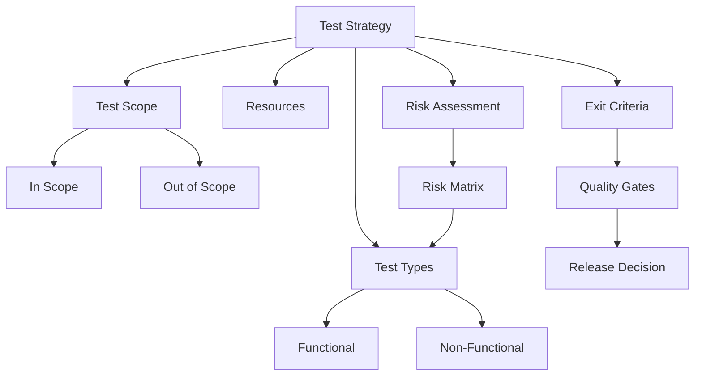
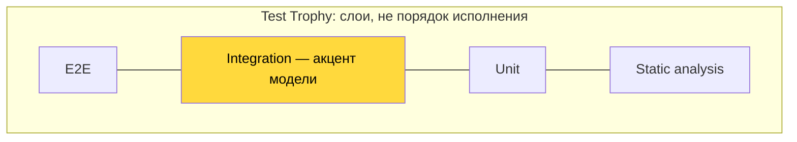
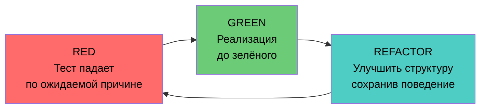
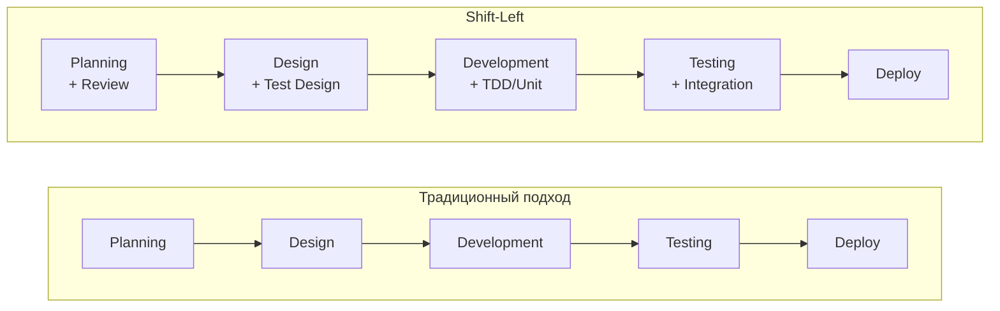
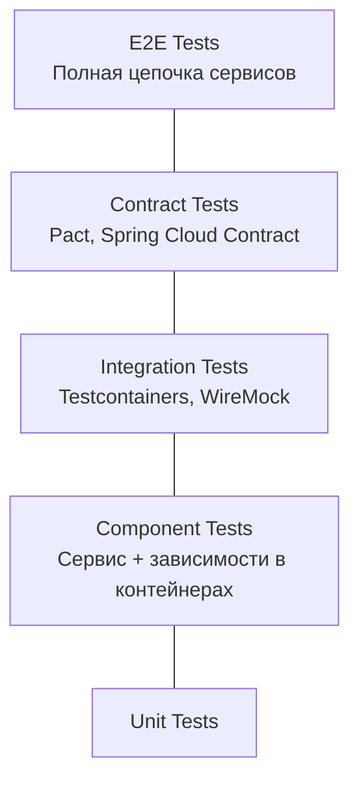
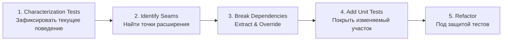
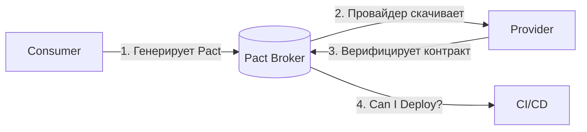
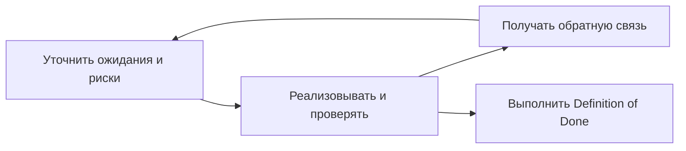
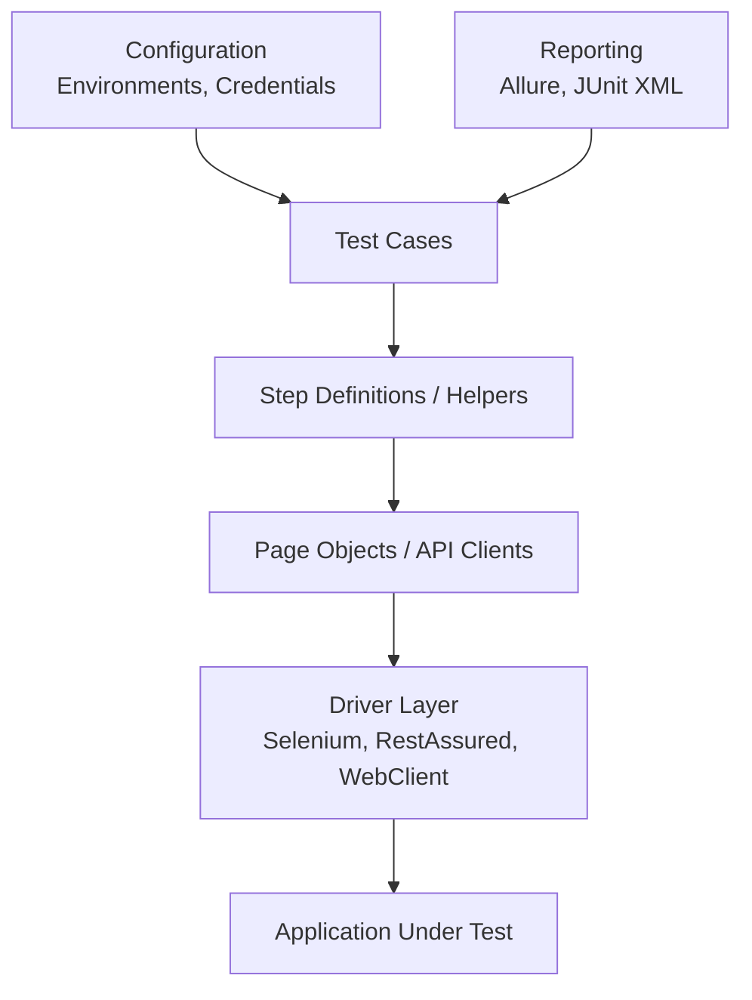
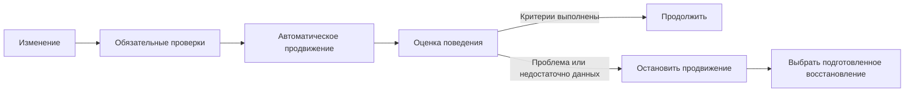

# Вопросы на собеседовании: Стратегии тестирования

Краткие ответы по стратегиям тестирования: как выбрать уровни тестов, распределить усилия команды, контролировать качество через метрики и риски, а также применять современные подходы `TDD`, `BDD`, `Property-Based Testing` и `Mutation Testing`.

**Стратегии тестирования** определяют, какие виды тестов использовать, как распределять усилия и какие метрики отслеживать. Этот файл фокусируется на управленческих и архитектурных решениях, а не на деталях конкретных фреймворков.

## Полезные ссылки

### Официальная документация

- [Test Pyramid in Spring Boot Microservice — Baeldung](https://www.baeldung.com/spring-test-pyramid-practical-example) — практический пример тестовой пирамиды
- [TDD a List Implementation in Java — Baeldung](https://www.baeldung.com/java-test-driven-list) — пошаговый TDD пример
- [Cucumber Spring Integration — Baeldung](https://www.baeldung.com/cucumber-spring-integration) — BDD с Cucumber и Spring
- [Property-Based Testing with jqwik — Baeldung](https://www.baeldung.com/java-jqwik-property-based-testing) — property-based тесты в Java
- [Mutation Testing with PITest — Baeldung](https://www.baeldung.com/java-mutation-testing-with-pitest) — мутационное тестирование
- [Google Testing Blog](https://testing.googleblog.com/) — блог Google о тестировании
- Agile Testing (Lisa Crispin, Janet Gregory), Working Effectively with Legacy Code (Michael Feathers)

## Содержание

- [Полезные ссылки](#полезные-ссылки)
- [See also](#see-also)

**Основы стратегий тестирования**
- [Q1. (!) Что такое стратегия тестирования и зачем она нужна?](#q1--что-такое-стратегия-тестирования-и-зачем-она-нужна)
- [Q2. (!) Что такое `Testing Pyramid` и как её применять?](#q2--что-такое-testing-pyramid-и-как-её-применять)
- [Q3. Какие существуют `Testing Quadrants`?](#q3-какие-существуют-testing-quadrants)
- [Q4. (!) В чём разница между `Test Pyramid` и `Test Trophy`?](#q4--в-чём-разница-между-test-pyramid-и-test-trophy)
- [Q5. Что такое `Test Strategy Document` и что в него входит?](#q5-что-такое-test-strategy-document-и-что-в-него-входит)

**TDD, BDD и Test-First подходы**
- [Q6. (!) Что такое `TDD` и как работает цикл `Red-Green-Refactor`?](#q6--что-такое-tdd-и-как-работает-цикл-red-green-refactor)
- [Q7. (!) Что такое `BDD` и как его реализовать с `Cucumber`?](#q7--что-такое-bdd-и-как-его-реализовать-с-cucumber)
- [Q8. Что такое `ATDD` и чем он отличается от `TDD` и `BDD`?](#q8-что-такое-atdd-и-чем-он-отличается-от-tdd-и-bdd)
- [Q9. Как реализовать `Test-First` подход на практике?](#q9-как-реализовать-test-first-подход-на-практике)
- [Q10. (!) Что такое `Property-Based Testing`?](#q10--что-такое-property-based-testing)

**Shift-Left, Shift-Right и Risk-Based Testing**
- [Q11. (!) Что такое `Shift-Left Testing`?](#q11--что-такое-shift-left-testing)
- [Q12. Что такое `Shift-Right Testing`?](#q12-что-такое-shift-right-testing)
- [Q13. (!) Как реализовать `Risk-Based Testing`?](#q13--как-реализовать-risk-based-testing)
- [Q14. Что такое `Testing in Production` и какие есть подходы?](#q14-что-такое-testing-in-production-и-какие-есть-подходы)

**Mutation Testing и качество тестов**
- [Q15. (!) Что такое `Mutation Testing` и как работает `PITest`?](#q15--что-такое-mutation-testing-и-как-работает-pitest)
- [Q16. Что такое `Exploratory Testing` и как совмещать с автоматизацией?](#q16-что-такое-exploratory-testing-и-как-совмещать-с-автоматизацией)
- [Q17. Что такое `Flaky Tests` и как с ними бороться?](#q17-что-такое-flaky-tests-и-как-с-ними-бороться)

**Тестирование специфических систем**
- [Q18. Какие стратегии тестирования микросервисов?](#q18-какие-стратегии-тестирования-микросервисов)
- [Q19. (!) Как тестировать legacy код?](#q19--как-тестировать-legacy-код)
- [Q20. Как тестировать `Distributed Systems`?](#q20-как-тестировать-distributed-systems)
- [Q21. Как тестировать `Event-Driven Architecture`?](#q21-как-тестировать-event-driven-architecture)
- [Q22. Что такое `Consumer-Driven Contract Testing`?](#q22-что-такое-consumer-driven-contract-testing)
- [Q23. Что такое `Chaos Engineering`?](#q23-что-такое-chaos-engineering)

**Метрики, организация и Agile**
- [Q24. (!) Какие метрики качества тестирования существуют?](#q24--какие-метрики-качества-тестирования-существуют)
- [Q25. Как организовать тестирование в `Agile`/`Scrum`?](#q25-как-организовать-тестирование-в-agilescrum)
- [Q26. Что такое `Three Amigos` и `Definition of Done`?](#q26-что-такое-three-amigos-и-definition-of-done)
- [Q27. Как балансировать скорость и качество тестирования?](#q27-как-балансировать-скорость-и-качество-тестирования)
- [Q28. Что такое `Test Observability`?](#q28-что-такое-test-observability)
- [Q29. Как организовать `Test Review`?](#q29-как-организовать-test-review)

**Test Data, окружения и инфраструктура тестирования**
- [Q30. Что такое `Test Doubles Strategy`?](#q30-что-такое-test-doubles-strategy)
- [Q31. (!) Что такое `Test Containerization` и `Testcontainers`?](#q31--что-такое-test-containerization-и-testcontainers)
- [Q32. Как организовать `Test Environments Strategy`?](#q32-как-организовать-test-environments-strategy)
- [Q33. Как организовать `Test Data Management`?](#q33-как-организовать-test-data-management)
- [Q34. Как организовать `Test Automation Framework`?](#q34-как-организовать-test-automation-framework)

**Продвинутые стратегии**
- [Q35. Что такое `Contract Testing` и как его реализовать с `Pact`?](#q35-что-такое-contract-testing-и-как-его-реализовать-с-pact)
- [Q36. Что такое `Visual Regression Testing`?](#q36-что-такое-visual-regression-testing)
- [Q37. Что такое `Performance Testing Strategy`?](#q37-что-такое-performance-testing-strategy)
- [Q38. Что такое `Security Testing Strategy`?](#q38-что-такое-security-testing-strategy)
- [Q39. Как организовать тестирование при `Continuous Deployment`?](#q39-как-организовать-тестирование-при-continuous-deployment)
- [Q40. (!) Рекомендации для `Test Strategy`](#q40--рекомендации-для-test-strategy)

**Практические паттерны и углублённые темы**
- [Q41. (!) Как правильно применять Test Doubles: когда Mock, когда Stub, когда Fake?](#q41--как-правильно-применять-test-doubles-когда-mock-когда-stub-когда-fake)
- [Q42. Что такое Contract Testing с Pact: Consumer и Provider стороны?](#q42-что-такое-contract-testing-с-pact-consumer-и-provider-стороны)
- [Q43. Как конкретно выглядит пирамида тестирования: соотношения и числа?](#q43-как-конкретно-выглядит-пирамида-тестирования-соотношения-и-числа)
- [Q44. (!) Как совместить Mutation Testing с CI/CD и quality gates?](#q44--как-совместить-mutation-testing-с-cicd-и-quality-gates)
- [Q45. Что такое Component Testing и как он вписывается в стратегию?](#q45-что-такое-component-testing-и-как-он-вписывается-в-стратегию)

---

## Q1. (!) Что такое стратегия тестирования и зачем она нужна?

**Стратегия тестирования** — обоснованный подход к выбору проверок и приоритетов по целям качества, рискам и ограничениям. Она связывает нужную обратную связь с доступными людьми, временем, инструментами и критериями оценки результата.

**Зачем нужна.** Стратегия помогает объяснить, какие риски проверяют первыми, почему выбраны именно эти границы тестов и какие ограничения остаются. Опыт команды — полезный вход, но привычный набор проверок не гарантирует оптимума для любого продукта. Подход можно вводить и пересматривать как для новой, так и для уже существующей системы; он не обязан впервые появиться до самого первого теста.

### Ключевые компоненты

| Компонент | Описание |
|-----------|----------|
| `Test Scope` | Что проверяем и что оставляем за границей |
| `Levels & Types` | Границы unit/integration/E2E и нужные виды проверок: функциональные, производительности, безопасности |
| `Resources` | Люди, инструменты, окружения, время |
| `Exit Criteria` | Согласованные условия завершения: нужные проверки, допустимые известные дефекты и остаточные риски; численные пороги выбирают для конкретной задачи |
| `Risk Assessment` | Последствия и вероятность отказов, приоритеты проверок |

### Связь компонентов стратегии



Это схема связанных решений, а не универсальный шаблон документа. Например, для расчётного модуля важны проверки правил, а для внешнего API — существенных взаимодействий. Критерии достаточности и способ фиксации решений зависят от контекста; ни наличие документа, ни процент покрытия сами по себе не гарантируют отсутствие дефектов.

**На собеседовании** полезно объяснить причины выбора и условия его пересмотра. В [ISTQB CTFL 4.0.1, §5.1.1](https://istqb.org/?download_id=3345&sdm_process_download=1) test plan связывает цели, ресурсы и процесс с политикой/стратегией; это не задаёт единственной формы отдельного стратегического документа.


## Q2. (!) Что такое `Testing Pyramid` и как её применять?

**Testing Pyramid** — модель распределения проверок по границам и масштабу: широкая основа небольших изолированных тестов и меньше широких проверок целой системы. В исходной модели Майка Кона выделены **unit, service и UI**; распространённая современная схема использует unit, integration и E2E. Названия и число слоёв могут отличаться. См. [Mike Cohn: средний слой пирамиды](https://www.mountaingoatsoftware.com/agile/the-forgotten-layer-of-the-test-automation-pyramid).

**Почему полезна.** Узкие проверки обычно дают быструю и локальную обратную связь; более широкие нужны для рисков взаимодействия и пользовательских путей. Конкретные скорость, хрупкость и стоимость определяются реализацией теста и окружением, а не только названием уровня. Широкие проверки дополняют основу: нельзя убрать важную интеграционную проверку лишь ради формы диаграммы.


### Границы проверок

| Слой в примере | Что проверяет | Практический выбор |
|----------------|---------------|--------------------|
| `Unit` | Небольшое правило или компонент в изоляции | Ветви расчёта и граничные значения |
| `Integration` | Взаимодействие выбранных частей | Обмен с БД, форматы и контракты границ |
| `E2E` | Сценарий через существенные части системы | Несколько важных пользовательских путей |

### Применение в `CI/CD`

Условная схема этапов, а не готовый исполняемый pipeline:

```yaml
stages:
  - static-analysis
  - unit-tests
  - integration-tests
  - e2e-tests
  - deploy
```

Начинайте с целей и рисков, распределяйте проверки по подходящим границам, измеряйте обратную связь и сопровождение. Реальный pipeline задаёт нужные задания, зависимости, возможность параллельного выполнения и критерии продвижения; пирамида не требует одной обязательной последовательности всех этапов.

Пропорции не задаются нормой 70/20/10 или фиксированными миллисекундами, секундами и минутами. В [микросервисах](../architecture/microservices-interview.md) могут быть важны контракты и сетевые отказы, но само имя архитектуры не определяет обязательный рост или сокращение доли интеграционных тестов. См. также [ISTQB CTFL 4.0.1, §5.1.6](https://istqb.org/?download_id=3345&sdm_process_download=1) и сравнение с Test Trophy в Q4.


## Q3. Какие существуют `Testing Quadrants`?

`Testing Quadrants` — модель Брайана Марика, развитая Лизой Криспин и Джанет Грегори. Она помогает обсудить **фокус** проверок (технология/бизнес) и **цель** (поддержка команды/критика продукта), а не последовательность этапов.

| Квадрант | Фокус и цель | Примеры |
|---|---|---|
| **Q1** | Технология, поддержка команды | Unit-проверки, проверки компонентов |
| **Q2** | Бизнес, поддержка команды | Приёмочные примеры, бизнес-правила |
| **Q3** | Бизнес, критика продукта | Исследование пользовательских сценариев, удобство |
| **Q4** | Технология, критика продукта | Нагрузка, безопасность, надёжность |

```mermaid
quadrantChart
    title Testing Quadrants
    x-axis "Technology Facing" --> "Business Facing"
    y-axis "Supporting the Team" --> "Critiquing the Product"
    quadrant-1 Q3: Exploratory, Usability
    quadrant-2 Q4: Performance, Security
    quadrant-3 Q1: Unit, Component
    quadrant-4 Q2: Acceptance examples
```

Примеры иллюстрируют области, но имя инструмента не определяет квадрант. Автоматизация может помогать исследованию и оценке; Q3 не означает запрета инструментов или обязательной отдельной ручной фазы.

Номера не задают порядок: начать можно с наиболее важного риска, например нагрузки на прототип. Набор проверок выбирают по контексту; модель не требует одинаковых пропорций или отдельного покрытия каждого квадранта в каждой истории. Пирамида обсуждает портфель автоматизированных проверок, квадранты — их цели. См. [объяснение Лизы Криспин](https://lisacrispin.com/2011/11/08/using-the-agile-testing-quadrants/).


## Q4. (!) В чём разница между `Test Pyramid` и `Test Trophy`?

Обе модели помогают выбирать набор проверок, но выделяют разные акценты. **Test Pyramid** делает широкую основу из небольших unit-проверок и оставляет меньше дорогих проверок через весь пользовательский интерфейс. В исходной пирамиде Майка Кона есть и средний **service layer**; это не требование сервисной архитектуры. См. [Test Automation Pyramid](https://www.mountaingoatsoftware.com/agile/the-forgotten-layer-of-the-test-automation-pyramid).

**Test Trophy** Кента Доддса усиливает роль интеграционных проверок взаимодействующих частей. Он сохраняет статический анализ, unit и E2E. Это ориентир отдачи от тестирования, первоначально описанный для JavaScript-приложений, а не универсальное правило для любого backend. См. [Testing Trophy и классификация тестов](https://kentcdodds.com/blog/the-testing-trophy-and-testing-classifications).

| Аспект | Test Pyramid | Test Trophy |
|---|---|---|
| Главный акцент | Много небольших unit, меньше широких GUI-проверок | Проверки взаимодействующих частей |
| Средний уровень | Service/API-проверки между unit и UI | Интеграционные проверки занимают заметное место |
| Остальные проверки | Верхние уровни дополняют основу | Unit, E2E и static сохраняются |
| Проценты | Универсальной нормы нет | Универсальной нормы нет |



**Выбор границы.** Для алгоритма можно изолировать вычисление; для пользовательского действия важно проверить взаимодействие частей. Оцените обнаруживаемые риски, скорость обратной связи и сопровождение. Название архитектуры само по себе не выбирает модель; unit не ограничиваются только «сложной логикой», а интеграционный акцент не отменяет остальные проверки. Дополнительные примеры — в [интеграционном тестировании](integration-testing-interview.md). Статический анализ полезен при обоих подходах. См. также [пояснение пирамиды Мартином Фаулером](https://martinfowler.com/bliki/TestPyramid.html).


## Q5. Что такое `Test Strategy Document` и что в него входит?

**Test Strategy Document** фиксирует выбранный подход к тестированию и причины решений, чтобы команда и заинтересованные лица могли их согласовать и использовать. Документ связывает цели, область и риски с приоритетами проверок, ресурсами и критериями оценки. Его подробность, охват и физическая форма зависят от принятого процесса.

### Возможное содержание

1. **Objectives** — какую информацию о качестве и рисках нужно получить.
2. **Scope** — что проверяем и что исключаем.
3. **Test Levels** — выбранные уровни и границы проверок.
4. **Test Types** — нужные функциональные и нефункциональные проверки.
5. **Entry/Exit Criteria** — условия начала и достаточности работы.
6. **Risk Assessment** — существенные риски и причины приоритетов.
7. **Tools & Infrastructure** — инструменты, данные, окружения и ограничения.
8. **Roles & Responsibilities** — ответственность за действия и решения.
9. **Metrics & Reporting** — как получать и обсуждать обратную связь.
10. **Defect Management** — как разбирать найденные проблемы.

Это практический перечень для обсуждения, не обязательный стандарт из десяти разделов. Даты, сценарии и отчёты можно связать с подходом, но сами по себе они не заменяют его обоснование.

### Связь с `Test Plan`

Граница не сводится к правилу «strategy — только организация, plan — только один релиз или фича». В [ISTQB CTFL 4.0.1, §5.1.1](https://istqb.org/?download_id=3345&sdm_process_download=1) test plan описывает цели, ресурсы, процессы и расписание тестового проекта; в него входит подход и отношение к существующей политике/стратегии. Поэтому содержание может пересекаться, а степень детализации и распределение по файлам выбирают в контексте команды.

**Поддержание актуальности.** Определите, кто обновляет решения и при каких изменениях рисков, архитектуры или ограничений они пересматриваются. Устаревшее описание может вводить в заблуждение; его практическую полезность оценивают по соответствию реальной работе. Обновляйте документ, когда подход меняется, и отделяйте устаревшие решения от действующих.


## Q6. (!) Что такое `TDD` и как работает цикл `Red-Green-Refactor`?

**TDD (Test-Driven Development)** — разработка небольшими шагами, в которой тест выбранного нового поведения предшествует реализации и помогает уточнять API и дизайн. Цикл даёт обратную связь по проверяемым случаям:

- **Red** — написать тест, запустить его и убедиться, что падение связано с отсутствующим поведением. Ошибка настройки или окружения не подтверждает чувствительность нужного утверждения.
- **Green** — добавить реализацию, достаточную для текущего случая, и пройти прежние проверки, применимые к актуальному контракту.
- **Refactor** — улучшить структуру, сохранив наблюдаемое поведение. Тесты помогают обнаруживать регрессии в своих проверках; зелёный набор не гарантирует отсутствие изменений вне этих утверждений.



### Пример цикла в Java

Учебный контракт: цена `BigDecimal` и тип клиента не `null`; для PREMIUM множитель 0.80, для REGULAR и VIP — 1. Отдельного правила скидки VIP пока нет. Типы ниже находятся в одном пакете, каждый класс — в своём файле. Тест использует **JUnit Jupiter с модулем params / Java 17+**.

```java
enum CustomerType { REGULAR, PREMIUM, VIP }
```

Возможная последовательность: сначала сформулировать случай PREMIUM и проверить его красный результат, затем добавлять следующие случаи по одному. Итоговый набор:

```java
import java.math.BigDecimal;
import org.junit.jupiter.params.ParameterizedTest;
import org.junit.jupiter.params.provider.CsvSource;
import static org.junit.jupiter.api.Assertions.assertEquals;

class PriceCalculatorTest {
    @ParameterizedTest
    @CsvSource({
        "PREMIUM, 100.00, 80.00",
        "REGULAR, 100.00, 100.00",
        "VIP, 100.00, 100.00"
    })
    void appliesDeclaredRate(CustomerType type, String price, String expected) {
        BigDecimal actual = new PriceCalculator()
            .applyDiscount(new BigDecimal(price), type);
        assertEquals(0, new BigDecimal(expected).compareTo(actual));
    }
}
```

Реализация Green для этого контракта:

```java
import java.math.BigDecimal;
import java.util.Objects;

public class PriceCalculator {
    public BigDecimal applyDiscount(BigDecimal price, CustomerType type) {
        Objects.requireNonNull(price);
        Objects.requireNonNull(type);
        BigDecimal factor = type == CustomerType.PREMIUM
            ? new BigDecimal("0.80") : BigDecimal.ONE;
        return price.multiply(factor);
    }
}
```

Возможный Refactor заменяет условие таблицей. Это альтернативная версия того же класса; обе версии одновременно не объявляются:

```java
import java.math.BigDecimal;
import java.util.Map;
import java.util.Objects;

public class PriceCalculator {
    private static final Map<CustomerType, BigDecimal> RATES = Map.of(
        CustomerType.PREMIUM, new BigDecimal("0.80")
    );

    public BigDecimal applyDiscount(BigDecimal price, CustomerType type) {
        Objects.requireNonNull(price);
        Objects.requireNonNull(type);
        return price.multiply(RATES.getOrDefault(type, BigDecimal.ONE));
    }
}
```

VIP по-прежнему получает исходную цену. Добавление VIP-скидки 30% изменило бы поведение и потребовало бы нового тестового цикла. Для двух ветвей таблица необязательна: рефакторинг должен иметь понятную пользу для конкретного дизайна. Сравнение через `compareTo` проверяет численное значение суммы; правила валюты и округления здесь не заданы.

### Три правила в формулировке Роберта Мартина

1. Сначала написать падающий тест, затем необходимый production-код.
2. Добавлять тест небольшими шагами, достаточными для падения; отсутствие компиляции тоже может быть ожидаемым промежуточным состоянием.
3. Добавлять production-код, достаточный для прохождения текущего падающего теста.

Это дисциплина мелких шагов. В статье [Robert C. Martin: The Cycles of TDD](https://blog.cleancoder.com/uncle-bob/2014/12/17/TheCyclesOfTDD.html) различаются эти правила и более крупный Red-Green-Refactor цикл. [Martin Fowler: TDD](https://martinfowler.com/bliki/TestDrivenDevelopment.html) также описывает выбор следующего случая из пополняемого списка.

TDD помогает получить тестируемый API и быструю обратную связь, но полезность зависит от выбранных случаев и утверждений. При исследовательской неопределённости команда может сначала провести ограниченный эксперимент, затем уточнить контракт и продолжить тестами до следующего изменения. Универсального запрета TDD для прототипов нет. Подробнее — в [вопросах по unit-тестированию](unit-testing-interview.md).

## Q7. (!) Что такое `BDD` и как его реализовать с `Cucumber`?

**BDD (Behavior-Driven Development)** — совместное уточнение ожидаемого поведения на конкретных примерах. Команда обсуждает правила и неизвестные случаи (**Discovery**), формулирует примеры (**Formulation**) и связывает их с проверками системы (**Automation**). Практики итеративны; Gherkin и Cucumber — средства поддержки, а не определение BDD. Обсуждение помогает выявлять разногласия раньше, но не гарантирует отсутствие недопонимания или дефектов. См. [Cucumber: BDD](https://cucumber.io/docs/bdd/).

### От примера к исполняемой проверке

В Cucumber сценарии `.feature` связываются со **step definitions**: выражение сопоставляется с текстом шага, после чего вызывается код действий и утверждений. Наличие feature-файла без корректного связывания и проверок не подтверждает поведение. Ключевые слова Given/When/Then помогают читателю, но сами не выбирают реализацию шага. См. [Step definitions](https://cucumber.io/docs/cucumber/step-definitions/).

Договоримся об учебном правиле корзины: от 3 единиц скидка 10%, от 10 — 20% вместо 10%. Сумма считается по добавленным товарам. Пример включает отдельный сценарий и три запуска Outline:

```gherkin
Feature: Корзина покупок
  Scenario: Добавление товара в корзину
    Given пустая корзина
    When я добавляю товар "Книга" по цене 500 руб
    Then в корзине 1 товар
    And итого 500 руб

  Scenario Outline: Скидка по количеству
    Given корзина с <количество> товарами по <цена> руб
    When применяется скидка
    Then итого <итого> руб

    Examples:
      | количество | цена | итого |
      | 3          | 100  | 270   |
      | 5          | 100  | 450   |
      | 10         | 100  | 800   |
```

Каждая строка данных Examples разворачивается в отдельный сценарий. Для **Cucumber-JVM 7.x / Java 17+** ниже показаны модель и все определения использованных шагов. Файлы классов находятся в пакете `example.cart`; feature — в `src/test/resources/features/cart.feature`.

```java
package example.cart;

import java.math.BigDecimal;
import java.util.ArrayList;
import java.util.List;

public class ShoppingCart {
    private record Item(String name, BigDecimal price) {}
    private final List<Item> items = new ArrayList<>();

    public void addItem(String name, int price) {
        if (price < 0) throw new IllegalArgumentException("negative price");
        items.add(new Item(name, BigDecimal.valueOf(price)));
    }

    public int size() {
        return items.size();
    }

    public BigDecimal total() {
        BigDecimal subtotal = items.stream().map(Item::price)
            .reduce(BigDecimal.ZERO, BigDecimal::add);
        BigDecimal factor = items.size() >= 10 ? new BigDecimal("0.80")
            : items.size() >= 3 ? new BigDecimal("0.90") : BigDecimal.ONE;
        return subtotal.multiply(factor);
    }
}
```

```java
package example.cart;

import io.cucumber.java.en.Given;
import io.cucumber.java.en.When;
import io.cucumber.java.en.Then;
import java.math.BigDecimal;
import static org.junit.jupiter.api.Assertions.*;

public class ShoppingCartSteps {
    private ShoppingCart cart;
    private BigDecimal observedTotal;

    @Given("пустая корзина")
    public void emptyCart() {
        cart = new ShoppingCart();
        observedTotal = null;
    }

    @Given("корзина с {int} товарами по {int} руб")
    public void filledCart(int count, int price) {
        emptyCart();
        for (int i = 0; i < count; i++) cart.addItem("Товар", price);
    }

    @When("я добавляю товар {string} по цене {int} руб")
    public void addItem(String name, int price) {
        cart.addItem(name, price);
        observedTotal = cart.total();
    }

    @When("применяется скидка")
    public void applyDiscount() {
        observedTotal = cart.total();
    }

    @Then("в корзине {int} товар(ов)")
    public void itemCount(int expected) {
        assertEquals(expected, cart.size());
    }

    @Then("итого {int} руб")
    public void totalEquals(int expected) {
        assertEquals(0, BigDecimal.valueOf(expected).compareTo(observedTotal));
    }
}
```

Для запуска через JUnit Platform нужны согласованные зависимости `cucumber-java`, `cucumber-junit-platform-engine`, Platform Suite и библиотека утверждений Jupiter; build tool должен использовать JUnit Platform. В suite выбирают ресурс feature и glue-пакет, например:

```java
package example.cart;

import org.junit.platform.suite.api.ConfigurationParameter;
import org.junit.platform.suite.api.IncludeEngines;
import org.junit.platform.suite.api.SelectClasspathResource;
import org.junit.platform.suite.api.Suite;

@Suite
@IncludeEngines("cucumber")
@SelectClasspathResource("features")
@ConfigurationParameter(key = "cucumber.glue", value = "example.cart")
public class RunCucumberTest {}
```

BDD и TDD могут сочетаться: общие примеры уточняют поведение, а небольшие тесты направляют реализацию. Границы не задаются жёсткой парой «BDD только acceptance, TDD только unit»; Gherkin без совместного обсуждения сам по себе не создаёт BDD-процесс.


## Q8. Что такое `ATDD` и чем он отличается от `TDD` и `BDD`?

**ATDD (Acceptance Test-Driven Development)** — совместное согласование приёмочных примеров **до реализации соответствующей функциональности**. Обсуждение соединяет бизнес-перспективу, разработку и тестирование; примеры уточняют ожидаемое поведение и могут стать автоматизированными проверками. Это не обязательно происходит до начала Sprint и не требует отдельного человека на каждую перспективу. См. [Agile Alliance: ATDD](https://agilealliance.org/glossary/atdd/).

| Практика | Основной фокус | Как направляет работу |
|---|---|---|
| **TDD** | Разработка и дизайн кода через короткую обратную связь | Неуспешный тест → минимальная реализация → рефакторинг |
| **BDD** | Общее понимание поведения на примерах | Совместное исследование, формулирование и автоматизация примеров |
| **ATDD** | Приёмочные ожидания с разных перспектив | Согласованные примеры направляют реализацию и проверку функции |

Границы терминов пересекаются. TDD не сводится к названию JUnit, BDD — к записи Given/When/Then, ATDD — к одному уровню UI/system-тестов. Участники и инструменты зависят от команды; это не три жёстко разделённых уровня или взаимоисключающих процесса. Источники: [Agile Alliance: TDD](https://agilealliance.org/glossary/tdd/), [Cucumber: BDD](https://cucumber.io/docs/bdd/).

**Пример сочетания.** Команда до реализации уточняет скидку: при выполнении условия 1000 превращается в 900, иначе сумма не меняется. Эти приёмочные примеры задают ожидания ATDD; совместное обсуждение поведения использует BDD, а TDD может направлять код расчёта. Это иллюстрация практик, не обязательный порядок ритуалов.


Приёмочные критерии конкретной функции не равны общей **Definition of Done** инкремента. ATDD не задаёт Sprint Goal и не требует, чтобы все тесты были написаны до Sprint. Дополнительные контекстные требования команды можно согласовать отдельно; они не становятся определением самой практики.


## Q9. Как реализовать `Test-First` подход на практике?

**Test-First** означает, что проверка выбранного нового поведения появляется до его реализации. Практический цикл TDD добавляет короткую обратную связь и сохраняющий поведение рефакторинг:

1. Уточнить следующий ожидаемый случай. Можно заранее составить и пополнять список случаев, затем выбирать один для текущего шага.
2. Написать тест и запустить его: проверить, что красный результат вызван отсутствующим поведением, а не ошибкой окружения или настройки.
3. Добавить реализацию, достаточную для выбранного случая, и получить зелёный результат.
4. Улучшить структуру под защитой тестов, сохранив поведение. Следующую возможность начинать новым циклом, а не называть её рефакторингом.

CI и quality gates могут поддерживать процесс; конкретный CI-инструмент не является условием определения Test-First. См. [Martin Fowler: TDD](https://martinfowler.com/bliki/TestDrivenDevelopment.html), включая предварительный список случаев.

### Небольшой исполняемый пример

Учебное правило для трёх выбранных случаев: строка допускается, если она не `null` и содержит `@`. Это не полная спецификация валидации email. Тесты для **JUnit Jupiter / Java 17+**:

```java
import org.junit.jupiter.api.Test;
import static org.junit.jupiter.api.Assertions.*;

class AddressMarkerRuleTest {
    @Test
    void acceptsMarkedAddress() {
        assertTrue(new AddressMarkerRule().isAllowed("user@example.com"));
    }

    @Test
    void rejectsNull() {
        assertFalse(new AddressMarkerRule().isAllowed(null));
    }

    @Test
    void rejectsWithoutAt() {
        assertFalse(new AddressMarkerRule().isAllowed("userexample.com"));
    }
}
```

Возможная последовательность: первый тест красный при ответе `false`, затем простейший ответ `true` делает его зелёным. Новый тест на `null` выявляет недостаточность этой реализации; проверка `address != null` закрывает второй случай. Третий тест требует учитывать `@`. Итог для заданного правила:

```java
public class AddressMarkerRule {
    public boolean isAllowed(String address) {
        return address != null && address.contains("@");
    }
}
```

Финальный код сам по себе не доказывает, что разработка шла test-first: важен наблюдавшийся порядок работы. Каждый красный этап проверяет чувствительность нового теста к отсутствующему условию; зелёный набор подтверждает только свои утверждения. Дополнительные требования к адресу потребуют отдельных примеров и реализации.


## Q10. (!) Что такое `Property-Based Testing`?

**Property-Based Testing (PBT)** задаёт свойство для допустимого домена входов и проверяет его на выбранных данных. Нужно определить предпосылки и критерий результата; один генератор не знает, что программа должна делать. Проверенный конечный набор не доказывает свойство на непосещённых значениях.

В зависимости от инструмента данные могут генерироваться случайно, перебираться для доступного конечного пространства или браться из заданных наборов. При нарушении свойства framework может искать более простой контрпример (**shrinking**), сохраняющий ошибку. Поиск ограничен стратегией и бюджетом; глобально наименьший пример не гарантирован. Источник и версия API: [jqwik User Guide 1.10.2](https://jqwik.net/docs/1.10.2/user-guide.html).

### Пример с `jqwik`

Для сортировки проверим длину, порядок и **кратности** элементов. Домен примера — списки `Integer` без `null` длиной до 100. `tries = 100` — настройка этого примера, не определение PBT. Для утверждений используется JUnit Jupiter; запуск properties требует также jqwik engine и совместимого JUnit Platform.

```java
import net.jqwik.api.ForAll;
import net.jqwik.api.Property;
import net.jqwik.api.constraints.Size;
import java.util.ArrayList;
import java.util.Collections;
import java.util.HashMap;
import java.util.List;
import java.util.Map;
import static org.junit.jupiter.api.Assertions.*;

class SortPropertyTest {
    @Property(tries = 100)
    void preservesSize(@ForAll @Size(max = 100) List<Integer> input) {
        assertEquals(input.size(), sorted(input).size());
    }

    @Property(tries = 100)
    void isOrdered(@ForAll @Size(max = 100) List<Integer> input) {
        List<Integer> result = sorted(input);
        for (int i = 1; i < result.size(); i++) {
            assertTrue(result.get(i - 1) <= result.get(i));
        }
    }

    @Property(tries = 100)
    void preservesMultiplicity(@ForAll @Size(max = 100) List<Integer> input) {
        assertEquals(counts(input), counts(sorted(input)));
    }

    private static List<Integer> sorted(List<Integer> input) {
        List<Integer> result = new ArrayList<>(input);
        Collections.sort(result);
        return result;
    }

    private static Map<Integer, Integer> counts(List<Integer> values) {
        Map<Integer, Integer> result = new HashMap<>();
        for (Integer value : values) result.merge(value, 1, Integer::sum);
        return result;
    }
}
```

Эти свойства описывают выбранный контракт сортировки; слабое или ошибочное свойство также может давать мало полезной информации. Полезны проверки отношений (`parse(serialize(x)) == x` при заданных условиях), сравнение с эталоном и модели переходов состояния.

### Выбор применения

| Задача | Что учитывать |
|--------|---------------|
| Алгоритмы, сериализация, парсеры | Допустимый домен, оракул и граничные случаи |
| Бизнес-правила и состояния | Инварианты, предусловия и модель переходов |
| UI, интеграционные и E2E-сценарии | Управляемость среды, наблюдаемость, стоимость и повторяемость |

Последняя группа не запрещена по названию: пригодность зависит от модели и среды. Повторение seed или входа не восстанавливает автоматически внешнее состояние. jqwik поддерживает сохранение и повторение предыдущих ошибок, но конкретное поведение зависит от версии и режима after-failure; оно не заменяет изоляцию окружения. Подробнее — в [шпаргалке по Property-Based Testing](property-based-testing-interview.md).


## Q11. (!) Что такое `Shift-Left Testing`?

`Shift-Left Testing` — подход, при котором проверки качества сдвигаются «влево» по временной шкале проекта, то есть ближе к началу разработки, а не в конец перед релизом. «Влево» — потому что на типичной диаграмме фаз время идёт слева направо.

**Зачем сдвигать.** Стоимость исправления дефекта растёт по мере его «старения»: ошибка в требованиях, найденная на дизайне, — это правка пары строк, а та же ошибка, найденная в production, — инцидент, откат и потеря доверия. Shift-Left не добавляет тестирование, а перераспределяет его: ловить дефекты там, где они дешевле всего.



### Практики `Shift-Left`

1. **Static Analysis** — линтеры, `SonarQube`, `SpotBugs` уже на этапе коммита
2. **TDD** — тесты до кода (см. [unit-тестирование](unit-testing-interview.md))
3. **Code Review с чек-листом тестируемости** — DI, SRP, минимум статики
4. **Pair Programming** — разработчик + тестировщик
5. **Continuous Testing в CI** — тесты на каждый коммит

### Принцип: предотвращение важнее обнаружения

Идея Shift-Left глубже, чем «тестировать раньше»: лучшая ошибка — та, которой не случилось. Ревью требований, статический анализ и TDD не столько ловят дефекты, сколько мешают им появиться. Эмпирическое правило: баг, найденный на этапе дизайна, обходится в 10–100 раз дешевле того же бага в production.

## Q12. Что такое `Shift-Right Testing`?

`Shift-Right Testing` — проверка качества уже после деплоя, на реальном трафике: мониторинг, `A/B`-тесты, `canary deployments`, `synthetic monitoring`.

**Зачем, если есть Shift-Left.** Часть проблем в принципе невозможно воспроизвести до прода: реальная нагрузка, неожиданные данные пользователей, поведение под пиками, редкие комбинации браузеров. Shift-Right признаёт это и переносит часть проверок туда, где есть настоящие условия — но делает это безопасно, маленькими порциями трафика и с возможностью мгновенного отката.

### Подходы `Shift-Right`

| Подход | Описание | Инструменты |
|--------|----------|-------------|
| `Canary Deployment` | Постепенный выкат на часть пользователей | `Kubernetes`, `Istio` |
| `A/B Testing` | Сравнение двух вариантов | `LaunchDarkly`, `Unleash` |
| `Synthetic Monitoring` | Автоматические проверки в production | `Datadog`, `New Relic` |
| `Chaos Engineering` | Инъекция сбоев для проверки отказоустойчивости | `Chaos Monkey`, `Litmus` |
| `Feature Flags` | Контроль доступа к фичам | `Unleash`, `Flagsmith` |

**Ключевая оговорка:** Shift-Right не заменяет проверки до релиза, а **дополняет** их. Выкатывать заведомо сырой код в надежде «поймать на проде» — антипаттерн. Подход работает только в связке с [observability](../monitoring/observability-interview.md): без метрик, логов и трейсов вы не увидите, что канарейка деградировала, и тестирование в production превращается в тестирование на пользователях вслепую.

## Q13. (!) Как реализовать `Risk-Based Testing`?

`Risk-Based Testing` (`RBT`) — приоритизация тестов по уровню риска, где **риск = вероятность дефекта × его влияние (impact)**. Тестировать всё одинаково тщательно невозможно при ограниченных сроках, поэтому усилия концентрируют там, где цена ошибки выше.

**Логика подхода.** Сначала оцениваешь по каждому участку две вещи: насколько вероятно, что здесь скрыт баг (сложный код, частые правки, новая команда), и насколько больно будет, если он выстрелит (потеря денег, утечка данных, простой). Произведение даёт приоритет: оплата заказа важнее, чем оформление подписи в профиле, даже если кода в подписи больше.

### Матрица рисков

```text
Impact ↑
  5 │ M  H  H  C  C
  4 │ M  M  H  H  C
  3 │ L  M  M  H  H
  2 │ L  L  M  M  H
  1 │ L  L  L  M  M
    └─────────────────→ Likelihood
      1  2  3  4  5

L = Low, M = Medium, H = High, C = Critical
```

### Распределение усилий по приоритету

| Приоритет | Покрытие | Подход |
|-----------|----------|--------|
| `Critical` | 95%+ | Полное тестирование, автоматизация, мониторинг |
| `High` | 85%+ | Автоматизация, ручное тестирование |
| `Medium` | 70%+ | Автоматизация основных сценариев |
| `Low` | 50%+ | Smoke-тесты, sampling |

### Факторы для оценки

- **Вероятность (likelihood)**: сложность кода, опыт команды, история дефектов на этом участке, число внешних зависимостей.
- **Влияние (impact)**: финансовые потери, ущерб для UX и репутации, нарушение требований (`GDPR`, `PCI DSS`).

**Важно:** риск не статичен. Карту рисков пересматривают при каждом изменении scope или стека — иначе вы тщательно тестируете участок, который давно стабилизировался, и пропускаете новый «горячий».

## Q14. Что такое `Testing in Production` и какие есть подходы?

`Testing in Production` (`TiP`) — это конкретные техники реализации Shift-Right: контролируемая проверка ПО на реальных пользователях и данных. Все они объединены одной идеей — ограничить «радиус поражения» и иметь путь отступления.

1. **Canary Deployment** — новая версия получает 1–5% трафика; если её метрики хуже, выкат останавливают, не задев большинство пользователей.
2. **Blue-Green Deployment** — два идентичных окружения; трафик переключают целиком, а откат — это мгновенное переключение обратно.
3. **A/B Testing** — два варианта работают параллельно, выбор делается по бизнес-метрикам (конверсия), а не по «нравится/не нравится».
4. **Synthetic Monitoring** — искусственные запросы по критическим путям проверяют, что система жива, ещё до того как сломается реальный пользователь.
5. **Dark Launching** — код выполняется на реальном трафике, но результат не показывается; так проверяют нагрузку и корректность нового пути без риска для UX.

```java
// Пример Canary: проверка метрик нового релиза
@Service
public class CanaryHealthCheck {

    private final MetricsService metrics;

    public boolean isCanaryHealthy(String version, Duration window) {
        double errorRate = metrics.getErrorRate(version, window);
        double p99Latency = metrics.getP99Latency(version, window);

        return errorRate < 0.01       // < 1% ошибок
            && p99Latency < 500.0;    // < 500ms p99
    }
}
```

Связано с [стратегиями деплоя](../cicd/deployment-strategies-interview.md) — без безопасного деплоя `TiP` опасен.

## Q15. (!) Что такое `Mutation Testing` и как работает `PITest`?

`Mutation Testing` — метод проверки **качества самих тестов**: «кто тестирует тестировщиков». Инструмент намеренно вносит в production-код мелкие поломки (мутации) — меняет `>` на `>=`, `+` на `-`, `true` на `false` — и прогоняет тесты. Если после поломки хоть один тест покраснел, мутант **убит** (тесты заметили); если все тесты остались зелёными, мутант **выжил** — значит, эту строку никто реально не проверяет.

**Зачем это нужно.** Покрытие строк (`line coverage`) показывает только, что строка выполнилась, а не что её поведение проверено. Можно вызвать метод без единого осмысленного `assert` и получить 100% покрытия. Mutation Testing ловит именно такие «пустые» тесты: выживший мутант — это прямое доказательство пробела в проверках.

### Типы мутаций

| Мутация | Оригинал | Мутант |
|---------|----------|--------|
| Conditionals | `a > b` | `a >= b` |
| Math | `a + b` | `a - b` |
| Return values | `return true` | `return false` |
| Void calls | `list.clear()` | удалено |
| Negation | `a == b` | `a != b` |

### Настройка `PITest` в Gradle

```groovy
plugins {
    id 'info.solidsoft.pitest' version '1.15.0'
}

pitest {
    targetClasses = ['com.example.service.*']
    targetTests = ['com.example.service.*Test']
    mutators = ['DEFAULTS']        // стандартный набор мутаций
    outputFormats = ['HTML']
    timestampedReports = false
    threads = 4
    mutationThreshold = 80         // минимальный mutation score
}
```

### Метрика: `Mutation Score`

```
Mutation Score = Killed Mutants / Total Mutants * 100%
```

- **> 80%** — хороший показатель: большинство поломок ловится.
- **< 60%** — тесты поверхностные: много строк выполняется, но почти не проверяется assertions.

**Цена и где применять.** Mutation Testing дорог: на каждую мутацию прогоняется весь набор тестов, поэтому полный прогон большого модуля идёт десятки минут. Его не гоняют на каждый коммит, а нацеливают на критичную бизнес-логику и запускают инкрементально (только изменённые классы) либо по ночам — см. Q44. Главный вывод для собеседования: 100% `line coverage` ничего не гарантирует, а `mutation score` показывает реальную строгость тестов.

## Q16. Что такое `Exploratory Testing` и как совмещать с автоматизацией?

`Exploratory Testing` — исследование, в котором обучение, проектирование, выполнение и оценка проверок влияют друг на друга: новое наблюдение помогает выбрать следующий шаг. Можно использовать заранее подготовленные идеи, данные и инструменты; отличие — в возможности пересматривать действия по ходу работы. Это не случайные действия без анализа. См. [James Bach: Exploratory Testing](https://www.satisfice.com/exploratory-testing).

### Совмещение с автоматизацией

| Задача | Как помогает автоматизация | Что остаётся исследователю |
|--------|-----------------------------|----------------------------|
| Изучить новое поведение | Подготовить данные, отправить запросы, собрать логи | Выбрать гипотезы и оценить неожиданные результаты |
| Повторить известную проверку | Выполнить формализованные шаги и сравнения | Проверить пригодность ожиданий и границы покрытия |
| Разобрать находку | Воспроизвести условия, сократить пример | Уточнить риск и решить, какой контроль нужен |

Например, исследование оплаты выявило повторный запрос после сетевого сбоя. Команда уточняет ожидаемое поведение и решает, нужен ли автотест на повторную обработку, дополнительное исследование или другой контроль. Не каждую находку можно и нужно автоматически превращать в регрессионный тест.

### Один способ организации: `Session-Based Test Management`

В SBTM можно согласовать **charter** — цель и область исследования, выделить ограниченное время, записать выполненную работу, находки и препятствия, затем обсудить результаты. Длительность, детализацию отчёта и частоту сессий выбирают по задаче. [Отчёт о сессии относится к SBTM](https://www.satisfice.com/download/sbtm-session-report-checklist); наличие charter, time-box и отчёта не является обязательным условием любого exploratory testing. Исследование может происходить и во время отладки или анализа требований.

На собеседовании полезно связать исследовательский выбор с наблюдениями и объяснить роль автоматизированных средств: они поддерживают исследование и повторяемые проверки, но не заменяют оценку полученных результатов.


## Q17. Что такое `Flaky Tests` и как с ними бороться?

`Flaky Tests` — тесты, которые на одном и том же коде то проходят, то падают без всякой причины во входных данных. Главный вред не в самих падениях, а в том, что они разрушают доверие: когда «красное» бывает ложным, команда начинает перезапускать сборку «на удачу» и в итоге пропускает настоящие баги, замаскированные под флаки.

**Почему так происходит.** Флакинесс почти всегда означает скрытую зависимость от чего-то недетерминированного — времени, порядка выполнения, сети, гонок потоков, общего состояния. Тест не «случайно ломается», он зависит от условия, которое мы не контролируем. Лечение — найти и устранить эту зависимость, а не добавить retry.

### Причины

| Причина | Пример | Решение |
|---------|--------|---------|
| Зависимость от времени | `Thread.sleep()`, таймзоны | `Awaitility`, `Clock` injection |
| Порядок выполнения | Shared state между тестами | `@DirtiesContext`, изоляция |
| Внешние зависимости | Сеть, API, файлы | `WireMock`, `Testcontainers` |
| Race conditions | Многопоточность | `CountDownLatch`, `CompletableFuture` |
| Ресурсы | Порты, память | Рандомные порты, cleanup |

### Стратегия борьбы

```java
// Вместо Thread.sleep — Awaitility
import static org.awaitility.Awaitility.*;

@Test
void shouldProcessAsyncEvent() {
    eventPublisher.publish(new OrderCreated(orderId));

    await()
        .atMost(Duration.ofSeconds(5))
        .pollInterval(Duration.ofMillis(100))
        .untilAsserted(() -> {
            Order order = orderRepository.findById(orderId);
            assertThat(order.getStatus()).isEqualTo(Status.PROCESSED);
        });
}
```

1. **Мониторинг**: измерять flaky rate (цель < 1%) — без цифры проблему не видно и она тихо разрастается.
2. **Карантин**: помечать `@Tag("flaky")` и выносить из блокирующего pipeline, чтобы ложные падения не останавливали поставку.
3. **Починить или удалить**: карантин — временная мера. Если тест нельзя стабилизировать за пару спринтов, его удаляют: флакающий тест не защищает от багов, а только создаёт шум.

## Q18. Какие стратегии тестирования микросервисов?

Тестирование [микросервисов](../architecture/microservices-interview.md) добавляет уровни, которых нет в монолите, потому что главный риск смещается внутрь сети — в контракты между сервисами и их взаимодействие, а не в логику отдельного класса. Поэтому к привычным unit/integration/E2E добавляют **component** (сервис целиком в изоляции) и **contract** (совместимость API между парами сервисов).



### Ключевые подходы

1. **Consumer-Driven Contract Testing** (`Pact`) — потребитель фиксирует, что именно он ждёт от API, а провайдер проверяет, что не сломал этих ожиданий. Заменяет дорогие сквозные E2E на быстрые независимые проверки.
2. **Service Virtualization** (`WireMock`) — внешние сервисы заменяются управляемой заглушкой, чтобы тестировать поведение при их таймаутах и ошибках, не имея доступа к реальным.
3. **Component Testing** — сервис со своей БД/кешем в контейнерах, внешние сервисы замоканы; проверяет сервис как единое целое, но без зависимости от остального ландшафта.
4. **Chaos Engineering** — намеренная инъекция сбоев, чтобы убедиться, что отказ одного сервиса не роняет всю цепочку.

```java
// WireMock: виртуализация внешнего сервиса
@SpringBootTest
@AutoConfigureWireMock(port = 0)
class OrderServiceTest {

    @Test
    void shouldHandlePaymentTimeout() {
        stubFor(post("/api/payments")
            .willReturn(aResponse()
                .withFixedDelay(10_000)
                .withStatus(504)));

        assertThrows(PaymentTimeoutException.class,
            () -> orderService.placeOrder(request));
    }
}
```

## Q19. (!) Как тестировать legacy код?

Главная трудность legacy-кода — порочный круг: чтобы безопасно его менять, нужны тесты, но код не покрыт тестами именно потому, что не был спроектирован тестируемым (жёсткие зависимости, статика, длинные методы). Майкл Фезерс в «Working Effectively with Legacy Code» даёт само определение: legacy — это любой код без тестов. Выход из круга — сначала зафиксировать текущее поведение, затем аккуратно разорвать зависимости, и только потом рефакторить.

### Пошаговый подход



### Техники

| Техника | Описание |
|---------|----------|
| `Characterization Test` | Тест, фиксирующий текущее поведение (даже если оно "неправильное") |
| `Sprout Method` | Новая логика — в новый тестируемый метод |
| `Sprout Class` | Новая логика — в новый тестируемый класс |
| `Wrap Method` | Обернуть legacy-метод в wrapper для тестируемости |
| `Extract & Override` | Выделить зависимость в protected метод, переопределить в тесте |

```java
// Characterization test: фиксируем текущее поведение
@Test
void characterizeDiscountCalculation() {
    LegacyPriceService service = new LegacyPriceService();

    // Документируем что СЕЙЧАС возвращает метод
    BigDecimal result = service.calculateDiscount(100, "GOLD");
    assertEquals(new BigDecimal("15.00"), result);
    // Теперь если кто-то изменит логику — тест упадёт
}

// Sprout Method: новая логика в отдельный тестируемый метод
public class LegacyOrderProcessor {
    // Legacy метод — не трогаем
    public void processOrder(Order order) { /* ... */ }

    // Новый метод — можно тестировать
    public ValidationResult validateOrder(Order order) {
        if (order.getItems().isEmpty()) return ValidationResult.error("No items");
        if (order.getTotal().compareTo(BigDecimal.ZERO) <= 0)
            return ValidationResult.error("Invalid total");
        return ValidationResult.ok();
    }
}
```

**Эмпирическое правило** работы с legacy: не пытаться покрыть всё сразу — это нереально и не окупается. Тесты добавляют только вокруг участка, который сейчас правят (правило бойскаута: оставь код чуть чище, чем нашёл). Так покрытие растёт там, где идёт работа, а не там, где код мёртв и стабилен.

## Q20. Как тестировать `Distributed Systems`?

Тестирование [распределённых систем](../architecture/distributed-systems-interview.md) сложнее не из-за объёма, а из-за природы: сеть ненадёжна, операции асинхронны, согласованность данных — отложенная (`eventual consistency`). Баги живут не внутри сервисов, а на стыках и во времени — поэтому ключ к стратегии не «больше тестов», а целенаправленная проверка сценариев сбоя, которые в монолите просто не возникают.

### Стратегия по уровням

| Уровень | Что тестируем | Инструменты |
|---------|---------------|-------------|
| Unit | Логика отдельных компонентов | `JUnit`, `Mockito` |
| Component | Сервис + зависимости | `Testcontainers` |
| Contract | Интерфейсы между сервисами | `Pact`, `Spring Cloud Contract` |
| Integration | Реальное взаимодействие | `Docker Compose` |
| Chaos | Отказоустойчивость | `Chaos Monkey`, `Toxiproxy` |
| E2E | Полная цепочка | Staging environment |

### Граничные случаи, которые легко забыть

Именно эти сценарии отличают тестирование распределённой системы от монолита — каждый из них надо проверять явно:

- **Таймауты**: что делает вызывающий, когда ответ не пришёл вовремя — падает, ретраит, отдаёт fallback?
- **Повторные вызовы (retry)**: идемпотентна ли операция? Повторный «создать заказ» не должен породить два заказа.
- **Частичные сбои (partial failures)**: сервис A ответил, B — нет; в каком состоянии остаются данные и как система из него выходит.
- **Отложенная согласованность**: чтение сразу после записи может вернуть старые данные — тест должен это допускать, а не считать багом.
- **Разрыв сети (network partition)**: часть кластера недоступна; продолжает ли система работать в деградированном режиме.

## Q21. Как тестировать `Event-Driven Architecture`?

В [event-driven архитектуре](../architecture/event-driven-patterns-interview.md) связь между сервисами не прямая, а через события, поэтому проверять надо всю цепочку: продюсер → топик → консьюмер. Сложность в том, что обработка асинхронна — нельзя просто проверить ответ сразу после вызова, нужно дождаться, пока консьюмер обработает событие.

Удобно разделить проверки на два уровня: unit подтверждает, что продюсер формирует правильное событие, а integration (с реальным брокером в Testcontainers) — что событие действительно доходит до консьюмера и приводит к нужному изменению состояния.

### Уровни тестирования

```java
// 1. Unit: проверяем формирование события
@Test
void shouldPublishOrderCreatedEvent() {
    OrderService service = new OrderService(eventPublisher);
    service.createOrder(request);

    verify(eventPublisher).publish(argThat(event ->
        event.getType().equals("ORDER_CREATED")
        && event.getOrderId().equals(orderId)));
}

// 2. Integration: Testcontainers + Kafka
@SpringBootTest
@Testcontainers
class KafkaIntegrationTest {

    @Container
    static KafkaContainer kafka = new KafkaContainer(
        DockerImageName.parse("confluentinc/cp-kafka:7.5.0"));

    @Test
    void shouldProcessEventEndToEnd() {
        kafkaTemplate.send("orders", orderEvent);

        await().atMost(Duration.ofSeconds(10))
            .untilAsserted(() -> {
                Order saved = orderRepo.findById(orderId);
                assertThat(saved.getStatus()).isEqualTo(CONFIRMED);
            });
    }
}
```

### Contract Testing для событий

В EDA контракт — это **схема события**, а не сигнатура метода. Если продюсер поменяет формат, консьюмеры узнают об этом не на компиляции, а в рантайме, когда не смогут разобрать сообщение. Поэтому схемы (`Avro`, `JSON Schema`) регистрируют в `Schema Registry` и проверяют на совместимость: реестр не даёт выкатить ломающее изменение формата. Подробнее о Kafka — в [вопросах по Kafka](../messaging/kafka-interview.md).

## Q22. Что такое `Consumer-Driven Contract Testing`?

`Consumer-Driven Contract Testing` — подход, где направление задаёт **потребитель**: он описывает, какие запросы шлёт и какие ответы ждёт, а **провайдер** обязан этим ожиданиям соответствовать. Контракт идёт «снизу вверх» — от того, кто использует API, к тому, кто его реализует.

**Какую проблему решает.** Без контрактов единственный способ убедиться, что сервисы совместимы, — гонять их вместе в E2E: медленно, хрупко, дорого поднимать всё окружение. Контрактные тесты разрывают эту связку: consumer и provider тестируются по отдельности и быстро, а артефакт-контракт (через Pact Broker) гарантирует, что они «договорились». Бонус: provider видит, какие именно поля реально нужны потребителям, и понимает, что можно менять безопасно.

### Пример с `Pact`

```java
// Consumer side: определяем ожидания
@ExtendWith(PactConsumerTestExt.class)
@PactTestFor(providerName = "UserService")
class OrderServiceContractTest {

    @Pact(consumer = "OrderService")
    public V4Pact userExists(PactDslWithProvider builder) {
        return builder
            .given("User 123 exists")
            .uponReceiving("get user by id")
                .path("/api/users/123")
                .method("GET")
            .willRespondWith()
                .status(200)
                .body(newJsonBody(body -> {
                    body.numberType("id", 123);
                    body.stringType("name", "John");
                    body.stringType("email", "john@example.com");
                }).build())
            .toPact(V4Pact.class);
    }

    @Test
    @PactTestFor(pactMethod = "userExists")
    void shouldFetchUser(MockServer mockServer) {
        UserClient client = new UserClient(mockServer.getUrl());
        User user = client.getUser(123L);

        assertThat(user.getName()).isEqualTo("John");
    }
}
```

### Workflow



## Q23. Что такое `Chaos Engineering`?

**Chaos Engineering** — управляемые эксперименты, которые повышают уверенность в устойчивости системы к реальным сбоям. Начинают с измеримого нормального поведения (**steady state**) и гипотезы, затем вводят возмущение и сравнивают наблюдения с ожиданиями. Успех одного опыта не доказывает устойчивость ко всем отказам. См. [Principles of Chaos Engineering](https://principlesofchaos.org/).

### Как спланировать эксперимент

1. Выбрать наблюдаемый результат: например, долю успешных покупок и задержку ответа.
2. Сформулировать гипотезу для конкретного сбоя и условий нагрузки; определить контроль и критерии оценки.
3. Ограничить воздействие и длительность. Заранее задать условия остановки и способ восстановления.
4. Ввести контролируемый сбой, наблюдать метрики и искать опровержение гипотезы.
5. Разобрать слабое место и после исправления повторить подходящую проверку. Автоматизация помогает регулярно получать обратную связь.

Примеры возмущений: недоступность зависимости, задержка сети, потеря экземпляра сервиса, нехватка ресурсов. Production даёт реалистичный контекст, но воздействие на пользователей нужно ограничивать; случайное разрушение без гипотезы и наблюдения не выражает метод.

### Пример отдельной проверки circuit breaker

Локальный тест ниже показывает только механизм **Resilience4j 2.3.0 / JUnit 5 / Java 17+**. Пять ошибок открывают breaker благодаря явным `minimumNumberOfCalls`, размеру окна и порогу, а не универсальному правилу. Заблокированный вызов не обращается к зависимости. Fallback реализован отдельно — сам breaker его не создаёт.

```java
import io.github.resilience4j.circuitbreaker.CallNotPermittedException;
import io.github.resilience4j.circuitbreaker.CircuitBreaker;
import io.github.resilience4j.circuitbreaker.CircuitBreakerConfig;
import org.junit.jupiter.api.Test;
import java.time.Duration;
import java.util.concurrent.atomic.AtomicInteger;
import java.util.function.Supplier;
import static org.junit.jupiter.api.Assertions.*;

class CircuitBreakerFailureTest {
    @Test
    void opensAfterConfiguredFailuresAndRejectsWithoutCallingDependency() {
        var config = CircuitBreakerConfig.custom()
            .slidingWindowType(CircuitBreakerConfig.SlidingWindowType.COUNT_BASED)
            .slidingWindowSize(5)
            .minimumNumberOfCalls(5)
            .failureRateThreshold(50)
            .waitDurationInOpenState(Duration.ofHours(1))
            .build();
        var breaker = CircuitBreaker.of("dependency", config);
        var calls = new AtomicInteger();
        Supplier<String> request = CircuitBreaker.decorateSupplier(breaker, () -> {
            calls.incrementAndGet();
            throw new IllegalStateException("dependency unavailable");
        });

        for (int i = 0; i < 5; i++) {
            assertThrows(IllegalStateException.class, request::get);
        }
        assertEquals(CircuitBreaker.State.OPEN, breaker.getState());
        assertThrows(CallNotPermittedException.class, request::get);
        assertEquals(5, calls.get());

        Supplier<String> withFallback = () -> {
            try {
                return request.get();
            } catch (CallNotPermittedException rejected) {
                return "cached";
            }
        };
        assertEquals("cached", withFallback.get());
        assertEquals(5, calls.get());
    }
}
```

При другом окне, пороге или учёте исключений переход будет иным. Этот component-тест не проверяет реальную сеть, маршрутизацию клиента или поведение распределённой системы под нагрузкой. Для полноценного эксперимента нужны выбранная гипотеза, наблюдение и контролируемое воздействие на систему. Источник API и конфигурации: [Resilience4j CircuitBreaker](https://resilience4j.readme.io/docs/circuitbreaker).


## Q24. (!) Какие метрики качества тестирования существуют?

Метрики делятся на три группы, отвечающие на разные вопросы: **покрытие** — сколько кода затронуто тестами, **качество** — насколько хорошо мы ловим дефекты, **процесс** — здоров ли сам тестовый набор и pipeline. Ни одна метрика не описывает качество целиком, поэтому смотрят на их сочетание.

### Метрики покрытия

| Метрика | Описание | Целевое значение |
|---------|----------|------------------|
| `Line Coverage` | % покрытых строк | > 80% |
| `Branch Coverage` | % покрытых ветвлений | > 70% |
| `Mutation Score` | % убитых мутантов | > 80% |

### Метрики качества

| Метрика | Формула | Описание |
|---------|---------|----------|
| `Defect Density` | Дефекты / KLOC | Плотность дефектов на 1000 строк |
| `Defect Leakage` | Дефекты в prod / Все дефекты | % дефектов, дошедших до production |
| `MTTD` | Среднее время обнаружения | От внедрения до обнаружения |
| `MTTR` | Среднее время исправления | От обнаружения до fix |
| `Test Effectiveness` | Дефекты от тестов / Все дефекты | Эффективность тестового набора |

### Метрики процесса

| Метрика | Целевое значение | Действия при отклонении |
|---------|------------------|------------------------|
| `Flaky Rate` | < 1% | Карантин + исправление |
| `Test Execution Time` | < 10 мин (unit) | Параллелизация, оптимизация |
| `Automation Rate` | > 70% | Автоматизация регрессии |
| `Build Success Rate` | > 95% | Анализ причин падений |

**На собеседовании** важно подчеркнуть: метрики — инструмент, а не цель (закон Гудхарта: как только метрика становится целью, её начинают накручивать). Классический пример — 100% `line coverage` без единого осмысленного assert. Поэтому `line coverage` дополняют `mutation score`, который показывает реальную строгость тестов, а не факт выполнения строк.

## Q25. Как организовать тестирование в `Agile`/`Scrum`?

В Scrum проверки качества входят в работу над пригодным к использованию инкрементом. **Definition of Done** описывает требуемое состояние качества: написанный код или один зелёный CI сами по себе не означают, что она выполнена. Вся Scrum Team отвечает за создание ценного, полезного инкремента; Developers отвечают за качество через соблюдение DoD. Отдельная обязательная роль QA в Scrum не определена. См. [Scrum Guide, November 2020](https://scrumguides.org/docs/scrumguide/v2020/2020-Scrum-Guide-US.pdf).

### Практическая организация

1. Уточнять ожидаемое поведение конкретной функции и её риски вместе с планированием реализации. Её критерии приёмки и общая DoD связаны, но не тождественны.
2. Выбирать проверки и момент обратной связи по риску: например, unit-тесты логики, проверки границ сервисов, регрессию и исследование новых сценариев. Это примеры практик команды, а не предписанный Scrum набор.
3. Проверять выполнение всех применимых критериев DoD до признания работы частью инкремента. CI подтверждает лишь выполненные им проверки.
4. Обсуждать дефекты, нестабильные тесты и задержки обратной связи; на ретроспективе адаптировать процесс.



Это иллюстрация организации работы, не отдельная последовательность фаз Scrum. Проверки могут повторяться и идти параллельно. Scrum Guide не устанавливает обязательные CI на каждый commit, только ручную регрессию или exploratory-сессии каждый Sprint; конкретные техники и каденцию выбирают в контексте продукта. Согласованные требования DoD при этом необходимо соблюдать.

Подробнее о возможной автоматизации — в [вопросах по автоматизации тестирования](test-automation-interview.md).


## Q26. Что такое `Three Amigos` и `Definition of Done`?

### Three Amigos

Короткая встреча трёх ролей **до** начала работы над user story. Смысл — собрать три разных взгляда на задачу, пока её ещё дёшево уточнить: бизнес знает «зачем», разработчик — «как реализуемо», тестировщик — «где сломается». Так требование рождается уже согласованным, а не уточняется правками после демо.

| Роль | Фокус |
|------|-------|
| **Business Analyst** | Бизнес-ценность, acceptance criteria |
| **Developer** | Техническая реализация, ограничения |
| **Tester** | Тестовые сценарии, edge cases, риски |

Результат встречи: общее понимание задачи, готовые критерии приёмки и заранее известные зоны риска.

### Definition of Done (DoD) — чек-лист

`Definition of Done` — единый, заранее согласованный список условий, при которых задача считается завершённой. Он переводит расплывчатое «вроде готово» в проверяемый чек-лист, общий для всей команды, и не даёт «сэкономить» на тестах под давлением дедлайна — пока пункты не закрыты, задача не done.

- [ ] Код написан и прошёл code review
- [ ] Unit-тесты написаны и проходят (coverage > 80%)
- [ ] Integration-тесты написаны и проходят
- [ ] Acceptance criteria выполнены
- [ ] Нет известных critical/high дефектов
- [ ] Документация обновлена
- [ ] Feature задеплоена на staging

## Q27. Как балансировать скорость и качество тестирования?

Скорость и качество — это компромисс, а не выбор «или-или». Чем больше и медленнее тестовый набор, тем надёжнее, но тем дольше обратная связь — и разработчики начинают пропускать прогон или мёрджить «не дожидаясь». Цель — не максимум тестов, а максимум уверенности на единицу времени. Достигается это не урезанием проверок, а умным их распределением и оптимизацией.

### Стратегии оптимизации

| Стратегия | Эффект |
|-----------|--------|
| **Параллелизация** | `JUnit 5 parallel`, `Gradle --parallel` |
| **Инкрементальное тестирование** | Запуск только тестов для изменённого кода |
| **Test Impact Analysis** | Определение затронутых тестов по diff |
| **Tiered Test Execution** | Unit на каждый коммит, E2E по расписанию |
| **Оптимизация медленных тестов** | Профилирование, замена `@SpringBootTest` на `@WebMvcTest` |

```java
// JUnit 5: параллельный запуск
// junit-platform.properties
junit.jupiter.execution.parallel.enabled = true
junit.jupiter.execution.parallel.mode.default = concurrent
junit.jupiter.execution.parallel.config.fixed.parallelism = 4
```

**Главный приём** — многоуровневый запуск (tiered execution): быстрые unit-тесты гоняются на каждый коммит и дают мгновенный сигнал, а медленные E2E — по расписанию или перед релизом. Решения о балансе принимают на основе данных (время прогона, покрытие, flaky rate), а не ощущений, и пересматривают на ретроспективах.

## Q28. Что такое `Test Observability`?

`Test Observability` — это применение принципов наблюдаемости к самому тестовому набору: видеть не только «зелёный/красный» последнего прогона, но и тренды, флакинесс, скорость и слабые места во времени. Без этого тесты — чёрный ящик: команда замечает деградацию покрытия или рост нестабильности слишком поздно, по жалобам, а не по дашборду.

### Компоненты

1. **Дашборды** — покрытие, flaky rate, время выполнения, pass/fail по модулям
2. **Тренды** — как метрики меняются от спринта к спринту
3. **Алерты** — оповещение при росте flakiness или падении покрытия
4. **Трассируемость** — от теста к требованию и обратно

### Инструменты

| Инструмент | Назначение |
|------------|-----------|
| `Grafana` | Визуализация метрик тестирования |
| `Allure Report` | Детальные отчёты по тестам |
| `SonarQube` | Покрытие, дублирование, code smells |
| `Datadog CI Visibility` | Тренды CI/CD pipeline |

Связано с [observability](../monitoring/observability-interview.md) — те же принципы (метрики, логи, трейсы) применяются к тестовой инфраструктуре.

## Q29. Как организовать `Test Review`?

Ревью тестов так же важно, как ревью production-кода, но его часто пропускают — «это же тест, главное, что зелёный». А зря: плохой тест опаснее отсутствующего. Он создаёт ложное чувство защиты, ломается при безобидном рефакторинге (хрупкость) или проходит всегда, ничего реально не проверяя. Поэтому тесты ревьюят по своему чек-листу. Подробнее о ревью — в [вопросах по code review](../code-quality/code-review-interview.md).

### Чек-лист ревью тестов

1. **Корректность**: тест проверяет то, что заявлено в названии?
2. **Assertions**: осмысленные, не `assertTrue(true)`?
3. **Изоляция**: тест не зависит от порядка выполнения?
4. **Читаемость**: Given-When-Then структура, осмысленные имена?
5. **Хрупкость**: нет зависимостей от времени, порядка, конкретных данных?
6. **Покрытие**: edge cases, error paths, boundary conditions?
7. **Naming**: `shouldReturnEmptyListWhenNoUsersFound` > `test1`?

```java
// BAD: что именно тестируем?
@Test
void test1() {
    var result = service.process(input);
    assertNotNull(result);
}

// GOOD: чёткое название, структура, assertions
@Test
void shouldReturnDiscountedPriceForPremiumCustomer() {
    // Given
    var customer = TestData.premiumCustomer();
    var order = TestData.orderWithTotal(Money.of(1000));

    // When
    var price = pricingService.calculateFinalPrice(order, customer);

    // Then
    assertThat(price).isEqualTo(Money.of(800)); // 20% скидка
}
```

## Q30. Что такое `Test Doubles Strategy`?

**Test Doubles Strategy** — выбор заместителей зависимостей под проверяемый контракт, нужную обратную связь и стоимость сопровождения. Сначала определяют результат или значимое взаимодействие, которое должен проверить тест, затем решают, нужна ли реальная зависимость, stub, mock или другая модель. Одно название API не определяет роль объекта в тесте.

| Роль | Что даёт тесту | Пример |
|------|----------------|--------|
| **Dummy** | Неиспользуемый заполнитель | Аргумент, к которому SUT не обращается |
| **Stub** | Заданные ответы зависимости | Вернуть пользователя для проверки расчёта |
| **Test Spy** | Запись обращений для последующей проверки | Список отправленных уведомлений |
| **Mock** | Проверку ожидаемых взаимодействий | Подтверждение важного внешнего вызова |
| **Fake** | Упрощённую рабочую реализацию | Хранилище с сохранением и поиском в памяти |

Это таксономия ролей [Месароша/Фаулера](https://martinfowler.com/articles/mocksArentStubs.html). Mockito `spy` с настоящими методами по умолчанию — отдельное понятие API; `Mockito.mock` можно использовать только как stub. Подробнее и примеры — в Q41.

### Как выбрать и проверить границы

- Для заданного ответа достаточно stub; если взаимодействие входит в контракт SUT, его допустимо проверять. Fake также может поддерживать проверку результата.
- `InMemoryRepository` полезен для связанных операций, но не гарантирует поведение SQL, транзакций и ограничений реальной БД. Выбирать fake для любого репозитория автоматически нельзя; соответствующие свойства проверяют с нужной реальной зависимостью.
- Изолируйте изменяемое состояние и историю вызовов между тестами. Новый экземпляр — один способ; неизменяемый или действительно не хранящий состояние double можно безопасно переиспользовать.
- Оценивайте понятность теста и связь с деталями реализации. Число моков само по себе не доказывает ни хороший, ни плохой дизайн. См. [Google Testing Blog: Don't Overuse Mocks](https://testing.googleblog.com/2013/05/testing-on-toilet-dont-overuse-mocks.html).

Подробнее о моках и стабах — в [вопросах по unit-тестированию](unit-testing-interview.md).


## Q31. (!) Что такое `Test Containerization` и `Testcontainers`?

**Контейнеризация тестового окружения** — запуск выбранных зависимостей или самой тестируемой системы в контейнерах с заданными образами и настройками. **Testcontainers** — библиотеки, позволяющие тестовому коду создавать и настраивать контейнерные зависимости, получать адреса/порты и управлять жизненным циклом через API и интеграции с тестовыми framework.

Например, интеграционная проверка может обращаться к PostgreSQL вместо замены его на H2: различия SQL-диалектов и типов могут быть существенны для проверяемого поведения. Образ и конфигурацию выбирает команда; библиотека не узнаёт версию production автоматически. Совпадение версии БД не гарантирует равенство сетей, прав, данных и всего production-окружения.

### Жизненный цикл и изоляция

В [интеграции с JUnit Jupiter](https://java.testcontainers.org/test_framework_integration/junit_5/) поведение зависит от объявления:

| Объявление | Жизненный цикл |
|---|---|
| `static @Container` | Один запуск до тестовых методов класса, остановка после последнего метода |
| Поле экземпляра `@Container` | Запуск и остановка для каждого тестового метода |
| Ручной запуск / singleton pattern | Границы задаёт выбранный код управления; это отдельный подход |

Общий контейнер класса может содержать данные предыдущего метода. Очистка таблиц, отдельные схемы или другая стратегия изоляции выбираются явно; свежий контейнер не заменяет анализ внешних томов и ресурсов. JUnit-интеграция документирована для последовательных тестов; параллельный запуск требует отдельного решения и не обещан этим примером.

### Минимальный пример с PostgreSQL и JDBC

API примера — **Testcontainers Java 1.20.6 / JUnit Jupiter / Java 17+**. Нужны test-зависимости `org.testcontainers:junit-jupiter:1.20.6`, `org.testcontainers:postgresql:1.20.6`, Jupiter и JDBC-драйвер PostgreSQL. Для выполнения требуется доступная поддерживаемая контейнерная среда. Выбранный `postgres:16-alpine` иллюстрирует настройку образа, а не обещает соответствие вашему production; для более строгой воспроизводимости фиксируют подходящую версию или digest.

```java
import java.math.BigDecimal;
import java.sql.DriverManager;
import org.junit.jupiter.api.Test;
import org.testcontainers.containers.PostgreSQLContainer;
import org.testcontainers.junit.jupiter.Container;
import org.testcontainers.junit.jupiter.Testcontainers;
import static org.junit.jupiter.api.Assertions.*;

@Testcontainers
class PostgresRoundTripTest {
    @Container
    static final PostgreSQLContainer<?> postgres =
        new PostgreSQLContainer<>("postgres:16-alpine")
            .withDatabaseName("testdb")
            .withUsername("test")
            .withPassword("test");

    @Test
    void readsBackStoredAmount() throws Exception {
        try (var connection = DriverManager.getConnection(
                postgres.getJdbcUrl(), postgres.getUsername(), postgres.getPassword());
             var statement = connection.createStatement()) {
            statement.execute("CREATE TEMP TABLE amounts (id int PRIMARY KEY, total numeric(10,2))");
            statement.executeUpdate("INSERT INTO amounts VALUES (1, 10.00)");
            try (var result = statement.executeQuery("SELECT total FROM amounts WHERE id = 1")) {
                assertTrue(result.next());
                assertEquals(0, new BigDecimal("10.00").compareTo(result.getBigDecimal("total")));
                assertFalse(result.next());
            }
        }
    }
}
```

Это проверка выбранной зависимости и JDBC round trip, не тест приложения с `OrderRepository`. Временная таблица существует в пределах соединения; другие тесты с общими постоянными таблицами потребуют своей очистки. Для Spring Boot адрес и учётные данные можно передавать через поддерживаемую версией Spring интеграцию, например `@DynamicPropertySource`; сущности, схема и repository остаются частью приложения.

### Reuse и стоимость

Общий `static`-контейнер внутри класса не означает reuse между отдельными JVM. [Reusable Containers](https://java.testcontainers.org/features/reuse/) — отдельная экспериментальная возможность: нужны opt-in окружения, `.withReuse(true)` и ручной запуск; остановка через JUnit/`stop()` мешает сохранению контейнера. Документация не рекомендует эту возможность для CI. Она также не обеспечивает автоматическую чистоту данных.

Контейнерные зависимости помогают воспроизводить выбранные условия и проверять реальное взаимодействие. Цена — доступность среды, загрузка образов, старт и управление состоянием; длительность измеряют на своей конфигурации. Обычно такие проверки относят к integration/component по границе взаимодействия, а изолированный unit-тест может использовать подходящий test double. Подробнее — в [вопросах по интеграционному тестированию](integration-testing-interview.md).

## Q32. Как организовать `Test Environments Strategy`?

Стратегия окружений отвечает на вопрос «где гонять каждый вид тестов». Идея — лестница окружений от дешёвого и быстрого (local) к близкому к боевому (staging) и самому prod: чем выше ступень, тем реалистичнее условия и тем дороже прогон. Тесты распределяют так, чтобы дешёвые проверки отсеяли большинство проблем рано, а на дорогих окружениях оставались только те, что требуют реалистичности.

### Уровни окружений

| Окружение | Назначение | Данные | Доступ |
|-----------|-----------|--------|--------|
| `Local` | Разработка | Фикстуры, `Testcontainers` | Разработчик |
| `CI` | Автоматические тесты | Сгенерированные | Pipeline |
| `Staging` | Pre-production проверка | Анонимизированные production | Команда |
| `Production` | Canary, monitoring | Реальные | Контролируемый |

### Принципы

1. **Staging ≈ Production** по конфигурации, но с анонимизированными данными — иначе тест на staging ничего не говорит о поведении в бою.
2. **Infrastructure as Code** — окружения поднимаются автоматически и одинаково; ручная настройка плодит «снежинки» с уникальными расхождениями.
3. **Изоляция** — параллельные тесты не делят состояние, иначе появляется флакинесс из-за гонок за данные.
4. **Seed-данные** — известный стартовый набор загружается автоматически, чтобы тесты были детерминированы.
5. **Feature Flags** — доступ к фичам контролируется на каждом окружении, что позволяет включать незавершённое только там, где это безопасно.

## Q33. Как организовать `Test Data Management`?

Тестовые данные — частая причина хрупких и непонятных тестов. Если данные «спрятаны» в общем дампе или зависят от состояния БД, тест ломается от чужих изменений, а при падении невозможно понять, какой именно вход его вызвал. Хорошая стратегия делает данные **явными, локальными для теста и воспроизводимыми**: каждый тест сам создаёт ровно то, что ему нужно.

### Подходы

| Подход | Описание | Когда использовать |
|--------|----------|-------------------|
| **Builders** | `TestDataBuilder` pattern | Unit, integration тесты |
| **Fixtures** | JSON/SQL файлы с данными | Integration тесты |
| **Factories** | `ObjectMother` pattern | Повторяемые наборы данных |
| **Anonymization** | Маскирование PII | Staging с production-данными |
| **Generation** | `Faker`, `jqwik` | Property-based тесты |

```java
// Test Data Builder pattern
public class TestOrderBuilder {
    private String product = "Default Product";
    private BigDecimal price = BigDecimal.TEN;
    private OrderStatus status = OrderStatus.NEW;

    public static TestOrderBuilder anOrder() { return new TestOrderBuilder(); }

    public TestOrderBuilder withProduct(String product) {
        this.product = product; return this;
    }

    public TestOrderBuilder withPrice(BigDecimal price) {
        this.price = price; return this;
    }

    public TestOrderBuilder completed() {
        this.status = OrderStatus.COMPLETED; return this;
    }

    public Order build() {
        return new Order(product, price, status);
    }
}

// Использование
Order order = anOrder().withProduct("Book").withPrice(new BigDecimal("29.99")).completed().build();
```

**Почему предпочтителен Builder.** В примере выше тест задаёт только значимые для него поля (`product`, `price`, `completed`), а всё остальное берётся из разумных дефолтов. Это держит фокус на сути теста и не ломает его при добавлении новых полей в `Order`.

### Приватность и требования регуляторов

Использовать production-данные в тестах заманчиво (они реалистичны), но рискованно: это персональные данные живых людей. Перед использованием их **анонимизируют** — маскируют PII (имена, email, телефоны), сохраняя структуру и форму, — чтобы соответствовать `GDPR`/`HIPAA`. Тестовые окружения регулярно чистят, чтобы такие данные не оседали там бесконтрольно.

## Q34. Как организовать `Test Automation Framework`?

Фреймворк автоматизации — это не «ещё один инструмент», а слоистая архитектура, цель которой — чтобы тесты выражали *что* проверяется, не зная *как* это технически делается. Когда детали (селекторы UI, эндпоинты API, драйверы) спрятаны в нижних слоях, смена URL или верстки правится в одном месте, а не в сотне тестов. Без такой структуры автотесты быстро превращаются в неподдерживаемый набор копипасты.

### Архитектура фреймворка



### Принципы

1. **Слоистая архитектура** — тесты не знают деталей UI/API; вся «техника» спрятана ниже.
2. **Page Object / API Client** — элементы UI или вызовы API инкапсулированы в один объект, поэтому изменение интерфейса локализуется.
3. **Управление через конфиг** — окружения, данные, credentials вынесены из кода тестов, что позволяет гонять один набор на разных стендах.
4. **Отчёты** — `Allure`, `JUnit XML` для интеграции с CI: упавший тест должен быть понятен без запуска локально.
5. **Минимализм** — не строить «фреймворк ради фреймворка»; абстракцию вводят, когда дублирование стало реальной болью, а не заранее.

## Q35. Что такое `Contract Testing` и как его реализовать с `Pact`?

`Contract Testing` проверяет согласованность взаимодействий на границе систем. В consumer-driven подходе **Pact** consumer-тест вызывает тестовый provider, проверяет обработку ответа и формирует pact; отдельная provider verification воспроизводит описанные взаимодействия против provider. Два реальных сервиса не требуется запускать вместе. Контракт описывает выбранные потребности consumer, а не автоматически весь API. См. [How Pact works](https://docs.pact.io/getting_started/how_pact_works), а также Q22 и Q42.

### Верификация на стороне провайдера

Ниже фрагмент для **Spring Boot 3 / JUnit 5 / Pact JVM 4.6.x**: приложение `UserService` предоставляет HTTP API, а `UserRepository` и `User` — его классы. Требуются соответствующие зависимости и настроенный broker с consumer-контрактом для `UserService`. Случайный порт сервера нужно передать в `HttpTestTarget`; одного `RANDOM_PORT` для настройки Pact недостаточно.

```java
@Provider("UserService")
@PactBroker(url = "https://pact-broker.example.com")
@SpringBootTest(webEnvironment = RANDOM_PORT)
class UserServiceProviderTest {
    @LocalServerPort
    int port;

    @Autowired
    UserRepository userRepository;

    @BeforeEach
    void configureTarget(PactVerificationContext context) {
        context.setTarget(new HttpTestTarget("localhost", port, "/"));
    }

    @TestTemplate
    @ExtendWith(PactVerificationInvocationContextProvider.class)
    void verifyPact(PactVerificationContext context) {
        context.verifyInteraction();
    }

    @State("User 123 exists")
    void userExists() {
        // В тестовой БД подготавливаем именно предусловие из pact.
        userRepository.save(new User(123L, "John", "john@example.com"));
    }
}
```

`@State` подготавливает предусловие проверки; consumer-ожидания создаются не этим методом. Пример предполагает изолированную тестовую БД и сброс фикстур между взаимодействиями средствами приложения. Одного вызова `save` недостаточно для независимости состояний: очистку и повторный запуск настраивают под приложение. Источник API: [Pact JVM: JUnit 5 extension](https://docs.pact.io/implementation_guides/jvm/provider/junit5). Вместо broker можно загрузить локальные pact-файлы через `@PactFolder`; broker полезен для обмена контрактами и результатами проверок.

Успех относится к описанным взаимодействиям и проверенным версиям сторон. Он не доказывает сетевую надёжность, корректность всей бизнес-логики или совместимость любых версий при выкладке.

### Альтернатива: `Spring Cloud Contract`

Пример фрагмента Groovy DSL, описывающего HTTP-взаимодействие:

```groovy
import org.springframework.cloud.contract.spec.Contract

Contract.make {
    request {
        method GET()
        url "/api/users/123"
    }
    response {
        status OK()
        body([id: 123, name: "John", email: "john@example.com"])
        headers { contentType(applicationJson()) }
    }
}
```

У Spring Cloud Contract собственные workflow генерации тестов и заглушек; этот DSL не является pact-файлом. См. [официальное описание Contract DSL](https://docs.spring.io/spring-cloud-contract/reference/project-features-contract/http.html).


## Q36. Что такое `Visual Regression Testing`?

`Visual Regression Testing` — автоматическое сравнение скриншотов UI «до» и «после», чтобы поймать непреднамеренные визуальные изменения. Функциональные тесты проверяют, что кнопка нажимается, но не заметят, что она съехала, побелела или налезла на текст. Эту слепую зону закрывает визуальный регресс: эталонный снимок сравнивается с текущим, и расхождение пикселей выносится на ревью человеку.

### Инструменты

| Инструмент | Описание |
|------------|----------|
| `Percy` | Cloud-based, интеграция с CI |
| `Playwright` | Встроенное сравнение скриншотов |
| `BackstopJS` | Open-source, конфигурируемый |
| `Chromatic` | Для Storybook компонентов |

### Сценарии применения

Визуальный регресс особенно окупается там, где визуальная поломка вероятна, а функциональный тест её не увидит:

- Изменения в CSS или общей дизайн-системе — одна правка стиля может затронуть десятки экранов.
- Обновление зависимостей (React, Bootstrap), способных незаметно сдвинуть верстку.
- Cross-browser проверки: один и тот же UI рендерится по-разному в разных движках.
- Адаптивная верстка: проверка, что layout не ломается на разных размерах экрана.

**Подводный камень** — ложные срабатывания: антиалиасинг шрифтов, анимации и динамические данные дают «розовый шум». Поэтому такие тесты держат стабильными (фиксируют данные, отключают анимации) и оставляют человеку финальное решение «баг или намеренное изменение».

## Q37. Что такое `Performance Testing Strategy`?

Стратегия нагрузочного тестирования отвечает на вопрос «выдержит ли система ожидаемую и пиковую нагрузку и где её предел». Это разные вопросы, поэтому существуют разные виды тестов: один проверяет поведение при штатной нагрузке, другой ищет точку отказа, третий — стабильность на длинной дистанции. Ключ к осмысленной стратегии — заранее заданный **baseline** (эталон), относительно которого ловят деградацию: «p99 вырос с 200 до 400 мс» гораздо полезнее, чем абсолютная цифра.

### Типы нагрузочного тестирования

| Тип | Цель | Инструменты |
|-----|------|-------------|
| `Load Testing` | Поведение при ожидаемой нагрузке | `Gatling`, `JMeter`, `k6` |
| `Stress Testing` | Предел системы | `Gatling`, `Locust` |
| `Spike Testing` | Резкий рост нагрузки | `k6` |
| `Soak Testing` | Стабильность при длительной нагрузке | `JMeter` |
| `Capacity Planning` | Определение необходимых ресурсов | `Gatling` + мониторинг |

### Метрики

- **Throughput** — пропускная способность, запросов в секунду (RPS).
- **Latency** — время отклика по перцентилям p50, p95, p99. Среднее обманчиво: важно, что чувствуют «худшие» 1% пользователей (p99), поэтому смотрят хвосты, а не среднее.
- **Error Rate** — доля ошибок под нагрузкой; система может «держать» RPS ценой роста ошибок.
- **Resource Utilization** — CPU, память, disk I/O; показывает, упрётесь ли вы в ресурс раньше, чем в логику.

Производительность гоняют в CI/CD на staging и сравнивают с baseline, чтобы регресс выявлялся автоматически, а не по жалобам в проде. Подробнее — в [вопросах по профилированию](../performance/application-profiling-interview.md).

## Q38. Что такое `Security Testing Strategy`?

Стратегия security-тестирования встраивает проверки безопасности в pipeline, а не оставляет их на разовый аудит перед релизом (этот сдвиг в сторону разработки называют DevSecOps). Логика — многослойная защита: разные инструменты ловят разные классы уязвимостей. SAST смотрит исходники, DAST бьёт по работающему приложению снаружи, dependency scanning ищет дыры в чужих библиотеках. Ни один слой не покрывает всё, поэтому их комбинируют.

### Уровни безопасности

| Уровень | Подход | Инструменты |
|---------|--------|-------------|
| `Static Analysis` (SAST) | Анализ исходного кода | `SonarQube`, `SpotBugs`, `Checkmarx` |
| `Dynamic Analysis` (DAST) | Тестирование работающего приложения | `OWASP ZAP`, `Burp Suite` |
| `Dependency Scanning` | Уязвимости в зависимостях | `OWASP Dependency-Check`, `Snyk` |
| `Penetration Testing` | Имитация атак | Ручное, `Metasploit` |
| `Secret Scanning` | Утечки секретов в коде | `Gitleaks`, `TruffleHog` |

### Интеграция в CI/CD

```yaml
# Security gates в pipeline
security:
  - stage: sast
    script: sonar-scanner
    allow_failure: false
  - stage: dependency-check
    script: owasp-dependency-check --project app
    allow_failure: false
  - stage: dast
    script: zap-baseline.py -t http://staging:8080
    allow_failure: true  # может быть flaky
```

Подробнее — в [вопросах по безопасности приложений](../security/application-security-interview.md) и [OWASP Top 10](../security/owasp-top10-interview.md).

## Q39. Как организовать тестирование при `Continuous Deployment`?

При **Continuous Deployment** изменения, прошедшие выбранные проверки pipeline, автоматически продвигаются в production. Обязательное ручное одобрение каждой выкладки соответствует другому режиму; **Continuous Delivery** означает готовность к выпуску с возможностью выбирать его момент. См. [Martin Fowler: Continuous Delivery](https://martinfowler.com/bliki/ContinuousDelivery.html).

### Организация проверок

| Момент | Что проверить | Как использовать результат |
|--------|---------------|---------------------------|
| До выкладки | Быстрые проверки кода и нужные unit/integration/contract/security-проверки | Не продвигать изменение при провале обязательного критерия |
| При развёртывании | Запуск приложения, конфигурацию, критические сценарии и совместимость версий/данных | Остановить продвижение при неподтверждённой готовности |
| При расширении воздействия | Ошибки, задержки и значимые результаты по сравнению с подходящим контролем | Решить, продолжать ли развёртывание |
| После выпуска | Поведение сервиса и соблюдение требований | Выявлять поздние проблемы и запускать подготовленную реакцию |

Набор этапов, возможность параллельного выполнения и обязательные проверки выбирают по рискам. Порог coverage, доля canary, длительность наблюдения и допустимые задержки не имеют универсальных значений для всех сервисов. Зелёный pipeline снижает риск, но не доказывает отсутствие дефектов.



Canary — один способ ограничить воздействие и сравнить новую версию с контрольной. Он не обязателен по определению Continuous Deployment; параметры и качество сигнала требуют отдельного выбора. См. [Google SRE: Canarying Releases](https://sre.google/workbook/canarying-releases/).

**Восстановление готовят заранее.** Возврат к старому бинарнику может оказаться несовместимым с уже изменёнными данными или протоколом. Проверяют совместимость версий и выбирают допустимую реакцию: остановку расширения, безопасный rollback, отключение функции или исправление вперёд. Полностью автоматический rollback не является универсальной гарантией безопасности. См. [AWS: Ensuring rollback safety](https://aws.amazon.com/builders-library/ensuring-rollback-safety-during-deployments/).

Дополнительные примеры — в [вопросах по CI/CD pipeline](../cicd/pipeline-design-interview.md).


## Q40. (!) Рекомендации для `Test Strategy`

Сводка проверенных практик. Объединяет их одна мысль: тестирование служит доставке ценности, а не наоборот. Метрики, покрытие, фреймворки — средства, и каждое из правил ниже отвечает на вопрос «как получить больше уверенности меньшими усилиями».

1. **Определить цели и scope** — что тестируем и зачем; без этого набор тестов растёт хаотично.
2. **Приоритизация по риску** — критичное первым (см. `Risk-Based Testing`)
3. **Баланс автоматизации** — не всё нужно автоматизировать
4. **Непрерывное тестирование** — тесты в `CI/CD` на каждый коммит
5. **Метрики и мониторинг** — `coverage`, `mutation score`, `flaky rate`
6. **Обучение команды** — ревью тестов, pair testing, workshops
7. **Ретро и адаптация** — стратегия эволюционирует с проектом
8. **Документирование подхода** — `Test Strategy Document` актуален
9. **Shift-Left + Shift-Right** — тестирование и рано, и в production
10. **Фокус на value** — покрытие ради покрытия бесполезно; `mutation testing` показывает реальное качество

### Антипаттерны

Каждый из них — это нарушение какого-то из принципов выше; полезно уметь назвать и сам антипаттерн, и противоядие:

| Антипаттерн | В чём проблема | Решение |
|-------------|----------------|---------|
| Ice Cream Cone | Много E2E, мало unit — медленная и хрупкая обратная связь | Следовать `Test Pyramid` |
| Культ 100% покрытия | Покрытие есть, проверок нет | `Mutation Testing` как метрика реального качества |
| Test-Last | Тесты дописывают после дедлайна, а значит — никогда | `TDD`, тесты в `DoD` |
| Терпимость к флакам | Нестабильные тесты игнорируют, доверие к набору падает | Карантин + починить/удалить |
| Copy-Paste тесты | Дублирование делает тесты хрупкими к изменениям | Test Builders, общие helpers |

## Q41. (!) Как правильно применять Test Doubles: когда Mock, когда Stub, когда Fake?

**Test Double** — заместитель зависимости в тесте. Выбор определяется нужным поведением и способом проверки, а не именем фабрики библиотеки. В [таксономии Месароша, изложенной Фаулером](https://martinfowler.com/articles/mocksArentStubs.html), роли различаются так:

| Роль | Назначение | Пример выбора |
|------|------------|---------------|
| **Dummy** | Заполнить параметр, который в этом тесте не используется | Неиспользуемый аргумент конструктора |
| **Stub** | Предоставить заранее заданные ответы | Вернуть найденного пользователя для проверки расчёта |
| **Test Spy** | Записать сведения о вызовах для последующей проверки | Сохранить отправленные письма в список |
| **Mock** | Позволить проверить ожидаемые взаимодействия | Проверить отправку подтверждения заказа |
| **Fake** | Выполнить упрощённую рабочую логику | Хранилище в памяти с сохранением и поиском |

### Stub, Mock и Fake на практике

Фрагменты Mockito предполагают инициализированные зависимости и тестовые данные:

```java
// Stub: управляем входом, затем проверяем результат работы SUT.
when(userRepository.findById(1L)).thenReturn(Optional.of(testUser));
UserProfile profile = profileService.load(1L);
assertEquals(testUser.getName(), profile.name());

// Mock: проверяем значимый внешний эффект работы SUT.
orderService.placeOrder(order);
verify(emailService).sendConfirmation(order.getCustomerEmail());
```

Объект, созданный `Mockito.mock`, можно использовать в роли stub: вызов `when` не обязывает добавлять `verify`. И наоборот, факт того, что у fake наблюдают состояние или записанные действия, не превращает его автоматически в другую реализацию. Роли могут сочетаться.

Пример простой fake-реализации (Java 17+; ID задаёт вызывающий код):

```java
import java.util.HashMap;
import java.util.Map;
import java.util.Optional;

interface OrderRepository {
    void save(long id, String description);
    Optional<String> findById(long id);
}

class InMemoryOrderRepository implements OrderRepository {
    private final Map<Long, String> store = new HashMap<>();

    @Override
    public void save(long id, String description) {
        store.put(id, description);
    }

    @Override
    public Optional<String> findById(long id) {
        return Optional.ofNullable(store.get(id));
    }
}
```

Fake подходит для связанных операций хранения, когда нужна рабочая модель без реальной БД. Этот пример не потокобезопасен и не воспроизводит транзакции, ограничения и ошибки БД; проверки с реальной зависимостью нужны там, где важны эти свойства.

### Test Spy и Mockito spy

В таксономии выше Test Spy записывает вызовы; выполнять настоящую логику зависимости для этого не требуется. **Mockito `spy`** — отдельное понятие: частичный mock с настоящими методами по умолчанию. Например, при настроенной инициализации `@Spy`:

```java
@Spy
UserService userService = new UserService(realRepo);

// doReturn задаёт результат без вызова настоящего loadFromCache при настройке.
doReturn(cachedUser).when(userService).loadFromCache(1L);
```

Это может быть полезно для отдельных случаев legacy-кода, но не определяет Test Spy из общей таксономии. См. [Mockito 5.11: spying on real objects](https://javadoc.io/static/org.mockito/mockito-core/5.11.0/org/mockito/Mockito.html#13).

Проверяйте результат и существенные взаимодействия по контракту SUT. Верификация каждого внутреннего вызова без поведенческой причины привязывает тест к деталям реализации и затрудняет рефакторинг.


## Q42. Что такое Contract Testing с Pact: Consumer и Provider стороны?

**Contract Testing** (контрактное тестирование) — подход, при котором пара сервисов (consumer + provider) договаривается о контракте взаимодействия, после чего каждая сторона проверяет его у себя независимо, не поднимая партнёра. Это снимает основную боль интеграции микросервисов: E2E-тесты, где надо поднять всё окружение, медленны, хрупки и плохо масштабируются с ростом числа сервисов.

В Pact контракт **consumer-driven** — его форму диктует потребитель, фиксируя ровно то, что реально использует. Ниже обе стороны: consumer генерирует контракт из своих ожиданий, provider скачивает его и верифицирует свой реальный API.

### Consumer-Driven Contract Testing с Pact

```java
// ============ CONSUMER (сервис, который вызывает API) ============

@ExtendWith(PactConsumerTestExt.class)
@PactTestFor(providerName = "order-service")
class OrderClientPactTest {

    @Pact(consumer = "notification-service")
    public RequestResponsePact createOrderPact(PactDslWithProvider builder) {
        return builder
            .given("order 1 exists")
            .uponReceiving("a request to get order 1")
                .path("/api/v1/orders/1")
                .method("GET")
                .headers(Map.of("Accept", "application/json"))
            .willRespondWith()
                .status(200)
                .headers(Map.of("Content-Type", "application/json"))
                .body(new PactDslJsonBody()
                    .integerType("id", 1)
                    .stringType("status", "PENDING")
                    .decimalType("amount", 99.99)
                )
            .toPact();
    }

    @Test
    @PactTestFor(pactMethod = "createOrderPact")
    void shouldGetOrder(MockServer mockServer) {
        // Pact запускает mock-сервер с заданным контрактом
        OrderClient client = new OrderClient(mockServer.getUrl());
        Order order = client.getOrder(1L);

        assertThat(order.getStatus()).isEqualTo("PENDING");
        // Файл с контрактом сохраняется в target/pacts/
    }
}

// ============ PROVIDER (сервис, который предоставляет API) ============

@SpringBootTest(webEnvironment = SpringBootTest.WebEnvironment.RANDOM_PORT)
@Provider("order-service")
@PactFolder("pacts")  // читаем контракты из файлов (или из Pact Broker)
class OrderServicePactVerificationTest {

    @LocalServerPort
    private int port;

    @MockBean
    private OrderRepository orderRepository;

    @BeforeEach
    void setUp(PactVerificationContext context) {
        context.setTarget(new HttpTestTarget("localhost", port));
    }

    @TestTemplate
    @ExtendWith(PactVerificationInvocationContextProvider.class)
    void verifyPact(PactVerificationContext context) {
        context.verifyInteraction();
    }

    @State("order 1 exists")
    void orderExists() {
        when(orderRepository.findById(1L))
            .thenReturn(Optional.of(new Order(1L, "PENDING", BigDecimal.valueOf(99.99))));
    }
}
```

### Схема работы Pact

```
Consumer-тест → генерирует контракт (JSON) → Pact Broker
Provider-тест → читает контракт из Broker → верифицирует свой API
```

**Pact Broker** — централизованное хранилище контрактов с версионированием и webhooks. Его ключевая функция — матрица совместимости и запрос `can-i-deploy`: перед деплоем сервис спрашивает брокера, совместима ли его версия со всеми, кто с ним общается в этом окружении. Так контрактные тесты превращаются из локальной проверки в реальный gate деплоя.

## Q43. Как конкретно выглядит пирамида тестирования: соотношения и числа?

Пирамида задаёт принцип («быстрых тестов больше дорогих»), а не закон. Конкретные числа всегда зависят от проекта, но интервьюеры часто хотят услышать порядки величин — ниже общепринятые ориентиры. Важно проговорить, что проценты — это следствие, а не цель: вы не «добиваете до 80% unit», а получаете такую пропорцию естественно, когда каждый тест пишется на правильном уровне.

### Типичные соотношения для Java-монолита

```
            ┌──────────┐
            │  E2E/UI  │  ~5%   (5-15 тестов)
            │  ~ 5%    │  Медленные, хрупкие, дорогие
           ┌┴──────────┴┐
           │Integration │  ~15%  (50-150 тестов)
           │   ~ 15%    │  @SpringBootTest, Testcontainers, API-тесты
          ┌┴────────────┴┐
          │     Unit     │  ~80%  (500-2000+ тестов)
          │    ~ 80%     │  Мгновенные, изолированные
          └──────────────┘
```

### Типичные времена выполнения

| Уровень | Время одного теста | Всего на сборку |
|---------|-------------------|-----------------|
| Unit | < 10 мс | < 30 сек |
| Integration (слайсы) | 1-5 сек | < 5 мин |
| Integration (полный контекст) | 5-30 сек | < 10 мин |
| E2E | 10-120 сек | < 30 мин |

### Когда нарушать пирамиду?

```
Ice Cream Cone (антипаттерн):        Honeycomb (для микросервисов):
    ┌────────────────┐                    ┌──────────┐
    │      E2E       │ много              │   E2E    │ мало
    ├────────────────┤                ┌───┴──────────┴───┐
    │  Integration   │ мало           │  Contract Tests   │ много
    ├────────────────┤          ┌─────┴──────────────────┴─────┐
    │     Unit       │ мало     │       Unit + Component        │ много
    └────────────────┘          └──────────────────────────────┘
```

**Когда форму меняют.** Ice Cream Cone (перевёрнутая пирамида — много E2E, мало unit) — это антипаттерн, к которому скатываются, когда боятся писать unit-тесты и проверяют всё «как пользователь». Honeycomb (Spotify) — наоборот, осознанный выбор для микросервисов: там основной риск во взаимодействии, поэтому акцент смещают на **Component Tests** (сервис в изоляции с реальными зависимостями через Testcontainers), а не на массу unit-тестов с моками, которые проверяют выдуманное взаимодействие.

### Метрика: тест-бюджет

| Метрика | Цель |
|---------|------|
| Время unit-прогона | < 30 сек (на каждый коммит) |
| Время integration-прогона | < 10 мин (на каждый PR) |
| Покрытие строк кода | > 80% (но не самоцель) |
| Mutation score | > 60% (реальное качество тестов) |

## Q44. (!) Как совместить Mutation Testing с CI/CD и quality gates?

**Mutation Testing** помогает оценить, какие изменения программы обнаруживает набор тестов. Для CI выбирают область анализа, бюджет выполнения, правила работы с surviving mutants и условия блокировки. Длительность зависит от проекта, тестов, машины и настроек; универсальных «10–30 минут» или запрета запуска на каждый PR нет.

В PIT перед мутационным прогоном собирается покрытие: по нему и времени тестов выбираются подходящие проверки для кода, затронутого мутантом. Это **не обязательный запуск всего набора для каждого мутанта**. См. [PIT: Basic concepts](https://pitest.org/quickstart/basic_concepts/).

### Область и повторные прогоны

1. Выбрать поведение с полезным сигналом и доступным бюджетом. `targetClasses` задаёт кандидатов, `excludedClasses` исключает классы из мутационного анализа, а не только прячет строки отчёта. DTO, entity и конфигурационный код могут содержать важную логику; одного имени для исключения недостаточно.
2. Снять исходный результат, разобраться в surviving/equivalent mutants и согласовать применимые пороги. Mutation score не доказывает полноту требований или отсутствие дефектов.
3. Для поддерживаемой версии и конфигурации использовать history: результаты можно переиспользовать с учётом изменений кода и тестов. Это не режим «мутировать только изменённые классы». В [описании incremental analysis](https://pitest.org/quickstart/incremental_analysis/) указаны условия и ограничения такого вывода; периодическая проверка без истории помогает получить свежую базу для выбранной области.
4. По измерениям выбрать PR-прогон, расписание или комбинацию. При сужении scope проверять, какие риски остались вне него; быстрый прогон не заменяет более широкий автоматически.

### Пример Maven-конфигурации

Это фрагмент `<build><plugins>` для учебного проекта с Jupiter: **PIT 1.15.3**, адаптер **pitest-junit5-plugin 1.2.1** (адаптер требует PIT 1.15.2+). Эти версии фиксируют пример, а совместимость с JDK и JUnit Platform проверяют по [матрице адаптера](https://github.com/pitest/pitest-junit5-plugin/blob/1.2.1/README.md). Scope и порог 70 — явный выбор примера.

```xml
<plugin>
    <groupId>org.pitest</groupId>
    <artifactId>pitest-maven</artifactId>
    <version>1.15.3</version>
    <dependencies>
        <dependency>
            <groupId>org.pitest</groupId>
            <artifactId>pitest-junit5-plugin</artifactId>
            <version>1.2.1</version>
        </dependency>
    </dependencies>
    <configuration>
        <targetClasses>
            <param>com.example.service.*</param>
            <param>com.example.domain.*</param>
        </targetClasses>
        <mutationThreshold>70</mutationThreshold>
        <historyInputFile>${project.build.directory}/pit-history.bin</historyInputFile>
        <historyOutputFile>${project.build.directory}/pit-history.bin</historyOutputFile>
        <threads>4</threads>
        <outputFormats>
            <outputFormat>HTML</outputFormat>
            <outputFormat>XML</outputFormat>
        </outputFormats>
    </configuration>
</plugin>
```

Явные пути history выбраны для сохранения между CI jobs. Здесь нет `withHistory=true`: этот флаг включает другую ветку настройки. В [коде PIT 1.15.3](https://github.com/hcoles/pitest/blob/1.15.3/pitest-maven/src/main/java/org/pitest/maven/MojoToReportOptionsConverter.java) она не передаёт явно заданные файлы в `ReportOptions`; смешивать два способа не следует. Для локального запуска без явных путей `withHistory` выбирает файл в `java.io.tmpdir`. Параметры сверяют с [Maven quickstart](https://pitest.org/quickstart/maven/) и версией plugin; при обновлении также проверяют наличие требуемой history-реализации.

### Фрагмент GitLab CI

Runner должен предоставлять подходящие JDK и Maven; обычные тесты проекта должны проходить. Это **GitLab CI**, не GitHub Actions. Пример запускает mutation job по расписанию или для MR с изменениями исходников, тестов и конфигурации; правила конкретного проекта могут быть шире.

```yaml
stages: [test, mutation]

unit-test:
  stage: test
  rules:
    - if: '$CI_PIPELINE_SOURCE == "schedule"'
    - if: '$CI_PIPELINE_SOURCE == "merge_request_event"'
  script:
    - mvn -B test

mutation-test:
  stage: mutation
  rules:
    - if: '$CI_PIPELINE_SOURCE == "schedule"'
    - if: '$CI_PIPELINE_SOURCE == "merge_request_event"'
      changes:
        - src/main/java/**/*
        - src/test/java/**/*
        - pom.xml
        - .gitlab-ci.yml
  cache:
    key: "pit-1.15.3-${CI_COMMIT_REF_SLUG}"
    paths:
      - target/pit-history.bin
  script:
    - mvn -B test-compile org.pitest:pitest-maven:1.15.3:mutationCoverage
  artifacts:
    when: always
    paths:
      - target/pit-reports/
  allow_failure: false
```

Обе задачи явно настроены для MR и запусков по расписанию; у задачи мутационного анализа для MR дополнительно ограничены изменившиеся пути. Это существенно: задача без `rules` по умолчанию исключается из MR pipeline. См. [GitLab: job rules](https://docs.gitlab.com/ci/jobs/job_rules/). Предыдущий этап `test` должен успешно завершиться перед запуском `mutation` в данном фрагменте.

Cache может отсутствовать: ускорение не гарантировано, и холодный прогон должен укладываться в допустимый бюджет. История должна относиться к совместимой версии и проекту; её доступность сама по себе не подтверждает корректность повторного использования. YAML описывает jobs; полный pipeline, включая `workflow:rules` и сборку многомодульного проекта, проверяют отдельно. См. [GitLab CI YAML reference](https://docs.gitlab.com/ci/yaml/).

### Согласование gate и действий

| Условие в выбранном примере | Действие |
|---|---|
| PIT mutation score ниже 70 | Maven goal завершается с ошибкой; обязательный job падает |
| Score не ниже 70 | Этот численный порог пройден; surviving mutants всё ещё анализируются |
| Изменились scope, версия или mutators | Пересмотреть сопоставимость результата и исходную базу |
| Анализ не запускался по rules или завершился ошибкой инфраструктуры | Не выдавать это за успешный mutation gate |

Порог для другого проекта может отличаться. Режим предупреждения настраивается явно и не равнозначен блокирующему `allow_failure: false`. Решение о merge/deploy учитывает все предусмотренные проверки; один mutation score его не определяет.

## Q45. Что такое Component Testing и как он вписывается в стратегию?

**Component Testing** — тестирование одного сервиса целиком: он работает с реальными зависимостями (БД, очереди через Testcontainers) и реальным HTTP, но **изолирован** от других сервисов — их заменяют заглушками (WireMock).

**Где его место.** Это золотая середина между двумя крайностями. Unit-тесты с моками быстры, но проверяют выдуманное взаимодействие и пропускают реальные SQL, сериализацию, конфигурацию Spring. E2E проверяют всё по-настоящему, но медленны, хрупки и требуют поднять весь ландшафт. Component Test берёт лучшее: реальную работу сервиса при стабильности и скорости одиночного теста. Именно поэтому в модели Honeycomb для микросервисов он — основной уровень.

### Место в иерархии тестов

```
┌──────────────────────────────────────────────────────┐
│                      E2E Tests                       │
│    Реальные сервисы + реальная инфраструктура        │
├──────────────────────────────────────────────────────┤
│                  Component Tests                     │
│    Один сервис + Testcontainers + WireMock           │
├──────────────────────────────────────────────────────┤
│                 Integration Tests                    │
│    Отдельные слои: @DataJpaTest, @WebMvcTest         │
├──────────────────────────────────────────────────────┤
│                    Unit Tests                        │
│    Классы/методы + Mockito                           │
└──────────────────────────────────────────────────────┘
```

### Реализация с Spring Boot

```java
// Полноценный компонентный тест: реальный HTTP, реальная БД, WireMock для внешних API
@SpringBootTest(webEnvironment = RANDOM_PORT)
@Testcontainers
@AutoConfigureWireMock(port = 0)  // случайный порт для WireMock
class OrderComponentTest {

    @Container
    static PostgreSQLContainer<?> postgres = new PostgreSQLContainer<>("postgres:16-alpine");

    @Container
    static KafkaContainer kafka = new KafkaContainer(DockerImageName.parse("confluentinc/cp-kafka:7.4.0"));

    @DynamicPropertySource
    static void configureProperties(DynamicPropertyRegistry registry) {
        registry.add("spring.datasource.url", postgres::getJdbcUrl);
        registry.add("spring.datasource.username", postgres::getUsername);
        registry.add("spring.datasource.password", postgres::getPassword);
        registry.add("spring.kafka.bootstrap-servers", kafka::getBootstrapServers);
    }

    @LocalServerPort
    private int port;

    @BeforeEach
    void setUp() {
        RestAssured.port = port; // RestAssured бьёт по реальному HTTP-порту
        // WireMock стаб для внешнего Payment Service
        stubFor(post("/payments/charge")
            .willReturn(aResponse()
                .withStatus(200)
                .withHeader("Content-Type", "application/json")
                .withBody("{\"transactionId\": \"txn-ok\", \"status\": \"SUCCESS\"}")));
    }

    @Test
    void shouldCompleteOrderFlow() {
        // Создаём заказ через реальный HTTP
        String orderId = given()
            .contentType(ContentType.JSON)
            .body("{\"customerId\": 1, \"amount\": 99.99}")
        .when()
            .post("/api/v1/orders")
        .then()
            .statusCode(201)
            .extract().jsonPath().getString("id");

        // Проверяем, что платёж был запрошен
        verify(postRequestedFor(urlEqualTo("/payments/charge")));

        // Проверяем финальный статус через реальную БД
        given()
            .pathParam("id", orderId)
        .when()
            .get("/api/v1/orders/{id}")
        .then()
            .statusCode(200)
            .body("status", equalTo("CONFIRMED"));
    }
}
```

### Преимущества Component Tests

| Vs Unit Tests | Vs E2E Tests |
|---------------|-------------|
| Ловят проблемы интеграции слоёв | В 10-100× быстрее |
| Тестируют реальные SQL-запросы | Нет зависимости от других сервисов |
| Проверяют сериализацию/десериализацию | Стабильные и повторяемые |
| Тестируют Spring-конфигурацию | Легко запустить локально |

Таким образом, Component Tests — ключевой уровень модели **Test Honeycomb** (Spotify): для микросервисов один такой тест даёт больше уверенности, чем десяток unit-тестов с моками, потому что проверяет реальные стыки слоёв, а не их имитацию.

---

## See also

- [Unit Testing](unit-testing-interview.md) — модульное тестирование, JUnit, Mockito
- [Integration Testing](integration-testing-interview.md) — интеграционное тестирование, Testcontainers
- [Test Automation](test-automation-interview.md) — автоматизация тестирования, CI/CD pipeline
- [Testcontainers](testcontainers-interview.md) — реальная инфраструктура в тестах вместо заглушек
- [Design Patterns](../design-patterns/design-patterns-interview.md) — паттерны, применяемые в тестовом коде (Builder, Factory)
- [Behavioral](../behavioral/behavioral-interview.md) — как рассказывать о тестовой стратегии на собеседовании
- [Code Review](../code-quality/code-review-interview.md) — ревью кода и тестов
- [CI/CD Pipeline](../cicd/pipeline-design-interview.md) — проектирование pipeline с тестами
- [Микросервисы](../architecture/microservices-interview.md) — тестирование микросервисной архитектуры
- [Cucumber и BDD](cucumber-bdd-interview.md) — исполняемые спецификации на Gherkin (Given-When-Then)
